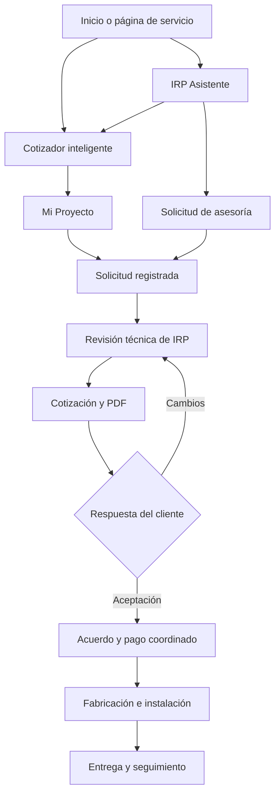

# Historial completo — Industrial Remotos Perú

- Fuente: https://chatgpt.com/share/6ace9bd7-45a0-83e9-b9a2-015080f60594
- Título de la conversación: Continuar chat industrial
- Conversación compartida: `6ace9bd7-45a0-83e9-b9a2-015080f60594`
- Mensajes visibles extraídos: 626
- Mensajes del usuario: 213
- Mensajes del asistente: 413
- Adjuntos de imagen referenciados: 125

> Alcance: se conservaron todos los mensajes visibles del usuario y todas las respuestas o actualizaciones visibles del asistente, en el orden lineal de la conversación compartida. Se excluyeron únicamente contextos ocultos, razonamiento interno, llamadas a herramientas y respuestas emitidas por herramientas, porque no son mensajes de conversación del usuario o del asistente. Los adjuntos se documentan con su referencia y metadatos disponibles; la página compartida no entrega sus archivos binarios dentro del historial.

## Mensaje 0001 — Usuario

- Fecha (Lima): 28/09/2026, 09:09:19
- ID: `c8e04160-04b3-44e1-8d9a-fd7ab540b74a`

CHAT N O EM DEJA EL OTOR CHAT DXQ DICE AQ ALCANCAMOS EL MAXIMO DE CHAT

---

## Mensaje 0002 — Asistente

- Fecha (Lima): 28/09/2026, 09:09:24
- ID: `76b8a9bd-ff37-5dd1-b76c-15d42cb0dda5`

Sí, ese aviso significa que **el otro chat llegó a su límite de mensajes**. Podemos seguir aquí con el proyecto de **Industrial Remotos Perú**; tengo el contexto general.

Dime qué estabas haciendo justo antes de que apareciera el aviso, o pega tu último mensaje, y seguimos desde ahí.

---

## Mensaje 0003 — Usuario

- Fecha (Lima): 28/09/2026, 09:09:46
- ID: `5eacd512-41a8-4b68-aa65-99bb55e1c629`

> **Adjunto de imagen 1**
>
> - Referencia original: `sediment://file_00000000db7881f5bb1354b93a45d2c9?shared_conversation_id=6ace9bd7-45a0-83e9-b9a2-015080f60594`
> - Tamaño: 587 × 545 px
> - Peso registrado: 39262 bytes
>
> La imagen está referenciada por el enlace compartido; no se incrustó ni se inventó una copia.

TE PREGUTNABA ESTO Q PONEMOS NOSE XQ IGUAL EN ETITULO N OHAY NTODO EMEP'IZEZA X OPERARIO

---

## Mensaje 0004 — Asistente — actualización de trabajo

- Fecha (Lima): 28/09/2026, 09:09:57
- ID: `637c9ec0-9ab6-5dc5-8c8c-1f87d9855b0b`

Voy a revisar la imagen para ver el título y proponerte uno que cubra toda la empresa.

---

## Mensaje 0005 — Asistente

- Fecha (Lima): 28/09/2026, 09:10:00
- ID: `4c62196b-ebad-57d7-b664-d057c92bb0d4`

Ah, ya vi: ese desplegable es el **área de la oferta laboral**, no el título de Industrial Remotos Perú. Si el puesto que estás publicando es de **operario técnico**, pondría **«Mantenimiento y Reparaciones Técnicas»**.

El título sí conviene que empiece por el puesto, por ejemplo: **«Operario técnico – Industrial Remotos Perú»**. Si me pasas la captura donde sale el campo «Título», te digo qué texto exacto poner según las funciones del trabajo.

---

## Mensaje 0006 — Usuario

- Fecha (Lima): 28/09/2026, 09:11:07
- ID: `8c46d5e2-e231-4858-9dad-d895764c9242`

PASAME DEL OTRO CHAT LOQ Q TENIOAMSOQ  POENR EN DESCREIPCION

---

## Mensaje 0007 — Asistente — actualización de trabajo

- Fecha (Lima): 28/09/2026, 09:11:12
- ID: `ed76ce77-87b3-575c-9a51-025cb10470a8`

Voy a buscar el texto que habíamos preparado para esa descripción y te lo paso listo para copiar.

---

## Mensaje 0008 — Asistente

- Fecha (Lima): 28/09/2026, 09:11:29
- ID: `f2bad674-4920-5b2f-9407-d7db885834bb`

Perdón, busqué el texto del otro chat, pero **no pude recuperar esa descripción exacta**. No quiero pasarte una inventada como si fuera la que ya habíamos acordado.

Mándame una captura de esa parte del chat o copia cualquier fragmento que recuerdes, y te la dejo completa y lista para pegar.

---

## Mensaje 0009 — Usuario

- Fecha (Lima): 28/09/2026, 11:38:20
- ID: `6feb2883-285d-469c-b57c-78b3796d8c70`

> **Adjunto de imagen 2**
>
> - Referencia original: `sediment://file_00000000f8dc820d8a313f2b145d44ba?shared_conversation_id=6ace9bd7-45a0-83e9-b9a2-015080f60594`
> - Tamaño: 1024 × 1535 px
> - Peso registrado: 3177886 bytes
>
> La imagen está referenciada por el enlace compartido; no se incrustó ni se inventó una copia.

Hyaq  ayudar  aiRp a bsucar empreo especialñmente apra Operario isntalador de Mamparas eso ppara villa els alvador pue ya sbaes mas q rtodo l oq dig al ov0ya ahavbce ren Indeed

---

## Mensaje 0010 — Asistente — actualización de trabajo

- Fecha (Lima): 28/09/2026, 11:38:26
- ID: `197aa296-7bb4-57e7-a450-2651c93e9017`

Voy a ver la imagen y preparar el aviso de Indeed para el puesto de operario instalador de mamparas en Villa El Salvador, listo para copiar en cada campo.

---

## Mensaje 0011 — Asistente

- Fecha (Lima): 28/09/2026, 11:38:36
- ID: `db75b0d2-865d-5724-a1b5-c853d374a2a8`

Sí, ahora con el afiche ya queda claro: **vamos a publicar una vacante específica para mamparas**, aunque Industrial Remotos Perú también esté buscando otros perfiles.

**Título en Indeed:** Operario instalador de mamparas y ventanas de aluminio  
**Área:** Construcción y obra  
**Ubicación:** Villa El Salvador, Lima

**Descripción lista para pegar:**

> **Industrial Remotos Perú** busca incorporar a su equipo un **operario instalador de mamparas y ventanas de aluminio** para trabajar en Villa El Salvador.
>
> **Funciones:**
> - Apoyar en la fabricación, armado e instalación de mamparas y ventanas de aluminio.
> - Realizar mediciones, montaje y ajustes durante la instalación.
> - Mantener el orden de las herramientas y del área de trabajo.
> - Coordinar las labores con el equipo técnico.
>
> **Requisitos:**
> - Con o sin experiencia; se valorará experiencia en aluminio, ventanas o mamparas.
> - Estudios técnicos o certificación, de preferencia.
> - Disponibilidad para trabajar jornadas de 8 horas con horario variable.
> - Responsabilidad, compromiso y disposición para trabajar en equipo.
> - Licencia de conducir, de preferencia.
>
> **Lugar de trabajo:** Villa El Salvador, a espaldas de los almacenes Ripley.
>
> Si te interesa el puesto, postula por Indeed o envía tu CV por WhatsApp al **987 908 444** indicando: **«Postulación – Instalador de mamparas»**.

En **sueldo y modalidad de contratación**, coloca solo lo que IRP ya haya confirmado contigo; el afiche no indica esos datos.

---

## Mensaje 0012 — Usuario

- Fecha (Lima): 28/09/2026, 11:43:42
- ID: `45120a81-0050-41b9-801d-c43c847ffa0b`

po ntmabien otras especialidade stmabie nsoem algo completo tmabiens e bsuca tal blablabla

---

## Mensaje 0013 — Asistente

- Fecha (Lima): 28/09/2026, 11:43:50
- ID: `31194bd6-5979-51b9-ba77-373c8102ceb4`

Sí, tienes razón. **La convocatoria es para varias especialidades**, con especial interés en instaladores de mamparas. Para Indeed pondría:

**Título:** Personal técnico y operarios de instalación – Villa El Salvador  
**Área:** Mantenimiento y Reparaciones Técnicas

**Descripción para pegar:**

:::writing{variant="standard" id="84126"}
Industrial Remotos Perú busca incorporar personal técnico y operarios para sus trabajos de instalación en Villa El Salvador.

Estamos recibiendo postulaciones para las siguientes especialidades:

• Instalador de mamparas, ventanas y estructuras de aluminio (especialidad prioritaria).
• Técnico instalador de puertas y sistemas de automatización.
• Soldador o técnico en estructuras metálicas.
• Ayudante u operario técnico de instalación.

Buscamos personas responsables, comprometidas y con disposición para trabajar en equipo. Pueden postular candidatos con o sin experiencia, según el puesto. Se valorarán estudios técnicos o certificaciones y contar con licencia de conducir.

El trabajo es presencial en Villa El Salvador, con referencia a espaldas de los almacenes Ripley. La jornada es de 8 horas, con horario variable.

Para postular, envía tu CV por WhatsApp al 987 908 444 e indica en el mensaje la especialidad a la que postulas.
:::

Así el título abarca todos los puestos y la descripción deja claro que **mamparas es la prioridad**.

---

## Mensaje 0014 — Usuario

- Fecha (Lima): 28/09/2026, 11:46:01
- ID: `bc4f6168-d373-470e-b2b5-258b17be60b5`

peor pon pue n oes esueldo nada de eos es apgo por obra y disponibidliad nose algo así es

---

## Mensaje 0015 — Asistente

- Fecha (Lima): 28/09/2026, 11:46:04
- ID: `1ff3bd65-5879-57f3-b006-3cb49930f819`

Claro, hay que decirlo de frente: **el pago es por obra realizada**. Te dejo la descripción corregida para Indeed:

:::writing{variant="standard" id="59307"}
Industrial Remotos Perú busca incorporar personal técnico y operarios para trabajos de instalación en Villa El Salvador.

Estamos recibiendo postulaciones para las siguientes especialidades:

• Instalación de mamparas, ventanas y estructuras de aluminio (prioridad).
• Instalación de puertas y sistemas de automatización.
• Soldadura y estructuras metálicas.
• Ayudantes u operarios técnicos de instalación.

Pueden postular personas con o sin experiencia, según la especialidad. Se valorarán los estudios técnicos, las certificaciones y contar con licencia de conducir. Buscamos responsabilidad, compromiso y disposición para trabajar en equipo.

**Modalidad de trabajo:** por obras o proyectos, según la disponibilidad y la especialidad del postulante. **El pago es por obra realizada; no se ofrece un sueldo mensual fijo.** Las condiciones de cada trabajo se coordinan antes de iniciar.

**Zona de trabajo:** Villa El Salvador. Referencia: a espaldas de los almacenes Ripley.

Para postular, envía tu CV por WhatsApp al **987 908 444** e indica tu especialidad y disponibilidad.
:::

---

## Mensaje 0016 — Usuario

- Fecha (Lima): 28/09/2026, 12:46:00
- ID: `fc8308cf-eca3-4ae7-91e4-1b4446cd2cb7`

> **Adjunto de imagen 3**
>
> - Referencia original: `sediment://file_00000000b91881f5bb1710f51c7c0166?shared_conversation_id=6ace9bd7-45a0-83e9-b9a2-015080f60594`
> - Tamaño: 923 × 684 px
> - Peso registrado: 95912 bytes
>
> La imagen está referenciada por el enlace compartido; no se incrustó ni se inventó una copia.

chat com oahcemso nsoe depseus m150 x día epsnaran nose haya  q ahcmeoss

---

## Mensaje 0017 — Asistente — actualización de trabajo

- Fecha (Lima): 28/09/2026, 12:46:05
- ID: `e404cc3f-5e28-5db0-ab95-ea8e61f95937`

Voy a leer la captura para ver qué campo te pide Indeed y cómo expresar el pago por obra sin poner un monto diario que no está acordado.

---

## Mensaje 0018 — Asistente

- Fecha (Lima): 28/09/2026, 12:46:14
- ID: `976f1065-5bff-50f7-bc19-e224b5a87739`

Ah, ya entendí. En la publicación **ya aparece “Desde S/150 por día – Medio tiempo”**. Eso hará pensar a los postulantes que IRP garantiza **S/150 por cada día trabajado**, aunque ustedes quieren acordar un **pago por obra**.

La ventana que tienes abierta (“Sueldo base mínimo”) es **tu preferencia como usuario**; la propia pantalla dice que las empresas no la verán. Cambiarla ahí **no corrige el aviso**.

Hay que entrar a **editar la oferta publicada** y corregir estos dos datos:

- **Sueldo:** quitar “Desde S/150 por día”. No pondría otra cifra hasta que IRP confirme cómo calculará cada obra.
- **Tipo de empleo:** revisar “Medio tiempo” y elegir una modalidad por proyecto/obra si el formulario la ofrece.

La descripción que preparamos ya explica que **las condiciones y el pago se acuerdan antes de iniciar cada obra**. Pásame captura de la pantalla donde *editas la oferta como empresa* y te digo exactamente qué seleccionar.

---

## Mensaje 0019 — Usuario

- Fecha (Lima): 28/09/2026, 12:47:16
- ID: `25edbc00-542a-47c4-bc08-2b58c286e967`

u nmensja eapr airp explicando todo lao  q es la publciaico nez esta  a ve vela: [https://pe.indeed.com/job/operario-instalador-de-mamparas-y-ventanas-de-aluminio-villa-el-salvador-cs-experiencia-e3cb7f5b9b1f3c66](https://pe.indeed.com/job/operario-instalador-de-mamparas-y-ventanas-de-aluminio-villa-el-salvador-cs-experiencia-e3cb7f5b9b1f3c66)

---

## Mensaje 0020 — Asistente — actualización de trabajo

- Fecha (Lima): 28/09/2026, 12:47:20
- ID: `56255264-01c6-5eb0-b463-bce31d64fe0a`

Voy a revisar el enlace tal como lo verá IRP y te redacto un mensaje claro con lo publicado y el detalle del pago por obra.

---

## Mensaje 0021 — Asistente

- Fecha (Lima): 28/09/2026, 12:47:42
- ID: `f0e38b45-dda8-5742-bc9f-3cefc6ea1a07`

Claro. Le mandaría este mensaje a IRP, incluyendo el enlace y señalando el dato que debemos corregir:

:::writing{variant="chat_message" id="72648"}
Estimado, ya publicamos en Indeed la convocatoria para **operario instalador de mamparas y ventanas de aluminio en Villa El Salvador**, con o sin experiencia. Puede verla aquí:

https://pe.indeed.com/job/operario-instalador-de-mamparas-y-ventanas-de-aluminio-villa-el-salvador-cs-experiencia-e3cb7f5b9b1f3c66

Los interesados podrán postular mediante la plataforma y también enviar su CV al WhatsApp indicado en el aviso. Aunque esta publicación destaca la instalación de mamparas y ventanas, estamos considerando candidatos de las otras especialidades que conversamos: puertas y automatización, soldadura, estructuras metálicas y apoyo técnico en instalaciones.

Hay un detalle que quisiera validar con usted: **Indeed muestra actualmente “desde S/150 por día” y “medio tiempo”**. Como me indicó que los trabajos se coordinan y pagan **por obra**, conviene corregir esos campos para que los postulantes no entiendan que se ofrece un pago diario fijo. ¿Me confirma que dejamos la remuneración como *a acordar según cada obra* y la disponibilidad según el proyecto? Así la publicación reflejará exactamente cómo trabajan ustedes.
:::

Intenté abrir el enlace directamente, pero Indeed bloqueó la consulta externa; el dato de **S/150 por día y medio tiempo** lo tomé de la captura que me enviaste.

---

## Mensaje 0022 — Usuario

- Fecha (Lima): 28/09/2026, 12:49:03
- ID: `a214b75e-4919-4ba4-838c-796fad2bb13a`

dile q ese p´recio es el minim o ydbee ir pbligatporialmente como minimo 50 x día entocnes reiterando q en la descrpcio nidnccia com opsitulars ey metodos de pago eso nsoe y elimina estoi . Aunque esta publicación destaca la instalación de mamparas y ventanas, estamos considerando candidatos de las otras especialidades que conversamos: puertas y automatización, soldadura, estructuras metálicas y apoyo técnico en instalaciones. n soe no lña publciacon explicifigva otra strbajaos ok sol odile suibimos saldra apsi xq es apsi y blablabla quedal sito

---

## Mensaje 0023 — Asistente

- Fecha (Lima): 28/09/2026, 12:49:15
- ID: `1618f8dc-8a10-5153-8a22-9c388963b3f4`

:::writing{variant="chat_message" id="32784"}
Estimado, ya quedó publicada en Indeed la convocatoria para **operario instalador de mamparas y ventanas de aluminio en Villa El Salvador**. Puede verla aquí:

https://pe.indeed.com/job/operario-instalador-de-mamparas-y-ventanas-de-aluminio-villa-el-salvador-cs-experiencia-e3cb7f5b9b1f3c66

Indeed nos exige ingresar un monto para publicar la oferta; el mínimo que permite colocar es **S/50 por día**. En este momento el aviso muestra **“desde S/150 por día”**, por lo que quisiera confirmar con usted ese importe antes de mantenerlo publicado. En la descripción se indica que el pago se acuerda según cada obra, junto con la disponibilidad requerida y la forma de postular enviando el CV al WhatsApp **987 908 444**.

Si el monto de S/150 no corresponde a lo que ofrecerán, lo corregimos para evitar confusiones con los postulantes.
:::

---

## Mensaje 0024 — Usuario

- Fecha (Lima): 04/10/2026, 08:19:12
- ID: `a2fdda45-a482-4f61-8944-8cc4b6839f78`

mira estamos reocntra cagados con iRP porque n osabe sni pinch odel proeycto xq el anrterior chat ya no se peude suar entonces abre y audita el repo de githug altoke

---

## Mensaje 0025 — Asistente — actualización de trabajo

- Fecha (Lima): 04/10/2026, 08:19:22
- ID: `15575944-6e3a-5692-b154-2bcb1c5b5316`

Voy a buscar el repositorio de IRP y revisar el código para reconstruir el estado del proyecto: qué funciona, qué falta y qué problemas hay.

---

## Mensaje 0026 — Asistente — actualización de trabajo

- Fecha (Lima): 04/10/2026, 08:20:28
- ID: `34993fa4-76a1-515e-9213-dd5a04ceee8a`

Ya encontré el repositorio. Hay dos ramas: `main` y `mejoras-animaciones`. Voy a comparar ambas porque los avances del otro chat podrían estar en la segunda. También recuperé el alcance acordado: web multiservicios, configurador, Mi Proyecto, proforma PDF y panel administrador.

---

## Mensaje 0027 — Asistente — actualización de trabajo

- Fecha (Lima): 04/10/2026, 08:21:46
- ID: `eb73dac1-f90c-5401-8a14-f6ddab09bcb1`

La rama más reciente es `mejoras-animaciones`, del 24 de septiembre; su último commit dice “intro hero scroll con fallas”. El proyecto tiene más avance del que indica el README: ya hay APIs, PostgreSQL, login administrativo, solicitudes, cotizaciones y PDF. Estoy contrastando eso con el código y comprobando si compila; también veo que el envío por correo y los adjuntos aún no están conectados.

---

## Mensaje 0028 — Asistente — actualización de trabajo

- Fecha (Lima): 04/10/2026, 08:23:56
- ID: `c92fcabd-5674-5168-8dc2-6e124cd4806e`

La rama reciente pasa TypeScript y el build de producción. Los pendientes principales están más claros: la proforma pública sigue mostrando “aún no emitida”, la confirmación depende de la sesión del navegador y el CMS/CRM completo todavía no existe. Además, `mejoras-animaciones` tiene diez commits que no están en `main`. Voy a dejar una auditoría con referencias para que podamos continuar el proyecto desde ella.

---

## Mensaje 0029 — Asistente — actualización de trabajo

- Fecha (Lima): 04/10/2026, 08:26:00
- ID: `5d223249-6df2-524b-835b-0d690e928c85`

La prueba local confirmó que las solicitudes se guardan, un reintento no las duplica y el panel exige autenticación. Encontré un problema de permisos: una cuenta con rol `COMMERCIAL` puede modificar productos del cotizador. Las diez rutas públicas que comprobé responden correctamente; eso aún no valida cómo se ven ni resuelve las fallas del intro.

---

## Mensaje 0030 — Asistente

- Fecha (Lima): 04/10/2026, 08:28:05
- ID: `90758281-c1ba-53a6-abf2-81399e2498ef`

**Ya abrí y audité [el repositorio de IRP](https://github.com/Fabrizn666d/industrial-remotos-peru). Recuperamos una base concreta para continuar.**

Lo más importante:

- **El avance reciente está en `mejoras-animaciones`**, con diez commits adicionales a `main`. El último, del 24 de septiembre, dice: **“intro hero scroll con fallas”**.
- **Sí hay backend y panel:** login, solicitudes persistentes, cotizaciones, diagramas y generación de PDF administrativo. El README está desactualizado.
- **La rama reciente compila correctamente:** pasaron TypeScript y el build de producción.
- Probé localmente el registro de solicitudes, reintentos sin duplicados y acceso administrativo: funcionan.

**Lo que falta:** corregir y validar visualmente intro/hero/scroll, conectar la entrega pública de proformas y correo, implementar adjuntos y completar CMS/CRM. También encontré que el rol comercial puede editar productos: falta separar permisos.

No cambié el código ni publiqué nada. Tampoco comprobé el VPS; esta auditoría corresponde a GitHub y pruebas locales.

Dejé el estado, archivos relevantes, hallazgos y orden de continuación en [Auditoria_IRP_2026-10-04.md](sandbox:/workspace/scratch/79fa97960f76/Auditoria_IRP_2026-10-04.md). **Este documento nos sirve para retomar el proyecto aunque se cierre otro chat.**

---

## Mensaje 0031 — Usuario

- Fecha (Lima): 04/10/2026, 08:32:44
- ID: `fc340ed1-93b0-4715-a483-e0060777afbb`

estro mas, entocnes e lotor chat me di oesto para tio:

---

## Mensaje 0032 — Asistente — actualización de trabajo

- Fecha (Lima): 04/10/2026, 08:32:58
- ID: `cc6ca77b-d5d0-500b-8afc-e7c75262bdc6`

Voy a leer lo que te dejó el otro chat y contrastarlo con la auditoría del repositorio para incorporar lo que falte.

---

## Mensaje 0033 — Asistente

- Fecha (Lima): 04/10/2026, 08:33:06
- ID: `2da5ffd8-3783-51dc-891b-5304b3995026`

**Ya lo leí completo. Ahora sí tenemos el punto exacto donde quedó el diseño**, además del estado del código.

Corrijo algo de mi auditoría: **que el Hero aparezca antes de terminar el video es intencional**. No lo consideraré un error por sí mismo y **no tocaré el intro/loader sin que me lo pidas**.

Queda como contexto activo:

- **“Somos Industrial Remotos Perú”** después de servicios, con fotografía protagonista y assets distintos para PC y celular.
- **Estadísticas y collage:** conservar la retícula original; assets cuadrados individuales y cifras solo confirmadas.
- **“De la idea a la instalación”:** versión clara arquitectónica aprobada. La versión oscura quedó descartada.
- **Punto pendiente:** fusionar cobertura/mapa y contacto en **una sola sección clara**, con ubicación a la izquierda, mapa grande a la derecha y CTA integrado debajo.

En el repo confirmé que esos últimos dos bloques siguen separados en `components/home/ApprovedHomeSections.tsx`, así que sabemos dónde intervenir cuando lo indiques.

También queda respetado: **“dime” → conversamos; “haz imagen” → genero; “haz prompt para Codex” → prompt preciso. Sin commit ni push antes de tu revisión visual.**

---

## Mensaje 0034 — Usuario

- Fecha (Lima): 04/10/2026, 08:43:18
- ID: `09e89747-a144-45aa-b21c-ed090410a191`

> **Adjunto de imagen 4**
>
> - Referencia original: `sediment://file_000000004818820e8302808fa9b59066?shared_conversation_id=6ace9bd7-45a0-83e9-b9a2-015080f60594`
> - Tamaño: 961 × 811 px
> - Peso registrado: 479280 bytes
>
> La imagen está referenciada por el enlace compartido; no se incrustó ni se inventó una copia.

chta rtrbaajemelso lso flujos ytdodo eso com odeberia ser desde el incii oalfinal lo de lIRp asisrtente y el cotizador inteligente

---

## Mensaje 0035 — Asistente — actualización de trabajo

- Fecha (Lima): 04/10/2026, 08:43:31
- ID: `cc44b6d9-d94f-56e5-8ff4-6f86ac572661`

Voy a revisar la captura y ordenar el recorrido completo: qué hace IRP Asistente, cómo configura el cliente su proyecto y cómo llega a una cotización validada por la empresa.

---

## Mensaje 0036 — Asistente

- Fecha (Lima): 04/10/2026, 08:43:41
- ID: `f1de23c3-1e16-50a5-9d32-6453f5d05235`

**Sí. Esas dos opciones deben ser dos entradas al mismo proyecto:** el Asistente ayuda a decidir y el Cotizador permite configurar directamente. Todo termina en **Mi Proyecto**, sin volver a pedir los mismos datos.

En tu captura se entiende bien la elección, pero hay que cumplir esa promesa: si el cliente conversa con el asistente, sus respuestas deben pasar al cotizador automáticamente.

**1. Desde dónde empieza el cliente**

Puede entrar desde el Home, una página de servicio, un producto o el botón flotante.

| Entrada | Qué debería suceder |
|---|---|
| IRP Asistente | Ayuda a identificar la solución adecuada. |
| Cotizador inteligente | Permite elegir y configurar una solución directamente. |
| “Cotizar” desde una mampara, puerta o techo | Abre esa solución ya seleccionada. |
| Asistente desde una página de servicio | Conoce qué servicio estaba viendo el cliente. |

**2. IRP Asistente: entender la necesidad**

Debe conversar con preguntas cortas, una por una, mostrando opciones cuando ayuden.

Ejemplo: alguien escribe **“Quiero cerrar mi terraza”**. El asistente pregunta qué busca: proteger de la lluvia, mantener iluminación, cerrar los laterales o combinar varias soluciones. Después pregunta ubicación, medidas aproximadas y preferencias.

Su recorrido sería:

1. **Necesidad:** qué quiere construir, mejorar o solucionar.
2. **Uso del espacio:** vivienda, comercio o industria.
3. **Ubicación:** distrito o provincia.
4. **Medidas:** aproximadas, con opción **“No las sé”**.
5. **Preferencias:** material, apariencia, apertura o acabado, según el servicio.
6. **Fotos o planos:** opcionales.
7. **Recomendación:** solución sugerida y motivo, con alternativas pertinentes.

Al terminar muestra una ficha: **“Te recomendamos una mampara corrediza…”**, resume lo recibido y ofrece **“Configurar esta solución”** o **“Solicitar asesoría”**.

**No debe obligar a conocer términos técnicos ni inventar precios o compatibilidades.** Si algo necesita inspección, lo deja pendiente de revisión.

**3. Cotizador inteligente: configurar la solución**

Cada especialidad necesita sus propias preguntas. No podemos usar el formulario de puertas para todo.

| Especialidad | Ejemplos de configuración |
|---|---|
| Puertas | Sistema de apertura, medidas, panel/material, acabado, automatización y accesorios. |
| Ventanas y mamparas | Tipo de apertura, distribución de paños, serie, vidrio, perfiles y medidas. |
| Techos y coberturas | Sistema, dimensiones, estructura, cobertura y acabado. |
| Barandas y estructuras | Tipo, dimensiones, material, acabado y condiciones del espacio. |

Estas opciones deben salir del **catálogo validado por IRP**.

El recorrido:

**Elegir solución → medidas → sistema y materiales → acabado y accesorios → revisar configuración.**

Durante la configuración debe mostrar una referencia visual coherente. Para mamparas y ventanas puede incluir el dibujo técnico con paños, apertura y cotas. Si todavía no hay medidas, permite continuar para pedir asesoría.

**4. Cuándo aparece el precio**

Aquí hay que distinguir dos resultados:

- **Configuración con tarifas y reglas aprobadas:** mostrar un **estimado inicial**, detallando qué incluye y qué queda sujeto a revisión.
- **Configuración incompleta o especial:** mostrar **“Requiere evaluación”**, conservar toda la información y permitir enviar la solicitud.

El precio debe calcularse con reglas reales de IRP, considerando los factores que correspondan: medidas, materiales, accesorios, fabricación, instalación y traslado. **Actualmente el repo mantiene el precio público pendiente; esa conexión todavía hay que implementarla.**

**5. Mi Proyecto: reunir todo**

El cliente puede agregar una puerta, una mampara y un techo a la misma solicitud.

Cada elemento muestra:

- Referencia visual y configuración.
- Medidas y cantidad.
- Estimado o estado de evaluación.
- Acciones para **editar, duplicar o eliminar**.

Editar debe recuperar exactamente lo elegido. Si una partida necesita evaluación, el resumen debe indicarlo: **no presentar un total completo cuando faltan importes**.

**6. Enviar la solicitud**

Después de revisar Mi Proyecto, pedimos los datos necesarios: nombre, teléfono/WhatsApp, correo y ubicación del trabajo. Lo que ya respondió al asistente aparece precargado y editable.

Puede añadir observaciones y fotos o planos. Antes de enviar, ve el resumen completo.

Al enviarlo:

- Se guarda la solicitud y sus adjuntos.
- Se genera un código.
- IRP recibe una notificación.
- El cliente recibe una constancia de recepción y un enlace seguro de seguimiento.

**La constancia confirma la solicitud; la proforma comercial se entrega después de validar el alcance.**

**7. Lo que hace IRP en el panel**

IRP abre el expediente con todas las respuestas, configuraciones y archivos. Desde ahí puede pedir información, coordinar medición, revisar materiales y preparar la cotización **sin volver a transcribir todo**.

La cotización permite ajustar partidas, precios y condiciones. Al emitirla genera un PDF identificado y guarda esa versión. Si después cambia la propuesta, se crea una nueva versión para conservar lo enviado anteriormente.

**8. Desde la propuesta hasta la entrega**

El cliente recibe la propuesta y puede **aceptarla, solicitar cambios o contactar al asesor**. IRP confirma el acuerdo y las condiciones de pago; después coordina fabricación, instalación y entrega.



**Yo definiría primero estos recorridos y las preguntas de cada especialidad.** Así el asistente, el cotizador y el panel compartirán la misma información y podremos implementar el flujo completo sin que parezcan herramientas desconectadas.

---

## Mensaje 0037 — Usuario

- Fecha (Lima): 04/10/2026, 08:45:52
- ID: `c5cc1df4-61e9-454d-a7a4-928f87b53153`

no en si el IRp azistente eslo mismo que cotiador intleigente epro ahji solo te pide te pedi yh te pdie no0 hay chat sol oes ocm opara seleccionr opcioens tentiende

---

## Mensaje 0038 — Asistente

- Fecha (Lima): 04/10/2026, 08:45:59
- ID: `fac395eb-622c-55f0-9511-48c8233352ec`

**Sí, ahora te entiendo. IRP Asistente también es un cotizador, pero guiado por selecciones.** No hay chat ni conversación escrita: muestra una pregunta, eliges una opción y avanzas.

La diferencia sería:

| IRP Asistente | Cotizador inteligente |
|---|---|
| Una pregunta por pantalla, con opciones visuales. | Un configurador donde puedes ajustar los campos directamente. |
| Te lleva paso a paso y muestra solo lo que corresponde a tu elección. | Te permite revisar y cambiar medidas, materiales y acabados con más libertad. |
| Ideal para quien necesita orientación. | Ideal para quien ya sabe qué quiere configurar. |

Por ejemplo, en **IRP Asistente**:

1. **¿Qué necesitas?** → Mampara.
2. **¿Qué apertura prefieres?** → Corrediza.
3. **¿Qué distribución?** → Seleccionas un dibujo de los paños.
4. **¿Qué medidas tiene?** → Introduces ancho y alto, o eliges “No las sé”.
5. **¿Qué vidrio y acabado?** → Seleccionas entre las opciones disponibles.
6. **Revisa tu configuración** → Referencia visual, características y estimado si hay tarifas aprobadas.
7. **Agregar a Mi Proyecto** → Continúas con otra solución o envías la solicitud.

**Ambos usan las mismas opciones, reglas y precios; cambia la forma de configurarlo.** También puedes pasar del asistente al configurador conservando todo lo seleccionado.

Entonces, en la sección de tu captura cambiaría **“Hablar con IRP Asistente”** por **“Configurar paso a paso”**, y la conversación de ejemplo por tarjetas de selección. Así la imagen representa lo que realmente hará.

---

## Mensaje 0039 — Usuario

- Fecha (Lima): 04/10/2026, 08:49:51
- ID: `c8b7ad99-d75d-46a6-a8b5-df4f0da12f7a`

> **Adjunto de imagen 5**
>
> - Referencia original: `sediment://file_00000000bec0820e9518494db580eceb?shared_conversation_id=6ace9bd7-45a0-83e9-b9a2-015080f60594`
> - Tamaño: 1920 × 930 px
> - Peso registrado: 1501663 bytes
>
> La imagen está referenciada por el enlace compartido; no se incrustó ni se inventó una copia.

> **Adjunto de imagen 6**
>
> - Referencia original: `sediment://file_0000000099d0820ea98c1d33c0a92bfb?shared_conversation_id=6ace9bd7-45a0-83e9-b9a2-015080f60594`
> - Tamaño: 1920 × 524 px
> - Peso registrado: 661937 bytes
>
> La imagen está referenciada por el enlace compartido; no se incrustó ni se inventó una copia.

Dejal oahío co nesen ombrne animakl, tenem,ois cmabie el frotned  ytoditititdo el bakcnd por el momento iemepzaremsoc oen lfrotned , mria ese apartaod esta horrrible, debemos elimianr de ahi la footer y que no haya scroll, quje la apgina se quede centrrada apra cad adispositivo  ytal si hacen scroll se mantienee se ahcen zoom se mantieen entiendes algo as´ies lo que qdeseo pero ahroa cmabeimos es abasura totoal pero a IRP co nsuss nuevos identificados entiendes neuvos diseños proq ya nole smco moantes e sneuv aidentidad

---

## Mensaje 0040 — Asistente — actualización de trabajo

- Fecha (Lima): 04/10/2026, 08:50:01
- ID: `46b67546-5bf2-5ab8-a1f6-2417fd10bfe5`

Mantendremos el nombre **IRP Asistente** y empezaremos por el frontend. Voy a revisar ambas capturas para definir una pantalla con la nueva identidad, sin footer y con el flujo centrado en cada dispositivo.

---

## Mensaje 0041 — Asistente

- Fecha (Lima): 04/10/2026, 08:50:19
- ID: `48d8b401-3ca4-514a-9839-26364dae21e0`

**Entendido: conservamos “IRP Asistente” y “Cotizador inteligente”. Primero rediseñamos el frontend con la nueva identidad de IRP.**

En la captura estás mostrando el **Cotizador**. Lo que falla es la composición: título y explicación ocupan demasiado alto, la foto se come la pantalla, las opciones quedan encerradas en una columna pequeña y los botones se cortan abajo. Además, el footer y el asistente flotante distraen dentro del propio flujo.

Lo convertiría en **una pantalla de trabajo que ocupe el espacio disponible del navegador**:

- **Cabecera compacta:** nuevo logo IRP, volver al sitio y acceso a Mi Proyecto con su contador.
- **Progreso discreto:** paso actual y etapas pertinentes a la solución seleccionada.
- **Zona central:** referencia visual bien encuadrada junto a las opciones, sin esa fotografía gigante y borrosa.
- **Barra inferior siempre visible:** Anterior, resumen de selección y Siguiente.
- **Sin footer, botón de subir ni asistente flotante dentro del configurador.** Esto solo aplica a estas herramientas; el resto de la web conserva sus elementos.

**Visualmente:** fondo blanco o azul muy suave, texto navy, azul para selección y acciones, bordes finos y fotografía protagonista. Quitamos la cuadrícula oscura, el exceso de paneles y esa estética antigua. Usaremos los nuevos logos y assets de IRP que correspondan.

| Dispositivo | Composición |
|---|---|
| PC | Vista visual a la izquierda; configuración a la derecha. Todo dentro de la pantalla. |
| Tablet | Dos columnas si hay espacio; composición vertical cuando convenga. |
| Celular | Pregunta y opciones protagonistas; referencia visual compacta o ampliable. Botones abajo, siempre accesibles. |

**Sobre scroll y zoom:** podemos mantener fija la estructura y evitar que se desplace toda la página. Cuando una lista sea larga, se desplazará **solo la zona de opciones**, mientras cabecera y botones permanecen visibles.

Al hacer zoom, el contenido debe **reacomodarse**. No conviene bloquear el zoom ni reducir todo hasta hacerlo ilegible: en pantallas pequeñas o con mucho aumento, permitimos desplazamiento dentro del contenido para que ninguna opción quede inaccesible.

Para **IRP Asistente** usaríamos esta misma identidad, pero con **una pregunta por paso y opciones visuales centradas**. El Cotizador mantendría la referencia visual y los controles juntos. Ambos deben sentirse parte del mismo sistema.

---

## Mensaje 0042 — Usuario

- Fecha (Lima): 04/10/2026, 08:52:01
- ID: `7523c8d3-b797-4317-99dd-816a097b2ad1`

Haber bruto, la pagina de cotisador itelegitne debe ser la msima apra PC,m tablet y celular pero para celular dbee ahbaer como una oipcon ssalir u na opcion en el cleualr digmaosuan ventnaa emergente co nuna aniamcio nbotnita, par amejro experiencia gira tu celualr y la venta se gir aapr atener mas especio entiendes ys e peude ver todo com osiejrpe horizontal

---

## Mensaje 0043 — Asistente

- Fecha (Lima): 04/10/2026, 08:53:45
- ID: `f98daadb-807d-5a86-bd28-5bbb02e9bb32`

Sí, ahora te entiendo: **el Cotizador inteligente tendrá la misma distribución horizontal en PC, tablet y celular**, con la referencia visual y las opciones juntas.

En celular, cuando esté vertical, aparecerá una ventana con una animación de un teléfono girando:

**“Para una mejor experiencia, gira tu celular.”**  
“En horizontal tendrás más espacio para configurar tu proyecto.”

Tendrá las opciones **“Continuar en vertical”** y **“Salir del cotizador”**. Al girar el teléfono, la ventana desaparecerá y el cotizador aprovechará el ancho disponible.

La web puede detectar el giro y adaptar la interfaz; **no puede girar físicamente el teléfono ni forzar la orientación en todos los navegadores**. Mantendremos los controles accesibles en pantallas pequeñas, sin reducir todo hasta que resulte ilegible.

---

## Mensaje 0044 — Usuario

- Fecha (Lima): 04/10/2026, 08:59:55
- ID: `20ad9781-1393-4e6d-93fb-facee40e45be`

o kahroa rediseñame el frotned ps a ver queirov er tu arte a ve rhaz imagen

---

## Mensaje 0045 — Asistente — actualización de trabajo

- Fecha (Lima): 04/10/2026, 09:00:02
- ID: `90372d7d-6ad0-5a3f-aad2-c1c5f41228d1`

Voy a crear una propuesta con la nueva identidad de IRP: cotizador horizontal, vista del proyecto junto a las opciones y una muestra en celular con el aviso animado para girarlo.


---

## Mensaje 0046 — Asistente

- Fecha (Lima): 04/10/2026, 09:01:53
- ID: `1ba54619-c1e0-5683-a1f9-77a2ddf7c688`

Así lo planteo: **una misma interfaz horizontal**, con vista del proyecto a la izquierda y opciones a la derecha. Sin footer y con los botones siempre visibles.

Abajo ves la versión para celular y la ventana **“Gira tu celular”**; el ícono tendría una animación de giro.

---

## Mensaje 0047 — Usuario

- Fecha (Lima): 04/10/2026, 09:09:31
- ID: `724cb362-2c6d-4652-b513-7260d226c031`

ME GHUSTA,o  kveamos necesito ps ahora com oiran lso  flujos de este apartado y tnato covm oe nadmi ncom soe podnra etc co msoe maneja eso

---

## Mensaje 0048 — Asistente

- Fecha (Lima): 04/10/2026, 09:09:41
- ID: `dbbe280e-52ff-53a6-9df1-85432958dc05`

Lo organizaría así: **el cliente configura su proyecto y lo envía; IRP lo revisa en el admin, define el precio y emite la cotización.** La imagen muestra el diseño visual; ahora necesitamos definir qué sucede en cada paso.

**1. El cliente configura**

Los pasos cambian según la solución elegida. Una mampara no debe pedir las mismas opciones que una puerta automatizada.

| Paso | Qué selecciona el cliente |
|---|---|
| Solución | Qué necesita: puerta, mampara, ventana u otra solución disponible. |
| Medidas | Ancho, alto y cantidad. Opción **“No conozco las medidas”**. |
| Diseño | Modelo y características compatibles con esa solución. |
| Acabado | Material, color y textura disponibles. |
| Complementos | Automatización, accesorios u opciones que correspondan. |
| Instalación | Ubicación y si necesita instalación, retiro o evaluación del lugar. |

La referencia visual acompaña las selecciones. Cuando una combinación no sea compatible, el cotizador debe explicarlo y ofrecer las alternativas válidas.

**2. Revisa y agrega a “Mi proyecto”**

Al terminar aparece un resumen con imagen de referencia, medidas y opciones. Puede **editarlo, eliminarlo o agregar otra solución**; por ejemplo, una puerta y dos mamparas dentro de la misma solicitud.

Todavía no mostraríamos un precio definitivo: eso depende de las reglas de costos y de la revisión técnica.

**3. Envía la solicitud**

Desde “Mi proyecto” completa nombre, teléfono, ubicación y comentarios. También puede adjuntar fotos del lugar. Revisa todo y pulsa **“Solicitar cotización”**.

La solicitud se guarda en el servidor y recibe un código. La confirmación muestra ese código y un botón para consultar por WhatsApp, conservando el proyecto enviado.

**4. IRP la recibe en el admin**

El apartado **Solicitudes** muestra código, cliente, fecha, ubicación, cantidad de soluciones y estado. Al abrir una solicitud, IRP ve:

- Cada solución con sus medidas, acabados y complementos.
- Fotos y comentarios del cliente.
- Datos de contacto.
- Notas internas, responsable e historial de cambios.

Desde ahí puede pedir información, coordinar una visita o comenzar la cotización.

**5. Prepara y envía la cotización**

El administrador toma la configuración del cliente como base y completa cantidades, precios, instalación, transporte, descuentos, plazo, forma de pago y vigencia.

Antes de emitirla ve una previsualización. Al confirmar, se genera una **versión de la cotización con PDF**. Si luego cambia el precio o el alcance, se crea una nueva versión para conservar lo que se ofreció anteriormente.

Propondría estos estados:

| Estado | Qué significa |
|---|---|
| Nueva | Llegó y falta revisarla. |
| En revisión | IRP está evaluando el proyecto. |
| Falta información | Necesita medidas, fotos o una respuesta del cliente. |
| Cotización enviada | Ya se entregó una propuesta. |
| Aceptada | El cliente confirmó la propuesta. |
| Cerrada | Terminó el seguimiento; se registra el motivo. |

**6. El admin controla lo que aparece en el cotizador**

Además de recibir solicitudes, necesita un apartado **Configuración del cotizador** para administrar soluciones, modelos, acabados, imágenes, rangos de medidas y compatibilidades. Podrá ocultar una opción sin borrar solicitudes anteriores.

Las reglas de precios también se gestionarán ahí cuando definamos cómo calcula IRP cada trabajo. **Los cambios del catálogo no deben modificar una cotización ya emitida.**

**IRP Asistente utilizaría estas mismas opciones y guardaría el mismo tipo de proyecto**, pero preguntando una cosa a la vez. El Cotizador inteligente permite recorrer los pasos con la referencia visual al lado.

Para empezar con el frontend, diseñaría estas pantallas: **configurador, Mi proyecto, formulario de envío y confirmación; en admin, lista de solicitudes, detalle, editor de cotización y configuración del cotizador**. Así el diseño cubre el recorrido completo del cliente y el trabajo de IRP.

---

## Mensaje 0049 — Usuario

- Fecha (Lima): 04/10/2026, 09:14:49
- ID: `90d34c51-a19b-4968-b4e4-0e53110cbb7d`

Peudes ve rla repo yu ver com oesta actualmente. profa

---

## Mensaje 0050 — Asistente — actualización de trabajo

- Fecha (Lima): 04/10/2026, 09:14:57
- ID: `52f8f338-7f3f-5c81-b9cb-c25e3fe5ccd8`

Voy a revisar cómo están conectados actualmente el cotizador, “Mi proyecto”, el envío de solicitudes y el admin, para separar lo que ya funciona de lo que falta.


---

## Mensaje 0051 — Asistente

- Fecha (Lima): 04/10/2026, 09:15:37
- ID: `2a98265a-5188-5da6-9a45-7064084c2087`

Sí, revisé el código del repo en la versión local **`b878ca9`**, de la rama `mejoras-animaciones`. **Hay bastante construido, pero el flujo del cliente y el de cotización del admin todavía están separados.** No modifiqué nada.

| Parte | Cómo está actualmente |
|---|---|
| **Cotizador** | Tiene pasos según el producto, medidas, opciones, acabados, accesorios y notas. Agrega la configuración a “Mi proyecto”. Sigue con el diseño antiguo. |
| **Mi proyecto** | Guarda las selecciones en el navegador. Permite revisar cantidades y configuraciones antes de enviarlas. |
| **Finalizar solicitud** | Envía los datos del cliente y los productos a `/api/requests`. La solicitud sí se guarda en el servidor y recibe un código. |
| **Confirmación** | Usa información guardada en esa sesión del navegador. Falta recuperar la solicitud desde el servidor para consultarla desde otro dispositivo. |
| **Admin → Solicitudes** | Tiene listado, búsqueda, filtros y detalle con cliente, ubicación y configuraciones. |
| **Seguimiento** | Estado y responsable se muestran, pero **todavía no hay controles para cambiarlos, asignar responsables o añadir notas**. |
| **Admin → Cotizaciones** | Permite crear y editar cotizaciones, duplicarlas, emitirlas, anularlas y descargar el PDF. |
| **Productos de cotización** | Tiene plantillas internas editables. **Estas no administran las opciones del cotizador público**, que siguen definidas en archivos del código. |
| **Fotos adjuntas** | Falta la subida real de archivos; actualmente el envío lleva una lista vacía de adjuntos. |

**La conexión principal que falta es “Crear cotización desde esta solicitud”.** Hoy IRP puede ver lo que pidió el cliente y crear una cotización por separado, pero no tiene esa acción que traslade sus datos y productos al editor y mantenga ambos registros vinculados.

También corrijo lo anterior: los estados y funciones que te propuse eran el flujo a desarrollar; **no todo eso está implementado ahora**.

Para nuestro rediseño aprovecharíamos la lógica existente del cotizador y “Mi proyecto”. Después conectaríamos **solicitud → revisión del admin → cotización → PDF para el cliente**, y unificaríamos la administración de opciones para que IRP pueda cambiarlas desde el panel.

---

## Mensaje 0052 — Usuario

- Fecha (Lima): 04/10/2026, 09:23:16
- ID: `326e0b86-eea2-48c4-8549-6c2888474d29`

esto es así mira, se supoen q esto del ctoizador inteleigente ya dbe de mandar d eporsi preciso tod oxq esos e configurara par apanel admin, el cotizasdor itneleigente e s lo mas estimaod d epreico en la relaida dque claor peudem variar a meos ao mas epro  debe se run estimado ,e tncoens, lo q s e necesitas esque todo eso sep euda ve rne amdi ndigmaos d etla emdid a atanto el preic osera así, o así ,e tneidnes ahora, se supone que la perosna entr a acotizador itneligente bie nconfigura su poroeycto blablbla, y anets d eneviar uan vez culmiando slae una animaico nbontia que dice nsoe cargrnap ropwarand opropeusta leugo ah´isale pa rellenar datos, pone su nombr ecompelto, ubnc9aicon, nuemro ,correo, etc esos datos si es con ddni o ruc si elige ruc razon social si es dni pone su dnio ahora, segudno se encesita  que leugod e eso ,se ponga poropeusta enviada, pum ahí la perosna peud adescargar en pdf su porpuesta ybie nehcha el pdf de ptm, entiendes??? es com ouna cortizaico npre. entocnes debe queda rbien yah´ie ne ssem ism oapartado habalr co nu nasesor, de toda sforma s dbe decir, u nasesor se podnr ane cotnacto ocn ustedes u nsasesor no ,seria IRP industria... se podnra en cotnacto ocn ustyede sl oams antes psible algio aspi nsoe, entiendes  aps idebe ser y el bot el irp bot eso dbe ser giual sol oque poreugtn arepsyretsay als repsuestas son cxom olos botsa d ewasap sol a0pretas botones nada mas y leugo al final te idce lrellena estos datos, tr epoden  dndnombre tlefono etc correwo yleug opon te envia el pdf y te se aocm ochatd we wasap lso cadescgarf ay ya queda algop así ahjora  ya que sabe socm ofucniona esto ps, es necesario que me ahgas proimtp para CODEX para hacer estos apartados, ya sbae sbien ,esto debe trbnahjar duro minimo unbas 3 horas entocne shaz algo que avanze tnaoit fornted, tnato lfujos ytando para configurar ne Amdin, hazlos ya co nprecios diugamso ps preciols referenciales y co nsu srespectvas opcioens y tnato, y en amdi ndebe ser tantoco km oapara agregar neusvos servivciso como elimianr neuvos serviciso yamdinsitgra ry perosnalziar dentor de amdin todo aboslutmanet etodo de ese cotizador ocm opar arecirbiry eya ssbers todo pues

---

## Mensaje 0053 — Asistente — actualización de trabajo

- Fecha (Lima): 04/10/2026, 09:23:33
- ID: `0740c19b-6db1-50d1-8925-bc129ddbafb9`

Ahora sí: el cotizador debe calcular una propuesta estimada con las reglas del admin y entregar el PDF al cliente al finalizar. Voy a preparar el prompt para Codex con el rediseño aprobado, ambos flujos, precios de demostración editables y la administración completa.


---

## Mensaje 0054 — Asistente

- Fecha (Lima): 04/10/2026, 09:23:44
- ID: `0c8d33c9-7815-58c4-9c3a-eb087069f707`

Sí: **el cliente recibe una propuesta preliminar con precio estimado y PDF al terminar**, calculada con lo configurado en el admin. Ambos recorridos deben usar el mismo cálculo.

Copia este prompt en Codex y adjunta el mockup aprobado. Los precios incluidos son **datos de demostración**, editables y pendientes de validación por IRP.

:::writing{variant="standard" id="73186"}
Implementa una evolución completa del Cotizador inteligente, IRP Asistente y su administración para Industrial Remotos Perú. Trabaja directamente en el repositorio existente, con frontend, backend, persistencia y pruebas. No te limites a explicar un plan ni a construir pantallas simuladas.

Dedica el trabajo necesario para completar los flujos. El usuario espera una implementación profunda, del alcance de varias horas; no midas la calidad por tiempo transcurrido ni introduzcas esperas artificiales. Avanza hasta obtener un resultado funcional, probado y visualmente revisable.

## 1. Revisa primero el proyecto real

Repositorio: Fabrizn666d/industrial-remotos-peru.

Verifica la rama, HEAD, cambios locales e instrucciones del repositorio antes de editar. No sobrescribas trabajo existente ni asumas que main es la versión correcta.

En la versión auditada, `mejoras-animaciones`, commit `b878ca9`, existen:

- `components/Configurator.tsx`
- `components/AssistantExperience.tsx`
- `components/ProjectContext.tsx`
- `components/MyProjectPage.tsx`
- `components/CartComponents.tsx`
- `components/CheckoutExperience.tsx`
- `components/ConfirmationScreen.tsx`
- `components/ProjectExperience.tsx`
- `data/configurator-schemas.ts`
- `app/(site)/layout.tsx`
- `app/(site)/cotizar/page.tsx`
- `app/(site)/cotizar/finalizar/page.tsx`
- `app/(site)/cotizar/confirmacion/[id]/page.tsx`
- `app/(site)/proforma/page.tsx`
- `app/api/requests/route.ts`
- `lib/backend/` con repositorios JSON y PostgreSQL.
- Admin de solicitudes en `app/admin/(protected)/solicitudes/`.
- Admin de cotizaciones en `app/admin/(protected)/cotizaciones/`.
- `components/control/QuoteEditor.tsx`
- `components/control/ProductTemplateManager.tsx`
- `lib/control/` con contratos, repositorios, cálculos y PDF.
- APIs internas de cotizaciones y productos de cotización.

Lee las implementaciones actuales y aprovecha lo que funciona. Actualmente el catálogo público está definido en código, los precios públicos quedan pendientes, las solicitudes y las cotizaciones internas están separadas y la confirmación depende de sessionStorage. Debes cerrar esas brechas.

No cambies el hero, la intro, el loader ni sus tiempos de reproducción. El hero comienza antes de terminar el video intencionalmente. Mantén los nombres **Cotizador inteligente** e **IRP Asistente**.

## 2. Comportamiento comercial correcto

El cotizador calcula automáticamente un precio estimado cercano a la propuesta real según reglas administradas por IRP:

solución + medidas + cantidad + modelo + material/acabado + complementos + instalación + ubicación.

El cliente termina con una **propuesta preliminar valorizada**, no solamente una solicitud sin precio.

El precio puede subir o bajar después de la evaluación técnica. Explica esto de forma clara y discreta:

“Propuesta preliminar. El importe puede variar según la verificación de medidas, las condiciones de instalación y el alcance final.”

No presentes el documento como factura, comprobante tributario, pago realizado ni aceptación de obra.

Cotizador e IRP Asistente deben compartir catálogo, validación, compatibilidades, motor de precios, generación de propuesta y PDF. Una misma configuración debe producir el mismo resultado en ambos.

## 3. Frontend del Cotizador inteligente

Usa el mockup adjunto como referencia aprobada.

Identidad:

- Plus Jakarta Sans.
- Blanco, azul muy claro, azul marino y azul intenso.
- Referencias: #FFFFFF, #F7FBFF, #EDF7FF, #07164B, #075CFF.
- Estética arquitectónica, industrial y premium.
- Usa la identidad y los logotipos aprobados disponibles en el proyecto. No recuperes el logo antiguo de los techos ni inventes un reemplazo definitivo.
- Evita fondo oscuro cuadriculado, neón, exceso de tarjetas y grandes títulos que consumen el espacio.

Estructura:

- Cabecera compacta: marca, “Cotizador inteligente”, “Mi proyecto” con cantidad y salida.
- Pasos horizontales adaptados a la solución elegida.
- Referencia visual a la izquierda y controles a la derecha.
- Barra inferior persistente con anterior, resumen y siguiente/agregar.
- Acabados con muestras reales o representaciones claramente identificadas.
- Selección visible, validaciones comprensibles y transiciones suaves.
- Referencia visual identificada como referencial; no prometas una representación exacta de fabricación.

La herramienta debe tener una estructura que ocupe el viewport disponible, usando unidades dinámicas y safe areas. Elimina footer, navegación comercial extensa, robot flotante y elementos ajenos únicamente dentro de estas herramientas y su recorrido. No alteres el resto del sitio.

Mantén la misma organización horizontal en PC, tablet y celular en horizontal. Adapta tamaños y densidad para que se pueda operar con los dedos; no reduzcas una captura de escritorio hasta volverla ilegible.

En celular vertical:

- Ventana accesible con animación de teléfono girando.
- Título: “Gira tu celular”.
- Texto: “En horizontal tendrás más espacio para configurar tu proyecto.”
- Acciones: “Continuar en vertical” y “Salir del cotizador”.
- Desaparece al detectar orientación horizontal.
- No reaparece continuamente si el usuario la descartó.
- Respeta reduced motion.
- Conserva el proyecto al girar o salir.
- No dependas de forzar la orientación del navegador.

Evita scroll del documento en condiciones normales del configurador. Usa scroll interno si las opciones exceden el panel. Con zoom, teclado abierto o altura pequeña, permite el reflujo o desplazamiento necesario para que todo siga accesible. No bloquees el zoom ni cortes campos, mensajes o botones.

## 4. Recorrido del cliente

1. Elige una solución.
2. Configura medidas y opciones.
3. Ve el precio estimado actualizado y su desglose.
4. Agrega uno o varios elementos a “Mi proyecto”.
5. Revisa, edita, duplica o elimina elementos.
6. Pulsa “Preparar propuesta”.
7. Aparece una transición cuidada con “Preparando tu propuesta…” mientras se valida y calcula realmente. Sin porcentajes inventados ni retrasos largos.
8. Completa sus datos.
9. Confirma y envía.
10. El servidor guarda la solicitud y la propuesta preliminar vinculadas.
11. Aparece “Propuesta enviada” y el código.
12. Puede descargar el PDF y hablar con IRP.

No pierdas el proyecto ante un error, recarga, cambio de orientación o fallo de red. Conserva el borrador local, pero el resultado enviado debe estar persistido en el servidor.

Si una medida se desconoce, permite indicarlo explícitamente. Define por solución si se puede calcular con un supuesto visible o si ese elemento requiere evaluación. Nunca lo cobres como cero ni muestres un total completo como definitivo si faltan partidas por estimar.

## 5. Datos del cliente

Formulario con:

- Nombre completo del contacto.
- Teléfono/WhatsApp.
- Correo.
- Ubicación: región, provincia, distrito y dirección/referencia según corresponda.
- Tipo de documento: DNI o RUC.
- DNI: número de 8 dígitos.
- RUC: número de 11 dígitos y razón social obligatoria.
- Con RUC, conserva también el nombre de la persona de contacto.
- Comentarios opcionales.
- Fotos opcionales del lugar, si implementas su almacenamiento persistente.
- Aviso de privacidad y consentimiento cuando corresponda.

No inventes una consulta automática a SUNAT o RENIEC. La validación local no debe afirmar que verificó la identidad.

Usa autocompletado, etiquetas, mensajes de error y teclado adecuado. No registres datos personales en logs innecesarios.

## 6. Confirmación y descarga

Después de guardar correctamente:

“Propuesta enviada”

“Industrial Remotos Perú se pondrá en contacto contigo lo antes posible para revisar los detalles de tu proyecto.”

Mostrar:

- Código de propuesta.
- Resumen del proyecto.
- Total estimado.
- Aviso de evaluación técnica.
- “Descargar propuesta PDF”.
- “Hablar con IRP”.
- Opción de volver al sitio o comenzar otro proyecto.

No muestres éxito antes de confirmar la persistencia. Si falla el PDF después del guardado, conserva el código y permite reintentar la descarga sin crear otra solicitud.

“Hablar con IRP” abre WhatsApp con un mensaje que incluye el código y un resumen breve. Usa el número configurado en el proyecto/admin. No envíes mensajes automáticamente ni afirmes que se envió un correo sin una integración real.

El cliente debe poder recuperar su propuesta mediante un enlace privado autorizado, sin depender de sessionStorage. Usa un token seguro o mecanismo equivalente; el código público por sí solo no debe permitir consultar datos personales.

## 7. IRP Asistente

Mantén el nombre **IRP Asistente**.

Debe parecer una conversación guiada tipo WhatsApp, con preguntas y respuestas mediante botones. No es un chat libre ni requiere un modelo de IA.

- Pregunta una cosa por vez.
- Muestra la respuesta seleccionada como burbuja.
- Ofrece opciones compatibles mediante botones, tarjetas o muestras.
- Permite corregir respuestas anteriores.
- Solicita medidas mediante campos específicos cuando corresponda.
- Recalcula dependencias si cambia una respuesta.
- Permite agregar varias soluciones.
- Al terminar, muestra resumen y estimado.
- Luego pide los mismos datos del cliente.
- Guarda mediante el mismo flujo del cotizador.
- Entrega una tarjeta de documento con código, total y “Descargar PDF”.
- Ofrece “Hablar con IRP”.

Los campos de medidas y contacto pueden aceptar texto; no incluyas un cuadro de conversación libre permanente. Las preguntas y respuestas deben venir de la configuración administrable del servicio.

## 8. Catálogo y configuración desde admin

Implementa una administración real y persistente del catálogo del cotizador y del asistente.

IRP debe poder crear, editar, ordenar, duplicar, publicar, desactivar y archivar soluciones. La eliminación definitiva solo corresponde a registros sin referencias; si ya tienen propuestas, archívalos y conserva el historial.

Configurable desde admin:

- Nombre, descripción, categoría, orden y visibilidad.
- Disponibilidad en cotizador y asistente.
- Imágenes y referencias visuales.
- Pasos y preguntas.
- Tipos de campo: selección única, múltiple, medidas, cantidad, acabado y notas.
- Etiquetas, ayudas, opciones, valores por defecto y obligatoriedad.
- Rangos de medidas y unidades.
- Compatibilidades y condiciones para mostrar opciones.
- Modelos, materiales, colores, acabados y accesorios.
- Reglas de precios y cargos de instalación/transporte.
- Preguntas y textos del asistente.
- Textos de confirmación y condiciones de propuesta.
- Identidad, contacto y datos comerciales usados en el PDF.

Usa un editor estructurado y validado; no obligues a IRP a editar JSON. No ejecutes código, SQL o fórmulas JavaScript arbitrarias introducidas desde admin.

Incluye vista previa y simulador: elegir medidas/opciones, ver desglose y comprobar el resultado antes de publicar. Separa borrador y versión publicada; el público consume una configuración válida y publicada.

Relaciona o migra las plantillas existentes de cotización cuando sea conveniente. Evita mantener dos catálogos incompatibles para la misma solución.

## 9. Motor de precios

Implementa un motor compartido y determinista con cálculo autoritativo en el servidor.

Admite reglas estructuradas:

- Precio fijo.
- Precio por unidad.
- Precio por metro lineal.
- Precio por metro cuadrado.
- Área o importe mínimo facturable.
- Rangos de ancho, alto o área con tarifas diferentes.
- Recargo fijo o porcentual por acabado/modelo.
- Accesorios por unidad.
- Instalación fija o según cantidad/área.
- Transporte por zona configurada.
- Impuestos y descuentos con criterios explícitos.
- Vigencia de la propuesta.

Documenta el orden de cálculo, redondeo y qué conceptos reciben porcentajes. Rechaza reglas ambiguas o rangos superpuestos al publicar, salvo que tengan una prioridad explícita y validada.

Trabaja importes en céntimos y usa una estrategia precisa para medidas y porcentajes. Nunca aceptes el total enviado por el cliente como precio fiable.

Ejemplo de semilla exclusivamente DEMO para “Puerta seccional”:

- Ancho entre 2 y 6 m; alto entre 2 y 3.5 m.
- Área = ancho × alto.
- Área facturable mínima = 6 m².
- Hasta 8 m² facturables: S/450 por m².
- Más de 8 m² facturables: S/430 por m² para toda el área facturable.
- Blanco: sin recargo.
- Grafito: +8% sobre la base.
- Nogal oscuro: +15% sobre la base.
- Motor opcional: S/850 por unidad de puerta.
- Control adicional: S/65 por unidad.
- Instalación: S/350 por unidad de puerta.
- Transporte demo zona Villa El Salvador: S/100 por propuesta, una sola vez.
- Semilla con precios demostrativos finales que incluyen impuestos; no agregar otro porcentaje automáticamente.

Caso de control: una puerta 3.20 × 2.40 m, nogal oscuro, un motor, sin controles adicionales, instalación y transporte indicado:

- Base: 7.68 × 450 = S/3,456.00.
- Acabado: S/518.40.
- Motor: S/850.00.
- Instalación: S/350.00.
- Transporte: S/100.00.
- Total: S/5,274.40.

Agrega semillas editables para otras soluciones existentes, por ejemplo:

- Mampara de aluminio y vidrio: S/320/m², mínimo 2 m²; instalación S/180/unidad.
- Ventana de aluminio: S/260/m², mínimo 1 m²; instalación S/120/unidad.
- Puerta metálica: S/520/m², mínimo 2 m²; instalación S/220/unidad.

Todos son ejemplos de demostración, no tarifas comprobadas de IRP. Identifícalos en admin. No sobrescribas tarifas o datos reales existentes. No publiques silenciosamente precios demo como tarifas aprobadas: usa entorno de pruebas o publicación explícita de una versión validada.

## 10. Solicitudes y propuestas en admin

Al enviar desde cualquiera de los dos recorridos, guarda de forma atómica:

- Datos del cliente.
- Elementos configurados.
- Origen: cotizador o asistente.
- Snapshot de catálogo y versión de reglas.
- Medidas, opciones, cantidades y supuestos.
- Desglose y total calculado en servidor.
- Código y fecha.
- Propuesta preliminar asociada.
- Acceso privado del cliente.

Implementa idempotencia para que doble clic o reintento no duplique registros.

Admin de solicitudes:

- Lista, búsqueda, filtros y paginación.
- Detalle completo y acceso al PDF.
- Cambio de estado.
- Asignación de responsable.
- Notas internas.
- Historial de acciones.
- Contacto por WhatsApp.
- Acción para revisar la propuesta preliminar y preparar su versión comercial.

Distingue estados de seguimiento de solicitud de estados documentales de cotización. Mantén compatibilidad con los estados existentes o realiza una migración explícita.

Las propuestas preliminares emitidas automáticamente no deben confundirse con cotizaciones finales validadas. Conserva versiones y vínculos.

Cuando IRP modifica precio, alcance o condiciones, crea una nueva versión documentada. No sobrescribas la propuesta que recibió el cliente. Un cambio posterior de catálogo tampoco debe alterar propuestas anteriores.

## 11. PDF

Genera el PDF en servidor con la infraestructura existente de `@react-pdf/renderer` si resulta adecuada. No uses una captura de pantalla como documento final.

Diseño premium con nueva identidad IRP:

- Logo aprobado y cabecera limpia.
- “Propuesta preliminar”.
- Código, fecha y vigencia.
- Datos del cliente y documento.
- Razón social cuando corresponda.
- Ubicación del proyecto.
- Elementos, cantidades, medidas y configuración.
- Imagen referencial o esquema técnico cuando exista.
- Desglose económico claro.
- Subtotal, ajustes, impuestos según configuración y total estimado.
- Supuestos y partidas pendientes de evaluación si existen.
- Condiciones, contacto y aviso de variación.
- Numeración de páginas.

Texto legible, fuentes embebidas, márgenes consistentes, tablas sin cortes defectuosos y encabezados repetidos en documentos largos. Evita firmas falsas o certificaciones inventadas.

Configura los datos comerciales desde admin, pero conserva su snapshot en cada propuesta emitida.

## 12. Persistencia, archivos y seguridad

Respeta los repositorios y la arquitectura existentes. PostgreSQL debe seguir siendo la persistencia de producción; JSON puede servir para desarrollo si se mantiene el contrato.

Incluye migraciones no destructivas y adapta ambos repositorios cuando corresponda. Nunca borres una base ni reemplaces registros reales para cargar semillas.

Si agregas archivos:

- Almacenamiento persistente mediante el mecanismo disponible.
- Límites de cantidad, tamaño y tipos.
- Nombres seguros y control de acceso.
- No guardarlos en directorios temporales o dentro de `.next`.
- Si falta infraestructura o credenciales, informa el bloqueo real y no muestres una subida ficticia.

Valida en servidor catálogo, medidas, compatibilidades, documentos y precios. Mantén las protecciones de origen, límites e idempotencia existentes.

Revisa permisos por rol. Un usuario comercial no debe administrar reglas, identidad o catálogo global solamente por tener sesión; define capacidades y aplícalas en APIs, además de la interfaz.

Los enlaces y PDFs del cliente deben tener autorización. No expongas tokens, datos personales ni secretos en logs. No inventes integraciones externas.

## 13. Validación obligatoria

Ejecuta `npm run typecheck` y `npm run build`.

Añade pruebas funcionales relevantes para:

- Cálculo del caso demo y límites de rangos.
- Acabados, cantidades, mínimos y cargos por propuesta.
- Igualdad entre cotizador y asistente.
- Rechazo de precio manipulado desde cliente.
- Cambio de catálogo sin alterar propuestas emitidas.
- Creación de un servicio desde admin y disponibilidad al publicarlo.
- Archivado sin romper historial.
- Envío real, persistencia e idempotencia.
- Formulario DNI y RUC.
- Descarga privada del PDF tras recarga y desde otra sesión autorizada.
- Protección de propuestas ajenas.
- Permisos de administración.
- Estados, notas y responsable.

Prueba visualmente:

- 1920×1080, 1440×900 y 1366×768.
- Tablet 1024×768 y 768×1024.
- Celular vertical 430×932, 390×844 y 360×800.
- Celular horizontal 932×430, 844×390 y 800×360.
- Zoom, teclado abierto, orientación y reduced motion.

Verifica botones accesibles, cero desbordamiento horizontal accidental, scroll interno cuando corresponda y ausencia del footer dentro de las herramientas.

Los scripts existentes pueden tener rutas de Chrome de Windows. Adapta la ejecución al entorno disponible; no declares una auditoría visual completada si no ejecutaste el navegador.

Renderiza e inspecciona al menos un PDF simple y otro con varios elementos/páginas. Corrige cortes, desbordamientos y diferencias entre total del servidor, pantalla y PDF.

## 14. Entrega

Trabaja por etapas con actualizaciones breves, pero completa el alcance autorizado. No te detengas después del rediseño superficial dejando precios, admin o PDF desconectados.

Entrega:

- Resumen de lo implementado.
- Rutas para revisar ambos flujos y admin.
- Capturas de PC y celular.
- PDF de ejemplo con datos ficticios.
- Resultado de pruebas.
- Migraciones y configuración necesaria.
- Bloqueos reales, si los hubiera, diferenciados de lo terminado.

No hagas commit, push ni despliegue hasta la revisión visual del usuario. No envíes correos ni WhatsApp reales durante las pruebas.
:::

---

## Mensaje 0055 — Usuario

- Fecha (Lima): 04/10/2026, 09:36:12
- ID: `68cbb3f6-f8d7-478b-b8ce-f83a0b7f204f`

o kagregando esto toambien **Cambiar “Cerco eléctrico” del Home.** Es el cambio visual más concreto que pidió. Esa categoría debe salir y ser sustituida por algo relacionado con **puertas diseñadas / puertas a medida**, porque representa mejor lo que realmente venden. El cliente dijo que mandará **Iron Pro** como referencia. Todavía falta definir el nombre exacto y la imagen definitiva, así que no conviene inventarlo todavía.   esto fue uant ranscipcio nde l meet que tuvikmos fue algo maosmenos así era com oque el quweerir apoenr puertas DISEÑADAs o sea co ntu promtp pa las puertas automaticas y principales soi nimportadas q queire decir ,que son puertas que  sol ocolor se peude cmabair and ampás, y claro medidas rpeseleciconadascon medidas, no?, Ahora laen vez d ecerco electrico peude sAer Puertas a diselo medida esas so nandcionaels s eocntruyen d e0 ok entonces tneemos hacer eso ahora veamos q hacemos ps, ah ivemos o kveamso y todo eso ok y agrega esto al pormtpto aghregmos nsoe dame al mejor upcion estot mabien s e debe cmabair en HHOME

---

## Mensaje 0056 — Asistente

- Fecha (Lima): 04/10/2026, 09:36:22
- ID: `e00bfac8-fcf6-507f-b1e2-31a48fbe1ee2`

La mejor opción es **“Puertas a medida”** para sustituir “Cerco eléctrico” en el Home. Es claro y permite incluir puertas diseñadas y fabricadas desde cero.

En el cotizador debemos distinguir **dos formas de configurar**: las puertas importadas tienen modelos y medidas disponibles; las puertas a medida permiten definir el proyecto que se fabricará. Agrega este bloque al prompt anterior:

:::writing{variant="standard" id="84629"}
## 15. Diferenciar puertas importadas y puertas a medida; actualizar el Home

Esta aclaración modifica el alcance anterior: no todas las puertas permiten personalizar libremente medidas, diseño, material y accesorios.

### Puertas importadas

Las puertas automáticas y principales importadas deben configurarse según las variantes que IRP realmente ofrece:

- Selección de modelo existente.
- Selección de medidas predefinidas disponibles para ese modelo.
- Selección de colores o acabados permitidos.
- Cantidad y condiciones de instalación.
- Otros complementos únicamente si están habilitados para ese modelo.

No muestres campos de medidas libres ni opciones de diseño que impliquen fabricar una puerta importada desde cero. La automatización incluida u opcional depende del modelo y debe administrarse explícitamente.

En admin, permite configurar modelos, imágenes, medidas disponibles, colores compatibles y precio por variante. Al cambiar de modelo, valida las selecciones anteriores y pide elegir de nuevo las incompatibles.

### Puertas a medida

Crea una categoría independiente llamada **“Puertas a medida”**, destinada a puertas diseñadas y fabricadas desde cero.

Su configuración debe permitir, según las reglas publicadas por IRP:

- Ancho, alto y cantidad.
- Tipo de puerta y sistema de apertura.
- Diseño o estilo.
- Material y acabado.
- Automatización y accesorios compatibles.
- Instalación y ubicación.
- Notas y referencias del cliente.

El precio estimado se calcula con las reglas de fabricación configuradas en admin. No reutilices automáticamente los precios o restricciones de las puertas importadas.

Cotizador e IRP Asistente deben respetar esta diferencia. Para importadas, el asistente ofrece modelos y medidas disponibles mediante botones; para puertas a medida, solicita dimensiones y opciones de fabricación.

### Cambio concreto en el Home

Sustituye la categoría visible **“Cerco eléctrico”** por **“Puertas a medida”**.

Texto propuesto:

“Puertas diseñadas y fabricadas según tu espacio y estilo.”

Actualiza la tarjeta, su destino y la entrada correspondiente al cotizador/asistente. Revisa las referencias para evitar que esa tarjeta continúe abriendo el servicio de cerco eléctrico.

Este cambio afecta a la categoría del Home; no borres automáticamente el servicio de cerco eléctrico, sus datos o solicitudes históricas. Su disponibilidad en otras partes del sitio se administra por separado.

Mantén el diseño actual del resto del Home, incluyendo hero, intro y loader.

### Referencia visual pendiente

El cliente enviará **Iron Pro** como referencia. Todavía no se ha aprobado la imagen definitiva ni un estilo específico de fabricación.

No inventes una imagen definitiva ni copies imágenes de Iron Pro sin material autorizado. Si hay una fotografía propia adecuada, úsala provisionalmente e identifica esa decisión en la entrega. Si no la hay, utiliza un recurso provisional sobrio y reemplazable desde admin.

“Puertas a medida” es el nombre propuesto para implementar; debe poder editarse desde admin.

### Administración y verificación

Permite administrar por separado:

- Puertas importadas: modelos, variantes, medidas cerradas, colores y precios.
- Puertas a medida: dimensiones, opciones de fabricación y reglas de cálculo.
- Tarjeta del Home: título, descripción, imagen, visibilidad, orden y destino.

Reutiliza el CMS existente si lo hay. Limita este cambio del Home a la categoría solicitada y su configuración.

Prueba que:

1. La tarjeta “Puertas a medida” abre la solución correcta.
2. Una puerta importada solo admite variantes publicadas.
3. Una puerta a medida admite dimensiones dentro de sus límites.
4. Ambos recorridos calculan y generan el PDF con el tipo de puerta correcto.
5. Archivar o renombrar categorías no altera propuestas anteriores.

Revisa también las semillas del apartado 9: la puerta seccional con cálculo por m² debe quedar como ejemplo de fabricación a medida cuando corresponda. Para modelos importados, utiliza precios por variante y medidas predefinidas. No asumas que todas las puertas seccionales son importadas o fabricadas a medida: esa clasificación se configura en admin.
:::

---

## Mensaje 0057 — Usuario

- Fecha (Lima): 04/10/2026, 17:53:37
- ID: `4fdf3437-0e25-4961-88ab-b5114d313b38`

> **Adjunto de imagen 7**
>
> - Referencia original: `sediment://file_00000000bce0820eba200a518ce311a2?shared_conversation_id=6ace9bd7-45a0-83e9-b9a2-015080f60594`
> - Tamaño: 1920 × 1080 px
> - Peso registrado: 880062 bytes
>
> La imagen está referenciada por el enlace compartido; no se incrustó ni se inventó una copia.

chat m,ira l oq hizo nsoe ve nad apremium...

---

## Mensaje 0058 — Asistente — actualización de trabajo

- Fecha (Lima): 04/10/2026, 17:53:53
- ID: `4202520b-a6a6-5972-a3b9-fe00a478ecaf`

Voy a revisar la captura para señalar qué está fallando en el diseño y cómo acercarlo al mockup aprobado.


---

## Mensaje 0059 — Asistente

- Fecha (Lima): 04/10/2026, 17:54:04
- ID: `c43f1f92-433c-5be5-a3ec-691f6764d262`

Sí, **se alejó bastante del mockup que aprobaste**. Cambió los colores, pero conservó buena parte de la distribución antigua.

En la captura se ve por qué:

- **Título demasiado grande:** “Configura tu proyecto” consume espacio que necesitan los controles.
- **Cuatro columnas:** pasos, foto, opciones y resumen. Todo queda dividido y las opciones se estrechan.
- **Foto borrosa y estirada:** domina la pantalla y reduce mucho la calidad visual.
- **Opciones sin nombres visibles:** aparecen miniaturas dentro de botones vacíos. Eso también es un fallo de funcionamiento.
- **Logo antiguo:** sigue apareciendo la identidad anterior.
- **Texto técnico para el cliente:** “El servidor validará nuevamente…” no debería estar en la interfaz.
- **Once pasos visibles de golpe:** parece un formulario largo, en lugar de una configuración cuidada.

**La corrección es recuperar la composición aprobada:** cabecera compacta, pasos horizontales, imagen nítida a la izquierda, opciones amplias a la derecha y barra inferior fija. El resumen debe integrarse abajo o abrirse desde “Mi proyecto”, evitando esa cuarta columna.

Antes de añadir más efectos, hay que corregir **distribución, imágenes, identidad y legibilidad**. Eso es lo que hará que se vea premium.

---

## Mensaje 0060 — Usuario

- Fecha (Lima): 04/10/2026, 17:54:45
- ID: `ae51b93c-3e29-46db-9d1e-8b8d4954e270`

haber ha znuevo mkocuop epro tienenq ir esos datos is osi

---

## Mensaje 0061 — Usuario

- Fecha (Lima): 04/10/2026, 17:54:54
- ID: `cda99ec6-981a-48b9-9416-0a7ab725572d`

exepto l odel titli oesaas cosa sis p'euden vbariar

---

## Mensaje 0062 — Asistente — actualización de trabajo

- Fecha (Lima): 04/10/2026, 17:55:07
- ID: `21b73432-e3ab-5fbe-abf2-901c12da0983`

Haré otro mockup conservando todos los pasos, los datos del resumen y el estimado. Cambiaré la distribución y los títulos para dar más espacio a las opciones y mejorar la presentación.


---

## Mensaje 0063 — Asistente

- Fecha (Lima): 04/10/2026, 17:56:04
- ID: `adf96c37-2309-5a0c-a9fb-7bb71ed53c51`

Aquí conservé **los 11 pasos, el resumen completo y el estimado**, organizados con más espacio para las opciones. Las imágenes son referencias para el mockup.

“Requiere evaluación” corresponde al estado sin medidas; al completar la configuración aparecería **el precio estimado calculado**.

---

## Mensaje 0064 — Usuario

- Fecha (Lima): 04/10/2026, 17:58:07
- ID: `eed4a7c1-b453-40bd-a0f2-9634831160a3`

me gusta pero sabes los pasos es preferente que no se ve ay solo haga boto nde siguiente siguiente siguiente y todo lo que esl a parte de abajo, otr aocsa en todo sol osera exterior.ok vamos que se puede a verrr haz neuvo mokcup

---

## Mensaje 0065 — Asistente — actualización de trabajo

- Fecha (Lima): 04/10/2026, 17:58:10
- ID: `ed316186-b987-5441-a3ca-b2698bcbbc9c`

Haré el nuevo mockup sin la lista de pasos y con una sola vista exterior. Mantendré el resumen y los controles de abajo para avanzar con “Siguiente”.


---

## Mensaje 0066 — Asistente

- Fecha (Lima): 04/10/2026, 17:59:01
- ID: `80c3ed93-07cf-5704-bf68-6ebfce6c537b`

Así: **sin pasos visibles y con una única vista exterior**. Se avanza con “Siguiente”, manteniendo abajo el resumen, el estimado y las acciones.

---

## Mensaje 0067 — Usuario

- Fecha (Lima): 04/10/2026, 18:02:29
- ID: `740c79ab-775a-47fd-a1ca-7d8e00a2b383`

epros abe speinso que sioguiente dbeeria estar debnajode que necesitas cofnigurtar debajod etoda slas imageens x qaprece que siguiente ahi dodne esta ahroita es com opara finalziar dbeerira aprecer ese botn cuandos e temrine tod y ah irecien sale el boton bonito co nrdegrade tip ofundidod y quedaria bien chevere en tinces a ver co neso ya sabes, hagamios promptssde mesta imagen pa codex

---

## Mensaje 0068 — Asistente

- Fecha (Lima): 04/10/2026, 18:02:39
- ID: `d3d53eb2-daf6-5685-84c9-6e1bf17b6652`

Sí: **“Siguiente” irá dentro del panel de opciones, debajo de las imágenes**. La acción final aparecerá únicamente al completar la configuración, con un degradado azul suave.

Adjunta el último mockup y pega este prompt en Codex:

:::writing{variant="standard" id="59271"}
Corrige el frontend del Cotizador inteligente tomando el mockup adjunto como referencia visual, con los ajustes siguientes. Implementa los cambios en el código existente; no te limites a proponerlos.

Primero revisa los componentes y estilos actuales, la rama y los cambios locales. Conserva la lógica de precios, catálogo administrable, persistencia, propuestas y PDF que ya se haya implementado.

## Composición aprobada

- Cabecera compacta con identidad actual de IRP, “Cotizador inteligente”, “Mi proyecto” con cantidad y “Salir”.
- Dos columnas: referencia visual a la izquierda y pregunta/opciones a la derecha.
- Una única vista exterior. Elimina los controles “Exterior / Detalle”.
- Sin listado de pasos, números de etapa ni navegación lateral. Los pasos siguen existiendo en la lógica, pero el cliente responde una pregunta por vez.
- Conserva abajo el resumen con solución, medidas, tipo, acabado, estimado y estado del borrador.
- Mantén todos los datos y opciones existentes. El rediseño cambia su presentación.

Usa Plus Jakarta Sans, blanco, azul muy claro, marino y azul intenso. Bordes finos, sombras discretas y jerarquía clara. Usa el logo aprobado del proyecto.

## Ubicación de “Anterior” y “Siguiente”

Este ajuste prevalece sobre la posición de los botones en el mockup:

“Anterior” y “Siguiente” deben estar DENTRO del panel derecho, debajo de las opciones, imágenes o campos de la pregunta actual.

- “Anterior” a la izquierda.
- “Siguiente” a la derecha, como botón azul sólido.
- Ambos pertenecen visualmente a la pregunta.
- No coloques “Siguiente” en la barra inferior general.
- Si las opciones requieren scroll interno, mantén la navegación en el pie del panel, sin cubrir opciones.
- Deshabilita “Siguiente” cuando falte una respuesta obligatoria y explica qué falta.
- Al avanzar, cambia la pregunta con una transición breve y suave.
- Al retroceder, conserva las respuestas válidas.
- Si cambia una respuesta que invalida opciones posteriores, solicita corregirlas claramente.

## Acción final

Durante las preguntas, no muestres un botón destacado “Agregar a Mi Proyecto” en la barra inferior. Esa acción debe aparecer únicamente cuando la configuración esté completa y validada.

Después de la última pregunta:

1. Presenta un resumen de la solución configurada.
2. Muestra medidas, opciones, cantidad, estimado y cualquier supuesto o dato pendiente permitido.
3. Permite volver a editar.
4. Muestra el botón final “Agregar a Mi proyecto”.

Diseña este botón final con un degradado azul continuo y suave, por ejemplo de #075CFF a #1570FF, profundidad discreta y una transición cuidada al aparecer. Debe sentirse especial por su jerarquía, sin brillos excesivos, neón ni efectos que dificulten leerlo.

Distingue las dos acciones:

- “Siguiente”: avanza a otra pregunta.
- “Agregar a Mi proyecto”: termina la configuración de este elemento.

Agregar un elemento no envía todavía la propuesta ni solicita datos personales. Conserva el recorrido posterior acordado: revisar Mi proyecto → preparar propuesta → completar datos → enviar → confirmación y PDF.

## Resumen inferior

Mantén la franja inferior como resumen persistente, evitando una cuarta columna:

- Estado del borrador.
- Solución.
- Medidas.
- Tipo.
- Acabado.
- Precio estimado.

Actualiza los valores con las respuestas. No muestres “Borrador guardado” si el guardado falló.

Antes de contar con datos suficientes, muestra un estado comprensible. Cuando se pueda calcular, presenta el importe estimado. Conserva el aviso breve de que el importe puede variar según verificación de medidas, instalación y alcance.

La franja inferior no debe parecer un footer comercial ni contener un “Siguiente” separado de la pregunta.

## Imágenes y opciones

- Referencia exterior nítida, con proporciones correctas.
- No amplíes fotografías pequeñas hasta que se vean borrosas.
- Usa imágenes disponibles y apropiadas; si falta una imagen de calidad, indica la limitación en la entrega.
- Identifica la vista como “Imagen referencial”.
- Todas las opciones deben tener nombre visible, contraste suficiente y estado de selección claro.
- Las tarjetas se organizan en dos columnas cuando el espacio lo permita.
- Evita botones vacíos, textos recortados y miniaturas sin etiqueta.
- Conserva la distinción entre puertas importadas con variantes predefinidas y puertas fabricadas a medida.

## Responsive

Mantén la composición horizontal en PC, tablet y celular horizontal.

En celular vertical conserva el aviso para girar el teléfono, con “Continuar en vertical” y “Salir del cotizador”. Al girar, adapta la interfaz sin perder respuestas.

La herramienta debe aprovechar el viewport, sin footer comercial ni elementos flotantes ajenos. Usa scroll interno cuando sea necesario; permite reflujo con zoom, teclado abierto o alturas pequeñas. No bloquees zoom ni ocultes controles para forzar que todo quepa.

## Alcance y validación

No modifiques el Home, hero, intro, loader, backend ni admin salvo una dependencia concreta necesaria para esta corrección visual. No reemplaces funcionalidades reales por datos simulados.

Ejecuta typecheck y build. Comprueba en navegador:

- Escritorio 1440×900 y 1366×768.
- Tablet 1024×768.
- Celular horizontal 844×390 y 800×360.
- Celular vertical 390×844.
- Pregunta con muchas opciones.
- Pregunta de medidas.
- Última pregunta y aparición de la acción final.
- Retroceso, edición y conservación de respuestas.

Entrega capturas del inicio, una pregunta intermedia y el resumen final. Verifica que “Siguiente” esté debajo de las opciones y que “Agregar a Mi proyecto” aparezca solamente al completar la configuración.

No hagas commit, push ni despliegue antes de la revisión visual.
:::

---

## Mensaje 0069 — Usuario

- Fecha (Lima): 06/10/2026, 07:40:06
- ID: `914aaaf2-9829-418b-8641-62ded93a7f1a`

chat croe que el apartaod de cortizador lk odejamos al final sabes priemro avancemos elr es0ot d ela WEB

---

## Mensaje 0070 — Asistente

- Fecha (Lima): 06/10/2026, 07:40:14
- ID: `4a0a86be-a02b-5ae2-9de7-f0ef6e9bc52c`

Sí, **dejamos el Cotizador inteligente e IRP Asistente para el final** y avanzamos primero con el resto de la web.

Empezaría por el **Home**:

1. Cambiar “Cerco eléctrico” por **“Puertas a medida”**.
2. Terminar las secciones pendientes y unificar la nueva identidad de IRP.
3. Revisar imágenes, textos y adaptación a celular.
4. Después continuar con Soluciones, Proyectos, Nosotros y Contacto.

Mantendremos el hero, la intro y el loader como están. **Primero veamos cómo quedó actualmente el Home** para trabajar sobre esa versión.

---

## Mensaje 0071 — Usuario

- Fecha (Lima): 06/10/2026, 07:43:56
- ID: `572df2a5-a67a-4cf8-899a-994cd0854ae5`

chat este apartado es d esoluciones ne general tneemso q rediseñar etse espacio por un omejro se v emuiy apagado el titul on ocolabro a avwer dame ideas

---

## Mensaje 0072 — Asistente — actualización de trabajo

- Fecha (Lima): 06/10/2026, 07:44:17
- ID: `c5842ebe-53f4-573e-b95d-4ecbb9824198`

Voy a revisar el PDF para ver la distribución y el título, y proponerte ideas que encajen con la nueva identidad de IRP.


---

## Mensaje 0073 — Asistente

- Fecha (Lima): 06/10/2026, 07:44:31
- ID: `c05014e8-348b-5039-8c4c-b4dbc07a8dae`

Sí, aquí **el título ocupa demasiado en vertical y la imagen de fondo borrosa le quita fuerza**. Además, las tarjetas tienen el mismo peso y bastante espacio vacío; cuesta identificar qué mirar primero. Lo veo en :codex-file-citation{path="sandbox:/workspace/scratch/79fa97960f76/upload/233223.pdf" purpose="source"}.

Te propongo tres caminos:

| Idea | Cómo se vería |
|---|---|
| **Arquitectónica — mi favorita** | Encabezado blanco, título en dos líneas a la izquierda y una composición nítida de puerta, mampara y cobertura a la derecha. Debajo, servicios con fotografías grandes. |
| **Catálogo visual** | Encabezado compacto y una cuadrícula de imágenes protagonistas, con nombre y descripción breve. Más directa para explorar servicios. |
| **Por tipo de proyecto** | Servicios agrupados en accesos, vidrio, estructuras y acabados. Facilita encontrar una solución cuando el cliente todavía no sabe su nombre. |

**Elegiría la primera**, con este título:

**Diseñamos soluciones.  
Transformamos espacios.**

Y debajo:

“Puertas, automatización, vidrio y estructuras: soluciones adaptadas a tu proyecto, desde la elección hasta la instalación.”

Para que tenga más presencia:

- **Fotografía nítida**, sin ese difuminado sobre toda la cabecera.
- Título marino con **“Transformamos espacios” en azul**, sin partirlo en cuatro líneas.
- Tarjetas con más superficie de imagen, menos sombra y descripciones cortas.
- “Puertas a medida” como servicio destacado, seguido de las demás especialidades.
- Un cierre sencillo: **“Conversemos sobre tu proyecto”**, con contacto a IRP.

También corregiría el texto de puertas importadas: actualmente dice “fabricadas a medida”, y debe respetar lo acordado sobre **modelos, medidas y colores disponibles**.

---

## Mensaje 0074 — Usuario

- Fecha (Lima): 06/10/2026, 07:44:47
- ID: `31dbac4a-3b47-46c6-b9e8-955d2dedc519`

a ver hazme un mockup

---

## Mensaje 0075 — Asistente — actualización de trabajo

- Fecha (Lima): 06/10/2026, 07:45:03
- ID: `7a77193d-a066-5870-aa93-958ece9547bd`

Haré el mockup con una cabecera arquitectónica más fuerte, fotografías protagonistas y todas las especialidades de IRP.


---

## Mensaje 0076 — Asistente — actualización de trabajo

- Fecha (Lima): 06/10/2026, 07:46:17
- ID: `d1d8e99e-d447-5d70-8c20-5e1e7d4794c5`

La propuesta combina una cabecera clara con una galería de nueve servicios. Las puertas a medida tendrán un acento azul para destacarlas sin romper la uniformidad del conjunto.


---

## Mensaje 0077 — Asistente

- Fecha (Lima): 06/10/2026, 07:46:43
- ID: `ea8bca66-1435-52ae-a09a-ecf662fc775f`

Aquí tienes la propuesta: **título en dos líneas, cabecera arquitectónica y fotografías con más protagonismo**. Mantiene las nueve especialidades y destaca “Puertas a medida”.

Las imágenes son referenciales para el diseño.

---

## Mensaje 0078 — Usuario

- Fecha (Lima): 06/10/2026, 07:47:22
- ID: `c5395b34-7035-427d-bd86-fb45c21ebfca`

l ovoe u nopoco simple nopsea cver otro estilo epro manteneindo el estilo ya de IRp

---

## Mensaje 0079 — Asistente — actualización de trabajo

- Fecha (Lima): 06/10/2026, 07:47:37
- ID: `1cb4aa97-f476-5212-9d5c-bb0bf592a967`

Voy a probar una composición más editorial: imágenes grandes, bloques de distintos tamaños y más contraste, manteniendo el blanco, azul y carácter arquitectónico de IRP.


---

## Mensaje 0080 — Asistente — actualización de trabajo

- Fecha (Lima): 06/10/2026, 07:48:47
- ID: `218212d6-de55-594d-929f-865ff7f7778f`

Esta versión da más protagonismo a “Puertas a medida” y alterna fotografías panorámicas con bloques más pequeños para que la página tenga más ritmo visual.


---

## Mensaje 0081 — Asistente

- Fecha (Lima): 06/10/2026, 07:49:14
- ID: `0975bf9c-3164-5474-b9bc-4104d3f5d380`

Esta versión tiene **más carácter arquitectónico**: composición asimétrica, fotografías grandes y un bloque marino que marca contraste, manteniendo la identidad de IRP.

Las imágenes y los datos del footer son provisionales; en la web usaríamos los recursos y contactos reales.

---

## Mensaje 0082 — Usuario

- Fecha (Lima): 06/10/2026, 07:50:35
- ID: `e80eb56e-dfe5-4df0-a65d-c69fdc3232e0`

o kese me gusta mas lo queiro exactamente igual ok

---

## Mensaje 0083 — Asistente

- Fecha (Lima): 06/10/2026, 07:50:40
- ID: `4898247e-661f-56e1-acfe-ade9fdf1a032`

Perfecto, **este queda como el diseño aprobado de Soluciones**: misma composición, tamaños de bloques, fotografías protagonistas, colores y distribución.

Al implementarlo respetaremos esa referencia, usando el logo, contactos e imágenes definitivas de IRP. En celular adaptaremos los bloques conservando el orden y el estilo.

---

## Mensaje 0084 — Usuario

- Fecha (Lima): 06/10/2026, 07:51:18
- ID: `aa8bb45a-69ba-4d7d-802e-15c626326afd`

Si

---

## Mensaje 0085 — Asistente

- Fecha (Lima): 06/10/2026, 07:51:33
- ID: `189311bf-81cb-5e84-b48d-7de4fdfde34c`

Adjunta **el último mockup aprobado** a Codex y pega esto:

:::writing{variant="standard" id="30864"}
Implementa el rediseño de la página general **Soluciones** de Industrial Remotos Perú siguiendo fielmente el mockup adjunto. Está aprobado: conserva su composición, proporciones, jerarquía, colores y distribución. No lo sustituyas por una cuadrícula uniforme ni lo simplifiques.

Primero lee las instrucciones del repositorio, revisa la rama y los cambios locales, y localiza la ruta `/soluciones`, sus componentes, estilos y datos. Trabaja sobre la implementación actual sin sobrescribir cambios existentes.

### Alcance

Modifica únicamente la página general de Soluciones y los componentes necesarios para este diseño. Mantén funcionando sus enlaces hacia los detalles de cada servicio.

El Cotizador inteligente e IRP Asistente quedan pendientes para otra etapa. No los modifiques. Tampoco cambies Home, hero de Inicio, intro, loader, admin ni backend.

### Referencia visual obligatoria

Reproduce el mockup adjunto, incluyendo:

1. **Cabecera arquitectónica**
   - Texto a la izquierda y fotografía protagonista a la derecha.
   - Eyebrow: “INGENIERÍA · DISEÑO · INSTALACIÓN”.
   - Título:
     “Cada espacio.”
     “Una solución propia.”
   - Primera línea marino y segunda azul.
   - Descripción: “Soluciones en accesos, cerramientos y estructuras que integran diseño, funcionalidad y durabilidad para proyectos residenciales, comerciales e industriales.”
   - Enlace “Explorar soluciones” hacia el contenido de esta misma página.
   - Imagen con recorte arquitectónico, integración suave hacia el blanco y acento geométrico azul como en la referencia.
   - Evita difuminar la fotografía completa.

2. **Navegación de categorías**
   - Accesos / Vidrio / Estructuras / Acabados.
   - Línea fina y estado activo azul.
   - Debe funcionar como navegación hacia los grupos correspondientes, sin ocultar servicios ni alterar el orden aprobado.
   - Agrupa Accesos: las tres categorías de puertas; Vidrio: mamparas y ventanas; Estructuras: techos, barandas y estructuras metálicas; Acabados: drywall.
   - Cerco eléctrico conserva su enlace propio y su ubicación en la composición.

3. **Galería editorial asimétrica**
   Respeta exactamente la organización visual:
   - “01 Puertas a medida”: bloque grande a la izquierda.
   - A su derecha, “02 Puertas automáticas y de garaje” y “03 Puertas principales”, en dos bloques apilados.
   - “04 Techos y coberturas”: franja panorámica con panel marino a la izquierda y fotografía amplia a la derecha.
   - “05 Mamparas y ventanas” y “06 Acero inoxidable y barandas”: dos bloques fotográficos grandes, lado a lado.
   - “07 Estructuras metálicas”, “08 Cerco eléctrico” y “09 Drywall y cielorrasos”: tres bloques pequeños en la última fila.

   Usa números, líneas finas, títulos y enlaces “Explorar solución →” como en el mockup. Conserva superficies claras, bordes discretos y esquinas poco redondeadas. Evita sombras pesadas, íconos circulares repetidos y tarjetas genéricas.

4. **Cierre**
   - Franja clara con fotografía arquitectónica a la derecha.
   - Título: “Hagamos espacio para tu proyecto.”
   - Resalta “para tu proyecto.” en azul.
   - Texto: “Cuéntanos tu idea y te ayudamos a encontrar la mejor solución para hacerla realidad.”
   - Botón “Conversemos”, conectado al contacto real de IRP.

### Identidad y contenido

Usa Plus Jakarta Sans y la paleta:
- Blanco #FFFFFF.
- Azul muy claro #EDF7FF.
- Marino #07164B.
- Azul #075CFF.

Usa el logotipo aprobado disponible en el proyecto. No inventes un logo nuevo ni recuperes el antiguo de los techos.

Las imágenes del mockup son referencias. Revisa los recursos existentes y selecciona fotografías apropiadas y nítidas para cada servicio. No amplíes miniaturas borrosas, no uses imágenes ajenas sin autorización y no presentes imágenes referenciales como trabajos realizados por IRP. Si falta una imagen equivalente, conserva el espacio y recorte del diseño e informa qué recurso falta.

Conserva la diferencia comercial:
- Puertas a medida: diseñadas y fabricadas según el proyecto.
- Puertas importadas: modelos, medidas y acabados disponibles.
No describas todas las puertas automáticas o principales como fabricación libre a medida.

Los contactos, correo y copyright del mockup no son datos autorizados. Usa los datos reales del proyecto. Reutiliza el header y footer existentes; si requieren ajustes para esta página, hazlos de forma específica sin cambiar otras rutas.

### Responsive y movimiento

En escritorio reproduce la composición aprobada. Usa un contenedor amplio y proporciones que mantengan el protagonismo de las fotografías.

En tablet y celular adapta la galería conservando el orden de lectura 01–09:
- Hero apilado con fotografía bien encuadrada.
- Bloques grandes a una columna cuando sea necesario.
- Panel marino de Techos encima o junto a su fotografía según el espacio.
- Textos y acciones legibles, sin desbordamiento horizontal.
- No reduzcas toda la página como una captura.

Añade únicamente transiciones discretas de entrada y hover. Respeta reduced motion. Evita animaciones que oculten contenido o ralenticen la navegación.

### Verificación y entrega

Comprueba en navegador:
- 1920×1080.
- 1440×900.
- 1366×768.
- 1024×768.
- 768×1024.
- 430×932.
- 390×844.
- 360×800.

Verifica todos los enlaces, navegación por categorías, contraste, recortes y ausencia de contenido cortado. Ejecuta `npm run typecheck` y `npm run build`.

Compara una captura completa de escritorio con el mockup adjunto y corrige las diferencias de composición antes de entregar. No consideres suficiente haber usado colores similares.

Entrega capturas de escritorio y celular, resumen de los cambios y cualquier imagen pendiente de reemplazar. No hagas commit, push ni despliegue antes de la revisión visual.
:::

---

## Mensaje 0086 — Usuario

- Fecha (Lima): 06/10/2026, 08:26:19
- ID: `da18734e-19c2-4185-8964-36b3572560e7`

ok mira neceisot que e ahagas als imagenes de fondo para todo o kseparadas pero en la de puerta sa medida pones  una de puerta de medica sde garagve y principal  lo demas si como esta+

---

## Mensaje 0087 — Asistente — actualización de trabajo

- Fecha (Lima): 06/10/2026, 08:26:28
- ID: `4b909882-e517-5014-b083-88c4de752281`

Haré las imágenes por separado, sin textos ni botones: cabecera, nueve servicios y cierre. En **Puertas a medida** mostraré juntas una puerta de garaje y una puerta principal diseñadas a juego; las demás seguirán el mockup aprobado.


---

## Mensaje 0088 — Asistente — actualización de trabajo

- Fecha (Lima): 06/10/2026, 08:28:29
- ID: `8a19cd4b-a123-5006-90d5-2070b7f0fa8d`

Ya están la cabecera y la imagen de puertas a medida, con ambos accesos a juego. Continúo con las demás especialidades, todas sin texto para colocarlas directamente en la web.


---

## Mensaje 0089 — Asistente — actualización de trabajo

- Fecha (Lima): 06/10/2026, 08:30:12
- ID: `b3a2caed-06e4-5d22-a629-50acd134bcbf`

Las puertas y la cobertura ya están listas. Mantengo materiales y encuadres coherentes para que las imágenes funcionen como una misma colección.


---

## Mensaje 0090 — Asistente — actualización de trabajo

- Fecha (Lima): 06/10/2026, 08:31:33
- ID: `0b54463e-a677-5087-be35-41c7da53d874`

Ya están también mamparas y barandas. Faltan las estructuras metálicas, el cerco, drywall y el fondo de cierre.


---

## Mensaje 0091 — Asistente — actualización de trabajo

- Fecha (Lima): 06/10/2026, 08:32:55
- ID: `66436695-ed74-5a94-902d-d025374a9fb1`

Solo queda la imagen de cerco eléctrico para completar las once piezas: nueve servicios, cabecera y cierre.


---

## Mensaje 0092 — Asistente

- Fecha (Lima): 06/10/2026, 08:33:26
- ID: `37a292d0-b0d3-5544-b8d4-47e8814801ee`

Listas las **11 imágenes separadas**, sin textos ni botones: cabecera, nueve servicios y cierre.

En **Puertas a medida** aparecen juntas la puerta de garaje y la principal, con el mismo diseño.

---

## Mensaje 0093 — Usuario

- Fecha (Lima): 06/10/2026, 09:59:32
- ID: `69ee16cd-c566-49f0-84b9-81945b7bdf61`

O kya quedo el apartaod general epro ahora nercesitgmaos trbajar cada pagina de acad aservicio cad apartado o kveamos eso a ver priemro dmae ideas

---

## Mensaje 0094 — Asistente — actualización de trabajo

- Fecha (Lima): 06/10/2026, 09:59:46
- ID: `c00d676e-ce2b-563d-bb21-6529fe9ee72d`

Voy a revisar la página de “Puertas a medida” que enviaste para proponerte una estructura que podamos adaptar a cada servicio.


---

## Mensaje 0095 — Asistente

- Fecha (Lima): 06/10/2026, 10:00:00
- ID: `31ba93cb-9838-5dac-82c2-0bbf30a37b7d`

**Cada página debe ayudar a entender la solución, elegir una alternativa y contactar a IRP**, conservando el estilo arquitectónico que aprobamos.

En el PDF actual hay una foto borrosa, bastante espacio vacío y títulos grandes junto a textos muy pequeños. También aparecen explicaciones internas como “no reutilizamos variantes ni precios…”, que debemos convertir en información útil para el cliente.

Para **Puertas a medida**, propongo este recorrido:

| Sección | Idea de diseño y contenido |
|---|---|
| **Portada protagonista** | Fotografía amplia con **garaje y puerta principal a juego**, integrada con el título: **“Tu acceso. Diseñado a tu medida.”** Descripción breve y botón “Conversemos sobre tu puerta”. |
| **Dos aplicaciones claras** | Dos bloques grandes: **Para tu garaje** y **Para tu ingreso principal**. Cada uno con imagen y explicación propia. Así la categoría no parece exclusiva de garajes. |
| **Diseño y posibilidades** | Composición editorial con detalles de materiales, acabados y apertura. Mostrar qué puede personalizarse, sin convertirla en un formulario. |
| **Alternativas de apertura** | Levadiza, corrediza y batiente, según lo que IRP confirme que ofrece. Imágenes o esquemas que expliquen la diferencia y dónde conviene cada una. |
| **Galería** | Una imagen grande y otras complementarias, con ampliación al tocar. Separar trabajos reales de imágenes referenciales. Evitar repetir las mismas fotos en carruseles. |
| **Cómo se realiza** | Cuatro etapas compactas: revisar el espacio, definir el diseño, fabricar e instalar, comprobar funcionamiento. |
| **Preguntas y cierre** | Dudas concretas sobre medidas, automatización, materiales y evaluación. Cierre con fotografía y “Hablemos de tu proyecto”. |

**Dejaría la configuración en el cotizador**, que acordamos terminar después. En estas páginas daríamos información y acceso al contacto; luego conectamos “Configurar esta solución” cuando esté listo.

Para las demás especialidades mantendremos esa base visual, pero cambiaremos el contenido:

- **Puertas importadas:** modelos disponibles, medidas preseleccionadas, colores y qué incluye cada modelo.
- **Mamparas y ventanas:** sistemas de apertura, perfiles, vidrio y aplicaciones.
- **Techos y coberturas:** tipos de cobertura, materiales y protección que ofrecen.
- **Barandas y estructuras:** diseños, materiales, usos y detalles de instalación.

**Empezaría diseñando completa “Puertas a medida” como referencia**, con bloques asimétricos y fotografías grandes, y después adaptamos las demás.

:codex-file-citation{path="sandbox:/workspace/scratch/79fa97960f76/upload/Puertas a medida _ Industrial Remotos Perú.pdf" purpose="source"}

---

## Mensaje 0096 — Usuario

- Fecha (Lima): 06/10/2026, 10:01:17
- ID: `bb654343-8582-4d47-b5cd-b9610429f9f4`

ok haber haz mockup

---

## Mensaje 0097 — Asistente — actualización de trabajo

- Fecha (Lima): 06/10/2026, 10:01:23
- ID: `df26fb1c-3388-5193-8aaf-52a98a7a7e65`

Haré el mockup completo de “Puertas a medida”, con garaje y entrada principal, siguiendo el estilo arquitectónico aprobado para Soluciones.


---

## Mensaje 0098 — Asistente

- Fecha (Lima): 06/10/2026, 10:02:50
- ID: `f935d459-bb90-5235-ab19-f894979c25c6`

Aquí tienes **“Puertas a medida”**: garaje e ingreso principal, detalles de diseño, alternativas de apertura y galería, manteniendo el estilo de IRP.

Las imágenes y opciones son referenciales para el mockup.

---

## Mensaje 0099 — Usuario

- Fecha (Lima): 06/10/2026, 10:15:16
- ID: `9aa579d0-62f0-435e-a81b-9d383ed644c1`

Bien me gusta pero nmose si pdorias hacer mockups para todos lso servicios. profa

---

## Mensaje 0100 — Asistente — actualización de trabajo

- Fecha (Lima): 06/10/2026, 10:15:27
- ID: `0c2298f6-b526-5895-bb83-9aff600de9c0`

Haré los mockups de los otros ocho servicios, manteniendo el diseño aprobado y adaptando las secciones a cada especialidad.


---

## Mensaje 0101 — Asistente — actualización de trabajo

- Fecha (Lima): 06/10/2026, 10:17:02
- ID: `af305a56-15a9-572f-9b27-edfa46e06f08`

Ya está el de puertas automáticas y de garaje. Las medidas y variantes que aparezcan son ejemplos visuales; al implementar usaremos el catálogo confirmado por IRP.


---

## Mensaje 0102 — Asistente — actualización de trabajo

- Fecha (Lima): 06/10/2026, 10:18:24
- ID: `21669c28-93d9-5896-85f0-2e86c4c9fb33`

Las páginas conservan la misma identidad, con contenido distinto para cada servicio. En puertas principales habrá que ajustar las frases de fabricación a medida que aparecieron en el mockup, para respetar los modelos importados.


---

## Mensaje 0103 — Asistente — actualización de trabajo

- Fecha (Lima): 06/10/2026, 10:19:45
- ID: `760a3d42-617c-50b2-a521-062b73b1fe04`

Techos y coberturas ya está listo, con aplicaciones para terrazas, patios y cocheras. Continúo con vidrio, barandas y las otras especialidades.


---

## Mensaje 0104 — Asistente — actualización de trabajo

- Fecha (Lima): 06/10/2026, 10:21:03
- ID: `46b42f90-87a8-5aa4-a441-1edee16f1b08`

Mamparas y ventanas ya tiene su propuesta, con ambos productos diferenciados y detalles de perfiles, vidrio y apertura. Faltan cuatro mockups.


---

## Mensaje 0105 — Asistente — actualización de trabajo

- Fecha (Lima): 06/10/2026, 10:22:08
- ID: `12260812-6aac-5ab7-8cd6-9e03df949efe`

Ya están estructuras metálicas y acero inoxidable/barandas. Solo faltan cerco eléctrico y drywall para completar las nueve páginas, contando “Puertas a medida”.


---

## Mensaje 0106 — Asistente — actualización de trabajo

- Fecha (Lima): 06/10/2026, 10:23:29
- ID: `ec7fda53-741a-519e-ba19-d0eef5aac541`

Cerco eléctrico ya está listo. Estoy esperando el último, drywall y cielorrasos, para entregarte el conjunto completo.


---

## Mensaje 0107 — Asistente

- Fecha (Lima): 06/10/2026, 10:24:11
- ID: `b657306f-3c53-549c-a47d-e7657aa4e517`

Listos los **ocho mockups restantes**. Con “Puertas a medida”, ya tienes las nueve páginas, cada una con contenido y composición propios dentro de la identidad IRP.

Son propuestas visuales: las imágenes, medidas y especificaciones deben ajustarse al catálogo real. En **Puertas principales** corregiremos las frases de fabricación a medida para respetar sus modelos importados.

---

## Mensaje 0108 — Usuario

- Fecha (Lima): 06/10/2026, 10:35:58
- ID: `24314813-8ef4-4840-ae66-071f39c85e92`

o kdame promtp le  enviare  acodex todas las oimagenes

---

## Mensaje 0109 — Asistente

- Fecha (Lima): 06/10/2026, 10:36:14
- ID: `5459a1cc-9497-5002-a093-15f306bbfe11`

Adjunta los **nueve mockups** y pega este prompt en Codex:

:::writing{variant="standard" id="68432"}
Rediseña e implementa las nueve páginas de detalle de servicios de Industrial Remotos Perú siguiendo los mockups adjuntos. Son las referencias visuales aprobadas. Trabaja en el repositorio existente y entrega las páginas funcionando, no solo un plan.

## 1. Revisión inicial y alcance

Lee las instrucciones del repositorio y revisa rama, cambios locales, rutas, componentes, estilos y datos antes de editar. No sobrescribas trabajo existente.

Localiza las páginas de:

1. Puertas a medida.
2. Puertas automáticas y de garaje.
3. Puertas principales.
4. Techos y coberturas.
5. Mamparas y ventanas.
6. Acero inoxidable y barandas.
7. Estructuras metálicas.
8. Cerco eléctrico.
9. Drywall y cielorrasos.

Conserva las URLs actuales y sus enlaces desde `/soluciones`.

La página general de Soluciones ya está aprobada. No la rediseñes. No modifiques Home, intro, loader, Cotizador inteligente ni IRP Asistente. Estos últimos se trabajarán después.

## 2. Fidelidad a los mockups

Relaciona cada imagen adjunta con su servicio por el título visible.

Reproduce la composición de cada referencia: proporciones, distribución, jerarquía, encuadres, bloques claros y marinos, galerías, detalles y cierre. No conviertas las nueve páginas en una plantilla genérica de tarjetas iguales.

Comparte componentes donde ayude, pero permite variantes de composición por servicio. Las páginas deben sentirse parte de una misma marca y conservar sus diferencias.

Identidad:

- Plus Jakarta Sans.
- Blanco #FFFFFF.
- Azul muy claro #EDF7FF.
- Marino #07164B.
- Azul #075CFF.
- Fotografías protagonistas.
- Líneas finas, numeración discreta y bordes sobrios.
- Sombras suaves, sin exceso de tarjetas redondeadas.
- Estética arquitectónica e industrial premium.

Reutiliza el logo, header y footer aprobados del proyecto. Los logos aproximados, textos de contacto o datos que aparezcan en los mockups no sustituyen los recursos reales de IRP.

## 3. Contenido de cada página

### Puertas a medida

Sigue el mockup con:

- Hero: “Tu acceso. Diseñado a tu medida.”
- Imagen donde se vean garaje y entrada principal.
- “Dos accesos. Una identidad.” con ambos usos diferenciados.
- Detalles de dimensiones, materiales, acabados y apertura.
- Alternativas de apertura ofrecidas realmente por IRP.
- Galería referencial.
- Proceso, preguntas y cierre de contacto.

Esta categoría corresponde a puertas diseñadas y fabricadas desde cero.

### Puertas automáticas y de garaje

Incluye modelos, medidas disponibles, colores/acabados, automatización, aplicaciones y detalles del sistema.

Para modelos importados, presenta variantes predefinidas. No prometas dimensiones libres, fabricación personalizada o complementos que no estén confirmados.

Las medidas numéricas del mockup son ejemplos visuales: sustitúyelas por datos verificados del proyecto. Si no existen, usa “Medidas disponibles según modelo”.

### Puertas principales

Incluye modelos, integración con fachada, colores/acabados, herrajes y aplicaciones.

IMPORTANTE: el mockup contiene frases como “a medida”, “fabricación” y “personalizar el diseño” que no corresponden a los modelos importados acordados. Corrige esos textos manteniendo el diseño visual:

- Modelos disponibles.
- Medidas predefinidas según modelo.
- Colores y acabados disponibles.
- Asesoría e instalación.

No confundas esta página con Puertas a medida.

### Techos y coberturas

Diferencia aplicaciones en terrazas, patios y cocheras. Presenta sol y sombra, policarbonato y cobertura metálica si están confirmados en el catálogo.

Incluye detalles constructivos, galería, proceso y preguntas. Evita afirmar que todas las alternativas protegen de la lluvia: depende del sistema.

### Mamparas y ventanas

Diferencia mamparas y ventanas visualmente. Incluye aplicaciones, sistemas de apertura, perfiles, vidrio, herrajes y acabados disponibles.

No publiques espesores, prestaciones acústicas o térmicas ni tipos de vidrio sin respaldo en los datos reales.

### Acero inoxidable y barandas

Presenta barandas, pasamanos y combinaciones con vidrio, según catálogo. Incluye aplicaciones en escaleras, balcones y terrazas, detalles y galería.

No inventes grados de acero, certificaciones ni garantías de resistencia o seguridad.

### Estructuras metálicas

Presenta aplicaciones y alternativas confirmadas: soportes, coberturas, cerramientos u otras existentes.

Incluye detalles de uniones/acabados, galería y proceso. No amplíes el alcance comercial a naves industriales u otros trabajos solo porque aparezcan en el mockup.

### Cerco eléctrico

Conserva esta página y su ruta. El reemplazo anterior de Cerco eléctrico por Puertas a medida correspondía al Home, no a borrar este servicio.

Incluye aplicaciones, componentes, evaluación del perímetro, instalación y mantenimiento según servicios reales.

Los componentes de las imágenes son ilustrativos. No inventes equipos marca IRP ni presentes una imagen generada como un producto propio. Evita promesas de protección absoluta y especificaciones eléctricas no verificadas.

### Drywall y cielorrasos

Diferencia divisiones y cielorrasos. Incluye aplicaciones, acabados, integración de iluminación cuando corresponda, galería, proceso y preguntas.

No prometas aislamiento acústico, resistencia al fuego o humedad para cualquier sistema sin especificaciones confirmadas.

## 4. Fotografías y recursos

Los mockups son referencias de diseño, no imágenes para colocar enteras dentro de la página.

Construye el contenido con HTML y CSS reales. No uses una captura del mockup como fondo de toda la web.

Revisa las imágenes existentes y las imágenes individuales suministradas:

- Asigna cada recurso a su servicio.
- Usa fotografías nítidas y proporciones correctas.
- Evita ampliar miniaturas borrosas.
- Ajusta `object-fit` y `object-position` para conservar puertas, cubiertas y detalles completos.
- No extraigas pequeños recortes de los mockups y los amplíes como fotografías finales.
- Si falta un recurso, conserva la composición con una imagen existente apropiada e informa el reemplazo pendiente.

Distingue trabajos reales documentados de imágenes referenciales. Las imágenes generadas deben identificarse como referencias y no como obras ejecutadas por IRP.

No inventes testimonios, estadísticas, certificaciones, garantías, medidas, tiempos de entrega o precios.

## 5. Navegación y contacto

- Breadcrumb funcional: Inicio / Soluciones / Servicio.
- Un H1 claro por página.
- Enlaces de galería, alternativas y contacto funcionando.
- Galerías con ampliación accesible, cierre con Escape y navegación por teclado.
- Preguntas frecuentes con acordeones accesibles.
- Sin carruseles automáticos que dificulten leer o explorar.
- Usa el contacto real configurado en el proyecto.

Los botones principales deben orientar al contacto: “Contactar a IRP”, “Solicitar asesoría” o el texto aprobado en cada mockup.

Retira de la presentación de estas páginas el mini configurador antiguo si rompe el nuevo diseño. Conserva su implementación y las rutas del cotizador para trabajarlas después. No sustituyas el contacto por botones que abran un flujo incompleto.

## 6. Responsive y animaciones

Adapta cada composición al dispositivo:

- Escritorio: respeta los bloques asimétricos del mockup.
- Tablet: reorganiza columnas conservando jerarquía.
- Celular: apila en un orden natural, con fotografías bien encuadradas y textos legibles.
- No reduzcas la página de escritorio como una imagen.
- Sin desbordamiento horizontal accidental.

Estas páginas de servicio sí deben tener scroll normal. La regla de viewport fijo y sin footer era específica del cotizador.

Usa entradas suaves y hover discreto. Respeta `prefers-reduced-motion`. No ocultes contenido mientras espera una animación ni añadas scroll artificial.

## 7. Implementación y validación

Usa estilos delimitados a estas páginas. Evita cambios globales que alteren Home o Soluciones.

Mantén metadatos adecuados por servicio, estructura semántica, textos alternativos y carga de imágenes eficiente. No añadas datos estructurados con afirmaciones comerciales inventadas.

Ejecuta:

- `npm run typecheck`.
- `npm run build`.

Revisa las nueve rutas en navegador, sus enlaces y errores de consola. Comprueba el diseño en:

- 1440×900 y 1366×768.
- 1024×768.
- 768×1024.
- 430×932, 390×844 y 360×800.

Compara las capturas con cada mockup adjunto. Corrige diferencias de composición, tipografía, recortes y espaciado antes de dar por terminado.

## 8. Entrega

Entrega las nueve páginas implementadas, con:

- Rutas para revisarlas.
- Capturas completas de escritorio y muestras de celular.
- Resultado de typecheck y build.
- Imágenes pendientes de reemplazar, si las hay.
- Datos comerciales pendientes de confirmar, sin presentarlos como definitivos.

Completa todas las páginas; no entregues una sola y dejes las demás como copias sin adaptar.

No hagas commit, push ni despliegue hasta la revisión visual del usuario.
:::

---

## Mensaje 0110 — Usuario

- Fecha (Lima): 07/10/2026, 08:33:34
- ID: `ebd7efe1-7b3f-4284-bf1a-9886363fed59`

es lo q  ha hehco de cada una nose que opians als veo muy simples, sabe sloq deberia ahber nose como perosnitas trbaajdores que slagna co nglboos de texot nose al ahcer scorl lsalen de lso ladosp epr olña aopgina ens i tiene q tnern mas movimiento, algunsemfectos,a lo mejor u ncarrusle infinito con lfotos poeude ser en loop , o n ose q opojans xq l ove omuy simple y deberia tener ahi su propio cuadro para soloicitar perosnalziacion pero ah imimso su propi octizador inteligente de esa solucion para ya no apr etar boton me redirigie y busco el nombre ya no directo en cad aservicio que teng asu propio esto peor n ose aHEWBR Q  opians p´rimero veamos ideas

---

## Mensaje 0111 — Asistente — actualización de trabajo

- Fecha (Lima): 07/10/2026, 08:33:59
- ID: `d8cbab00-5c98-5435-9329-9e930a0fef92`

Voy a revisar el PDF y ver dónde añadir movimiento y personajes sin recargar la página. También plantearé cómo integrar el cotizador de cada servicio dentro de su propia página.


---

## Mensaje 0112 — Asistente

- Fecha (Lima): 07/10/2026, 08:35:33
- ID: `aa5c0d44-512d-5f40-a095-de583f527385`

Sí, entiendo lo que buscas: **que cada servicio tenga personalidad, movimiento y su propio espacio para configurar el proyecto.** La base visual mantiene los colores de IRP, pero en el PDF predomina la misma fórmula de título, texto y fotos. Además, algunos textos suenan demasiado técnicos, como “configuración clara, sin opciones inventadas”. Eso debería convertirse en mensajes útiles para el cliente. El PDF permite revisar la composición; las animaciones actuales habría que verlas en la web. :codex-file-citation{path="sandbox:/workspace/scratch/79fa97960f76/upload/rwetrewrwer.pdf" purpose="source"}

Yo lo llevaría por estas ideas:

**1. Trabajadores de IRP que acompañen el recorrido.**  
Tu idea puede quedar muy bien: personajes con uniforme de IRP, recortados sin fondo, entrando suavemente desde un lateral en momentos concretos. Sus globos deben ayudar:

- Al elegir una puerta: “¿Qué tipo de acceso tienes?”
- Al configurar medidas: “¿Todavía no tienes las medidas? Podemos ayudarte.”
- Al finalizar: “Tu proyecto empieza aquí.”

Usaría dos o tres apariciones por página. En celular aparecerían dentro de la sección para dejar libres los controles. Podemos explorar un estilo ilustrado elegante o personas con apariencia fotográfica.

**2. Una sección donde el producto se pueda explorar.**  
Cada servicio necesita una interacción propia: cambiar el color de una puerta, comparar modelos, explorar acabados de una baranda o ver alternativas de cobertura. Así el visitante participa y entiende qué puede elegir. Las opciones deben corresponder a lo que IRP realmente ofrece.

**3. Un carrusel continuo de imágenes grandes.**  
Sí pondría una franja de fotografías en movimiento lento, con distintos ambientes y detalles. Se detiene al interactuar y permite abrir cada imagen. Si son imágenes conceptuales, se presentan como inspiración; los trabajos realizados se identifican como proyectos de IRP.

**4. El cotizador dentro de cada servicio: esta es la mejora más importante.**  
Una sección protagonista con el título **“Configura tu puerta”**, **“Configura tu mampara”**, etc. El servicio ya está seleccionado y, si el visitante eligió un modelo arriba, también se conserva.

Ahí mismo tendría este recorrido:

**Opciones → medidas → acabados y complementos → estimado → datos de contacto → propuesta y PDF.**

El botón **Siguiente** va debajo de las opciones, como habíamos acordado. Al terminar aparece el botón destacado **“Preparar mi propuesta”**. Todo permanece dentro de esa página.

Internamente compartirían el mismo cotizador y la configuración del administrador, para mantener precios y opciones consistentes.

**5. Un espacio para proyectos especiales.**  
Junto al configurador pondría **“¿Tu proyecto necesita algo diferente?”**, con un formulario breve para describir la necesidad y adjuntar una referencia.

En puertas a medida permitiría solicitar un diseño desde cero. En puertas importadas permitiría consultar alternativas y condiciones de instalación, respetando los modelos y medidas disponibles.

**6. Movimiento conectado con el contenido.**  
Fotografías que entran suavemente, cambios de acabado con transiciones, detalles que aparecen sobre el producto y etapas de instalación que se iluminan al recorrerlas. Las animaciones deben dejar leer y usar la página con comodidad, incluyendo una versión con movimiento reducido.

**La estructura que recomiendo:** portada impactante → modelos interactivos → detalles y acabados → galería continua → cotizador integrado → proceso de instalación → preguntas frecuentes.

Mantendría la identidad blanca, azul y arquitectónica de IRP. Los trabajadores aportarían cercanía; las interacciones y el cotizador le darían a cada página una función real. **Empezaría diseñando una página completa de puertas automáticas con este enfoque y después adaptaría el sistema a los demás servicios.**

---

## Mensaje 0113 — Usuario

- Fecha (Lima): 07/10/2026, 08:38:58
- ID: `70aa775a-3638-46f3-9be9-b65a0e2aad0e`

ok haber haz mockup

---

## Mensaje 0114 — Asistente — actualización de trabajo

- Fecha (Lima): 07/10/2026, 08:39:04
- ID: `196dc2ce-8443-5bf5-8e23-e54de356b793`

Voy a hacer el mockup de puertas automáticas con trabajadores de IRP, una galería continua y el cotizador integrado, manteniendo el blanco y azul de la marca.

---

## Mensaje 0115 — Asistente — actualización de trabajo

- Fecha (Lima): 07/10/2026, 08:40:52
- ID: `eabbaee5-d0bf-5c51-8572-47d0cbe1dec3`

El diseño incluye dos guías de IRP y el botón “Siguiente” debajo de las opciones del cotizador. La imagen mostrará la composición; los movimientos al hacer scroll se aplicarían después en la web.

---

## Mensaje 0116 — Asistente

- Fecha (Lima): 07/10/2026, 08:41:53
- ID: `e964d153-2463-5780-8401-82f1a5ce332d`

Aquí tienes el mockup: **trabajadores de IRP con globos de ayuda, galería para un carrusel continuo y cotizador dentro de la página**, con “Siguiente” debajo de las opciones.

Las entradas de los personajes y el movimiento de la galería se animarían al implementarlo.

---

## Mensaje 0117 — Usuario

- Fecha (Lima): 07/10/2026, 08:46:03
- ID: `c444846f-76a5-4a3c-bcc7-0db71161c2ba`

nose se sigue viendo muy generica nose weon a ver dime..

---

## Mensaje 0118 — Asistente

- Fecha (Lima): 07/10/2026, 08:46:08
- ID: `ba818e1e-b057-5186-a631-be478eaba097`

Sí, lo veo. **Quedó demasiado parecido a una plantilla de empresa de construcción:** casa elegante, tarjetas, botones azules y personas de banco de imágenes. Los trabajadores con globos terminaron pareciendo publicidad pegada encima. Esa propuesta no consiguió la personalidad que buscabas.

Creo que debemos cambiar **cómo se presenta el servicio**, además de añadir movimiento:

- **La puerta como protagonista.** Una portada con una puerta enorme, vista de frente, con detalles de sus materiales. Al avanzar, se abre y revela el siguiente contenido. Ese movimiento tiene relación con lo que vende IRP.
- **Una experiencia de showroom.** Una misma puerta grande donde seleccionas modelos y colores y ves el cambio en el momento. Debajo aparecen sus opciones y medidas disponibles. Esto puede convertirse directamente en el cotizador.
- **Composición más atrevida.** Títulos grandes, fotografías que atraviesan secciones y planos de detalles, alternando blanco con bloques azul marino. Menos filas repetidas de tarjetas.
- **Presencia humana trabajando.** Un técnico tomando medidas, instalando o explicando un detalle del mecanismo. Su mensaje aparece junto al trabajo que está realizando; así tiene un propósito dentro de la página.
- **Cada servicio con su propia escena.** Puertas: apertura y mecanismos. Mamparas: transparencia y luz. Techos: estructura y cobertura. Todos comparten la identidad IRP, pero cada página muestra su producto de una forma distinta.

**Mi elección sería una página tipo showroom arquitectónico interactivo:** entras, exploras la puerta, la configuras y solicitas tu propuesta dentro del mismo recorrido. Ahí sí habría una diferencia fuerte respecto a lo que tenemos ahora.

---

## Mensaje 0119 — Usuario

- Fecha (Lima): 07/10/2026, 08:47:58
- ID: `0a0d02a1-c346-4396-b61f-4c713b9083f5`

ahaz mockup

---

## Mensaje 0120 — Asistente — actualización de trabajo

- Fecha (Lima): 07/10/2026, 08:48:03
- ID: `a5ecb453-5b84-5c51-93aa-fe7c4f80bd7e`

Voy a hacer otra propuesta con la puerta como protagonista: una composición de showroom, detalles del mecanismo y la configuración integrada en la misma escena.

---

## Mensaje 0121 — Asistente — actualización de trabajo

- Fecha (Lima): 07/10/2026, 08:49:50
- ID: `0a935168-ae07-5e6d-8d15-8031a5f4564f`

Esta versión muestra la puerta a gran escala y los controles junto a ella, para que explorar el producto y configurarlo formen parte del mismo recorrido.

---

## Mensaje 0122 — Asistente

- Fecha (Lima): 07/10/2026, 08:49:56
- ID: `dca48f71-2da4-5c83-9eb5-10a4d91705a2`

Esta propuesta tiene **la puerta como protagonista**, detalles del mecanismo y un técnico trabajando. El cotizador queda integrado junto a la vista del producto.

En la web, la apertura de la puerta acompañaría el scroll y la vista cambiaría al seleccionar modelo o color.

---

## Mensaje 0123 — Usuario

- Fecha (Lima): 07/10/2026, 08:51:14
- ID: `034dd5cf-a182-41a3-a5c2-dc5506e50157`

no ps q feo perdiste todal identeidad de IRP es algo formal, algo como nsoe bsuc auna apgina profesionald e etse tipo de paginas y a ver reicen diem o ky and aocrre buisca

---

## Mensaje 0124 — Asistente — actualización de trabajo

- Fecha (Lima): 07/10/2026, 08:51:20
- ID: `620b9772-1686-5bcd-aae8-654a9fdc4cb1`

Voy a buscar webs reales de fabricantes de puertas y soluciones arquitectónicas, para encontrar referencias más formales que encajen con IRP.

---

## Mensaje 0125 — Asistente

- Fecha (Lima): 07/10/2026, 08:51:38
- ID: `b328bf8e-15ad-5970-b86f-f1407357aa2f`

Sí, **la última propuesta se alejó de la formalidad de IRP**. Busqué referencias reales del sector y estas son más pertinentes:

| Referencia | Qué tomaría para IRP |
|---|---|
| **[Hörmann — Puertas de garaje](https://www.hormann.es/gama-residencial/puertas-de-garaje/)** | Organización clara por tipos de puerta, explicación de cada solución y acceso directo a solicitar una oferta. Es la referencia más útil para ordenar el contenido. |
| **[Silvelox — Puertas de garaje](https://www.silvelox.it/en/door-categories/garage-doors/)** | Presentación centrada en diseño, acabados y relación entre puerta de garaje y entrada principal. Nos sirve especialmente para **Puertas a medida**. |
| **[Ryterna](https://www.ryterna.es/)** | Separación entre puertas residenciales e industriales, galería y contacto con posibilidad de adjuntar archivos. Útil para presentar proyectos y consultas especiales. |

Estas páginas presentan productos, variantes y asesoramiento con una estructura propia del sector. genui{"citation":{"refs":["turn3view0","turn2search1","turn3view2"]}}

**Mi elección para IRP sería combinar la claridad de Hörmann con el enfoque arquitectónico de Silvelox.** Mantendría nuestra identidad blanca, azul y marino, con:

- Una portada con fotografía arquitectónica y un título formal: **“Puertas automáticas y de garaje”**.
- Modelos bien presentados, con imágenes grandes y información breve.
- Una sección de acabados y automatización.
- Una galería con transiciones suaves.
- El **cotizador integrado**, ya situado en ese servicio.
- Fotografías del equipo trabajando cuando tengamos material de IRP.

El movimiento lo pondría en las transiciones, la galería y la selección de opciones. **Primero debemos lograr una composición formal y reconocible como IRP; después animarla.** Estos enlaces nos dan una referencia concreta para la siguiente propuesta.

---

## Mensaje 0126 — Usuario

- Fecha (Lima): 07/10/2026, 08:52:42
- ID: `43ca1e36-8c3c-4608-9229-3747d983261b`

ok ahor ahaz mockup a ver pues

---

## Mensaje 0127 — Asistente — actualización de trabajo

- Fecha (Lima): 07/10/2026, 08:52:48
- ID: `6bdd98ae-8265-584a-afe1-0ee53d4ca8c1`

Voy a hacer el mockup con una presentación formal y arquitectónica: blanco, azul y marino de IRP, modelos bien organizados y el cotizador integrado en la página.

---

## Mensaje 0128 — Asistente

- Fecha (Lima): 07/10/2026, 08:54:15
- ID: `5abc6207-87aa-53a0-b37b-5710fb3581c1`

Aquí tienes una versión **más formal y alineada con IRP**: fotografía arquitectónica, modelos en una composición desigual, acabados sobre azul marino y cotizador integrado.

Los datos de contacto y las opciones mostradas son ilustrativos para el mockup.

---

## Mensaje 0129 — Usuario

- Fecha (Lima): 07/10/2026, 09:15:06
- ID: `21cff18d-2bba-43d1-8e8a-206cce23f6f5`

ok bien pormtp pa todos las soluciones

---

## Mensaje 0130 — Asistente

- Fecha (Lima): 07/10/2026, 09:15:15
- ID: `1907a2a1-2d3e-53dd-b747-9416036a2ef7`

Copia este prompt en Codex y adjunta el último mockup:

```text
Rediseña las páginas individuales de todas las soluciones de Industrial Remotos Perú siguiendo el mockup adjunto como referencia visual principal.

Trabaja directamente en el repositorio: revisa primero la estructura, los componentes, las rutas, los recursos y el funcionamiento actual. Después implementa el rediseño completo y verifica el resultado. No te limites a entregar un plan.

OBJETIVO VISUAL

La web debe transmitir una empresa formal, especializada y profesional, con una presentación arquitectónica cuidada.

Conserva la identidad actual de IRP:
- Blanco como base.
- Azul marino para títulos y bloques de contraste.
- Azul intenso para acciones y detalles.
- Celeste muy claro para fondos secundarios.
- Tipografía y logotipo oficiales existentes en el proyecto.

El mockup adjunto es la referencia aprobada para composición, jerarquía, fotografías, colores y presentación del cotizador.

Mantén sus características:
- Portada con fotografía arquitectónica grande y transición suave hacia el espacio del título.
- Título claro con el nombre del servicio.
- Navegación interna entre secciones.
- Modelos presentados con fotografías de diferentes tamaños.
- Bloque azul marino para materiales, acabados u opciones.
- Galería horizontal.
- Cotizador integrado sobre fondo celeste.
- Espacio para solicitudes especiales.
- Proceso, preguntas frecuentes y cierre corporativo.

Evita titulares gigantes experimentales, estética de videojuegos, neón, exceso de tarjetas repetidas, personajes de banco de imágenes y globos decorativos. Utiliza recursos oficiales de IRP; no inventes un nuevo logotipo.

PÁGINAS QUE DEBES TRABAJAR

1. Puertas a medida.
2. Puertas automáticas y de garaje.
3. Puertas principales.
4. Techos y coberturas.
5. Mamparas y ventanas.
6. Acero inoxidable y barandas.
7. Estructuras metálicas.
8. Cerco eléctrico.
9. Drywall y cielorrasos.

Identifica y conserva las rutas actuales. Cada página debe tener contenido e imágenes propios, adaptados al servicio. No repitas la misma página cambiando únicamente el título.

ESTRUCTURA DE CADA PÁGINA

1. Portada
- Nombre del servicio.
- Descripción breve y comercial.
- Fotografía adecuada.
- Botón para ir al cotizador de esa misma página.
- Acción secundaria para explorar modelos o alternativas.

2. Navegación interna
Adapta las etiquetas al servicio: modelos, aplicaciones, materiales, acabados, galería y cotizar.
El desplazamiento debe respetar la altura de la cabecera y funcionar en celular.

3. Alternativas del servicio
Utiliza una composición fotográfica asimétrica, similar al mockup: una imagen principal y alternativas secundarias.
Explica qué distingue cada opción mediante textos breves y útiles.

4. Materiales, acabados y características
Presenta detalles relevantes sobre fondo azul marino, con fotografías cercanas y controles cuando correspondan.
Muestra únicamente características verificadas y opciones habilitadas.

5. Galería
Fotografías grandes con apertura para verlas en detalle.
Puede incorporar desplazamiento continuo lento, con controles manuales y pausa al interactuar.
Identifica las imágenes conceptuales como referenciales. Solo presenta como trabajos realizados aquellos que realmente pertenezcan a IRP.

6. Cotizador integrado
Debe estar dentro de la página del servicio, sin redirigir al usuario a buscar nuevamente la categoría.

7. Solicitud especial
Incluye un espacio para describir el proyecto y adjuntar una referencia, cuando exista soporte real para archivos.
Si el soporte no existe, impleméntalo con almacenamiento persistente y validación; no simules una subida exitosa.

8. Proceso y preguntas frecuentes
Contenido propio del servicio, breve y comprensible.

9. Cierre y footer
Conserva el footer corporativo y los datos reales del proyecto.

DIFERENCIAS IMPORTANTES ENTRE SERVICIOS

Puertas a medida:
- Fabricación nacional desde cero.
- Diferenciar puertas de garaje y puertas principales.
- Permitir dimensiones y personalización compatibles con la fabricación.
- Mostrar una imagen que combine puerta de garaje y puerta principal con un mismo diseño.

Puertas automáticas y de garaje:
- Presentar modelos realmente disponibles.
- Las puertas importadas utilizan medidas predefinidas y colores habilitados para cada modelo.
- Automatización y complementos dependen del modelo.
- No ofrecer fabricación libre de un modelo importado.

Puertas principales:
- Respetar su condición de modelos importados.
- Mostrar medidas y colores disponibles por referencia.
- Una solicitud de diseño fabricado desde cero debe dirigirse a Puertas a medida conservando el contexto.

Techos y coberturas:
- Organizar por aplicaciones, materiales y alternativas confirmadas.
- Solicitar dimensiones, ubicación y condiciones relevantes del espacio.

Mamparas y ventanas:
- Diferenciar ambas aplicaciones.
- Configurar medidas, sistema, vidrio y perfiles según las opciones reales.

Acero inoxidable y barandas:
- Diferenciar aplicaciones y diseños disponibles.
- Solicitar longitud, dimensiones y condiciones de instalación pertinentes.

Estructuras metálicas:
- Presentar aplicaciones reales.
- Para proyectos que requieran evaluación técnica, permitir una solicitud de evaluación en lugar de generar un importe sin fundamento.

Cerco eléctrico:
- Mantener su página como servicio.
- Su sustitución por Puertas a medida corresponde al Home, no a eliminar este servicio del sitio.

Drywall y cielorrasos:
- Presentar aplicaciones y acabados correspondientes.
- Solicitar superficie y características necesarias para estimar el proyecto.

No inventes certificaciones, garantías, tiempos de entrega, testimonios, proyectos ejecutados ni prestaciones técnicas.

COTIZADOR COMPARTIDO, INTEGRADO POR SERVICIO

Reutiliza un único motor y componentes comunes para todas las páginas. Cada página debe cargar su servicio y sus opciones automáticamente.

Si el usuario selecciona un modelo antes de llegar al cotizador, conserva esa selección.

Interfaz:
- Fotografías o alternativas seleccionables.
- Campos pertinentes al servicio.
- Botón “Siguiente” debajo de las opciones.
- Posibilidad de volver y corregir sin perder información.
- Sin indicador visible de pasos numerados.
- Resumen de la configuración.
- Estimado cuando exista información suficiente.
- Botón final destacado únicamente al completar la configuración.

Las páginas de servicios tienen scroll normal y footer. La condición de pantalla sin scroll y sin footer pertenece al cotizador independiente; no la apliques a toda la página de servicio.

En celular, el cotizador integrado debe funcionar en vertical con controles cómodos y sin obligar a girar el dispositivo.

FLUJO DE PROPUESTA

Configuración completa
→ animación breve “Preparando tu propuesta”
→ formulario de contacto
→ envío y almacenamiento real
→ confirmación
→ descarga de propuesta PDF.

Formulario:
- Nombre completo.
- Ubicación del proyecto.
- Teléfono.
- Correo electrónico.
- Tipo de documento: DNI o RUC.
- Número de documento.
- Razón social si elige RUC.

Al confirmar, mostrar:
“Industrial Remotos Perú se pondrá en contacto contigo lo antes posible.”

Incluir:
- Descargar propuesta PDF.
- Hablar con IRP por el canal de contacto real configurado.

La propuesta debe incluir identificación, datos del cliente, servicio, configuración, desglose del estimado y condiciones aplicables. Debe quedar claro que es una propuesta referencial sujeta a validación del proyecto.

ADMINISTRACIÓN Y PRECIOS

Revisa primero lo existente y amplíalo evitando módulos duplicados.

El administrador debe poder gestionar:
- Servicios y su publicación.
- Modelos y variantes.
- Medidas permitidas.
- Materiales, colores y acabados.
- Complementos y compatibilidades.
- Precios base y reglas de cálculo.
- Imágenes.
- Textos y preguntas frecuentes.
- Solicitudes, datos del cliente y propuestas.

Los precios y las opciones del cotizador integrado deben proceder de esta misma configuración.

Calcula y valida los importes en el servidor. Conserva en cada propuesta una copia de la configuración y precios utilizados para que cambios posteriores no alteren propuestas anteriores.

Si se necesitan datos iniciales, utiliza precios referenciales editables e identificados como datos de demostración en administración. No publiques importes de demostración como precios confirmados.

Cuando falten reglas suficientes, muestra “Requiere evaluación” y permite enviar la solicitud. No muestres cero ni inventes un total.

ANIMACIONES

Introduce movimiento discreto y formal:
- Aparición suave de títulos y fotografías.
- Transiciones al seleccionar modelos o acabados.
- Galería horizontal con controles.
- Estados de carga y confirmación cuidados.
- Efectos leves al interactuar con botones e imágenes.

Respeta movimiento reducido, navegación con teclado y pantallas táctiles. Evita bloquear el scroll o añadir efectos que dificulten la lectura.

CONTENIDO COMERCIAL

Escribe para el cliente, con lenguaje claro y formal.

Evita mensajes internos como:
“Sin opciones inventadas”.
“Se valida contra la oferta publicada”.
“Configuración clara, sin opciones inventadas”.

Expresa la información de forma natural:
“Encuentra el modelo adecuado para tu acceso”.
“Explora los acabados disponibles”.
“Configura tu proyecto y recibe una propuesta referencial”.

RECURSOS Y ALCANCE

Utiliza las imágenes adjuntas y los recursos existentes cuando correspondan.
No uses una captura completa del mockup como página: construye componentes reales y adaptables.

Conserva los datos reales de contacto y enlaces.
No modifiques la introducción, el video ni las animaciones del Home.
Si el cambio de Cerco eléctrico por Puertas a medida ya está hecho en el Home, consérvalo. Si está pendiente, realiza únicamente esa sustitución utilizando los recursos aprobados.

Preserva las funcionalidades actuales, los datos y los archivos persistentes. No ejecutes migraciones destructivas.

VERIFICACIÓN Y ENTREGA

- Comprueba todas las rutas de soluciones.
- Revisa escritorio, tablet y celular.
- Verifica navegación interna, selección de opciones y conservación de datos.
- Comprueba cálculos, validación del servidor y recepción en administración.
- Verifica el PDF y su descarga.
- Ejecuta las comprobaciones apropiadas al proyecto.
- Revisa visualmente páginas representativas y corrige desbordamientos, imágenes deformadas y problemas de legibilidad.

Entrega un resumen de cambios, comprobaciones realizadas y cualquier dependencia pendiente, indicando su efecto concreto.

No hagas commit, push ni despliegue todavía. Deja los cambios listos para revisión visual.
```

---

## Mensaje 0131 — Usuario

- Fecha (Lima): 07/10/2026, 13:00:15
- ID: `4ade95a1-33ac-4ec6-810b-b57baa09adb5`

No la veo n oem gusta la veo muy siemple, de verdad creo yo eu m e gustaria que fuera mejor tiene aniamcion, tiene transiciones, nsoe efectos en lso carruseles infinitos loopss aspi com oestan en el home ntonces eos queiro que se vea todo muy profesional yu n otan simple, n oem gusta q el hero de cada servicio este mal cuadrado y todavia sabes en e lehro qsi va vaer una ingen de fodn o uya el ehro que se ad extrem oa extreem ode alñ paigna yya leugo ya tiene su amrgen paral osdema sxq si no se va ver descuadrado xq lñe poens todo blanc oa laizuqierday mal plant4eaod la aderehca erntien de slogras comrpenderp iremro dime

---

## Mensaje 0132 — Asistente

- Fecha (Lima): 07/10/2026, 13:00:29
- ID: `4acfc44c-62d4-5a45-a490-574637b54d79`

Sí, te entiendo. **Quieres conservar la formalidad de IRP, pero con una composición más trabajada y el movimiento que ya tiene el Home.**

Lo que me estás señalando es:

- **Hero de extremo a extremo:** una imagen de fondo que cubra todo el ancho, con el título y los botones encima. El texto puede llevar una sombra o degradado suave para leerse bien.
- **Composición equilibrada:** ahora ese espacio blanco a la izquierda y la foto a la derecha hacen que la portada se sienta partida y mal encajada.
- **Márgenes después del hero:** las demás secciones sí deben tener un ancho máximo y márgenes consistentes.
- **Movimiento durante el recorrido:** transiciones entre secciones, imágenes que aparecen suavemente y carruseles infinitos como los del Home, manteniendo controles y una velocidad elegante.
- **Más elaboración visual:** variar tamaños de fotografías, fondos y distribución para que cada apartado tenga presencia y no parezca una sucesión básica de bloques.

**La dirección es llevar el lenguaje visual y las animaciones del Home a las páginas de servicios**, con una portada panorámica y el cotizador propio integrado. Eso es lo que debemos corregir.

---

## Mensaje 0133 — Usuario

- Fecha (Lima): 07/10/2026, 13:01:33
- ID: `6cc9fe21-3eb1-481e-ae41-b7158661cc03`

ok mock up

---

## Mensaje 0134 — Asistente — actualización de trabajo

- Fecha (Lima): 07/10/2026, 13:01:39
- ID: `e2bbecb9-05d1-5c8c-835a-659986ba33b6`

Haré el mockup con el hero de extremo a extremo, el texto sobre la fotografía y las demás secciones con márgenes uniformes. Incluiré una galería continua y el cotizador integrado, conservando la formalidad de IRP.

---

## Mensaje 0135 — Asistente

- Fecha (Lima): 07/10/2026, 13:03:05
- ID: `08640e92-d60a-5b20-9731-aa83d0128271`

Aquí tienes el mockup con **el hero de extremo a extremo y el texto sobre la fotografía**, manteniendo los colores de IRP y el cotizador integrado.

En la web, la galería tendría movimiento continuo y las secciones aparecerían con transiciones suaves.

---

## Mensaje 0136 — Usuario

- Fecha (Lima): 07/10/2026, 13:03:59
- ID: `dd97a947-7daa-474c-ab71-e3c0bcd91912`

se sigue viwend omuy simple generica horrible de verda que n oemgusta opara nada nose algo mas minimalista sdi pero atractivo que venda enti9endes algo corporativo al estil ode toda lahome sabe sayudame  asubira  git y leugo analzias la mrepo y de  ah ives com eosta estructura todo y vez que tla esta ok

---

## Mensaje 0137 — Asistente

- Fecha (Lima): 07/10/2026, 13:04:08
- ID: `6d90d679-d00c-58ad-9d07-0e6400321861`

Sí, **necesitamos tomar el Home real como referencia**: su tipografía, espacios, composición y animaciones. Los mockups que hice no están consiguiendo esa coherencia.

Primero subamos lo que tienes actualmente. En la terminal de VS Code, dentro del proyecto IRP, ejecuta:

```bash
git status
git branch --show-current
git remote -v
```

**Pégame el resultado** y te doy los comandos exactos para subirlo a la rama correcta, revisando antes qué archivos se incluirán.

Después revisaré el repositorio actualizado y compararé el Home con las páginas de soluciones para definir un diseño **minimalista, corporativo y más vendedor**, basado en la identidad que ya tiene tu web.

---

## Mensaje 0138 — Usuario

- Fecha (Lima): 07/10/2026, 13:04:34
- ID: `80e7b873-60be-4f01-9ecb-c642a6f7ae4f`

Microsoft Windows [Versión 10.0.19045.5608]
(c) Microsoft Corporation. Todos los derechos reservados.

C:\Users\FAbri>cd /d D:\PROYECTOS\005 Industrial Remotos Perú>
La sintaxis del comando no es correcta.

C:\Users\FAbri>cd /d D:\PROYECTOS\005 Industrial Remotos Perú

D:\PROYECTOS\005 Industrial Remotos Perú>git status
On branch mejoras-animaciones
Your branch is up to date with 'origin/mejoras-animaciones'.

Changes not staged for commit:
  (use "git add/rm <file>..." to update what will be committed)
  (use "git restore <file>..." to discard changes in working directory)
        modified:   app/(site)/cotizar/finalizar/page.tsx
        modified:   app/(site)/cotizar/page.tsx
        modified:   app/(site)/layout.tsx
        modified:   app/(site)/soluciones/[slug]/page.tsx
        modified:   app/(site)/soluciones/page.tsx
        modified:   app/admin/(protected)/solicitudes/[id]/page.tsx
        modified:   app/admin/AdminShell.tsx
        modified:   app/admin/admin.module.css
        modified:   app/api/requests/route.ts
        modified:   app/globals.css
        modified:   app/layout.tsx
        modified:   components/AssistantExperience.tsx
        modified:   components/CartComponents.tsx
        modified:   components/CatalogExperience.tsx
        modified:   components/CheckoutExperience.tsx
        modified:   components/Configurator.tsx
        modified:   components/ConfirmationScreen.tsx
        modified:   components/Footer.tsx
        modified:   components/Header.tsx
        modified:   components/HomeExperience.tsx
        modified:   components/HomeIntroController.tsx
        modified:   components/IntroLoader.tsx
        modified:   components/Logo.tsx
        modified:   components/MyProjectPage.tsx
        modified:   components/PremiumScrollIndicator.tsx
        modified:   components/ProjectContext.tsx
        modified:   components/ProjectExperience.tsx
        modified:   components/home/AnimatedCounter.tsx
        modified:   components/home/ApprovedHomeSections.tsx
        modified:   components/home/HeroSection.tsx
        modified:   components/home/InteractiveSolutionsSection.module.css
        modified:   components/home/InteractiveSolutionsSection.tsx
        modified:   components/home/NeedsSection.module.css
        modified:   components/home/NeedsSection.tsx
        modified:   components/home/ProjectPathSection.module.css
        modified:   components/home/ProjectsShowcase.module.css
        modified:   components/home/ProjectsShowcase.tsx
        modified:   components/home/StatsWaveSection.module.css
        modified:   components/home/StatsWaveSection.tsx
        modified:   data/configurator-schemas.ts
        modified:   data/products.ts
        modified:   data/site.ts
        modified:   data/solution-pages.ts
        modified:   data/solutions.ts
        modified:   docs/animaciones.md
        deleted:    hooks/useHeroScroll.ts
        modified:   lib/backend/contracts.ts
        modified:   lib/backend/json-request-repository.ts
        modified:   lib/backend/postgres-request-repository.ts
        modified:   lib/backend/repository.ts
        modified:   lib/backend/request-repository.ts
        modified:   lib/control/pdf/QuotePdfDocument.tsx
        modified:   next-env.d.ts
        modified:   next.config.mjs
        modified:   package-lock.json
        modified:   package.json
        deleted:    public/NUEVO/ChatGPT Image 19 sept 2026, 19_13_22.png
        deleted:    public/logo-original-transparent.png
        deleted:    public/logo-white-blue.png
        deleted:    public/logo.jpg
        modified:   scripts/loader-frame-audit.mjs
        modified:   scripts/platform-integration-check.mjs
        modified:   types/catalog.ts
        modified:   types/configurator.ts
        modified:   types/quote.ts

Untracked files:
  (use "git add <file>..." to include in what will be committed)
        app/(site)/soluciones/SolutionsPage.module.css
        app/admin/(protected)/configuracion/cotizador/
        app/admin/RequestOperations.tsx
        app/api/admin/pricing-catalog/
        app/api/admin/requests/
        app/api/catalog/
        app/api/proposals/
        components/Configurator.module.css
        components/ToolHeader.tsx
        components/control/PricingCatalogManager.module.css
        components/control/PricingCatalogManager.tsx
        components/home/AboutHomeSection.module.css
        components/home/AboutHomeSection.tsx
        components/home/ExperienceImpactSection.module.css
        components/home/ExperienceImpactSection.tsx
        components/solutions/
        data/solution-editorial.ts
        database/migrations/0004_preliminary_proposal_pricing.sql
        database/migrations/0005_pricing_catalog_versions.sql
        database/migrations/0006_assistant_request_source.sql
        lib/home-intro-session.ts
        lib/pricing/
        "public/NUEVO/0244 _ Industrial Remotos Per\303\272/"
        public/NUEVO/F/
        public/NUEVO/G/
        public/NUEVO/H/
        public/NUEVO/HERO MOPVIL.mp4
        public/NUEVO/I/
        public/NUEVO/LOGO.png
        public/NUEVO/Nueva carpeta (4)/
        public/NUEVO/garage-intro-first-frame.webp
        public/NUEVO/garage-intro-last-frame.webp
        public/NUEVO/marco.png
        public/NUEVO/mobile-intro-first-frame.webp
        public/NUEVO/mobile-intro-last-frame.webp
        public/images/experience-impact/
        scripts/admin-password-hash.mjs
        scripts/experience-impact-audit.mjs
        scripts/preliminary-proposal-check.mjs
        scripts/preliminary-proposal-visual-check.mjs
        scripts/proposal-pdf-preview.mjs
        scripts/solution-details-visual-check.mjs
        scripts/solution-integrated-configurator-check.mjs
        scripts/solutions-visual-check.mjs

no changes added to commit (use "git add" and/or "git commit -a")

D:\PROYECTOS\005 Industrial Remotos Perú>git branch --show-current
mejoras-animaciones

D:\PROYECTOS\005 Industrial Remotos Perú>git remote -v
origin  https://github.com/Fabrizn666d/industrial-remotos-peru.git (fetch)
origin  https://github.com/Fabrizn666d/industrial-remotos-peru.git (push)

D:\PROYECTOS\005 Industrial Remotos Perú>

---

## Mensaje 0139 — Asistente

- Fecha (Lima): 07/10/2026, 13:04:49
- ID: `de733c02-ae32-5586-a486-2e20f7ced2b7`

Estás en la rama correcta: **`mejoras-animaciones`**. Antes de subir, comprueba el tamaño de los archivos nuevos, especialmente los videos. Ejecuta esto en esa misma terminal:

```bat
powershell -NoProfile -Command "git ls-files --others --exclude-standard | ForEach-Object { if (Test-Path -LiteralPath $_ -PathType Leaf) { Get-Item -LiteralPath $_ } } | Sort-Object Length -Descending | Select-Object -First 10 @{Name='MB';Expression={[math]::Round($_.Length/1MB,2)}},FullName | Format-Table -AutoSize"
```

**Pásame el resultado.** Así comprobamos si hay algún archivo demasiado grande antes de preparar el commit y subir todo a GitHub.

---

## Mensaje 0140 — Usuario

- Fecha (Lima): 07/10/2026, 13:05:38
- ID: `59314eb4-14d8-4e93-aff8-df2a8e9325ba`

_[Mensaje sin contenido textual]_

---

## Mensaje 0141 — Asistente — actualización de trabajo

- Fecha (Lima): 07/10/2026, 13:05:45
- ID: `de3f5a07-1c57-5b28-811b-8f596dd7a643`

Voy a leer el resultado para darte los comandos de subida.

---

## Mensaje 0142 — Asistente

- Fecha (Lima): 07/10/2026, 13:05:50
- ID: `b47c1f12-7e04-5a67-a5b1-d53e26605300`

El comando que te pasé falló con algunos nombres que tienen tildes porque Git los devolvió escapados. **Tus archivos están bien.** Corrijamos la comprobación leyendo directamente la carpeta de recursos:

```bat
powershell -NoProfile -Command "Get-ChildItem -LiteralPath '.\public' -Recurse -File | Sort-Object Length -Descending | Select-Object -First 10 @{Name='MB';Expression={[math]::Round($_.Length/1MB,2)}},FullName | Format-Table -AutoSize"
```

Si todos salen por debajo de **100 MB**, ejecuta, uno por uno:

```bat
git add -A
git diff --cached --stat
git commit -m "Actualiza Home, soluciones y cotizador integrado de IRP"
git push origin mejoras-animaciones
```

`git add -A` incluye los archivos nuevos, las modificaciones y las eliminaciones que aparecen en tu listado. Revisa el resumen antes del commit.

**Pásame el resultado del `git push`** y continúo con la revisión del repositorio actualizado.

---

## Mensaje 0143 — Usuario

- Fecha (Lima): 07/10/2026, 13:08:27
- ID: `d74bc2f9-841b-4208-bc27-01b3bdc5e63e`

tmr nos e q me comand ocopie qreo q fue el diff saliro nartos slai oend yn oqueria aprece rma sy leugo se crahseo se cerr o oey mucyha webdas me ahce sapreta rn oera mad faicl nada mas git add y leugo orignam imai neso

---

## Mensaje 0144 — Asistente

- Fecha (Lima): 07/10/2026, 13:08:33
- ID: `b5ab6b35-d38d-5f8c-a76f-1de3f9322b8c`

Sí, te compliqué algo sencillo. Si salió **`END`**, estabas en el visor de Git; se sale presionando **`q`**. Eso no borra tu trabajo.

Abre la terminal y ejecuta **uno por uno**:

```bat
cd /d "D:\PROYECTOS\005 Industrial Remotos Perú"
git add -A
git commit -m "Actualiza web IRP"
git push origin mejoras-animaciones
```

La rama es **`mejoras-animaciones`**, por eso usamos ese nombre en lugar de `main`. Pásame lo que salga al finalizar el último comando.

---

## Mensaje 0145 — Usuario

- Fecha (Lima): 07/10/2026, 13:10:03
- ID: `1a7da0ec-f260-426e-9f88-9b3e82440557`

eres un idiota en nun principi oanda mas me debiste decir po ngit status git add yleugo git push mucha proqueri ame ahces hacer hij ode puta

---

## Mensaje 0146 — Usuario

- Fecha (Lima): 07/10/2026, 13:10:18
- ID: `4f6c93b5-9de6-4ff4-b720-3148e33a6c66`

Microsoft Windows [Versión 10.0.19045.5608]
(c) Microsoft Corporation. Todos los derechos reservados.

C:\Users\FAbri>cd /d :\PROYECTOS\005 Industrial Remotos Perú
El nombre de archivo, el nombre de directorio o la sintaxis de la etiqueta del volumen no son correctos.
C:\Users\FAbri>cd /d :\PROYECTOS\005 Industrial Remotos Per
El nombre de archivo, el nombre de directorio o la sintaxis de la etiqueta del volumen no son correctos.
C:\Users\FAbri>git add -A

C:\Users\FAbri>
C:\Users\FAbri>git add -A
warning: could not open directory 'AppData/Local/Archivos temporales de Internet/': Permission denied
warning: could not open directory 'AppData/Local/Datos de programa/': Permission denied
warning: could not open directory 'AppData/Local/ElevatedDiagnostics/': Permission denied
warning: could not open directory 'AppData/Local/Historial/': Permission denied
warning: could not open directory 'AppData/Local/Microsoft/Windows/INetCache/Content.IE5/': Permission denied
warning: could not open directory 'AppData/Local/Microsoft/Windows/Temporary Internet Files/': Permission denied

C:\Users\FAbri>g
"g" no se reconoce como un comando interno o externo,
programa o archivo por lotes ejecutable.

C:\Users\FAbri>
C:\Users\FAbri>
C:\Users\FAbri>
C:\Users\FAbri>
C:\Users\FAbri>
C:\Users\FAbri>git commit -m "Actualiza web IRP"
warning: could not open directory 'Configuración local/': Permission denied
warning: could not open directory 'Cookies/': Permission denied
warning: could not open directory 'Datos de programa/': Permission denied
warning: could not open directory 'Entorno de red/': Permission denied
warning: could not open directory 'Impresoras/': Permission denied
warning: could not open directory 'Menú Inicio/': Permission denied
warning: could not open directory 'Mis documentos/': Permission denied
warning: could not open directory 'Plantillas/': Permission denied
warning: could not open directory 'Reciente/': Permission denied
warning: could not open directory 'SendTo/': Permission denied
On branch master

Initial commit

Untracked files:
  (use "git add <file>..." to include in what will be committed)
        -1.14-windows.xml
        .android/
        .arduinoIDE/
        .cache/
        .claude.json
        .claude/
        .codex/
        .config/
        .continue/
        .copilot/
        .dotnet/
        .gitconfig
        .gitignore
        .local/
        .matplotlib/
        .ssh/
        .vscode-shared/
        .vscode/
        3D Objects/
        AppData/
        Contacts/
        Desktop/
        Documents/
        Downloads/
        Favorites/
        Links/
        Muse Hub/
        Music/
        NTUSER.DAT
        NTUSER.DAT{53b39e87-18c4-11ea-a811-000d3aa4692b}.TxR.0.regtrans-ms
        NTUSER.DAT{53b39e87-18c4-11ea-a811-000d3aa4692b}.TxR.1.regtrans-ms
        NTUSER.DAT{53b39e87-18c4-11ea-a811-000d3aa4692b}.TxR.2.regtrans-ms
        NTUSER.DAT{53b39e87-18c4-11ea-a811-000d3aa4692b}.TxR.blf
        NTUSER.DAT{53b39e88-18c4-11ea-a811-000d3aa4692b}.TM.blf
        NTUSER.DAT{53b39e88-18c4-11ea-a811-000d3aa4692b}.TMContainer00000000000000000001.regtrans-ms
        NTUSER.DAT{53b39e88-18c4-11ea-a811-000d3aa4692b}.TMContainer00000000000000000002.regtrans-ms
        Pictures/
        Saved Games/
        Searches/
        Tracing/
        Videos/
        git
        ibex-cdp-profile/
        ibex-credential-scroll-audit/
        ibex-credentials-audit/
        ibex-credentials-size-audit/
        ibex-flexo-audit/
        ibex-font-desktop/
        ibex-font-mobile/
        ibex-footer-desktop/
        ibex-footer-mobile/
        ibex-footer-redesign-desktop/
        ibex-footer-redesign-mobile/
        ibex-hero-audio-audit/
        ibex-hero-loop-audit/
        ibex-impact-desktop/
        ibex-impact-mobile/
        ibex-native-motion-audit/
        ibex-project-gallery-audit/
        ibex-service-hover-audit/
        ibex-services-characters-audit/
        ntuser.dat.LOG1
        ntuser.dat.LOG2
        ntuser.ini
        package-lock.json
        package.json
        pseint/
        tecnova-perunpm/

nothing added to commit but untracked files present (use "git add" to track)

C:\Users\FAbri>git push origin mejoras-animaciones
error: src refspec mejoras-animaciones does not match any
error: failed to push some refs to 'origin'

C:\Users\FAbri>git push origin mejoras-animaciones
error: src refspec mejoras-animaciones does not match any
error: failed to push some refs to 'origin'

C:\Users\FAbri>git push origin mejoras-animaciones
error: src refspec mejoras-animaciones does not match any
error: failed to push some refs to 'origin'

C:\Users\FAbri>

---

## Mensaje 0147 — Asistente

- Fecha (Lima): 07/10/2026, 13:10:18
- ID: `3da50f47-09f2-5e75-8108-193526f4cbf3`

_[Mensaje sin contenido textual]_

---

## Mensaje 0148 — Asistente

- Fecha (Lima): 07/10/2026, 13:10:18
- ID: `cbfd9e8e-4a4f-54b5-99d9-0c8bdc6e67f9`

Faltó la **`D`** en la ruta y los comandos se ejecutaron en tu carpeta de usuario. **No se creó ningún commit ni se subió nada.**

Copia estos comandos completos. Funcionan sin cambiar de carpeta:

```bat
git -C "D:\PROYECTOS\005 Industrial Remotos Perú" add -A
git -C "D:\PROYECTOS\005 Industrial Remotos Perú" commit -m "Actualiza web IRP"
git -C "D:\PROYECTOS\005 Industrial Remotos Perú" push origin mejoras-animaciones
```

Ejecuta uno por uno. Si alguno da error, detente y pásame ese resultado.

---

## Mensaje 0149 — Usuario

- Fecha (Lima): 07/10/2026, 13:15:40
- ID: `738df211-f3a9-4e25-8ceb-0b54fa5c11f9`

_[Mensaje sin contenido textual]_

---

## Mensaje 0150 — Asistente — actualización de trabajo

- Fecha (Lima): 07/10/2026, 13:15:48
- ID: `c301593a-ab98-51b1-9695-587fba8c0238`

Voy a comprobar si terminó la subida y, si está lista, revisaré el Home y las páginas de soluciones del repositorio actualizado.

---

## Mensaje 0151 — Asistente

- Fecha (Lima): 07/10/2026, 13:16:55
- ID: `ebc946a4-edef-5d39-b8b3-d3f5bc35569d`

**Ya se subió correctamente:** commit `dcd5f81` en `mejoras-animaciones`. El segundo `push` confirma que todo está actualizado.

Revisé el código nuevo y encontré por qué las soluciones se sienten distintas al Home:

- **El hero está construido en dos columnas:** texto sobre blanco y fotografía aparte. En celular se apilan. Eso produce la separación que te molesta.
- **La galería es una cuadrícula estática** con ampliación de imágenes; no tiene el carrusel continuo que pediste.
- **El Home sí incorpora carruseles en loop, animaciones al entrar y efectos ligados al scroll.** Las páginas de servicios utilizan principalmente cambios al pasar el mouse.
- Todas las soluciones comparten una plantilla editorial, así que podemos corregir la base y adaptar cada servicio conservando su contenido.

**Ahora tenemos una referencia real:** hay que trasladar el diseño y movimiento del Home a esa plantilla, empezando por el hero panorámico, la galería y el ritmo entre secciones. Esta revisión fue del código; todavía falta comprobar el resultado en pantalla.

---

## Mensaje 0152 — Usuario

- Fecha (Lima): 07/10/2026, 13:27:37
- ID: `2b038a5a-0846-4d0e-8259-4aff8a5d7f53`

Revi a rtodo abrel obien pa ver com oes asp ique revisa absolutamente tiodo audita todo audita todo xq leujgo trbajarmeos mas apartaods revisa si hay apartados si nusar revisa el panel amdi nxq harmeosl eugo el pane ladmin strable rtod ook as´iqeu veamos velo todo

---

## Mensaje 0153 — Asistente — actualización de trabajo

- Fecha (Lima): 07/10/2026, 13:27:44
- ID: `e40d0072-1543-5b0e-babf-751edae0648b`

Voy a auditar toda la versión que subiste: páginas públicas, componentes sin uso, cotizador, solicitudes, PDF, API, base de datos y panel admin. También intentaré ejecutarla para revisar cómo se ve y funciona; separaré lo comprobado de lo que dependa de credenciales o servicios externos.

---

## Mensaje 0154 — Asistente — actualización de trabajo

- Fecha (Lima): 07/10/2026, 13:28:24
- ID: `06a7c611-c648-532f-95a8-b7dc200d67cf`

El admin ya tiene solicitudes, cotizaciones, reclamos y configuración del cotizador, pero todavía no incluye un CMS completo para administrar las páginas, proyectos y archivos. También encontré un detalle importante: “Publicar versión” publica el borrador guardado, aunque haya cambios nuevos sin guardar en el formulario. Voy a comprobar los flujos y los permisos antes de ordenar los pendientes.

---

## Mensaje 0155 — Asistente — actualización de trabajo

- Fecha (Lima): 07/10/2026, 13:30:05
- ID: `fec803fa-334b-5566-8db9-9ece70f53ee3`

La compilación de producción y la revisión de TypeScript pasaron. Encontré componentes sin uso, precios de instalación y transporte fijados en código, y un botón para convertir una solicitud en cotización que aún no carga los datos de esa solicitud. Estoy probando la API y el admin con datos temporales. La revisión visual está limitada porque la descarga del navegador de pruebas falló.

---

## Mensaje 0156 — Asistente — actualización de trabajo

- Fecha (Lima): 07/10/2026, 13:32:05
- ID: `b7225094-6098-5d14-b3c1-92e019a26563`

Las pruebas de propuestas pasaron: cálculo en servidor, rechazo de precios manipulados, DNI/RUC, enlace privado, conservación de precios y PDF multipágina. En desarrollo también abrieron los módulos del admin. Confirmé que el rol comercial puede entrar a “Productos de cotización” por URL aunque el menú lo oculte; ese permiso necesita definirse y aplicarse en servidor. Prepararé un informe con los hallazgos y el orden de trabajo para el admin.

---

## Mensaje 0157 — Asistente

- Fecha (Lima): 07/10/2026, 13:34:06
- ID: `bb2af131-c369-5dcb-95ac-4dd87fd33290`

**Ya audité la versión `dcd5f81`. Hay una base funcional, pero el admin todavía necesita trabajo para quedar completo y estable.**

Lo más importante:

- **Compilación y TypeScript:** pasaron.
- **Propuestas:** pasaron las pruebas de cálculo, validación, acceso privado y PDF.
- **Admin existente:** dashboard, solicitudes, reclamos, cotizaciones, plantillas y configuración del cotizador.
- **Admin pendiente:** gestión completa de servicios, contenido web, proyectos, multimedia, clientes y usuarios.
- **Problemas concretos:** publicar puede ignorar cambios sin guardar; convertir una solicitud en cotización abre un formulario vacío; algunos permisos solo se ocultan en el menú.
- **Precios:** instalación y transporte todavía tienen importes fijados en código; el navegador puede conservar tarifas demo si falla la API.
- **Componentes sin uso:** encontré 18 candidatos, incluido un carrusel infinito que las soluciones no utilizan. No eliminé ninguno.
- **Diseño:** confirmé que las soluciones no aprovechan las animaciones y composición del Home.

Dejé el inventario, las evidencias y el orden recomendado de trabajo en [Auditoria_IRP_2026-10-07.md](sandbox:/workspace/scratch/79fa97960f76/Auditoria_IRP_2026-10-07.md).

**Falta verificar visualmente en navegador y probar PostgreSQL real.** No cambié el código ni hice otro push.

---

## Mensaje 0158 — Usuario

- Fecha (Lima): 07/10/2026, 13:35:18
- ID: `cadea2b5-9b73-4c47-9147-5bedcf72cc57`

ok ahroa loq necesitmaos es ahroa trebajar el apartado de cada unos  pues yua sabes com oesta la apgina ok haz tu mockuop

---

## Mensaje 0159 — Asistente — actualización de trabajo

- Fecha (Lima): 07/10/2026, 13:35:23
- ID: `debaeda8-b09c-56d0-9098-51e596762f84`

Haré el mockup de puertas automáticas tomando el Home como referencia: tipografía, azul, transiciones visuales y fotografías grandes. La portada irá de extremo a extremo, con una composición más limpia y el cotizador integrado.

---

## Mensaje 0160 — Asistente

- Fecha (Lima): 07/10/2026, 13:38:07
- ID: `db077584-0ec0-5408-93c9-8205774949c1`

Así plantearía cada servicio: **portada de extremo a extremo**, fotografías grandes, galería en movimiento y cotizador integrado en la misma página.

Este mockup muestra puertas automáticas; los demás servicios mantendrían la identidad de IRP, adaptando imágenes, contenido y opciones de configuración.

---

## Mensaje 0161 — Usuario

- Fecha (Lima): 07/10/2026, 13:40:43
- ID: `59da6022-0182-4bd5-ae4e-0a9bccbd515e`

claro peor aver otro a ver nose otra opcion n otan curveado todo ps el herop eso hbayq  mdoficar a ver

---

## Mensaje 0162 — Asistente — actualización de trabajo

- Fecha (Lima): 07/10/2026, 13:40:51
- ID: `d447325b-4afd-5537-acde-a3624da9d345`

Haré otra opción con líneas rectas y un hero más arquitectónico: foto de extremo a extremo, título mejor ubicado y secciones sin tantas curvas, manteniendo el azul y blanco de IRP.

---

## Mensaje 0163 — Asistente

- Fecha (Lima): 07/10/2026, 13:42:11
- ID: `2e955706-9d99-5a44-9466-ccf535eee5e8`

Esta opción tiene **líneas rectas y un hero más arquitectónico**, con la puerta como protagonista y el texto sobre la fotografía. Mantiene el azul y blanco de IRP, la galería y el cotizador integrado.

---

## Mensaje 0164 — Usuario

- Fecha (Lima): 07/10/2026, 13:43:56
- ID: `33b217ac-f628-483f-be94-7c8364e7cedd`

> **Adjunto de imagen 8**
>
> - Referencia original: `sediment://file_00000000d07881fb9fd3f504b6f08d08?shared_conversation_id=6ace9bd7-45a0-83e9-b9a2-015080f60594`
> - Tamaño: 813 × 1935 px
> - Peso registrado: 2921830 bytes
>
> La imagen está referenciada por el enlace compartido; no se incrustó ni se inventó una copia.

osea etse ets abien pero falta unpco de texto ps  faltal lso colore s edecad auno osea a ver pensemos ok pensemos bien para IRp que encesitmaos si osi msotrar en cada servicio a ve rprimero palnteemos iDEAS

---

## Mensaje 0165 — Asistente

- Fecha (Lima): 07/10/2026, 13:44:06
- ID: `5a7908fa-4695-5e66-a36f-4df60f0c1ace`

Sí, el diseño puede servir como base, pero **falta información para que el cliente entienda qué puede elegir y qué está contratando**. Para IRP, cada página debería mostrar lo siguiente:

| Apartado | Qué debe mostrar |
|---|---|
| **Portada** | Nombre del servicio, una frase que explique qué ofrece IRP y una fotografía donde se vea claramente la solución. |
| **Tipos de solución** | Los modelos o alternativas disponibles, con foto y una explicación breve de cuándo conviene cada uno. |
| **Opciones de personalización** | Colores, acabados, materiales y medidas disponibles para esa alternativa. |
| **Funcionamiento y detalles** | Cómo funciona, qué componentes tiene y qué opciones adicionales se pueden incorporar. |
| **Qué incluye el trabajo** | Fabricación o suministro, instalación, automatización y otros trabajos, según corresponda. |
| **Galería** | Ejemplos de instalaciones, vistas completas y acercamientos a los detalles. |
| **Cotizador del servicio** | Configurar esa solución directamente, ver el estimado y solicitar la propuesta. |
| **Preguntas frecuentes** | Dudas concretas sobre medidas, instalación, mantenimiento y condiciones del servicio. |

**Los colores y acabados deberían tener su propio bloque visual**, no quedar únicamente dentro del cotizador. Por ejemplo: una puerta grande como vista previa y, debajo, muestras seleccionables con su nombre. Al elegir un acabado, cambia la imagen. Si todavía no tenemos un catálogo confirmado, dejamos planteado el diseño y luego cargamos las opciones reales.

También necesitamos distinguir bien estos dos casos:

- **Puertas importadas:** mostrar los modelos, medidas preseleccionadas y colores disponibles de cada modelo. La página debe explicar los límites de personalización.
- **Puertas a medida:** mostrar diseños, materiales, acabados y dimensiones que pueden adaptarse al proyecto, porque se fabrican desde cero.

Para las demás soluciones, el contenido cambia según lo que el cliente necesita decidir:

| Servicio | Opciones que debemos explicar y confirmar con IRP |
|---|---|
| **Puertas principales** | Modelos, medidas disponibles, colores, cerraduras y accesorios compatibles. |
| **Techos y coberturas** | Tipo de cobertura, material, estructura, acabado y dimensiones. |
| **Ventanas y mamparas** | Tipo de apertura, perfiles, vidrio, colores y medidas. |
| **Acero y barandas** | Diseños, material, acabado, aplicaciones y dimensiones. |
| **Estructuras metálicas** | Uso, alcance de fabricación, dimensiones y protección del metal. |
| **Cerco eléctrico** | Aplicación, componentes, alcance de instalación y mantenimiento. |
| **Drywall y cielorrasos** | Tipo de trabajo, sistema, acabado y área de intervención. |

Mi propuesta es ordenar cada página así: **portada → alternativas → personalización → detalles y alcance → galería → cotizador → preguntas frecuentes**.

Mantendría la identidad azul y blanca en todas. La diferencia entre servicios vendría de sus fotografías, materiales y contenido. El movimiento tendría una función: cambiar modelos, previsualizar acabados y recorrer instalaciones; así la página resulta atractiva y también ayuda a elegir.

---

## Mensaje 0166 — Usuario

- Fecha (Lima): 07/10/2026, 13:48:16
- ID: `c352da3e-b13d-4404-87bb-03cf23be5f49`

> **Adjunto de imagen 9**
>
> - Referencia original: `sediment://file_000000002b00820e9428cdca7400a437?shared_conversation_id=6ace9bd7-45a0-83e9-b9a2-015080f60594`
> - Tamaño: 813 × 1935 px
> - Peso registrado: 2921830 bytes
>
> La imagen está referenciada por el enlace compartido; no se incrustó ni se inventó una copia.

perfercto apsi diseñemoslo a base de ese pero agreguemso masp ues

---

## Mensaje 0167 — Asistente — actualización de trabajo

- Fecha (Lima): 07/10/2026, 13:48:24
- ID: `c103a57e-b0cf-5a0c-a5b3-44e446ef0c3b`

Voy a ampliar ese diseño con más información, un bloque de colores y acabados, detalles de instalación y preguntas frecuentes, manteniendo el hero y las líneas rectas.

---

## Mensaje 0168 — Asistente

- Fecha (Lima): 07/10/2026, 13:49:47
- ID: `250851b4-f37b-52d0-a2d9-06c4769264e7`

Aquí está la versión ampliada: **colores y acabados con vista previa**, más explicación de los modelos, detalles de automatización, proceso de instalación y preguntas frecuentes.

Mantiene el hero, las líneas rectas y el cotizador integrado. Los acabados mostrados son ilustrativos; luego colocamos los disponibles de IRP.

---

## Mensaje 0169 — Usuario

- Fecha (Lima): 07/10/2026, 13:51:15
- ID: `aedbc038-8fc0-43eb-b15a-f4b3cae1e26a`

ok prompt  para todos

---

## Mensaje 0170 — Asistente

- Fecha (Lima): 07/10/2026, 13:51:20
- ID: `743f88b8-a841-5152-b519-49b974d57782`

Copia este prompt en Codex y adjunta el último mockup:

```text
Rediseña e implementa todas las páginas individuales de soluciones de Industrial Remotos Perú (IRP), tomando el mockup adjunto como referencia visual principal y manteniendo la identidad del Home actual.

Trabaja sobre el repositorio existente. Primero revisa su estructura, componentes, datos y funcionalidades; después implementa los cambios. No te quedes en un análisis o una propuesta: termina el frontend y verifica su funcionamiento.

OBJETIVO VISUAL

Quiero páginas corporativas, atractivas y completas, con información útil para elegir una solución y solicitar una propuesta.

Reproduce la dirección del mockup:
- Blanco, azul IRP y azul marino.
- Tipografías y botones coherentes con el Home.
- Fotografías grandes, composición editorial y márgenes consistentes.
- Líneas rectas y separaciones limpias.
- Sin ondas, curvas grandes ni recortes redondeados en las secciones.
- Evita convertir todo en tarjetas iguales.
- Conserva el Header, Footer y elementos globales del sitio.

HERO DE CADA SERVICIO

- Fotografía de extremo a extremo del viewport.
- Sin dividirlo en una mitad blanca y otra mitad con imagen.
- Texto sobre la fotografía, con un degradado discreto que asegure legibilidad.
- Nombre del servicio, título comercial breve, descripción concreta y CTA.
- La solución fotografiada debe seguir siendo visible; no tapes el producto con el texto.
- El hero termina con un borde recto.
- En móvil adapta encuadre, altura y tipografía, sin cortar información ni provocar scroll horizontal.

Debajo coloca una navegación interna a las secciones disponibles: modelos o alternativas, acabados, detalles y cotización. Debe funcionar con desplazamiento suave y contemplar la altura del header.

PÁGINAS A TRABAJAR

Revisa los slugs actuales y conserva sus rutas:
1. Puertas a medida.
2. Puertas automáticas y de garaje.
3. Puertas principales.
4. Techos y coberturas.
5. Ventanas y mamparas.
6. Acero y barandas.
7. Estructuras metálicas.
8. Cerco eléctrico.
9. Drywall y cielorrasos.

Adapta la composición y el contenido a cada servicio. Deben compartir identidad visual, pero cada página debe explicar sus propias alternativas y decisiones de compra.

ESTRUCTURA Y CONTENIDO

1. PRESENTACIÓN Y ALTERNATIVAS
Explica qué ofrece el servicio y para qué situaciones sirve.
Combina un selector de alternativas con una fotografía dominante y una descripción útil.
Al cambiar la selección, deben cambiar la imagen y el contenido con una transición suave.
Usa las alternativas reales presentes en los datos del proyecto.

2. COLORES, MATERIALES Y ACABADOS
Cuando corresponda, crea un bloque dedicado a estas opciones fuera del cotizador:
- Vista previa grande.
- Muestras seleccionables con nombre.
- Explicación breve del material o acabado.
- Disponibilidad vinculada al modelo seleccionado.

Usa imágenes reales de variantes si existen. Si faltan, muestra las muestras y su información sin simular una fotografía exacta del acabado.

No copies las mismas opciones en todos los servicios. En cerco eléctrico, por ejemplo, este bloque puede sustituirse por componentes y configuración del sistema.

3. FUNCIONAMIENTO Y DETALLES
Incluye imágenes de detalles y texto que explique componentes, funcionamiento, aplicaciones y opciones compatibles.
Utiliza un bloque azul marino como en el mockup cuando favorezca la composición.
No inventes certificaciones, garantías, prestaciones técnicas, marcas asociadas o beneficios absolutos.

4. ALCANCE Y PROCESO
Explica cómo se desarrolla el trabajo:
- Revisión del espacio y necesidades.
- Definición de la solución.
- Coordinación de fabricación, suministro o instalación, según corresponda.

Aclara que el alcance específico se detalla en la propuesta.
No anuncies instalación, transporte, automatización o accesorios como incluidos si los datos actuales no lo confirman.

5. GALERÍA
Implementa una galería horizontal en loop con fotografías relacionadas con el servicio.
- Movimiento lento y fluido.
- Pausa al interactuar.
- Control visible para pausar/reanudar.
- Arrastre táctil y con ratón.
- Sin saltos visibles al reiniciar el loop.
- Apertura de imágenes en lightbox accesible, con cierre mediante Escape y gestión correcta del foco.

Reutiliza o adapta los componentes existentes si son adecuados.
Las imágenes de referencia deben identificarse como inspiración; solo llama “proyectos realizados” a trabajos reales confirmados de IRP.

6. COTIZADOR INTEGRADO
Cada página debe tener su propio cotizador dentro de la misma página, con el servicio ya seleccionado.

Reutiliza el motor, las validaciones, el catálogo de precios y el flujo de propuestas existentes. No crees otra calculadora independiente ni otra fuente de precios.

Presentación:
- Bloque de fondo azul muy claro.
- Imagen o vista previa del proyecto.
- Opciones propias del servicio.
- Botón “Siguiente” debajo de las opciones.
- Transiciones claras entre pasos.
- Resumen final antes del envío.
- Acceso a “Solicitar personalización” cuando el proyecto requiera evaluación.

Conserva el flujo existente de estimación, datos del cliente, envío y descarga de propuesta PDF.
Mantén DNI/RUC y razón social condicional donde corresponda.
Explica que es una propuesta preliminar y que el importe final se confirma tras la evaluación.
No muestres precios inventados ni uses un valor fijo como sustituto de un cálculo.

Si una configuración requiere evaluación, permite solicitarla sin forzar un precio ni bloquear al cliente.
En estas páginas el cotizador debe ser responsive y convivir con el scroll normal. No impongas orientación horizontal al móvil.

7. PREGUNTAS FRECUENTES
Crea preguntas específicas para cada servicio.
Incluye dudas sobre alternativas, medidas, personalización, instalación, mantenimiento y solicitud de propuesta cuando correspondan.
Usa acordeones accesibles y evita respuestas genéricas repetidas entre páginas.

8. CONTACTO FINAL
Cierra con una invitación breve y un botón para hablar con IRP.
El enlace debe utilizar el contacto configurado en el proyecto e incluir el servicio de interés en el mensaje cuando sea posible.

REGLAS IMPORTANTES POR SERVICIO

PUERTAS AUTOMÁTICAS Y PUERTAS PRINCIPALES IMPORTADAS:
- Respeta los modelos y medidas preseleccionadas disponibles.
- Los colores y accesorios deben depender del modelo.
- No las presentes como puertas fabricadas libremente desde cero.
- Explica las posibilidades reales de personalización.

PUERTAS A MEDIDA:
- Presenta fabricación desde cero y adaptación al proyecto.
- Diferencia puertas de garaje y puertas principales cuando los datos lo permitan.
- Muestra diseños, materiales, acabados y dimensiones correspondientes.
- Las configuraciones especiales pueden requerir evaluación.

TECHOS Y COBERTURAS:
- Explica alternativas de cobertura, estructura, materiales, acabados y dimensiones existentes.

VENTANAS Y MAMPARAS:
- Explica tipos de apertura, perfiles, vidrio, colores y medidas disponibles.

ACERO Y BARANDAS:
- Explica diseños, materiales, acabados, aplicaciones y dimensiones.

ESTRUCTURAS METÁLICAS:
- Explica aplicaciones, alcance de fabricación, dimensiones y protección del metal según la información disponible.

CERCO ELÉCTRICO:
- Explica aplicaciones, componentes, alcance y mantenimiento.
- Conserva su página aunque no sea una categoría destacada del Home.

DRYWALL Y CIELORRASOS:
- Explica tipos de trabajo, sistemas, acabados y área de intervención.
- No fuerces opciones de puertas o automatización en este servicio.

ANIMACIONES

Integra movimiento coherente con el Home:
- Aparición sutil de títulos, texto e imágenes al entrar en pantalla.
- Transiciones al cambiar modelos y acabados.
- Carrusel continuo.
- Hover discreto en fotografías y botones.
- Parallax suave donde tenga sentido.

Evita efectos excesivos, scroll secuestrado, contenido oculto permanentemente y animaciones que dificulten leer.
Respeta prefers-reduced-motion y permite que todo funcione sin animaciones.
Usa las librerías instaladas; no agregues dependencias innecesarias.

IMPLEMENTACIÓN

- Conserva las rutas, el SEO y las funcionalidades existentes.
- Organiza el contenido por servicio en datos estructurados y tipados.
- Crea componentes compartidos con variantes para evitar duplicar nueve páginas completas.
- Separa contenido editorial, imágenes y opciones comerciales para facilitar su futura administración.
- Usa los recursos del repositorio y comprueba que cada imagen corresponda al servicio.
- Si falta un recurso, utiliza una alternativa existente apropiada o deja el pendiente documentado.
- No inventes información comercial para rellenar huecos.
- Evita títulos SEO con el nombre de la empresa duplicado.
- No modifiques el Home ni rediseñes el panel admin en esta tarea.
- No elimines componentes solo porque parezcan antiguos.
- No hagas commit, push ni despliegue.

VALIDACIÓN

Comprueba:
- Las nueve páginas.
- Escritorio, tablet y móvil.
- Ausencia de desbordamiento horizontal.
- Legibilidad del hero y encuadre de imágenes.
- Selectores, navegación interna, acordeones, galería y lightbox.
- Cotizador con servicio preseleccionado.
- Flujo de solicitud y PDF cuando el entorno permita probarlo.
- Navegación por teclado y movimiento reducido.
- Typecheck y build.
- Pruebas existentes relevantes para los cambios.

Al terminar, entrega un resumen de lo implementado, las verificaciones realizadas y los pendientes concretos. Distingue claramente lo probado de aquello que el entorno no permitió verificar.
```

---

## Mensaje 0171 — Usuario

- Fecha (Lima): 07/10/2026, 15:44:44
- ID: `e2d3d661-bad2-41db-8eb9-506cdca49cd9`

> **Adjunto de imagen 10**
>
> - Referencia original: `sediment://file_00000000e7fc820e984302ad43984e1b?shared_conversation_id=6ace9bd7-45a0-83e9-b9a2-015080f60594`
> - Tamaño: 1920 × 960 px
> - Peso registrado: 2468542 bytes
>
> La imagen está referenciada por el enlace compartido; no se incrustó ni se inventó una copia.

nm oem gustga el ehro que tienen en si podemos mejroarlo a ver haz

---

## Mensaje 0172 — Asistente — actualización de trabajo

- Fecha (Lima): 07/10/2026, 15:45:04
- ID: `a26b83a7-f864-5668-a84f-8c257535f309`

Voy a probar un hero más impactante: fotografía panorámica, título con más presencia y una composición limpia, manteniendo las líneas rectas y la identidad de IRP.

---

## Mensaje 0173 — Asistente

- Fecha (Lima): 07/10/2026, 15:46:12
- ID: `9a963333-f47e-5f59-bec3-73bce51059bb`

Aquí el título tiene mejor proporción y la fotografía deja ver más la baranda. Añadí una descripción clara, dos accesos —**configurar el proyecto y explorar alternativas**— y las aplicaciones del servicio debajo.

---

## Mensaje 0174 — Usuario

- Fecha (Lima): 07/10/2026, 15:46:45
- ID: `e31504ca-34cf-4c51-a5c1-dbc568ffb006`

esta feo no me gsta oye se cv emuy generico nose m,ucho cuadros letras textos nio dbee habe rnignun boton xq s euspone que ahi en es amisma pagina son los servicios ps bruto

---

## Mensaje 0175 — Asistente — actualización de trabajo

- Fecha (Lima): 07/10/2026, 15:47:00
- ID: `8b3eeb09-991b-5406-a19c-4a1ca0bda13a`

Entiendo: el hero debe presentar el servicio con una imagen protagonista y texto mínimo. Haré otra opción sin botones, cuadros ni menús dentro del hero, con más atención a la composición de la fotografía.

---

## Mensaje 0176 — Asistente

- Fecha (Lima): 07/10/2026, 15:47:45
- ID: `d5770d76-e71a-5da3-b9ba-4c4660eaee19`

Así: **fotografía protagonista y solo el nombre del servicio**, sin botones ni bloques de texto en el hero. La información y las opciones aparecen al bajar.

Para implementarlo conservaríamos el logo y la tipografía actuales de IRP.

---

## Mensaje 0177 — Usuario

- Fecha (Lima): 07/10/2026, 15:48:20
- ID: `54b10348-9bd3-4e01-88c8-273ecf225db0`

n o peus eso esta feo , la verdad no me gusta si ya sabes cualm es al identidad de iRP poruq ehaces porquerias no em gusta esos heros q haces sde verdad que so nfeos

---

## Mensaje 0178 — Asistente

- Fecha (Lima): 07/10/2026, 15:48:32
- ID: `74b6488c-848d-524b-813f-7a517b26b057`

Tienes razón: cambié la tipografía y el logo, y eso perdió la identidad de IRP.

El hero debe conservar **el header actual, la tipografía del Home y el azul de IRP**. Una foto bien encuadrada, el nombre del servicio con tamaño equilibrado y nada de botones, cuadros ni frases publicitarias.

Lo que debemos cambiar es la **composición y el encuadre**, no la identidad.

---

## Mensaje 0179 — Usuario

- Fecha (Lima): 07/10/2026, 15:48:55
- ID: `74ec5212-5f53-4671-b4c6-496036ce5614`

n ose haz ps

---

## Mensaje 0180 — Asistente — actualización de trabajo

- Fecha (Lima): 07/10/2026, 15:48:59
- ID: `7ccba77d-8077-5f15-b822-5fce878f2d97`

Haré otra composición sobre tu captura, conservando el header, el logo y la tipografía de IRP: título más compacto, fotografía despejada y sin botones dentro del hero.

---

## Mensaje 0181 — Asistente

- Fecha (Lima): 07/10/2026, 15:50:04
- ID: `00de4f11-7b34-551c-842d-20015358d2cb`

Probé el **título centrado en blanco y azul IRP**, dejando la baranda como protagonista. Sin botones ni párrafos dentro del hero; conserva el estilo del header actual.

---

## Mensaje 0182 — Usuario

- Fecha (Lima): 07/10/2026, 15:50:37
- ID: `ca4f0be3-78c4-4599-a4ae-2b4d234dc817`

Eso me gusta más pero algo mas nose siento que leg falta alfgo mas quzias si esta ondeado las aprte d ebaajo del ehro quedfaria chulazo

---

## Mensaje 0183 — Asistente — actualización de trabajo

- Fecha (Lima): 07/10/2026, 15:50:52
- ID: `70309fee-ecdf-5a73-a701-c76fb50e0360`

Voy a añadir una onda suave en la parte inferior del hero, manteniendo el título centrado y la fotografía que te gustó.

---

## Mensaje 0184 — Asistente

- Fecha (Lima): 07/10/2026, 15:51:52
- ID: `f09c23b4-655e-5e88-96ad-8c4c09c841cd`

Así queda con **una onda blanca suave y un borde celeste**, conectando el hero con la siguiente sección y conservando la composición que te gustó.

---

## Mensaje 0185 — Usuario

- Fecha (Lima): 07/10/2026, 15:53:19
- ID: `db32de13-7089-44fa-8e8a-cda67665e649`

> **Adjunto de imagen 11**
>
> - Referencia original: `sediment://file_00000000da68820e97404cf9e1da7d9e?shared_conversation_id=6ace9bd7-45a0-83e9-b9a2-015080f60594`
> - Tamaño: 849 × 776 px
> - Peso registrado: 973128 bytes
>
> La imagen está referenciada por el enlace compartido; no se incrustó ni se inventó una copia.

ok pero siendo que mira  aver en  hero hoem rtnemeso un pata que sale as´ide la nada, nose si puedieramos poner 2 diferentes en cad alado nose o sol oun oporuqe s erve algo  vacioa a ver antes d ehace rpriemro veamso ideas

---

## Mensaje 0186 — Asistente — actualización de trabajo

- Fecha (Lima): 07/10/2026, 15:53:27
- ID: `60560a0d-4b8d-551c-8622-fe2dc3ceb324`

Voy a mirar cómo aparece el personaje en el Home para plantear una versión que encaje con este hero.

---

## Mensaje 0187 — Asistente

- Fecha (Lima): 07/10/2026, 15:53:36
- ID: `a226ac73-d2a5-5eac-a35b-99973340a48d`

Sí, **el personaje del Home puede darle continuidad y más personalidad**. Lo colocaría saliendo desde detrás de la onda inferior, dejando libre el título y la parte principal de la fotografía.

Podemos plantearlo así:

| Opción | Cómo quedaría |
|---|---|
| **Un técnico en un lateral** | Aparece desde abajo, con uniforme IRP y una pose relacionada con el servicio. Es la opción que elegiría para este hero. |
| **Dos técnicos, uno por lado** | Uno con tablet y otro con herramientas. Tendrían que ser más pequeños para no tapar la solución; puede cargar demasiado la portada. |
| **Uno en el hero y otro más abajo** | El primero presenta el servicio; el segundo aparece junto a materiales o al cotizador. Permite dar movimiento a toda la página. |

**Mi propuesta: uno en el hero y otro más abajo.** Para barandas, el del hero podría llevar un plano enrollado o una muestra de acero, manteniendo el casco y uniforme del Home. No repetiría el pulgar arriba en todos los servicios.

La animación sería breve: primero aparece el título y después el técnico sube suavemente desde detrás de la onda. Se queda quieto, sin estar entrando y saliendo continuamente.

El globo sería opcional y corto: **“Veamos qué encaja en tu espacio.”** Si recarga la composición, dejamos solo al personaje. En móvil usaríamos uno más pequeño, sin cubrir la baranda ni el título.

---

## Mensaje 0188 — Usuario

- Fecha (Lima): 07/10/2026, 15:54:48
- ID: `6ba6e0a5-7574-43cb-9650-bfe7a0dc0739`

a ver vamos haz

---

## Mensaje 0189 — Asistente — actualización de trabajo

- Fecha (Lima): 07/10/2026, 15:54:54
- ID: `e1139e4c-0d4a-5c8f-ba18-5aa407208bc6`

Haré el mockup con un técnico IRP saliendo desde detrás de la onda, a un lado, dejando libres el título y la baranda.

---

## Mensaje 0190 — Asistente

- Fecha (Lima): 07/10/2026, 15:56:09
- ID: `71b91bb0-266e-580c-8b70-2807a00e4838`

Así queda con **un técnico IRP detrás de la onda y un globo breve**, manteniendo el título centrado y la baranda visible.

---

## Mensaje 0191 — Usuario

- Fecha (Lima): 07/10/2026, 15:58:10
- ID: `ff3195fc-a387-45a9-896c-37e0cd0197c0`

aunque nose vemaos n ol oves muy vacio nsoe...

---

## Mensaje 0192 — Asistente

- Fecha (Lima): 07/10/2026, 15:58:18
- ID: `008fdd5a-c646-58a9-bbd0-f6264a9062f0`

Sí, **se siente un poco vacío porque el título está muy arriba y el técnico queda pegado al borde izquierdo**. Los elementos se ven separados.

Yo ajustaría esto:

- **Bajar el título** y añadir debajo una sola línea: “Soluciones para escaleras, balcones y terrazas”.
- **Mover al técnico hacia dentro**, con un tamaño ligeramente menor.
- **Acercar el encuadre de la baranda**, para que el material y sus detalles tengan más presencia.
- Reducir un poco la altura del hero y mantener la onda.

No pondría otro técnico todavía: primero haría que fotografía, título y personaje formen una composición más unida.

---

## Mensaje 0193 — Usuario

- Fecha (Lima): 07/10/2026, 16:00:02
- ID: `d828e97f-2ea8-4d07-9392-ef13db1d36e8`

2nose a ver haz

---

## Mensaje 0194 — Asistente — actualización de trabajo

- Fecha (Lima): 07/10/2026, 16:00:13
- ID: `16a17a86-e8e7-5097-8ace-968f81852ea9`

Voy a probar esa composición más compacta: título más abajo, técnico separado del borde y un encuadre más cercano de la baranda.

---

## Mensaje 0195 — Asistente

- Fecha (Lima): 07/10/2026, 16:01:17
- ID: `ea5c1b1e-336a-5239-935b-b1a89c3fe46a`

Así queda más unido: **técnico hacia dentro, título con una descripción breve y baranda en primer plano**, manteniendo la onda y los colores de IRP.

---

## Mensaje 0196 — Usuario

- Fecha (Lima): 07/10/2026, 16:03:54
- ID: `e0fde459-ae0d-407a-9fcd-5e3fdb96fcef`

> **Adjunto de imagen 12**
>
> - Referencia original: `sediment://file_000000002cfc820e85ef2a37bf257a8a?shared_conversation_id=6ace9bd7-45a0-83e9-b9a2-015080f60594`
> - Tamaño: 1254 × 1254 px
> - Peso registrado: 783696 bytes
>
> La imagen está referenciada por el enlace compartido; no se incrustó ni se inventó una copia.

peude ser peude ser pero deberiamso varia slso perosnajes peuden ir unsoa ald erehca otros izuqierda erpor debens er todos sdiferentes en curwerp oropa etc claor dbeen ntner su logo de emrpesa q t elo envio yhazme peus apra tododos lsoservicios un odiferente ne png pue spra que codex los pongas pues

---

## Mensaje 0197 — Asistente — actualización de trabajo

- Fecha (Lima): 07/10/2026, 16:04:03
- ID: `ea05b3eb-e743-5327-b43f-8c05d42a5c2b`

Haré nueve personajes distintos, uno por servicio, en PNG con fondo transparente. Alternaré su posición a izquierda y derecha, con ropa y herramientas diferentes, usando el logo que enviaste en sus uniformes.

---

## Mensaje 0198 — Asistente — actualización de trabajo

- Fecha (Lima): 07/10/2026, 16:05:51
- ID: `236a580a-abf0-5759-96e7-351b2733de0f`

Estoy diferenciando también las poses: planos para puertas a medida, control y tablet para automatización, muestras de materiales y herramientas según cada especialidad. Los globos quedarán fuera del PNG para que Codex pueda cambiar sus textos.

---

## Mensaje 0199 — Asistente — actualización de trabajo

- Fecha (Lima): 07/10/2026, 16:06:59
- ID: `21e5b9f1-bf1c-5666-a679-9afca9427e8d`

Ya están los personajes de las tres categorías de puertas. Continúo con coberturas, mamparas y trabajos en metal, variando rostros, complexión y vestuario.

---

## Mensaje 0200 — Asistente — actualización de trabajo

- Fecha (Lima): 07/10/2026, 16:08:22
- ID: `b2443d31-afb3-55a4-b64c-9ac0640298d7`

Mantengo una paleta común de azul, marino y gris para que todos pertenezcan a IRP, aunque cambien la ropa y la especialidad. Cada personaje irá en su archivo separado.

---

## Mensaje 0201 — Usuario

- Fecha (Lima): 07/10/2026, 16:10:01
- ID: `3fbdc2ea-1ea2-4a7a-88a4-a70f0bbb141b`

Heyy todo mals e supoenque cad aun ode ellso deben tener pues  su burbuja no direcatmene tepar acad apeurte sino 3 par apoenr distribnuedo en la apgina un oal costado de el cotrizador luego otro en e lmedio y otro en hOME por eso co nsus busbujas d etexto yubuen ohaz para todos lso serevicios ok porfa vamos

---

## Mensaje 0202 — Asistente — actualización de trabajo

- Fecha (Lima): 07/10/2026, 16:10:10
- ID: `376a6eab-feb4-5f47-9e7d-deb49db08002`

Entendido: son **tres personajes por servicio**, cada uno con su burbuja: uno en el hero, otro en una sección intermedia y otro junto al cotizador. Haré los PNG por separado y alternaré izquierda y derecha para distribuirlos en cada página.

---

## Mensaje 0203 — Asistente — actualización de trabajo

- Fecha (Lima): 07/10/2026, 16:11:59
- ID: `d4e09d9b-420e-5f38-b641-51ec396ef198`

Ahora cada archivo incluye su burbuja con un mensaje para esa ubicación: presentación del servicio, ayuda para elegir y orientación junto al cotizador. Serán 27 piezas en total.

---

## Mensaje 0204 — Asistente — actualización de trabajo

- Fecha (Lima): 07/10/2026, 16:13:16
- ID: `c537d98a-7836-5ee0-b627-8c2c8c13634b`

Estoy completando las tres piezas de puertas a medida. Los textos de las burbujas son cortos para que puedan leerse cuando los personajes se coloquen a menor tamaño en la web.

---

## Mensaje 0205 — Asistente — actualización de trabajo

- Fecha (Lima): 07/10/2026, 16:14:35
- ID: `0f2f626f-7ee0-58ea-b808-799dd5c67d7c`

Puertas a medida ya tiene sus tres versiones. Estoy preparando las de puertas automáticas con mensajes sobre acceso, modelos y configuración.

---

## Mensaje 0206 — Asistente — actualización de trabajo

- Fecha (Lima): 07/10/2026, 16:15:49
- ID: `609db344-eb5b-5eab-ab09-ed5638a5a0d6`

Las dos primeras categorías ya tienen sus tres personajes con burbuja. Continúo con puertas principales y coberturas, manteniendo la distribución alternada entre los laterales.

---

## Mensaje 0207 — Asistente — actualización de trabajo

- Fecha (Lima): 07/10/2026, 16:17:06
- ID: `5015bc30-20e0-57c0-ab36-a8c2e2efd351`

En el hero, la onda podrá ocultar la parte inferior del personaje. En los bloques intermedios y el cotizador conviene colocarlos junto al contenido, con espacio para que la burbuja no tape imágenes ni controles.

---

## Mensaje 0208 — Asistente — actualización de trabajo

- Fecha (Lima): 07/10/2026, 16:18:26
- ID: `15650aa0-d174-5abf-b78a-6c22cfc76836`

Ya están las nueve piezas de las categorías de puertas. Ahora sigo con las tres de techos y coberturas.

---

## Mensaje 0209 — Asistente — actualización de trabajo

- Fecha (Lima): 07/10/2026, 16:19:57
- ID: `b75467ba-5431-584e-aa07-922f25cec2ee`

En coberturas, las burbujas orientan sobre materiales, acabados y medidas. Después continúo con ventanas y mamparas.

---

## Mensaje 0210 — Asistente — actualización de trabajo

- Fecha (Lima): 07/10/2026, 16:21:24
- ID: `be4bfc0f-0fd9-5e06-831b-102c67be1a34`

Van doce piezas completas y ya salió la primera de ventanas y mamparas. Estoy terminando esa categoría antes de seguir con acero y estructuras.

---

## Mensaje 0211 — Asistente — actualización de trabajo

- Fecha (Lima): 07/10/2026, 16:22:44
- ID: `1e0b5ed2-cc41-5c0d-ba97-7fc101c119a9`

Los PNG llevan la burbuja integrada, como pediste. Para usarlos, Codex deberá conservar su orientación: reflejar la imagen también invertiría el texto y el logo.

---

## Mensaje 0212 — Asistente — actualización de trabajo

- Fecha (Lima): 07/10/2026, 16:24:03
- ID: `b7d9888d-c89b-502f-a484-77c15c9186e3`

Ventanas y mamparas ya tiene sus tres piezas. Estoy completando acero y barandas; después quedan estructuras metálicas, cerco eléctrico y drywall.

---

## Mensaje 0213 — Asistente — actualización de trabajo

- Fecha (Lima): 07/10/2026, 16:25:31
- ID: `f66dfa08-e11d-5b99-9f11-47c08e6fbd6a`

Ya están 18 de las 27 piezas. Continúo con estructuras metálicas y las dos categorías finales.

---

## Mensaje 0214 — Asistente — actualización de trabajo

- Fecha (Lima): 07/10/2026, 16:27:10
- ID: `9ebb0fa7-799c-50dc-bb65-075692438dab`

En estructuras, los mensajes acompañan la presentación del proyecto, la elección de la solución y la solicitud de propuesta. Mantengo las herramientas en poses de presentación para que se vean claras a tamaño pequeño.

---

## Mensaje 0215 — Asistente — actualización de trabajo

- Fecha (Lima): 07/10/2026, 16:28:48
- ID: `5ee03199-1c0e-5618-9d5d-447a05428222`

Las siete primeras categorías están completas. Faltan las tres piezas de cerco eléctrico y las tres de drywall; ya salió la primera de cerco.

---

## Mensaje 0216 — Asistente — actualización de trabajo

- Fecha (Lima): 07/10/2026, 16:30:18
- ID: `3bf60588-dd5d-5c11-9622-7a91025c9503`

Cerco eléctrico ya está completo. Estoy generando las últimas tres piezas, para drywall y cielorrasos.

---

## Mensaje 0217 — Asistente — actualización de trabajo

- Fecha (Lima): 07/10/2026, 16:31:55
- ID: `364d0d99-5e0f-565d-a2c2-5ada6cd63f66`

Faltan las dos últimas piezas de drywall. Después comprobaré que los archivos tengan transparencia para poder superponerlos en la página.

---

## Mensaje 0218 — Asistente

- Fecha (Lima): 07/10/2026, 16:33:17
- ID: `81f33178-e5ed-5e08-9042-cfec0abe7b99`

_[Mensaje sin contenido textual]_

---

## Mensaje 0219 — Asistente

- Fecha (Lima): 07/10/2026, 16:35:46
- ID: `1a3bde1e-2f7e-5378-9fc3-981875317f5e`

Listo: **27 PNG con transparencia**, tres por cada servicio, con sus burbujas:

- **Hero:** presentación.
- **Medio:** ayuda para elegir.
- **Cotizador:** orientación para solicitar la propuesta.

Cada imagen está identificada por servicio, ubicación y lado. **Codex debe conservar su orientación**, porque reflejarlas invertiría el texto y el logo.

---

## Mensaje 0220 — Usuario

- Fecha (Lima): 07/10/2026, 16:37:15
- ID: `0ada94b7-16b6-43d9-afd4-3470193f80ab`

terminaste?

---

## Mensaje 0221 — Asistente

- Fecha (Lima): 07/10/2026, 16:37:30
- ID: `60fefc01-42b6-5f04-9edc-31447631491b`

Sí, terminé los **27 PNG con sus burbujas**, tres para cada uno de los nueve servicios: hero, sección intermedia y cotizador. Ya están arriba para descargarlos.

---

## Mensaje 0222 — Usuario

- Fecha (Lima): 07/10/2026, 16:37:37
- ID: `01ae72e5-a83c-44c1-bfb5-26ac86112eed`

o kahora necesito las imagenes de hero de cada una ya sabes

---

## Mensaje 0223 — Asistente — actualización de trabajo

- Fecha (Lima): 07/10/2026, 17:04:12
- ID: `efc37611-d723-5768-a565-0404669d5317`

Voy a crear las nueve fotografías para los heroes, una por servicio, en formato panorámico. Dejaré espacio para el título y los personajes que pondrás encima, sin texto ni logos dentro de las fotos.

---

## Mensaje 0224 — Asistente — actualización de trabajo

- Fecha (Lima): 07/10/2026, 17:05:49
- ID: `02ad2740-ec67-5741-9cf0-3481826e5ed9`

Ya salieron las imágenes de puertas a medida y garaje. Las demás mantendrán el mismo estilo fotográfico, mostrando claramente los materiales y la solución de cada servicio.

---

## Mensaje 0225 — Asistente — actualización de trabajo

- Fecha (Lima): 07/10/2026, 17:06:57
- ID: `9e1cd1ca-a433-5e28-857e-507b10765fd1`

También están puertas principales y coberturas. La onda, el título y los personajes se añadirán en la web para poder ajustar su posición en escritorio y móvil.

---

## Mensaje 0226 — Asistente — actualización de trabajo

- Fecha (Lima): 07/10/2026, 17:08:04
- ID: `164a5f34-a435-5794-810c-6e28abfb0310`

Ya están ventanas y mamparas, y acero y barandas. Quedan estructuras metálicas, cerco eléctrico y drywall para completar las nueve.

---

## Mensaje 0227 — Asistente

- Fecha (Lima): 07/10/2026, 17:08:59
- ID: `79d63e1d-afba-5dc0-8729-c97d0c823bb3`

Listo: **las nueve imágenes panorámicas**, una por servicio, en el orden mostrado arriba.

Preparadas para colocar encima **el título, los personajes y la onda del hero**. Son imágenes ilustrativas; no deben presentarse como trabajos realizados por IRP.

---

## Mensaje 0228 — Usuario

- Fecha (Lima): 07/10/2026, 17:21:50
- ID: `6f7e259d-a4dd-4521-a192-a3d26e580b39`

> **Adjunto de imagen 13**
>
> - Referencia original: `sediment://file_0000000000d4820ebf3271d914dcf039?shared_conversation_id=6ace9bd7-45a0-83e9-b9a2-015080f60594`
> - Tamaño: 605 × 330 px
> - Peso registrado: 209703 bytes
>
> La imagen está referenciada por el enlace compartido; no se incrustó ni se inventó una copia.

> **Adjunto de imagen 14**
>
> - Referencia original: `sediment://file_00000000c5f0820e91bfa75aabe43dab?shared_conversation_id=6ace9bd7-45a0-83e9-b9a2-015080f60594`
> - Tamaño: 800 × 1105 px
> - Peso registrado: 2092771 bytes
>
> La imagen está referenciada por el enlace compartido; no se incrustó ni se inventó una copia.

y np habria forma de alargar el chasis porq loq  s epeude hacer es este la cola dle m5 e sma,s alrgo pero nose a ver piensaa

---

## Mensaje 0229 — Usuario

- Fecha (Lima): 07/10/2026, 17:22:11
- ID: `151d4cf8-76d6-42f2-894c-c5f7a4e70147`

para olvida eso sigamos dma eprompt par alas fotosde lso trbajadores y las dfotos

---

## Mensaje 0230 — Asistente

- Fecha (Lima): 07/10/2026, 17:22:25
- ID: `a52935b2-a4d9-5149-b6dc-3b9f81e1c9a1`

Copia esto en Codex junto con las imágenes:

```text
Integra las imágenes de hero y los personajes de Industrial Remotos Perú en las nueve páginas de servicios existentes.

Primero revisa los archivos adjuntos y los recursos del proyecto para identificar correctamente cada imagen. No cambies el Home ni el panel admin.

SERVICIOS
1. Puertas a medida.
2. Puertas automáticas y de garaje.
3. Puertas principales.
4. Techos y coberturas.
5. Ventanas y mamparas.
6. Acero y barandas.
7. Estructuras metálicas.
8. Cerco eléctrico.
9. Drywall y cielorrasos.

FOTOGRAFÍAS DEL HERO
- Usa la fotografía correspondiente a cada servicio como fondo panorámico de extremo a extremo.
- Conserva el header, logo, tipografía y colores actuales de IRP.
- Coloca el título centrado, combinando blanco y azul IRP según la referencia aprobada.
- Añade únicamente una descripción breve debajo cuando ayude a entender el servicio.
- Sin botones, tarjetas ni cuadros dentro del hero.
- Aplica un degradado discreto para asegurar la lectura sin oscurecer excesivamente la fotografía.
- Ajusta el encuadre individualmente: el producto o instalación debe seguir siendo protagonista.
- Termina el hero con una onda blanca suave y un borde celeste, como en el mockup aprobado. Construye la onda en código para adaptarla a cada pantalla.
- Las fotografías generadas son ilustrativas: no las etiquetes como trabajos realizados por IRP.

PERSONAJES CON BURBUJAS
Hay tres PNG por servicio:
1. Hero.
2. Sección intermedia.
3. Cotizador.

Usa los tres personajes correspondientes en cada página:
- HERO: aparece en un lateral desde detrás de la onda inferior, ligeramente hacia dentro del margen. Deben verse claramente el rostro, uniforme, logo y burbuja.
- MEDIO: colócalo junto a alternativas, materiales o detalles, donde su mensaje tenga sentido.
- COTIZADOR: colócalo junto al configurador sin tapar campos, botones ni el resumen.

Respeta el lado y la orientación original de cada archivo.
NO reflejes los PNG: invertirías el texto de las burbujas y el logo.
No recortes las burbujas ni añadas otra burbuja encima.
Conserva la transparencia y la proporción original.
Alterna las posiciones según las imágenes disponibles; evita colocar todos los personajes en el mismo lado.
No uses un mismo personaje como sustituto para todos los servicios.

COMPOSICIÓN Y RESPONSIVE
- Fotografía, título y personaje deben formar una composición equilibrada.
- Evita espacios vacíos excesivos y personajes pegados a los bordes.
- Ajusta tamaños según las proporciones reales de cada PNG.
- Mantén las burbujas legibles; no reduzcas las imágenes hasta que el texto resulte diminuto.
- En móvil puedes colocar el personaje debajo del título o junto al contenido, conservando la burbuja completa.
- No ocultes información ni provoques scroll horizontal.
- Los personajes de medio y cotizador deben acompañar el contenido dentro del flujo normal.
- Si el texto está integrado en el PNG, proporciona una alternativa accesible que transmita su mensaje sin duplicarlo visualmente.

ANIMACIONES
- Hero: entrada breve y suave del personaje desde abajo, como si saliera detrás de la onda.
- Medio y cotizador: aparición sutil al entrar en pantalla.
- La animación ocurre una vez; los personajes quedan quietos después.
- Sin rebotes continuos ni movimientos que dificulten leer las burbujas.
- Respeta prefers-reduced-motion y mantén todo visible cuando las animaciones estén desactivadas.

IMPLEMENTACIÓN
- Conserva las rutas y las funcionalidades existentes.
- Centraliza por servicio las rutas de fotografía, los tres personajes, su orientación y el encuadre del hero en datos tipados.
- Reutiliza componentes compartidos sin duplicar nueve páginas.
- Usa nombres descriptivos para los recursos.
- Optimiza el peso de las fotografías y preserva el canal alfa de los personajes.
- No inventes archivos ni referencias: si falta una pieza, identifica exactamente cuál falta.
- No hagas commit, push ni despliegue.

VALIDACIÓN
Revisa las nueve páginas en escritorio, tablet y móvil:
- Correspondencia entre servicio, fotografía y personajes.
- Hero equilibrado y título legible.
- Burbujas completas, legibles y sin texto invertido.
- Transparencia correcta.
- Personajes sin cubrir contenido ni controles.
- Onda adaptable y ausencia de desbordamiento horizontal.
- Cotizador funcionando como antes.
- Typecheck y build.

Termina la implementación y entrega un resumen breve de lo cambiado, lo verificado y cualquier recurso pendiente.
```

---

## Mensaje 0231 — Usuario

- Fecha (Lima): 07/10/2026, 19:14:39
- ID: `b99fc660-c15c-48f9-b211-62aa77f626f3`

> **Adjunto de imagen 15**
>
> - Referencia original: `sediment://file_000000006790820e82c3281efad72a42?shared_conversation_id=6ace9bd7-45a0-83e9-b9a2-015080f60594`
> - Tamaño: 1920 × 822 px
> - Peso registrado: 2406107 bytes
>
> La imagen está referenciada por el enlace compartido; no se incrustó ni se inventó una copia.

CREO YO QUE CADA HERO TENIA UN DIFUMINADO AZUL SOLO EN LA SLETRAS DLE FONDO XQ NO LO ESTA...

---

## Mensaje 0232 — Asistente

- Fecha (Lima): 07/10/2026, 19:14:50
- ID: `14a6dd24-0657-5415-af7c-5e53ae8f34c3`

Sí, **faltó especificar el difuminado azul localizado detrás del título**, como en el diseño que elegimos. Pásale esto a Codex:

```text
Corrige el fondo de los títulos en los nueve heroes de servicios.

Añade un difuminado azul IRP detrás del título y su descripción: una mancha suave, amplia y centrada, que se desvanezca gradualmente hacia los bordes.

Debe estar entre la fotografía y el texto. Usa un degradado radial con transparencia y, si hace falta, blur para suavizarlo.

No debe parecer un rectángulo ni teñir toda la fotografía. Concentra el azul en la zona de las letras y deja visibles los materiales y la solución alrededor.

Ajusta su tamaño e intensidad en escritorio y móvil para que el texto blanco y azul se lea claramente.

Conserva el encuadre, los personajes, la onda inferior, el header y la tipografía actuales.
```

---

## Mensaje 0233 — Usuario

- Fecha (Lima): 07/10/2026, 19:40:02
- ID: `8e7ca5d6-e510-47e7-8409-657d175af391`

> **Adjunto de imagen 16**
>
> - Referencia original: `sediment://file_00000000c47c820e8df5ccf18d40b89c?shared_conversation_id=6ace9bd7-45a0-83e9-b9a2-015080f60594`
> - Tamaño: 1920 × 1019 px
> - Peso registrado: 2487955 bytes
>
> La imagen está referenciada por el enlace compartido; no se incrustó ni se inventó una copia.

> **Adjunto de imagen 17**
>
> - Referencia original: `sediment://file_000000006794820eb3c4ede54bb70b91?shared_conversation_id=6ace9bd7-45a0-83e9-b9a2-015080f60594`
> - Tamaño: 1774 × 887 px
> - Peso registrado: 2845405 bytes
>
> La imagen está referenciada por el enlace compartido; no se incrustó ni se inventó una copia.

asi n oera mira bien la 2d imagenq  te envio q es el mockuo mu ycleestel ohzi o yfeo

---

## Mensaje 0234 — Asistente

- Fecha (Lima): 07/10/2026, 19:40:13
- ID: `885cab54-eddd-5941-b433-1b2921cadf4e`

**Lo hizo demasiado celeste.** El efecto debe usar azul marino profundo y desvanecerse suavemente detrás de las letras. No pude abrir las imágenes adjuntas para comparar el detalle exacto; pásale esto a Codex junto con la segunda imagen:

```text
Corrige el difuminado del hero tomando la SEGUNDA imagen adjunta —el mockup— como referencia principal.

El resultado actual es demasiado celeste y claro. Reproduce el tono, intensidad, extensión y ubicación del efecto del mockup.

Usa azul marino profundo detrás del título, con una transición suave hacia transparente. Evita una mancha celeste brillante, un halo luminoso o una capa azul uniforme sobre toda la fotografía.

El difuminado debe dar profundidad y contraste a las letras, manteniendo visible la imagen alrededor. No apliques blur a la fotografía ni al texto.

Compara visualmente el resultado con el mockup antes de terminar. Aplica la corrección a los nueve heroes, adaptando el efecto al tamaño del título en escritorio y móvil.
```

---

## Mensaje 0235 — Usuario

- Fecha (Lima): 07/10/2026, 20:33:37
- ID: `30905d95-133d-4d3e-bc78-bfa198e50f04`

ok subamos a gitt rpaid opa q vea sloq hzio me disguts u npoco ol oveo muy vacio

---

## Mensaje 0236 — Asistente

- Fecha (Lima): 07/10/2026, 20:33:55
- ID: `df874777-a935-52e4-bb81-001fb049373e`

Copia estos comandos **uno por uno** en tu terminal:

```bat
git -C "D:\PROYECTOS\005 Industrial Remotos Perú" add -A
git -C "D:\PROYECTOS\005 Industrial Remotos Perú" commit -m "Actualiza heroes y personajes de servicios IRP"
git -C "D:\PROYECTOS\005 Industrial Remotos Perú" push origin mejoras-animaciones
```

Si alguno da error, detente. **Pásame el resultado del último comando** para comprobar la subida y seguir revisando lo que se siente vacío.

---

## Mensaje 0237 — Usuario

- Fecha (Lima): 07/10/2026, 20:41:41
- ID: `0c4406b0-265f-4812-91ed-7c6103758352`

ya quedo+

---

## Mensaje 0238 — Asistente — actualización de trabajo

- Fecha (Lima): 07/10/2026, 20:41:50
- ID: `a696ebce-5ec6-51d0-980f-0b195da3117c`

Voy a comprobar si tengo acceso al repositorio actualizado para revisar cómo quedaron los servicios y qué hace que se vean vacíos.

---

## Mensaje 0239 — Asistente

- Fecha (Lima): 07/10/2026, 20:42:31
- ID: `f4c6a71d-30d8-592d-b205-9d3289650ae3`

**Confirmado: ya subió el commit `684569f` a `mejoras-animaciones`.**

Revisé el código actualizado y encontré varias razones que pueden explicar esa sensación de vacío:

- **Hero muy alto:** entre 740 y 860 px, con 270 px reservados debajo del texto. El título y el personaje quedan separados.
- **Mucho espacio entre apartados:** casi todas las secciones tienen 92 px de margen interno arriba y abajo.
- **Demasiado blanco seguido:** alternativas, acabados, proceso y galería usan el mismo fondo. Falta el bloque azul marino de detalles que habíamos planteado.
- **Textos pequeños:** varias descripciones están en 10–13 px, mientras los títulos y espacios son grandes.
- **Difuminado demasiado extendido:** cubre todo el ancho y buena parte superior del hero, aunque lo pedimos localizado detrás del título.

**Primero compactaría el hero, acercaría el personaje al título y recuperaría el bloque marino con fotografía y explicación del servicio.** Eso daría más presencia y continuidad.

Esto está comprobado en código; todavía no lo he verificado en pantalla.

---

## Mensaje 0240 — Usuario

- Fecha (Lima): 07/10/2026, 21:04:26
- ID: `68dfd3fb-65a7-4981-a2bb-dd68e97bc503`

A ver nsoe velo tu tiene q verse compelto llen ovivo algo a´psi nsoe ahrotia se v emu yvacio todo...

---

## Mensaje 0241 — Asistente — actualización de trabajo

- Fecha (Lima): 07/10/2026, 21:04:36
- ID: `154a46eb-a22d-51d9-9bb5-7bed7432cba1`

Voy a abrir el PDF para revisar la página completa: qué espacios sobran y dónde faltan imágenes, información o contraste para que se sienta más llena y viva.

---

## Mensaje 0242 — Asistente

- Fecha (Lima): 07/10/2026, 21:05:33
- ID: `d34fbddd-a114-5872-9eee-2bc67f46b1d5`

**Ya vi las cinco páginas. Sí: los apartados están, pero se sienten pequeños y aislados dentro de demasiado blanco.** Se nota especialmente en materiales y proceso. El PDF también añade espacios por los saltos de impresión; ese vacío no necesariamente aparece igual en la web.

Lo que cambiaría:

- **Dar más ancho al contenido.** Las fotos grandes de la galería tienen presencia; los bloques anteriores quedan estrechos en comparación.
- **Unir fotografía, opciones y personaje.** En materiales, el técnico parece flotando lejos del contenido. Debe acompañar la explicación.
- **Recuperar el bloque azul marino de detalles**, con una fotografía grande y explicaciones visibles sobre diseños, encuentros y aplicaciones.
- **Aumentar los textos útiles.** Ahora los títulos dominan y las descripciones son diminutas. Además, frases como “No se publican grados de acero…” parecen instrucciones internas: deben sustituirse por información que ayude al cliente a elegir.
- **Hacer el proceso más visual**, con imágenes de medición, definición y montaje, usando recursos disponibles.
- **Reducir la separación entre secciones** y alternar blanco, marino y azul claro para que el recorrido tenga ritmo.

**El hero lo tocaría menos: la prioridad está debajo.** Mantendría sus elementos y daría al resto de la página la misma fuerza visual que tienen la portada y la galería.

Revisión de :codex-file-citation{path="sandbox:/workspace/scratch/79fa97960f76/upload/dsafsdfds.pdf" purpose="source"}

---

## Mensaje 0243 — Usuario

- Fecha (Lima): 07/10/2026, 21:07:39
- ID: `b35e9581-01af-4d8d-b358-ee811c0fdd7f`

A ver ha zmockup

---

## Mensaje 0244 — Asistente — actualización de trabajo

- Fecha (Lima): 07/10/2026, 21:07:46
- ID: `97200f6a-00db-5420-9d72-9b76d509575d`

Haré un mockup completo de acero y barandas: fotos más grandes, contenido mejor conectado y un bloque azul marino de detalles, manteniendo el hero con su onda y los tres técnicos con burbujas.

---

## Mensaje 0245 — Asistente — actualización de trabajo

- Fecha (Lima): 07/10/2026, 21:09:25
- ID: `114fdb56-730e-53c1-9128-825376c51bf1`

El nuevo diseño dará más presencia a los materiales y al proceso, con fotografías y texto legible. Los técnicos quedarán junto al contenido que explican, para que no se vean aislados.

---

## Mensaje 0246 — Asistente

- Fecha (Lima): 07/10/2026, 21:10:10
- ID: `e67956b0-c70b-5778-8d3a-97f5d1fe51d5`

Así se ve **más lleno y conectado**: fotografías grandes, detalles sobre azul marino, materiales visibles y proceso con imágenes.

Los tres técnicos acompañan el contenido. Para implementarlo conservaríamos el logo y los recursos reales de IRP.

---

## Mensaje 0247 — Usuario

- Fecha (Lima): 07/10/2026, 21:10:54
- ID: `ba67d886-95a5-4daf-ab91-ae6b0a40fe72`

me encanta podrias hacer ahora mockups para todos lso demas servicios!!!p orfisss

---

## Mensaje 0248 — Asistente — actualización de trabajo

- Fecha (Lima): 07/10/2026, 21:11:00
- ID: `92add32e-ff2a-5910-8ebd-cbcb090ea5dd`

Haré los ocho servicios restantes con esa misma composición: fotos grandes, bloques azul marino, materiales y proceso visual, más tres técnicos con burbujas en cada página. Adaptaré las opciones a cada servicio.

---

## Mensaje 0249 — Asistente — actualización de trabajo

- Fecha (Lima): 07/10/2026, 21:12:50
- ID: `72beec53-8523-55d5-9b7d-fc6c9099c5ac`

Estoy preparando cada página completa, del hero al footer. Las puertas importadas mostrarán opciones por modelo; puertas a medida, fabricación personalizada; y cerco eléctrico tendrá componentes en lugar de muestras de acabados.

---

## Mensaje 0250 — Asistente — actualización de trabajo

- Fecha (Lima): 07/10/2026, 21:13:58
- ID: `3dbf06b4-8a45-57d6-88c6-17caa0fb34dc`

Ya está el de **puertas a medida**, con garaje, puerta principal y diseños especiales. Mantiene el bloque marino y el proceso con fotografías que te gustaron.

---

## Mensaje 0251 — Asistente — actualización de trabajo

- Fecha (Lima): 07/10/2026, 21:15:04
- ID: `abebdbf9-b53a-542c-b4c0-c5d5b8bd162d`

Los siguientes siguen generándose. Cada mockup incluirá sus propias imágenes de detalles y opciones de configuración para que se entienda qué ofrece ese servicio.

---

## Mensaje 0252 — Asistente — actualización de trabajo

- Fecha (Lima): 07/10/2026, 21:16:13
- ID: `056c6746-66c7-5dba-b1b9-dffc1cc6e399`

También salió **puertas principales**, con modelos, herrajes y acabados. Las opciones se presentan vinculadas al modelo elegido.

---

## Mensaje 0253 — Asistente — actualización de trabajo

- Fecha (Lima): 07/10/2026, 21:17:21
- ID: `c81d9b4b-f2b5-5471-8e15-2ba1f56cdbdf`

Las tres categorías de puertas ya tienen mockup. Continúan coberturas, mamparas, estructuras, cerco eléctrico y drywall.

---

## Mensaje 0254 — Asistente — actualización de trabajo

- Fecha (Lima): 07/10/2026, 21:18:29
- ID: `9374db73-7b59-5e42-aa62-6e3a53c54ff7`

Ya salieron **techos y coberturas** y **ventanas y mamparas**. Quedan las tres últimas páginas: estructuras metálicas, cerco eléctrico y drywall.

---

## Mensaje 0255 — Asistente — actualización de trabajo

- Fecha (Lima): 07/10/2026, 21:19:38
- ID: `a37ce973-65c0-585c-98c1-61f331daa26d`

**Estructuras metálicas** ya está, con aplicaciones industriales y detalles de uniones y perfiles. Cerco eléctrico y drywall siguen generándose.

---

## Mensaje 0256 — Asistente — actualización de trabajo

- Fecha (Lima): 07/10/2026, 21:20:46
- ID: `eacb4adf-950f-5303-b0fa-a9f9763059b2`

Faltan dos mockups. En ellos mantengo la composición aprobada, cambiando los bloques de elección por componentes del cerco y sistemas de drywall.

---

## Mensaje 0257 — Asistente — actualización de trabajo

- Fecha (Lima): 07/10/2026, 21:21:55
- ID: `177a4175-bc47-5eb8-9ee7-8a6f24f38349`

La generación de las dos últimas está tardando más. Los seis mockups que ya salieron están visibles arriba; sigo hasta completar ambos.

---

## Mensaje 0258 — Asistente — actualización de trabajo

- Fecha (Lima): 07/10/2026, 21:23:01
- ID: `53208731-f4b6-5673-b295-9e21437fb4c2`

Ya salió **cerco eléctrico**, con postes, aisladores y cableado. Solo falta **drywall y cielorrasos**.

---

## Mensaje 0259 — Asistente

- Fecha (Lima): 07/10/2026, 21:23:49
- ID: `041928c6-aa7a-569e-a682-0f2be0285575`

¡Listo! **Los ocho mockups restantes están arriba.** Con acero y barandas, ya tenemos los nueve servicios.

Mantienen fotografías grandes, bloques marinos, proceso visual y tres técnicos con burbujas. Al implementarlos usaremos el logo original y las opciones reales de IRP.

---

## Mensaje 0260 — Usuario

- Fecha (Lima): 07/10/2026, 21:24:25
- ID: `d5bc906d-1f02-4e90-9c27-dd18a9c18c63`

prompt pa codex

---

## Mensaje 0261 — Asistente

- Fecha (Lima): 07/10/2026, 21:24:39
- ID: `46001196-2053-5818-b417-3268272a959e`

Copia este prompt en Codex **y adjunta los nueve mockups**:

```text
Implementa el rediseño de las nueve páginas de servicios de Industrial Remotos Perú tomando los mockups adjuntos como referencia visual principal.

Trabaja sobre el proyecto existente. Termina la implementación y compruébala en navegador; no te quedes en una propuesta.

OBJETIVO
La versión actual se siente vacía: contenido estrecho, grandes separaciones, textos pequeños y personajes aislados.

Reproduce la composición de los mockups: fotografías grandes, contenido conectado, bloques azul marino, materiales visibles y proceso con imágenes. Mantén una página completa, viva y legible, con espacios equilibrados.

SERVICIOS
Conserva los slugs y rutas existentes:
- Puertas a medida.
- Puertas automáticas y de garaje.
- Puertas principales.
- Techos y coberturas.
- Ventanas y mamparas.
- Acero inoxidable y barandas.
- Estructuras metálicas.
- Cerco eléctrico.
- Drywall y cielorrasos.

IDENTIDAD
- Conserva el logo ORIGINAL, header, footer, tipografías y colores actuales de IRP.
- Los logos y textos generados dentro de los mockups son referencias, no recursos definitivos.
- Usa blanco, azul IRP y azul marino profundo.
- No modifiques el Home ni el panel admin.
- Evita convertir todas las secciones en tarjetas iguales.

HERO
- Fotografía panorámica de extremo a extremo.
- Sigue la composición del mockup correspondiente: texto a un lado y personaje al otro cuando así aparezca.
- Título blanco y azul IRP, descripción breve y legible.
- Sin botones ni tarjetas dentro del hero.
- Difuminado azul marino suave detrás del texto, localizado y con transición hacia transparente. Evita celeste brillante y una capa uniforme que oculte la fotografía.
- Conserva la onda blanca inferior y su borde celeste fino.
- Equilibra altura, título, fotografía y personaje; evita grandes zonas vacías.
- En móvil adapta la composición y el encuadre sin cortar título, burbuja ni producto.

ALTERNATIVAS
- Fotografía dominante y texto útil junto a ella.
- Selector de modelos o alternativas que cambie imagen y descripción.
- Miniaturas de aplicaciones cuando existan recursos apropiados.
- Usa las alternativas reales del proyecto.
- Aumenta la presencia del contenido y el tamaño de las descripciones respecto a la versión actual.

BLOQUE DE DETALLES AZUL MARINO
Recupera este apartado destacado como en los mockups:
- Fondo azul marino de extremo a extremo.
- Título y explicación legibles.
- Fotografías grandes de componentes, encuentros, mecanismos o materiales propios del servicio.
- Dos o tres temas concretos que ayuden a entender la solución.
- Segundo personaje integrado junto a la explicación, con su burbuja completa.

Adapta el contenido: motores y guías para automatización, herrajes para puertas, perfiles y vidrio para mamparas, uniones para estructuras, componentes para cercos y sistemas constructivos para drywall.

MATERIALES Y ACABADOS
- Imagen grande, opciones visuales y explicación.
- Muestras o miniaturas seleccionables con nombres legibles.
- Disponibilidad vinculada al modelo cuando corresponda.
- No simules una fotografía exacta de un acabado si no existe esa variante.
- Para cerco eléctrico muestra componentes y configuración.
- Para drywall muestra sistemas, placas y acabados confirmados.
- Diferencia las puertas importadas de las fabricadas a medida.

PROCESO
- Presenta Asesoría → Propuesta → Coordinación → Instalación, adaptando los pasos al alcance real.
- Usa imágenes apropiadas disponibles, números y descripciones breves.
- Si faltan fotografías, conserva una composición cuidada y documenta los recursos necesarios.
- Las imágenes ilustrativas no deben presentarse como fotos del equipo o de obras reales de IRP.

GALERÍA
- Conserva el carrusel continuo, arrastre, pausa y lightbox.
- Fotografías grandes relacionadas con el servicio.
- Identifica las imágenes ilustrativas como referencias.
- Evita separaciones excesivas entre el encabezado y las fotografías.

COTIZADOR
- Mantén el motor, catálogo de precios, validaciones y flujo de propuestas existentes.
- Servicio preseleccionado dentro de su propia página.
- Fondo azul claro y composición integrada con imagen, campos y tercer personaje.
- Conserva pasos, resumen, datos del cliente, DNI/RUC, razón social condicional, envío y PDF.
- El personaje y su burbuja no deben tapar controles.
- Las configuraciones sin precio suficiente deben permitir solicitar evaluación.
- No inventes precios ni reemplaces cálculos por importes fijos.
- Mantén scroll normal y responsive sin exigir orientación horizontal.

PERSONAJES
- Usa los tres recursos existentes correspondientes a cada servicio: hero, medio y cotizador.
- Conserva transparencia, proporción, orientación y burbujas.
- No reflejes las imágenes: invertirías texto y logo.
- Colócalos junto al contenido, evitando que floten lejos de él.
- No copies los personajes generados en el mockup como sustitutos de los PNG entregados.

CONTENIDO Y ESPACIADO
- Amplía el área útil en escritorio, manteniendo márgenes laterales adecuados.
- Reduce espacios excesivos entre apartados sin amontonar elementos.
- Usa aproximadamente 16–18 px para textos principales en escritorio y un tamaño cómodo en móvil.
- Equilibra titulares y descripciones.
- Sustituye instrucciones internas visibles, como “No se publican grados de acero…”, por información útil para el cliente.
- No copies literalmente afirmaciones comerciales del mockup que no estén confirmadas.
- No inventes garantías, certificaciones, materiales disponibles, prestaciones, marcas ni trabajos realizados.
- Mantén preguntas frecuentes específicas y cierre de contacto.

MOVIMIENTO
- Aparición sutil de contenido al entrar.
- Transiciones suaves en modelos y acabados.
- Carrusel fluido y hover discreto.
- Entrada breve de los personajes, una sola vez.
- Respeta prefers-reduced-motion y mantén todo el contenido accesible.

IMPLEMENTACIÓN
- Revisa los componentes actuales antes de modificar.
- Usa componentes compartidos con variantes y datos tipados por servicio.
- Evita duplicar nueve páginas completas.
- Conserva rutas, SEO y funcionalidades.
- Corrige títulos SEO con el nombre de la empresa duplicado.
- Usa los recursos existentes y documenta los faltantes.
- No elimines componentes antiguos sin necesidad.
- No hagas commit, push ni despliegue.

VERIFICACIÓN
Comprueba las nueve páginas en escritorio, tablet y móvil:
- Comparación visual con su mockup.
- Composición completa y equilibrada.
- Imágenes correspondientes al servicio.
- Texto y burbujas legibles.
- Sin solapamientos ni desbordamiento horizontal.
- Selectores, navegación interna, acordeones, galería y lightbox.
- Cotizador y flujo de solicitud sin regresiones.
- Teclado y movimiento reducido.
- Typecheck, build y pruebas existentes relevantes.

Usa capturas del navegador para revisar el resultado; no declares validación visual basándote únicamente en el código o en el PDF impreso.

Entrega un resumen breve de los cambios, las verificaciones realizadas y los pendientes concretos.
```

---

## Mensaje 0262 — Usuario

- Fecha (Lima): 07/10/2026, 22:30:20
- ID: `d5d07195-e176-4934-87b9-b65f978b7ace`

subamos a git pa q audites ok porfas

---

## Mensaje 0263 — Asistente

- Fecha (Lima): 07/10/2026, 22:30:30
- ID: `5e249bc7-3ba9-5758-9672-feb3282bee98`

Ejecuta estos tres comandos **uno por uno**:

```bat
git -C "D:\PROYECTOS\005 Industrial Remotos Perú" add -A
git -C "D:\PROYECTOS\005 Industrial Remotos Perú" commit -m "Rediseña las nueve páginas de servicios IRP"
git -C "D:\PROYECTOS\005 Industrial Remotos Perú" push origin mejoras-animaciones
```

Si alguno falla, detente. **Pásame el resultado del `push`** y reviso la versión nueva contra los mockups y el funcionamiento del cotizador.

---

## Mensaje 0264 — Usuario

- Fecha (Lima): 07/10/2026, 22:33:52
- ID: `a6291986-4eec-4707-9da1-54e9b9f19b7b`

ya quedo creo a ver ve

---

## Mensaje 0265 — Asistente — actualización de trabajo

- Fecha (Lima): 07/10/2026, 22:34:00
- ID: `fc908f51-30f8-5a75-a0f5-a6193530da1c`

Voy a comprobar la subida y revisar los cambios en las nueve páginas, especialmente la composición y el cotizador.

---

## Mensaje 0266 — Asistente

- Fecha (Lima): 07/10/2026, 22:34:13
- ID: `ec61dd0d-e3bf-5c76-9bf2-519ce518053d`

**Todavía aparece la versión anterior en GitHub:** `684569f` en `mejoras-animaciones`. No veo el nuevo commit del rediseño.

Ejecuta esto y pásame el resultado:

```bat
git -C "D:\PROYECTOS\005 Industrial Remotos Perú" status --short --branch
git -C "D:\PROYECTOS\005 Industrial Remotos Perú" push origin mejoras-animaciones
```

Así comprobamos si quedaron cambios sin guardar en un commit o si falló la subida.

---

## Mensaje 0267 — Usuario

- Fecha (Lima): 07/10/2026, 22:34:30
- ID: `7ea6c7e8-53ba-4e4f-b66c-e1d9439dcb06`

_[Mensaje sin contenido textual]_

---

## Mensaje 0268 — Asistente — actualización de trabajo

- Fecha (Lima): 07/10/2026, 22:34:37
- ID: `a4a75a3f-dcd4-5829-976d-1ab88187b4dc`

Voy a leer el resultado de la terminal para ver qué pasó con la subida.

---

## Mensaje 0269 — Asistente

- Fecha (Lima): 07/10/2026, 22:34:44
- ID: `0bbc0a74-8733-5300-bd91-bbbc1d013aa9`

**Sí se creó el nuevo commit `a27f369`, pero falta subirlo:** el registro termina después del `commit`.

Ejecuta **solo este comando**:

```bat
git -C "D:\PROYECTOS\005 Industrial Remotos Perú" push origin mejoras-animaciones
```

Pásame el resultado y reviso el rediseño nuevo.

---

## Mensaje 0270 — Usuario

- Fecha (Lima): 07/10/2026, 22:37:05
- ID: `a3c8f71a-b0bb-48a4-b090-c358739ab32b`

ya quedo we

---

## Mensaje 0271 — Asistente — actualización de trabajo

- Fecha (Lima): 07/10/2026, 22:37:15
- ID: `128c397b-37a2-5912-bf1f-fe73de2e8358`

Voy a comprobar que ya aparezca `a27f369` y revisar qué implementó del nuevo diseño.

---

## Mensaje 0272 — Asistente — actualización de trabajo

- Fecha (Lima): 07/10/2026, 22:38:54
- ID: `6c7644cc-2992-5f7d-8f35-6f6146f0d4bf`

Ya aparece el commit `a27f369`. Sí añadieron la franja azul y más imágenes, pero encontré un problema de ancho en tablet y varios detalles que todavía se alejan del mockup. Estoy comprobando cuáles son cambios reales y cuáles siguen pendientes.


---

## Mensaje 0273 — Asistente

- Fecha (Lima): 07/10/2026, 22:39:02
- ID: `876982c4-049d-53c3-8d15-04646466f502`

Sí, we, **ya quedó subido**: commit `a27f369` en `mejoras-animaciones`.

Revisé el código: añadieron la franja azul de detalles, miniaturas y fotos en el proceso. Pero todavía falta para llegar al mockup:

- **Tablet:** las columnas de detalles exceden el espacio disponible en algunos anchos y pueden quedar recortadas.
- **Hero:** el azul sigue cubriendo toda la parte superior; todavía no está localizado solo detrás de las letras.
- **Proceso:** reutiliza imágenes de productos terminados, en vez de mostrar medición, fabricación e instalación.
- **Detalles:** cuando el trabajador va a la izquierda, las dos fotos quedan en una columna muy estrecha.
- **Textos:** varias descripciones siguen en 12–14 px, por debajo de lo pedido.

**Lo tomaría como avance, todavía no como terminado.** Esta revisión fue de código; falta comprobar las nueve páginas en navegador. El commit no modifica la lógica del cotizador ni del PDF.

---

## Mensaje 0274 — Usuario

- Fecha (Lima): 08/10/2026, 10:04:37
- ID: `f6f95cc1-c717-430a-b205-30bd9f0f8c49`

ok esuchcame trbajaremso todo l odemas q falta ya sea lo de footer d eporivacidasd, librod e reclamcioens nose, este nsoostros, contacto y proeyctos que solo debe ser una galeria bien bonita d eiomaghenes si ntexto n ianda y todo l oq es el pane lADMIN ya que funcione en su totalidad  los inteligentes que ya de porsi tienenq  dar su precio todo epro sabes tienes q hacer bien lso calcuslos, bien los algoritmos todo eso dse dbee manejar en panel amdin para todo porque s esupone que todas esas cotizacioens del cotizador inteligente debe ser  n otan variando al oq saea en relaidad entocnes tiene q estar biene structurado, tu peudes ahcerlo ahrotia co nprfecios referenciales, leugo el cotizxador intleigente e chat trtaa que este bien hehco muy pero muybien hehco preugfnrta y boto nde repsuesta y cards ap poenr emdidas elegir, lñeugo en qmdi napra agrgear colores, aghregar medidas co nrpecio aspí todo ya sabe sy amntener loas plantrillas de admin epro reucerds aue el panel admin debe ser todo muy faicl de usarse pero debe estar con botoncitos cards para sol orellenear nmoem pongas así tip ocodigo, no, opor secciones aperA CXOLOCAR ahí las cards co nagregar mas  yasí ya sabes ok y recuerda que debe ahcers euna proforma al final sde cada enviar cotrizador peor buen oahroa ahorita veamos los flujos de estos cotizadores y leugo hqaxcemso mocku0s de nosotros y contacto leugo lo demas t el odej oa ti

---

## Mensaje 0275 — Asistente

- Fecha (Lima): 08/10/2026, 10:04:45
- ID: `74579fbd-88e9-5d54-acd9-78fc4fc12107`

Sí, Fabrizio. Vamos a completar toda la web, pero **ahora empezamos por los flujos de los cotizadores**; después hacemos los mockups de Nosotros y Contacto.

El cotizador tendrá este recorrido:

1. **Elegir qué necesita:** preguntas cortas, botones y tarjetas con imágenes.
2. **Configurar:** modelo, material, color y opciones propias de cada servicio.
3. **Indicar medidas:** tarjetas con medidas habituales o campos para medidas personalizadas.
4. **Definir instalación:** ubicación, instalación o solo suministro y complementos necesarios.
5. **Ver la estimación:** detalle de lo elegido y precio calculado.
6. **Completar sus datos y enviar:** generar la proforma PDF y guardar la cotización en el panel.

**Los precios y las reglas se manejarán desde el admin**, conservando sus plantillas. Todo con secciones, tarjetas, campos y botones de “Agregar”: modelos, colores, medidas, materiales, precios, instalación y adicionales. Nada de pedirte que escribas código o fórmulas.

Cada servicio necesita su propio cálculo: por unidad, m², metro lineal o combinación, según corresponda. Usaremos precios referenciales identificados como tales, con mínimos y adicionales claros; luego podrán reemplazarse por los costos reales. La proforma guardará los precios utilizados para que una actualización del admin no cambie cotizaciones anteriores.

También queda dentro del trabajo:

- **Proyectos:** galería bonita de imágenes, sin títulos ni descripciones visibles.
- **Nosotros y Contacto:** primero mockups para aprobar el diseño.
- **Footer, privacidad y Libro de Reclamaciones:** páginas y formularios completos.
- **Admin:** gestión funcional de contenido, galerías, consultas, reclamaciones y cotizaciones.

Primero definiremos **las preguntas, opciones y cálculo de cada uno de los nueve servicios**. Eso será la base tanto del chat del cotizador como de sus controles en el admin.

---

## Mensaje 0276 — Usuario

- Fecha (Lima): 08/10/2026, 10:07:01
- ID: `50724d7f-52c7-4177-b468-aca31853bc96`

ya ese cotizador q me eidces en chat irp peor eol cotizaDOR INTELIGENTE que esta en cad apagina d eservicios la eoprosnas eligen tblablabla y leugo ya sabes al finalziar d epoenr sus datos todos recien ahí es donde envia ry ellos mismso descargan su proforma ok entiendes, ya co nsu s datosy todo l oregistrado pero bvueno ya ok , o kahora hablemso de nsootro lso datos te los inventa sepro  avber hazme un mockup de nsootrosy proeyctos como dbeerian verse n otan largo n osotros algo corto pero suficiente info ok aa ver haz

---

## Mensaje 0277 — Asistente — actualización de trabajo

- Fecha (Lima): 08/10/2026, 10:07:10
- ID: `7008eec7-1c9e-5e57-98ed-684fd60081cf`

Entendido: en cada servicio, el cotizador inteligente primero recoge las opciones y medidas; al final pide los datos del cliente y, al enviar, permite descargar la proforma completa.

Ahora haré los mockups: **Nosotros corto y con información de ejemplo**, y **Proyectos como una galería de imágenes sin textos**, siguiendo el estilo azul de IRP.


---

## Mensaje 0278 — Asistente — actualización de trabajo

- Fecha (Lima): 08/10/2026, 10:07:19
- ID: `637603e0-a89a-541e-8f73-af2af247280d`

Usaré la habilidad de generación de imágenes para mostrarte dos mockups separados, con el diseño completo de cada página.


---

## Mensaje 0279 — Asistente

- Fecha (Lima): 08/10/2026, 10:09:59
- ID: `9171b52a-6a9f-5574-b558-d710a9aea07c`

Listo, Fabrizio 👆

- **Nosotros:** corto, con presentación, misión, visión, valores y contacto.
- **Proyectos:** galería protagonista, sin títulos ni descripciones sobre las imágenes; al pulsarlas se ampliarían.

Los textos y fotos son de ejemplo. Al implementarlo conservamos el logo real de IRP.

---

## Mensaje 0280 — Usuario

- Fecha (Lima): 08/10/2026, 10:11:32
- ID: `e2d555e0-9b60-4ed5-a8f2-1bd709f99165`

no pue pero mira galeria aprobada pero nosotros no: se supone qhayq ,kmso0tra rmisiso nvisio nvalores etc etc todo eso pues

---

## Mensaje 0281 — Asistente — actualización de trabajo

- Fecha (Lima): 08/10/2026, 10:11:38
- ID: `6827c6ff-ba63-5ea7-b1da-daed164fdb66`

La galería queda aprobada. En **Nosotros**, misión, visión y valores quedaron demasiado pequeños y resumidos. Lo rehago con bloques propios, más visibles y con suficiente contenido, manteniendo la página corta.


---

## Mensaje 0282 — Asistente

- Fecha (Lima): 08/10/2026, 10:13:00
- ID: `15aa9979-54f6-5a47-86a0-40572f6d7657`

Ahora sí 👆 **Quiénes somos, misión y visión con bloques destacados, y valores con sus propias tarjetas.** Más completo, sin alargar demasiado la página.

La galería sigue aprobada. Los textos son propuestas para revisar con el cliente.

---

## Mensaje 0283 — Usuario

- Fecha (Lima): 08/10/2026, 10:13:59
- ID: `0f4a07b4-2e40-49dd-8501-76870698f986`

pero esta muy feo poruqelo ahces todo cuadrados feos apsi que n ovan todo se ve horrivle, n oem gusta tiene q sver se mas profesional cororaticvo haces cardsa feas horribvles n oem gusta apra anda no tiene orden sentido n ose fve b onito n ose ve mdoerno ni actuial tod ose veh orrible y generico caca

---

## Mensaje 0284 — Asistente — actualización de trabajo

- Fecha (Lima): 08/10/2026, 10:14:04
- ID: `ea7f28a3-e362-5e2e-85bc-5b7b6034c586`

Sí, las tarjetas y los bloques rígidos hicieron que se viera genérico. Voy a rehacer Nosotros con una composición más corporativa: fotografía amplia, tipografía con jerarquía y misión, visión y valores integrados en el diseño, sin encerrarlos en cajas.


---

## Mensaje 0285 — Asistente

- Fecha (Lima): 08/10/2026, 10:15:22
- ID: `9bf4a279-5772-5bad-92e2-7cfcefe2f727`

Rehice la propuesta 👆 Misión y visión comparten una sección con fotografía; los valores van en filas, sin tarjetas. La composición tiene alineaciones y una jerarquía más clara.

El logo sigue siendo provisional; en la web conservamos el real de IRP.

---

## Mensaje 0286 — Usuario

- Fecha (Lima): 08/10/2026, 10:17:19
- ID: `cd3dbb8f-437e-4dea-8f00-c2047ca2b81a`

esque lo ahces muiy apagado, se tien que ver mas vivo, mas vendedor , ams simpatico mas colorido nose com ote hago entednder eso auqnue sea que vyaa fotos de fodndo algo u nfodn obonito

---

## Mensaje 0287 — Asistente — actualización de trabajo

- Fecha (Lima): 08/10/2026, 10:17:24
- ID: `aa3690fb-3696-543e-b185-6fb03a473d47`

Quieres que tenga más energía y cercanía: fotos grandes, fondos con color y una presentación que invite a contratar. Voy a darle más luz y azul al diseño, con misión, visión y valores sobre fondos fotográficos, sin volver a las tarjetas.


---

## Mensaje 0288 — Asistente

- Fecha (Lima): 08/10/2026, 10:18:58
- ID: `fa05a4a8-edd9-5130-b709-18f62f10626e`

Esta propuesta lleva **azul más vivo, fotografías de fondo y luz cálida**, con misión, visión y valores integrados sin tarjetas. 👆

---

## Mensaje 0289 — Usuario

- Fecha (Lima): 08/10/2026, 10:20:42
- ID: `fbd0226d-4412-40cd-b369-1e8d72c7d6d5`

claor me gusta mas eso pero no tnato celeste a mver nose otro y que hayan imagenencen centrale sd eofndo peude ser en u ncscpaio para q n ose vea tna lleno

---

## Mensaje 0290 — Asistente — actualización de trabajo

- Fecha (Lima): 08/10/2026, 10:20:52
- ID: `aaea45de-0a93-5155-9ddb-9c344ae91420`

Mantengo esa dirección, pero reduzco el celeste: más blanco y azul profundo en los acentos. Pondré una fotografía central amplia y dejaré espacio alrededor para que la página respire.


---

## Mensaje 0291 — Asistente

- Fecha (Lima): 08/10/2026, 10:22:19
- ID: `b6700a24-8853-5722-bbec-6b43999ceb72`

Esta versión 👆 tiene **menos celeste, más blanco y una fotografía central** que une misión y visión. Los valores quedan sobre un fondo limpio para que respire sin perder vida.

---

## Mensaje 0292 — Usuario

- Fecha (Lima): 08/10/2026, 10:23:14
- ID: `2aabf5d5-1eb7-4118-a5fd-5ed12cc62660`

> **Adjunto de imagen 18**
>
> - Referencia original: `sediment://file_00000000554c820ea30e288a9556b984?shared_conversation_id=6ace9bd7-45a0-83e9-b9a2-015080f60594`
> - Tamaño: 921 × 1708 px
> - Peso registrado: 3578023 bytes
>
> La imagen está referenciada por el enlace compartido; no se incrustó ni se inventó una copia.

ese me gusta ok, ese mas etsa gaaleria  eso si que la agalweria d eprefernecia que no teng atitulos ok ,ahora eso mas SUPER PORMPT PARA TODO LO DEMAS ADE AMDIN y ya sabes ok porfas

---

## Mensaje 0293 — Asistente

- Fecha (Lima): 08/10/2026, 10:23:24
- ID: `fe8850ac-b2f5-5d0c-a4a0-43aaa9958ab3`

Sí, Fabrizio. **Nosotros queda aprobado con el último diseño y Proyectos como galería sin títulos ni descripciones.** Copia este prompt en Codex y adjunta ambos mockups aprobados:

```text
Trabaja en el proyecto Industrial Remotos Perú. Completa las páginas pendientes, los cotizadores inteligentes y el panel administrativo. Implementa y verifica el trabajo; no te limites a dar recomendaciones.

ANTES DE CAMBIAR
Inspecciona el repositorio, las instrucciones del proyecto, la base de datos, las rutas, los componentes y los flujos actuales. Conserva las plantillas del admin, el logo real y los componentes que ya funcionan. No sobrescribas datos ni imágenes existentes. Si necesitas cambios de base de datos, usa migraciones que preserven la información.

No hagas commit, push ni despliegue. Deja todo implementado localmente, probado y listo para revisar.

1. DIRECCIÓN VISUAL APROBADA

Usa los dos mockups adjuntos como referencia principal.

NOSOTROS:
- Reproduce el último mockup aprobado: fotografía cálida, azul profundo y azul royal en acentos, bastante blanco y una imagen panorámica central.
- Hero con fotografía, texto legible y degradado localizado detrás del texto.
- Presentación breve de la empresa.
- Misión y visión integradas sobre una fotografía central, manteniendo el centro de la imagen visible.
- Valores sobre blanco, con títulos y descripciones; sin tarjetas encerradas en cajas.
- Cierre fotográfico con llamada a contactar.
- Página corta, completa, moderna y comercial.
- Evita exceso de celeste, bloques cuadrados genéricos, fondos apagados y espacios vacíos excesivos.
- Puedes escribir textos provisionales de presentación, misión, visión y valores. No inventes años de experiencia, certificaciones, estadísticas, testimonios ni datos legales.
- Conserva el logo real, el header y el footer del proyecto. Los logos de los mockups son provisionales.

PROYECTOS:
- Galería fotográfica según el mockup aprobado.
- El contenido debe ser únicamente imágenes: SIN título de página, introducción, nombres de proyectos, descripciones, etiquetas ni filtros visibles.
- Conserva header y footer.
- Composición editorial con tamaños variados, imágenes grandes y separaciones pequeñas.
- Al pulsar una imagen, abre un visor con navegación y cierre.
- Soporta teclado, Escape, gestos móviles y restauración del foco.
- Aunque no haya texto visible, utiliza textos alternativos apropiados para accesibilidad.
- Administra imágenes, orden y publicación desde el panel.
- No presentes fotografías referenciales como obras reales documentadas.

CONTACTO:
- Diseña siguiendo la dirección aprobada de Nosotros: luminoso, profesional, cercano y con fotografía.
- Formulario fácil de completar: nombre, teléfono, correo, servicio y mensaje.
- Datos de contacto, horarios, redes y ubicación configurables desde admin.
- Usa únicamente datos reales disponibles; no inventes teléfonos ni direcciones.
- El formulario debe guardar la consulta y mostrar un resultado claro.
- No simules envíos de correo: conecta el proveedor existente o deja explícita la configuración pendiente.
- Mapa responsive si existe una ubicación verificada.

2. FOOTER Y PÁGINAS PENDIENTES

Completa enlaces y páginas del footer, incluidos privacidad, términos cuando correspondan y Libro de Reclamaciones. No dejes enlaces rotos ni páginas vacías.

Usa datos reales de la empresa disponibles en el proyecto. Los datos legales que falten deben quedar como campos pendientes en admin y señalarse en el informe final; no inventes RUC, razón social ni domicilio.

Para privacidad y Libro de Reclamaciones:
- Verifica los requisitos peruanos vigentes usando fuentes oficiales.
- No declares cumplimiento legal sin comprobarlo.
- Ajusta el contenido a lo que realmente recoge y hace la web.
- El formulario de reclamaciones debe guardar el registro, generar una constancia con identificador y fecha y permitir al usuario conservarla.
- Incluye los campos y las comunicaciones que exija la normativa aplicable.
- Permite gestionar registros y estados desde admin.
- Protege los datos personales y evita exponer reclamaciones públicamente.
- No añadas consentimientos premarcados.

3. DOS EXPERIENCIAS DE COTIZACIÓN

Distingue:

A. COTIZADOR INTELIGENTE EN CADA PÁGINA DE SERVICIO
Es el configurador propio del servicio. El usuario selecciona opciones, medidas y complementos. Después completa sus datos. SOLO ENTONCES envía la solicitud y puede descargar su proforma con toda la información registrada.

B. CHAT IRP
Es una experiencia conversacional guiada, con preguntas, botones de respuesta y tarjetas de selección. Debe utilizar el mismo catálogo, reglas de cálculo y sistema de cotizaciones que el configurador.

No implementes dos motores de precios independientes. Una misma selección debe producir el mismo importe en ambas experiencias.

4. FLUJO DEL COTIZADOR POR SERVICIO

Adapta el flujo a cada uno de los nueve servicios:
- Puertas a medida.
- Puertas automáticas.
- Puertas principales.
- Techos y coberturas.
- Ventanas y mamparas.
- Acero y barandas.
- Estructuras metálicas.
- Cerco eléctrico.
- Drywall y cielorrasos.

Recorrido:
1. Elegir solución o modelo.
2. Seleccionar materiales y características relevantes.
3. Elegir medidas predefinidas o introducir medidas personalizadas.
4. Seleccionar color/acabado y complementos compatibles.
5. Definir

---

## Mensaje 0294 — Usuario

- Fecha (Lima): 08/10/2026, 10:24:39
- ID: `8bcc692b-db68-43e3-9a38-23b13057053a`

chat antes que hagas el promtp podrias ir al proeycto de git de IBEX contructura y ver com oesta diseñado el panela mdin porfas porque no soloe  spanela dmin tiene par amdoificar todoa la apgina a su antrojo  aver checala porfis el repo de git+

---

## Mensaje 0295 — Asistente — actualización de trabajo

- Fecha (Lima): 08/10/2026, 10:24:53
- ID: `a9c8fe7e-ea49-58d9-8727-aa376b18666b`

Voy a buscar el repositorio de IBEX y revisar cómo organiza el admin para editar toda la web. Eso nos servirá de referencia para el prompt de IRP.


---

## Mensaje 0296 — Asistente — actualización de trabajo

- Fecha (Lima): 08/10/2026, 10:25:23
- ID: `66baf686-57dd-57bf-a843-1fc3b1aaeb37`

Encontré IBEX. El admin tiene editores por página y por sección: textos, imágenes, misión y visión, valores, galerías y datos de contacto. También permite subir, reemplazar y ordenar imágenes sin escribir rutas.

Estoy revisando cómo guarda esos cambios y los conecta con la web pública para tomarlo como referencia funcional.


---

## Mensaje 0297 — Asistente

- Fecha (Lima): 08/10/2026, 10:25:38
- ID: `d2d6f761-af06-513d-be23-4020529810ff`

Sí, Fabrizio, revisé el código de [IBEX Constructora](https://github.com/Fabrizn666d/ibex-constructora). **Ahora entiendo la referencia: quieres controlar el contenido de toda la web desde el admin.**

IBEX lo organiza así:

- **Por páginas:** Home, Nosotros, Servicios, Proyectos y Contacto.
- **Por secciones:** dentro de Nosotros hay pestañas para hero, historia, misión y visión, valores, equipo, galerías y cierre.
- **Imágenes y videos:** vista previa, subir archivo, elegir de la biblioteca y quitar.
- **Elementos repetidos:** agregar valores, párrafos e imágenes; ordenar con botones de subir y bajar.
- **Configuración general:** empresa, sedes, teléfonos, WhatsApp, redes y footer.
- **Gestión:** consultas, cotizaciones, reclamaciones, usuarios, actividad y copias de seguridad.

**Los cambios están conectados con las páginas públicas:** se guardan en la base de datos y la web lee ese contenido. No es solamente una maqueta de panel.

Para IRP tomaremos esa organización, manteniendo sus plantillas y añadiendo controles sencillos para **modelos, colores, medidas, precios, adicionales y reglas de cada cotizador**. La galería pública seguirá sin títulos ni descripciones visibles.

Una precisión: IBEX permite editar muchas partes dentro de diseños definidos; no es un editor libre para arrastrar cualquier cosa. Esa base encaja con lo que buscas y ayuda a conservar el diseño aprobado.

Revisé la implementación en Git; todavía no probé el panel funcionando en navegador.

---

## Mensaje 0298 — Usuario

- Fecha (Lima): 08/10/2026, 10:33:06
- ID: `0d415b93-0365-4d3b-a680-e4424276b8a3`

bien queiro que todos ea como iebx en tmea d emodifica rpeort mabien tenga sus propios tmeas d eoctizacion y etc etec ok masomenso em entiende so kahora sisisi lo que dices chevere entocnes esoharemos ok puede sredactar tu suepr oppromtp jutnoa  alos 2 apartados d ela apgina ok profa ahzlo

---

## Mensaje 0299 — Asistente

- Fecha (Lima): 08/10/2026, 10:33:16
- ID: `92b35653-cfa9-5705-a2e0-2b9caf42d2fe`

Sí, Fabrizio. **Adjunta a Codex el mockup aprobado de Nosotros y el de la galería**, y pega este prompt completo:

```text
Trabaja sobre el proyecto existente de INDUSTRIAL REMOTOS PERÚ (IRP). Implementa lo solicitado y verifica su funcionamiento; no te quedes en propuestas, pantallas estáticas o botones sin conectar.

OBJETIVO

Completar las páginas pendientes y convertir el admin en un centro de control del contenido de toda la web, tomando como referencia funcional el proyecto IBEX Constructora:

https://github.com/Fabrizn666d/ibex-constructora

Conserva las plantillas y la identidad del admin actual de IRP. De IBEX toma la organización por páginas y secciones, los campos fáciles de rellenar, la biblioteca de medios y la conexión real entre admin y web pública.

IRP debe tener sus propios módulos comerciales, cotizadores, precios, reglas de cálculo, clientes y proformas.

ANTES DE IMPLEMENTAR

1. Lee las instrucciones del repositorio.
2. Revisa rutas, componentes, base de datos, autenticación, admin, uploads, cotizadores y PDF existentes.
3. Reutiliza lo que funciona y evita crear sistemas paralelos.
4. Revisa en IBEX especialmente:
   - components/admin/AdminConsole.tsx
   - lib/cms/admin-schemas.ts
   - lib/cms/repositories.ts
   - lib/admin/data.ts
   - app/api/admin/pages/
5. Usa IBEX como referencia de funcionamiento, sin copiar su contenido empresarial ni añadir módulos ajenos a IRP.
6. Preserva datos existentes, imágenes, usuarios y cotizaciones. Las migraciones deben ser incrementales. No resetees la base de datos ni ejecutes seeds que sobrescriban información.
7. No hagas commit, push ni despliegue en esta tarea.

REFERENCIAS VISUALES APROBADAS

Las dos imágenes adjuntas corresponden a:
A. Nosotros.
B. Proyectos: galería de fotografías.

Son referencias de composición, proporciones y dirección visual. No insertes el mockup completo como imagen de la página: construye sus secciones reales y responsive.

Conserva el logo real de IRP, su tipografía y los componentes compartidos del sitio. Los logos y fotografías generados en los mockups son provisionales.

1. PÁGINA NOSOTROS

Reproduce la última propuesta aprobada:

- Hero fotográfico con “Tu idea. Nuestro compromiso.”
- Fotografía luminosa de instalación o arquitectura.
- Oscurecimiento azul profundo localizado detrás del texto.
- Evita el exceso de celeste y los filtros que apagan toda la fotografía.
- Presentación breve sobre fondo blanco.
- Fotografía panorámica central que integra misión y visión.
- Centro de la fotografía visible; texto legible a ambos lados.
- Valores en composición abierta sobre fondo blanco, sin tarjetas encerradas.
- Cierre fotográfico breve con llamada a contactar.
- Header y footer reales del sitio.

Dirección visual:
Corporativa, moderna, cercana y comercial. Fotografías protagonistas, azul intenso como acento, blanco y luz cálida. Espacio suficiente para respirar sin quedar vacía. Evita las cuadrículas genéricas de cards, los bloques rígidos y repetir ondas en cada sección.

Contenido inicial editable:

Presentación:
“En Industrial Remotos Perú diseñamos, fabricamos e instalamos puertas, estructuras y acabados para viviendas y negocios. Escuchamos tus necesidades y acompañamos tu proyecto desde la primera idea hasta la entrega.”

Destacados:
- Diseño a medida.
- Atención cercana.
- Cuidado en los detalles.

Misión:
“Crear soluciones funcionales y duraderas, con fabricación cuidadosa y atención personalizada para cada espacio.”

Visión:
“Crecer como una empresa de confianza, reconocida por la calidad de su trabajo y la mejora continua.”

Valores:
- Responsabilidad: Coordinamos cada etapa y cuidamos nuestros compromisos.
- Calidad: Cuidamos los materiales y los acabados.
- Honestidad: Propuestas claras y comunicación transparente.
- Compromiso: Te escuchamos y acompañamos tu proyecto.

Estos textos son propuestas iniciales. No inventes años de experiencia, cifras de proyectos, certificaciones, testimonios, nombres de trabajadores ni datos legales.

Todo el contenido debe poder editarse desde el admin: textos, imágenes, destacados, misión, visión, valores y CTA.

2. PÁGINA PROYECTOS

Construye la galería aprobada:

- Debajo del header comienza directamente la galería.
- Sin título visible “Proyectos”.
- Sin introducción, nombres, categorías, descripciones ni textos sobre las fotografías.
- Composición visual de imágenes de distintos tamaños, ordenada y con separaciones pequeñas.
- Buena adaptación a escritorio, tablet y móvil.
- Al pulsar una imagen se abre un visor ampliado.
- El visor permite anterior, siguiente, cerrar y usar teclado.
- Gestiona correctamente foco y bloqueo del fondo.
- Mantén textos alternativos accesibles, aunque no sean captions visibles.
- Optimiza imágenes y carga diferida sin provocar saltos de layout.

Admin de galería:
- Subir varias imágenes.
- Elegir de la biblioteca.
- Reemplazar, quitar y ordenar.
- Vista previa de cada imagen.
- Ajustar encuadre mediante controles visuales.
- Guardar texto alternativo.
- Publicar u ocultar imágenes.

No obligues a crear una ficha de proyecto con título y descripción para añadir una fotografía.

Si Home tiene su propia selección de proyectos, conserva su gestión independiente.

Las fotos de ejemplo no deben presentarse como obras reales documentadas de la empresa.

3. CONTACTO, FOOTER Y PÁGINAS PENDIENTES

Completa Contacto con una composición coherente con el diseño aprobado:
- Encabezado breve.
- Datos reales disponibles de contacto.
- WhatsApp, teléfono y correo funcionales.
- Formulario claro.
- Sedes y mapa cuando haya información configurada.
- Confirmación únicamente después de guardar correctamente la consulta.

El formulario debe registrar la consulta en el admin. Si hay correo configurado, integra la notificación; si falta configuración, no simules que se envió.

Los datos de empresa y contacto deben tener una única fuente en el admin y reflejarse en Contacto, footer y proformas donde corresponda.

Completa los enlaces del footer:
- Nosotros.
- Servicios.
- Proyectos.
- Contacto.
- Política de privacidad.
- Libro de Reclamaciones.
- Otras páginas legales que el proyecto realmente necesite.

Para privacidad y Libro de Reclamaciones:
- Verifica los requisitos vigentes de Perú en fuentes oficiales antes de implementarlos.
- Redacta según los datos que realmente recoge y utiliza esta web.
- No copies textos genéricos que mencionen procesos inexistentes.
- No inventes razón social, RUC, dirección ni correos.
- Deja los datos empresariales pendientes como configuración claramente identificada en el admin.
- No afirmes que una página está lista para producción si faltan datos obligatorios.

Libro de Reclamaciones:
- Formulario con los campos y distinciones aplicables.
- Validación.
- Registro persistente.
- Código único.
- Constancia descargable.
- Consulta y seguimiento desde el admin.
- Estados, fechas y respuesta.
- Notificación por correo cuando esté configurada.
- Protección de datos y acceso restringido.

4. ADMIN: CONTROL REAL DE LA WEB

Mantén el diseño del admin de IRP, pero organiza su funcionamiento como IBEX.

Navegación sugerida:

CONTENIDO
- Home.
- Nosotros.
- Servicios.
- Proyectos.
- Contacto.
- Footer y contenido legal.
- Biblioteca de medios.

COTIZADORES
- Servicios y modelos.
- Preguntas y opciones.
- Materiales y colores.
- Medidas y tarifas.
- Instalación y adicionales.
- Reglas de cálculo.
- Simulador de precios.

COMERCIAL
- Consultas.
- Clientes.
- Cotizaciones.
- Proformas.

SISTEMA
- Empresa y contacto.
- Usuarios y permisos.
- Actividad.
- Copias de seguridad.

Puedes ajustar la agrupación para evitar duplicaciones.

Cada página tendrá sus propias pestañas o secciones, con nombres reconocibles: Hero, Presentación, Misión y visión, Valores, Galería, Cierre, etc.

El cliente debe poder:
- Cambiar textos e imágenes.
- Añadir y quitar elementos repetibles.
- Reordenar listas y galerías.
- Administrar FAQs y contenido de servicios.
- Cambiar etiquetas y enlaces de botones.
- Gestionar visibilidad cuando corresponda.
- Ver una previsualización o abrir la página pública.

Permite administrar el contenido de Home sin rediseñar su composición aprobada.

No conviertas el admin en un editor libre que permita romper el layout. Usa estructuras definidas y controles sencillos.

USABILIDAD OBLIGATORIA

- Campos con etiquetas en español.
- Botones “Agregar”, “Editar”, “Duplicar”, “Quitar” y “Guardar”.
- Cards y miniaturas dentro del admin cuando faciliten elegir o editar.
- Selectores de color con muestra visual.
- Medidas con su unidad visible.
- Precios con su moneda y unidad.
- Confirmación de cambios sin guardar.
- Indicadores reales de carga, éxito y error.
- Validación junto al campo correspondiente.
- Mensajes comprensibles.

El administrador no debe escribir JSON, código, CSS, rutas de archivos ni fórmulas.

Seleccionar un encuadre debe ser visual o mediante opciones simples, no mediante valores CSS.

Todos los botones deben funcionar y los cambios deben persistir después de recargar.

5. DOS EXPERIENCIAS DE COTIZACIÓN

Distingue:

A. Cotizador inteligente de cada página de servicio:
Flujo visual de selección de modelos, opciones, medidas y adicionales.

B. Chat IRP:
Conversación guiada con preguntas cortas, botones de respuesta y tarjetas cuando corresponda.

Ambos deben consultar el mismo catálogo y utilizar el mismo motor de precios. No crees dos sistemas de cálculo distintos.

El chat debe recordar respuestas, permitir corregirlas y preguntar solo lo que falta. Si utiliza IA, la IA ayuda a interpretar o explicar; no inventa precios ni decide el total.

6. FLUJO DEL COTIZADOR EN CADA SERVICIO

Secuencia:

1. Elegir solución o modelo.
2. Elegir materiales y opciones compatibles.
3. Elegir una medida habitual o ingresar medidas personalizadas.
4. Indicar cantidad cuando corresponda.
5. Configurar acabados, color y adicionales.
6. Definir suministro/instalación y ubicación según el servicio.
7. Revisar la configuración y su estimación.
8. Completar todos los datos del cliente.
9. Pulsar el botón final para enviar y generar la proforma.
10. Mostrar confirmación y permitir que el cliente descargue su propia proforma.

La proforma final se genera DESPUÉS de completar los datos y enviar correctamente.

El cliente no debe necesitar entrar al admin ni contactar por WhatsApp para descargarla.

Datos:
- Nombre completo.
- Teléfono.
- Correo.
- Ubicación del proyecto.
- Tipo y número de documento.
- DNI o RUC según corresponda.
- Razón social cuando corresponda.
- Información adicional pertinente.

Conserva la consulta de DNI/RUC existente si funciona. Si el proveedor falla, permite completar los datos manualmente; no bloquees toda la cotización por una dependencia externa.

UX:
- Pasos claros.
- Tarjetas de modelos e imágenes.
- Botones de respuesta.
- Medidas predefinidas y opción personalizada.
- Atrás/Siguiente.
- Resumen editable.
- Mantener datos al retroceder.
- Limpiar elecciones dependientes incompatibles al cambiar un modelo.
- Evitar preguntas innecesarias.
- Usable en móvil vertical sin obligar a girar el teléfono.
- El teclado no debe ocultar los campos ni la acción principal.
- Estados de carga y errores sin perder lo elegido.

7. MOTOR DE PRECIOS

Debe ser determinista, verificable y específico para cada servicio.

No apliques indiscriminadamente “ancho × alto × precio” a todo.

Servicios:
- Puertas a medida.
- Puertas automáticas.
- Puertas principales.
- Techos y coberturas.
- Ventanas y mamparas.
- Acero y barandas.
- Estructuras metálicas.
- Cerco eléctrico.
- Drywall y cielorrasos.

Define para cada modelo:
- Base de cálculo.
- Unidad.
- Medidas aceptadas.
- Límites.
- Materiales compatibles.
- Componentes incluidos.
- Adicionales.
- Instalación.
- Transporte si corresponde.
- Mínimos y condiciones.
- Casos que requieren revisión técnica.

Criterios:
- Puertas: separar fabricación, herrajes y automatización cuando corresponda.
- Automatización: diferenciar automatizar una puerta existente de fabricar una nueva.
- Techos: superficie, estructura y cobertura sin cobrar dos veces lo mismo.
- Ventanas/mamparas: dimensiones, sistema, vidrio y accesorios compatibles.
- Barandas: longitud, altura y tipo; vidrio solo cuando corresponde.
- Cerco: perímetro y componentes; no confundir metros de perímetro con metros de alambre.
- Drywall: superficie de tabique o cielo según el sistema; explicar qué caras/acabados incluye.
- Estructuras: no convertir una estimación comercial en validación estructural. Limitar a modelos definidos y derivar los casos especiales a evaluación.

El admin configura todo mediante campos y selectores:
- Precio fijo.
- Precio por unidad.
- Precio por m².
- Precio por metro lineal.
- Recargo fijo.
- Recargo por cantidad.
- Recargo porcentual con base de aplicación explícita.
- Mínimo facturable.
- Tarifa por rango de medidas.
- Precio específico de una medida estándar.
- Instalación y traslado.

Define cómo se combinan o sustituyen estas reglas para evitar duplicidades.

Importes:
- Usa centavos enteros o una librería decimal adecuada.
- Normaliza unidades antes de calcular.
- Rechaza valores negativos, cero cuando no sea válido, NaN y medidas fuera de rango.
- Define redondeo y límites de los rangos sin huecos ni solapamientos.
- Distingue costo interno, margen y precio de venta.
- No confundas margen sobre venta con recargo sobre costo.
- Define si el precio incluye impuestos o se añaden al final.
- No apliques impuestos dos veces.
- Calcula en servidor; no confíes en el total enviado por el navegador.
- Cliente, servidor y PDF deben mostrar importes coherentes.

Si cambia una tarifa mientras el cliente configura:
- Recalcula antes de emitir.
- Informa cualquier cambio de total.
- Permite revisar y aceptar el nuevo importe.

PRECIOS REFERENCIALES

Puedes crear un catálogo inicial de precios demostrativos para probar todo el sistema.

Identifícalos como referenciales, editables y pendientes de validación comercial. No los presentes como costos reales contrastados del mercado.

No sobrescribas tarifas reales existentes.

Permite marcar modelos como:
- Precio referencial.
- Precio validado por la empresa.
- Requiere evaluación.

Nunca sustituyas una configuración incompleta por un importe arbitrario o S/0. Explica qué falta y permite solicitar evaluación.

8. SIMULADOR DE PRECIOS EN ADMIN

El administrador debe poder:
- Elegir un servicio.
- Configurar un caso igual que el cliente.
- Ver el total.
- Ver cada concepto y su base de cálculo.
- Identificar qué regla produjo cada cargo.
- Comparar antes/después de un cambio de tarifa.

Mostrar explicaciones sencillas:
“6 m² × S/ X por m²”
“Motor: S/ X por unidad”
“Instalación: S/ X”

Antes de publicar tarifas, detectar configuraciones incompletas, reglas contradictorias y opciones incompatibles.

9. COTIZACIONES Y PROFORMAS

Al enviar:
- Validar datos y configuración.
- Calcular el precio en servidor.
- Guardar cliente, selección, medidas, cantidades y desglose.
- Guardar la versión de tarifas utilizada.
- Crear código único y registro de proforma.
- Evitar duplicados por doble clic o reintento.
- Permitir descargar el PDF desde la confirmación.

El PDF debe incluir:
- Logo real y datos configurados de IRP.
- Código, fecha y vigencia.
- Datos completos del cliente.
- Servicio/modelo.
- Material, color y medidas.
- Cantidad y unidad.
- Conceptos y precios.
- Subtotal, impuestos cuando correspondan y total.
- Alcance, exclusiones y condiciones configuradas.
- Indicación de precio referencial cuando corresponda.

Mantén la plantilla PDF existente si es adecuada y mejórala sin romperla.

No es un comprobante de pago.

Guarda una instantánea de la cotización emitida:
Cambiar precios, opciones o datos empresariales en el admin no debe alterar una proforma histórica. Las modificaciones comerciales posteriores generan una nueva revisión.

Si falla el PDF después de guardar:
- No pierdas la cotización.
- Permite reintentar la generación.
- No vuelvas a crear el registro.

Protege los documentos con datos personales. La descarga pública debe usar un mecanismo seguro; no expongas cotizaciones mediante IDs predecibles.

Admin comercial:
- Buscar y filtrar.
- Abrir detalle.
- Ver configuración completa.
- Descargar proforma.
- Cambiar estado.
- Añadir notas internas.
- Consultar fecha y origen: servicio o Chat IRP.
- Crear revisiones con trazabilidad.
- Conservar el carrito existente si forma parte del flujo.

10. PERSISTENCIA Y SEGURIDAD

- Autenticación real.
- Permisos comprobados en servidor.
- API protegida.
- Validación de entrada.
- Protección de formularios públicos contra abuso.
- Uploads con validación de tipo y tamaño.
- Archivos persistentes fuera de directorios de build.
- No borrar medios usados por contenido o documentos sin advertirlo.
- No almacenar secretos en el navegador.
- No exponer datos personales ni archivos privados.
- Registrar cambios administrativos relevantes.
- Evitar sobrescribir silenciosamente cambios concurrentes.
- Copias de seguridad que contemplen base de datos y archivos.
- Restauración con vista previa y confirmación explícita.

11. VERIFICACIÓN

No declares terminado solo porque compila.

Ejecuta las comprobaciones del proyecto:
- Typecheck.
- Lint aplicable.
- Build.

Prueba visualmente:
- Nosotros.
- Galería y visor.
- Contacto.
- Admin.
- Los nueve cotizadores.
- Escritorio, tablet y móvil.

Incluye anchos cercanos a los cambios de breakpoint para detectar recortes.

Prueba funcionamiento:
- Editar contenido desde admin, guardar, recargar y comprobar la web pública.
- Subir, reemplazar y reordenar imágenes.
- Registrar consulta.
- Registrar reclamación y recuperar constancia.
- Completar una cotización por servicio.
- Completar datos y enviar.
- Descargar y abrir PDF.
- Comprobar que PDF y registro coinciden.
- Comprobar que cambiar tarifas no altera documentos históricos.
- Reintentar sin crear duplicados.

Tests de cálculo:
- Casos conocidos con resultado esperado calculado de forma independiente.
- Medida estándar y personalizada.
- Conversión de unidades.
- Mínimos.
- Límites entre rangos.
- Cantidades.
- Adicionales.
- Impuestos incluidos/excluidos.
- Opciones incompatibles.
- Entradas inválidas.
- Casos fuera del alcance automático.

Si no puedes verificar algo por falta de credenciales, datos o servicios externos, explica exactamente qué quedó pendiente. No simules el resultado.

ENTREGA

Completa el trabajo de manera ordenada hasta donde permitan las dependencias reales.

Al finalizar, informa:
1. Qué quedó implementado y funcionando.
2. Qué módulos del admin controlan cada parte.
3. Cómo funcionan los cálculos y dónde se editan.
4. Qué precios siguen siendo demostrativos.
5. Qué pruebas ejecutaste y sus resultados.
6. Qué datos o integraciones faltan para producción.

Incluye capturas de Nosotros, Proyectos y los principales módulos del admin.

No hagas commit, push ni despliegue.
```

---

## Mensaje 0300 — Usuario

- Fecha (Lima): 08/10/2026, 12:40:45
- ID: `6fadfa92-d65b-485d-a9eb-13372537181b`

> **Adjunto de imagen 19**
>
> - Referencia original: `sediment://file_0000000021cc820ea98a0cb1845fcc4f?shared_conversation_id=6ace9bd7-45a0-83e9-b9a2-015080f60594`
> - Tamaño: 1920 × 960 px
> - Peso registrado: 194772 bytes
>
> La imagen está referenciada por el enlace compartido; no se incrustó ni se inventó una copia.

ok mira tenemso u nproblema, se supone qel HOME tambien debe ser totoal modificable  y sobretodo el hero tambien pues y poner si e scon video pla, ysis es solo u nfodn ose leimina absolutamente todo y se pone solamente un fondo que esu an imagen para pc y otr apara cleualñrigual video ok ,ahora nop hay dodne modificar HOMe, segundo , todas als imagenes q se peudan subir tieneq  aparecer ahi mismo un card apra subir driectamente con el cleuaolr entiendes no desde su biblioteca que e smuy demororso ok porfa eso mas

---

## Mensaje 0301 — Asistente

- Fecha (Lima): 08/10/2026, 12:40:57
- ID: `57d9161d-2a22-5eba-b687-df3d55206086`

Sí, **Home necesita su propio editor completo**, y cada imagen debe poder subirse directamente donde se utiliza. Pega esta ampliación en Codex:

```text
AMPLIACIÓN OBLIGATORIA: HOME Y SUBIDA DIRECTA DE ARCHIVOS

Implementa estas correcciones dentro del trabajo anterior.

1. HOME COMPLETAMENTE EDITABLE

Agrega “Home” como sección visible del menú del admin.

Debe permitir editar todas las secciones reales de la página:
- Hero.
- Títulos y descripciones.
- Imágenes y videos.
- Botones y enlaces.
- Servicios destacados.
- Contadores.
- Galerías y carruseles.
- Bloques informativos.
- Llamadas a la acción.
- Cualquier otro bloque existente.

Organiza el editor por secciones reconocibles, con campos simples, miniaturas, botones de agregar/quitar y controles para ordenar los elementos repetidos.

Conecta todos los cambios con la página pública y la base de datos. No dejes un editor que guarda información que Home no utiliza.

Conserva inicialmente el diseño y contenido existentes.

2. HERO: MODOS DE PRESENTACIÓN

Permite seleccionar mediante tarjetas:

A. Hero actual / composición.
Conserva la composición existente y permite editar sus recursos, textos y botones.

B. Solo imagen.
Reemplaza completamente la composición del hero por una fotografía de fondo.

C. Solo video.
Reemplaza completamente la composición del hero por un video de fondo.

En “Solo imagen” y “Solo video”:
- Oculta todos los elementos propios de la composición anterior: títulos, descripciones, personajes, ilustraciones, botones, capas decorativas y otros elementos superpuestos.
- Mantén el header y la navegación del sitio.
- No borres los datos de la composición anterior: consérvalos para poder volver a activarla.
- Renderiza únicamente los recursos correspondientes al modo activo.

3. RECURSOS DIFERENTES PARA PC Y CELULAR

Modo imagen:
- Imagen para escritorio.
- Imagen para celular.

Modo video:
- Video para escritorio.
- Video para celular.
- Imagen de portada/respaldo para escritorio.
- Imagen de portada/respaldo para celular.

Cada recurso tendrá su propia tarjeta de subida y vista previa.

Permite ajustar el encuadre por dispositivo mediante controles visuales sencillos. No pidas valores CSS ni rutas.

Implementa selección responsive real:
- Imagen mediante picture/srcset o mecanismo equivalente.
- Video seleccionando el recurso adecuado al dispositivo.
- Evita descargar y reproducir simultáneamente ambos videos.

Videos:
- Reproducción automática cuando el navegador lo permita.
- Sin sonido.
- En bucle.
- Reproducción integrada en móvil.
- Mostrar portada si no carga o no puede reproducirse.
- Respetar preferencias de movimiento reducido mediante imagen de respaldo.

Valida los archivos necesarios antes de activar y guardar el modo. Explica claramente si falta algún recurso.

Incluye vista previa de escritorio y celular.

4. SUBIDA DIRECTA EN TODOS LOS EDITORES

En CADA lugar donde pueda cambiarse una imagen, video o archivo, coloca ahí mismo una tarjeta de subida.

La tarjeta debe mostrar:
- Vista previa del recurso actual.
- Botón “Subir desde mi dispositivo”.
- Botón “Reemplazar”.
- Botón “Quitar” cuando corresponda.
- Estado y progreso real de subida.
- Recomendaciones de formato, dimensiones y tamaño.
- Error claro y opción de reintentar.

El usuario debe poder subir desde su celular o computadora directamente en esa sección, sin tener que entrar primero a la biblioteca ni copiar una URL.

Flujo:
1. Pulsa la tarjeta o el botón.
2. Selecciona el archivo desde su dispositivo.
3. Se sube y aparece la vista previa.
4. Queda asociado al campo que estaba editando.
5. Al guardar, se refleja en la web pública.

La biblioteca se mantiene como opción secundaria:
“Elegir archivo existente”.
Nunca debe ser un paso obligatorio para subir o reemplazar.

Aplica esto a:
- Home y todos sus recursos.
- Hero de cada página.
- Nosotros.
- Servicios y modelos.
- Materiales y muestras visuales.
- Personajes y fotografías de fondo.
- Galerías.
- Proyectos.
- Contacto.
- Logos y recursos configurables.
- Cualquier otro campo de medios del admin.

En galerías permite subir varios archivos directamente, ver miniaturas y ordenar antes de guardar.

5. FUNCIONAMIENTO Y PERSISTENCIA

Usa un componente compartido de subida directa para mantener una experiencia consistente.

- Guarda los archivos en almacenamiento persistente.
- Valida tipo, tamaño y permisos en servidor.
- No utilices enlaces temporales como ubicación definitiva.
- Una subida fallida no debe quitar el recurso actual.
- Reemplazar un recurso no debe borrar un archivo utilizado en otras secciones.
- No muestres “Guardado” si solo se subió el archivo y falta guardar la página.
- Diferencia claramente “Archivo subido” de “Cambios publicados”.
- Avisa al salir con cambios pendientes.
- Los recursos pueden incorporarse automáticamente a la biblioteca, pero eso ocurre internamente y no añade pasos al usuario.

6. PRUEBAS OBLIGATORIAS

Comprueba:
- Home aparece en el menú del admin.
- Cada sección se edita y persiste después de recargar.
- Cambiar a “Solo imagen” elimina visualmente toda la composición anterior.
- Cambiar a “Solo video” hace lo mismo.
- Volver al modo original recupera su contenido.
- Escritorio y celular utilizan sus recursos correspondientes.
- Subir y reemplazar directamente funciona desde móvil.
- Las galerías permiten subida múltiple.
- No hay botones de subida sin conectar.
- Los cambios aparecen en la web pública.
- No se pierden datos existentes.

Ejecuta los checks del proyecto y entrega capturas del editor de Home, los modos del hero y las tarjetas de subida directa.

No hagas commit, push ni despliegue.
```

---

## Mensaje 0302 — Usuario

- Fecha (Lima): 08/10/2026, 18:48:43
- ID: `6d2cb5a6-bd42-4ae9-8d50-30557b110966`

Chat creo que n odbee haber u napartaodd d econtacto sin osea una ventana ekmergente que este como tipo gloss vidri osobrepuesta encima de dodne estemos y ah isalga rellena rformulairo improtnat esu boto nwasap y la ubicacion gogole maps que t eparece

---

## Mensaje 0303 — Asistente

- Fecha (Lima): 08/10/2026, 18:48:50
- ID: `23b77642-5cc8-5bba-a9f7-91df13604fbd`

Sí, **le queda bien a IRP**: pulsar “Contacto” abriría una ventana sobre la página actual, sin sacarte de lo que estás viendo.

La haría con **efecto vidrio suave**, fondo desenfocado y un panel blanco translúcido para que se lea bien:

- **Formulario breve:** nombre, teléfono, correo y “¿Qué necesitas?”.
- **Botón de WhatsApp destacado**, para quien prefiera conversar directamente.
- **Ubicación:** mapa pequeño, dirección y botón “Cómo llegar” en Google Maps.

En PC, formulario a la izquierda y WhatsApp/ubicación a la derecha. En celular, un panel casi completo con desplazamiento y cierre siempre visible; una ventanita pequeña sería incómoda.

El formulario seguiría guardando las consultas en el admin, y desde ahí editarías los datos, WhatsApp y ubicación. **Quitamos Contacto como página del menú y hacemos que todos sus botones abran esta ventana.**

---

## Mensaje 0304 — Usuario

- Fecha (Lima): 08/10/2026, 19:22:16
- ID: `f9cf3546-4e0c-407c-91de-67f927bfb0b7`

ok promtp pa codex

---

## Mensaje 0305 — Asistente

- Fecha (Lima): 08/10/2026, 19:22:30
- ID: `d3c067a3-9b99-5471-afca-d8d121360261`

Pega esto en Codex:

```text
CAMBIO DE CONTACTO: VENTANA EMERGENTE GLOBAL CON EFECTO VIDRIO

Implementa este cambio en Industrial Remotos Perú sobre el proyecto existente.

Contacto dejará de funcionar como una página independiente en la navegación. Al pulsar “Contacto”, se abrirá una ventana superpuesta sobre la página donde esté el usuario, conservando su posición y contexto.

1. DISEÑO

Crea una ventana moderna, elegante y coherente con IRP:
- Fondo de la página suavemente oscurecido y desenfocado.
- Panel con efecto vidrio: blanco translúcido, backdrop blur, borde sutil y sombra suave.
- Transparencia controlada para que textos y campos sean perfectamente legibles.
- Azul IRP en botones y acentos.
- Título “Conversemos sobre tu proyecto”.
- Descripción breve y cercana.
- Botón de cerrar siempre visible.

Evita exceso de celeste, tarjetas decorativas innecesarias y fondos tan transparentes que dificulten la lectura.

En escritorio:
- Formulario a la izquierda.
- WhatsApp y ubicación a la derecha.
- Tamaño equilibrado, sin cubrir innecesariamente toda la pantalla.

En celular:
- Panel casi completo, adaptado al espacio disponible.
- Contenido en una columna.
- Desplazamiento interno si hace falta.
- Cierre accesible y campos utilizables con el teclado abierto.
- No obligar a girar el dispositivo.

2. CONTENIDO

Formulario:
- Nombre completo.
- Teléfono.
- Correo.
- “¿Qué necesitas?” como mensaje.
- Botón “Enviar consulta”.
- Aviso de privacidad con enlace funcional y consentimiento cuando corresponda.

Reutiliza las validaciones y el registro de consultas existentes. Define los campos obligatorios de manera consistente en cliente y servidor.

WhatsApp:
- Botón destacado “Conversar por WhatsApp”.
- Número obtenido de la configuración del admin.
- Mensaje inicial configurable y correctamente codificado.
- No obligar a rellenar el formulario para usar WhatsApp.

Ubicación:
- Dirección real configurada.
- Google Maps integrado.
- Botón “Cómo llegar” que abre la ubicación en Google Maps.
- Carga el mapa al abrir la ventana, no en cada página desde el inicio.
- Si no hay ubicación configurada, oculta el bloque sin inventar datos.

3. APERTURA GLOBAL

Todos los botones y enlaces de contacto del sitio deben abrir la misma ventana:
- Header, tanto escritorio como menú móvil.
- Footer.
- Nosotros.
- Servicios.
- Cierres y llamadas a la acción de contacto.

No cambies los botones que abren cotizadores ni los accesos directos de WhatsApp.

Centraliza el estado y el componente para evitar una ventana duplicada en cada página.

Al abrir desde el menú móvil, cierra primero ese menú.

Conserva compatibilidad con enlaces existentes a /contacto: esa ruta debe llevar a una experiencia que abra el mismo modal, sin mostrar una página antigua ni producir un 404. Evita redirecciones con bucles.

4. COMPORTAMIENTO Y ACCESIBILIDAD

- Usar un diálogo accesible con título asociado.
- Llevar el foco al diálogo al abrir.
- Mantener el foco dentro mientras esté abierto.
- Cerrar con el botón, Escape y clic en el fondo exterior.
- Restaurar el foco al elemento que lo abrió.
- Bloquear la interacción y el scroll de la página de fondo.
- Recuperar exactamente la posición anterior al cerrar.
- No cerrar al pulsar dentro del panel.
- No perder los datos escritos al cambiar temporalmente al aviso de privacidad o al reabrir durante la misma sesión de página.
- No persistir información personal innecesariamente en localStorage.
- Animaciones breves y respeto de movimiento reducido.

5. FORMULARIO FUNCIONAL

Enviar la consulta al backend y guardarla en el admin.

Estados:
- Enviando.
- Consulta registrada correctamente.
- Error con opción de reintentar sin perder los datos.

Solo mostrar éxito cuando el servidor confirme el registro.

Evitar envíos duplicados por doble clic o reintento.

Guardar el origen de la consulta, incluyendo la página desde la que se abrió.

Si existe correo configurado, reutilizar la notificación. Si falla el correo después de guardar, no perder ni duplicar la consulta y no afirmar que el correo se envió.

6. ADMIN

Mantén el módulo “Contacto” en el admin, pero conviértelo en el editor de esta ventana.

Permitir modificar:
- Título y descripción.
- Texto del botón de envío.
- Texto y mensaje inicial de WhatsApp.
- Visibilidad de WhatsApp y mapa.
- Mensaje de confirmación.

Teléfono, correo, WhatsApp, dirección y mapa deben utilizar la configuración general de empresa como única fuente, con accesos claros para editarlos.

No pedir código, JSON, HTML de iframe ni rutas.

Para Maps, usar un campo de enlace compatible o controles sencillos. Validar y transformar los formatos admitidos de manera segura; no insertar HTML arbitrario proporcionado por el administrador.

Los cambios deben persistir y reflejarse en la ventana pública.

7. VERIFICACIÓN

Comprueba:
- Apertura desde header, footer, Nosotros y servicios.
- Apertura desde menú móvil.
- Compatibilidad de /contacto.
- Cierre y recuperación del scroll.
- Navegación con teclado y restauración del foco.
- Uso en móvil con teclado abierto.
- WhatsApp y Google Maps.
- Registro real de consultas y aparición en admin.
- Errores y reintentos sin duplicados.
- Edición desde admin y persistencia tras recargar.
- Ausencia de interferencias con cotizadores y otros diálogos.

Ejecuta typecheck, lint aplicable y build.
Entrega capturas de escritorio y celular e informa las pruebas realizadas.

Implementa el cambio completo. No hagas commit, push ni despliegue.
```

---

## Mensaje 0306 — Usuario

- Fecha (Lima): 08/10/2026, 20:06:37
- ID: `439d46e3-fe68-421e-b02a-9f160c2d85dc`

> **Adjunto de imagen 20**
>
> - Referencia original: `sediment://file_000000005324820e8644ce86d99c05d9?shared_conversation_id=6ace9bd7-45a0-83e9-b9a2-015080f60594`
> - Tamaño: 1920 × 1080 px
> - Peso registrado: 1563105 bytes
>
> La imagen está referenciada por el enlace compartido; no se incrustó ni se inventó una copia.

> **Adjunto de imagen 21**
>
> - Referencia original: `sediment://file_000000007c00820ebe33c88d9af19401?shared_conversation_id=6ace9bd7-45a0-83e9-b9a2-015080f60594`
> - Tamaño: 1920 × 1080 px
> - Peso registrado: 1686257 bytes
>
> La imagen está referenciada por el enlace compartido; no se incrustó ni se inventó una copia.

as´ise ve proeyctos, nose no me gusta mucho eh a ver hazme u nmejor mocku pde algo much omejor con mas alegria nose como una galeria d everdad pues

---

## Mensaje 0307 — Asistente — actualización de trabajo

- Fecha (Lima): 08/10/2026, 20:06:46
- ID: `8686b00a-c814-5514-af73-1a9002331431`

Haré una galería con más vida: fotos luminosas, tamaños variados y una composición más cuidada, manteniéndola sin títulos ni textos sobre las imágenes. Las capturas no se pudieron abrir, así que partiré de la dirección que ya aprobaste.


---

## Mensaje 0308 — Asistente

- Fecha (Lima): 08/10/2026, 20:08:07
- ID: `9adfc398-f312-53cf-b9e7-9adc00e45faa`

Esta propuesta 👆 combina **fotos grandes, tamaños variados y colores naturales más vivos**, con espacio entre imágenes.

Sin títulos ni descripciones; al pulsar una foto se ampliaría. El logo y las fotos son provisionales.

---

## Mensaje 0309 — Usuario

- Fecha (Lima): 08/10/2026, 20:13:02
- ID: `d79f80f4-5413-4c77-b724-052ea97668b6`

pero u npeuqño titu l oalgo se veria tanbime bbvien peor que n oocupe tanto como  unmhero nose

---

## Mensaje 0310 — Asistente

- Fecha (Lima): 08/10/2026, 20:13:07
- ID: `e49ceeb2-5956-56b3-8900-4bba27b91ac6`

Sí, **un encabezado pequeño le daría contexto** sin quitar protagonismo a las fotos.

Pondría **“Nuestros proyectos”** en azul oscuro, alineado a la izquierda, justo encima de la galería. Sin fondo, sin descripción y sin hero; una franja breve con poco espacio vertical.

Las fotografías siguen **sin títulos ni textos encima**.

---

## Mensaje 0311 — Usuario

- Fecha (Lima): 08/10/2026, 20:13:16
- ID: `863eb900-c748-4a2c-ae1e-d9ba93f5c144`

haber mockup

---

## Mensaje 0312 — Asistente — actualización de trabajo

- Fecha (Lima): 08/10/2026, 20:13:22
- ID: `b43a50f6-50d5-5903-938e-6637d03c40bf`

Haré el mockup con “Nuestros proyectos” en una franja breve sobre la galería, manteniendo las fotos como protagonistas.


---

## Mensaje 0313 — Asistente

- Fecha (Lima): 08/10/2026, 20:14:18
- ID: `040aee3e-fa7c-5352-9c2b-2ad513d63050`

Así 👆 **Título breve, sin hero, y la galería empieza enseguida.** Las fotos siguen sin nombres ni descripciones encima.

---

## Mensaje 0314 — Usuario

- Fecha (Lima): 08/10/2026, 20:17:26
- ID: `453aeeba-5088-4385-b823-3af894cbc64b`

> **Adjunto de imagen 22**
>
> - Referencia original: `sediment://file_000000003a74820e9b04c898e7c326b4?shared_conversation_id=6ace9bd7-45a0-83e9-b9a2-015080f60594`
> - Tamaño: 1920 × 964 px
> - Peso registrado: 1393300 bytes
>
> La imagen está referenciada por el enlace compartido; no se incrustó ni se inventó una copia.

> **Adjunto de imagen 23**
>
> - Referencia original: `sediment://file_00000000b74c820eb43af47341d45eee?shared_conversation_id=6ace9bd7-45a0-83e9-b9a2-015080f60594`
> - Tamaño: 1920 × 1080 px
> - Peso registrado: 937847 bytes
>
> La imagen está referenciada por el enlace compartido; no se incrustó ni se inventó una copia.

> **Adjunto de imagen 24**
>
> - Referencia original: `sediment://file_000000006628820eab8f9c2857f51624?shared_conversation_id=6ace9bd7-45a0-83e9-b9a2-015080f60594`
> - Tamaño: 1920 × 1080 px
> - Peso registrado: 1007427 bytes
>
> La imagen está referenciada por el enlace compartido; no se incrustó ni se inventó una copia.

> **Adjunto de imagen 25**
>
> - Referencia original: `sediment://file_00000000a668820e818830349e39f593?shared_conversation_id=6ace9bd7-45a0-83e9-b9a2-015080f60594`
> - Tamaño: 1920 × 396 px
> - Peso registrado: 461282 bytes
>
> La imagen está referenciada por el enlace compartido; no se incrustó ni se inventó una copia.

ok podría quedar bien otra cosa este tenemosq  rediseñar todo el paartaodde nsootrospor un omejor ok

---

## Mensaje 0315 — Asistente — actualización de trabajo

- Fecha (Lima): 08/10/2026, 20:17:40
- ID: `2bc5a232-f6b5-59fe-b578-dff80bc140f3`

Voy a rehacer Nosotros completo con una composición más cuidada: fotos luminosas, misión y visión bien destacadas y valores integrados sin tarjetas. Mantendré el azul de IRP y espacio para que respire. Las cuatro capturas no se pudieron abrir, así que no puedo comparar el diseño actual con ellas.


---

## Mensaje 0316 — Asistente

- Fecha (Lima): 08/10/2026, 20:19:02
- ID: `6d99d0aa-68a6-5e78-acf5-11daec5cfd94`

Aquí tienes otra propuesta de **Nosotros completo** 👆: presentación breve, fotografía central para misión y visión, y valores junto a una imagen integrada.

“Conversemos” abriría el contacto emergente. Textos y fotos son de ejemplo; conservamos el logo real al implementarlo.

---

## Mensaje 0317 — Usuario

- Fecha (Lima): 08/10/2026, 20:20:56
- ID: `fe853c5a-686b-454f-8070-5e2ad5ec923f`

hazme las imagenes para ponerlas ps recuerda quier ahi tambioen debe estar un espacio para google maps y su nuemrowde waspa y un peerosnaje diciendo llamanos y hacesmos relaidad tu sueño no ahce  ave rmocku priemro

---

## Mensaje 0318 — Asistente — actualización de trabajo

- Fecha (Lima): 08/10/2026, 20:21:08
- ID: `91c3009f-ef76-52c6-a58b-2290704c63f2`

Primero haré el mockup de Nosotros con un bloque para Google Maps, WhatsApp y un personaje que diga: “Llámanos y hacemos realidad tu sueño”. Después sacamos las imágenes por separado para colocarlas en la web.


---

## Mensaje 0319 — Asistente — actualización de trabajo

- Fecha (Lima): 08/10/2026, 20:22:55
- ID: `f0c7f231-1f07-5521-8c9b-01ea066476f5`

El cierre tendrá el mapa a la izquierda y el personaje con WhatsApp a la derecha. Dejaré el teléfono y la ubicación como ejemplos para sustituirlos por los datos reales de IRP.


---

## Mensaje 0320 — Asistente

- Fecha (Lima): 08/10/2026, 20:23:36
- ID: `7421451a-0582-50ed-8546-d05d1f005a7e`

Así quedaría 👆 **Google Maps, número y botón de WhatsApp**, junto al personaje diciendo: “Llámanos y hacemos realidad tu sueño”.

El mapa y el número son provisionales; se conectarán a los datos del admin.

---

## Mensaje 0321 — Usuario

- Fecha (Lima): 08/10/2026, 20:25:13
- ID: `8138d8d5-19ff-4315-b496-bb1d5169f8bd`

me gusta ahzme toda slas imagenes de este apartado

---

## Mensaje 0322 — Asistente — actualización de trabajo

- Fecha (Lima): 08/10/2026, 20:25:23
- ID: `4958e28e-0acc-5951-9624-f9f39cffe328`

Voy a generar las cuatro fotografías y el personaje por separado. Las fotos irán limpias, sin textos ni filtros azules, y el personaje tendrá fondo transparente para colocarlo junto al mapa. El mapa, el número y el globo de diálogo se montan en la web.


---

## Mensaje 0323 — Asistente — actualización de trabajo

- Fecha (Lima): 08/10/2026, 20:27:38
- ID: `60a36f5b-fc4c-5484-a484-1b250497a83e`

Ya están el hero, la foto de presentación y el fondo de misión y visión. Faltan la foto del instalador para valores y el personaje transparente.


---

## Mensaje 0324 — Asistente — actualización de trabajo

- Fecha (Lima): 08/10/2026, 20:28:58
- ID: `ae2a5eeb-aba7-5fd0-bced-6e5116aa59e4`

Las cuatro fotografías ya están listas. El personaje sigue generándose; lo pedí sin texto ni logo incrustado para añadir el logo real y la frase desde la web.


---

## Mensaje 0325 — Asistente

- Fecha (Lima): 08/10/2026, 20:29:11
- ID: `15e6703e-18bf-54e8-9eef-026dd807ff4f`

Listas las **5 imágenes** 👆:

1. Hero con instaladores.
2. Fotografía de presentación.
3. Fondo de misión y visión.
4. Instalador para valores.
5. Personaje con fondo transparente.

El globo, la frase, WhatsApp y Google Maps se añaden en la web para que sean editables y funcionales.

---

## Mensaje 0326 — Usuario

- Fecha (Lima): 08/10/2026, 20:34:32
- ID: `ebcb1ee2-018b-44bd-bed1-8c7055ce2c9a`

> **Adjunto de imagen 26**
>
> - Referencia original: `sediment://file_000000006740820ea7761aa679027f6c?shared_conversation_id=6ace9bd7-45a0-83e9-b9a2-015080f60594`
> - Tamaño: 391 × 857 px
> - Peso registrado: 362555 bytes
>
> La imagen está referenciada por el enlace compartido; no se incrustó ni se inventó una copia.

> **Adjunto de imagen 27**
>
> - Referencia original: `sediment://file_0000000072a8820eb7578c3b4fbccbfe?shared_conversation_id=6ace9bd7-45a0-83e9-b9a2-015080f60594`
> - Tamaño: 396 × 838 px
> - Peso registrado: 386208 bytes
>
> La imagen está referenciada por el enlace compartido; no se incrustó ni se inventó una copia.

> **Adjunto de imagen 28**
>
> - Referencia original: `sediment://file_00000000f778820ea0569c983f1d4e84?shared_conversation_id=6ace9bd7-45a0-83e9-b9a2-015080f60594`
> - Tamaño: 393 × 843 px
> - Peso registrado: 443800 bytes
>
> La imagen está referenciada por el enlace compartido; no se incrustó ni se inventó una copia.

> **Adjunto de imagen 29**
>
> - Referencia original: `sediment://file_000000006ea0820e9bb9dc42d138c3fb?shared_conversation_id=6ace9bd7-45a0-83e9-b9a2-015080f60594`
> - Tamaño: 390 × 851 px
> - Peso registrado: 428644 bytes
>
> La imagen está referenciada por el enlace compartido; no se incrustó ni se inventó una copia.

> **Adjunto de imagen 30**
>
> - Referencia original: `sediment://file_000000001418820ea519e3f558af2944?shared_conversation_id=6ace9bd7-45a0-83e9-b9a2-015080f60594`
> - Tamaño: 401 × 849 px
> - Peso registrado: 415826 bytes
>
> La imagen está referenciada por el enlace compartido; no se incrustó ni se inventó una copia.

> **Adjunto de imagen 31**
>
> - Referencia original: `sediment://file_0000000073b0820e9c2fa260c5ea4bc0?shared_conversation_id=6ace9bd7-45a0-83e9-b9a2-015080f60594`
> - Tamaño: 401 × 843 px
> - Peso registrado: 318692 bytes
>
> La imagen está referenciada por el enlace compartido; no se incrustó ni se inventó una copia.

este apartaod d esoluciones se ve mal en celular necesito que se vea mejor el respojnsive en  celular

---

## Mensaje 0327 — Asistente

- Fecha (Lima): 08/10/2026, 20:34:45
- ID: `47f3bc4e-ba8d-5788-afc9-a266c51651b6`

Sí, hay que **adaptar Soluciones para celular**, no solo reducir todo. Las capturas no se pudieron abrir, así que no puedo señalar sus fallos exactos. Pega esto en Codex:

```text
CORRIGE EL RESPONSIVE MÓVIL DE SOLUCIONES EN IRP

Revisa las capturas adjuntas y los componentes reales. Corrige tanto el listado de Soluciones como las páginas de los nueve servicios que compartan estos problemas.

Conserva el diseño de escritorio. En celular adapta la composición para que sea clara, legible y fácil de usar.

1. HERO
- Ajusta altura, títulos, descripción, fotografía y personaje para móvil vertical.
- Evita textos cortados, palabras desbordadas y superposiciones.
- El personaje no debe tapar el título ni información importante.
- Usa encuadre móvil independiente cuando sea necesario.
- No reduzcas excesivamente las letras para hacerlas caber.
- Elimina espacios vacíos innecesarios.

2. CONTENIDO
- Convierte las composiciones de varias columnas en una secuencia móvil coherente.
- Prioriza título, descripción, imagen y controles en un orden claro.
- Fotos con proporciones adecuadas, sin recortes que oculten el producto.
- Evita columnas estrechas y tarjetas comprimidas.
- Descripciones principales de aproximadamente 16 px y buen interlineado.
- Márgenes laterales consistentes de 16–20 px.
- Botones cómodos para tocar y sin salir de la pantalla.

3. MODELOS, MATERIALES Y MEDIDAS
- Selectores fáciles de recorrer y entender.
- Opciones con imágenes y etiquetas legibles.
- No comprimir varias pestañas hasta volverlas diminutas.
- Usar filas desplazables señalizadas o una distribución móvil adecuada.
- Mantener visible qué opción está seleccionada.
- Campos de medidas con unidades claras y teclado apropiado.

4. DETALLES Y PERSONAJES
- Revisa especialmente las columnas con mínimos de ancho fijo.
- Apila contenido antes de que deje de caber.
- No uses overflow:hidden o clip para esconder errores de layout.
- Reubica personajes y globos sin cubrir fotografías ni texto.
- Evita que el personaje ocupe una pantalla entera innecesariamente.

5. COTIZADOR
- Funcionamiento completo en móvil vertical.
- Pasos, resumen, campos y botones legibles.
- Mantener respuestas al retroceder.
- El teclado no debe ocultar el campo activo ni impedir continuar.
- Sin obligar a girar el celular.
- No alterar precios, reglas de cálculo ni generación de proformas.

6. VERIFICACIÓN REAL
Prueba las nueve páginas y el listado en:
320, 360, 390, 430, 768, 820, 900 y 1050 px.

Comprueba:
- Sin desbordamiento horizontal.
- Sin textos, imágenes o botones recortados.
- Sin superposiciones.
- Navegación y selectores utilizables.
- Cotizador completo hasta la descarga de proforma.
- Escritorio conservado.

Usa componentes y estilos compartidos para resolver problemas comunes, con ajustes por servicio cuando sean necesarios.

Ejecuta los checks del proyecto. Entrega capturas móviles del resultado e indica qué corregiste y qué verificaste.

Implementa las correcciones; no te quedes en recomendaciones.
No hagas commit, push ni despliegue.
```

---

## Mensaje 0328 — Usuario

- Fecha (Lima): 08/10/2026, 23:22:54
- ID: `bde744e9-6252-4912-b0c4-961ae5dfb486`

haz mocku pírmero com odeberia evrse ps

---

## Mensaje 0329 — Asistente — actualización de trabajo

- Fecha (Lima): 08/10/2026, 23:23:20
- ID: `889e01c8-7669-5e93-84d3-9f90318f80f3`

Haré primero el mockup de una página de servicio en celular: título legible, personaje bien ubicado, imágenes amplias y cotizador cómodo de usar en vertical.


---

## Mensaje 0330 — Asistente

- Fecha (Lima): 08/10/2026, 23:24:33
- ID: `3305003f-1c3c-57d5-a852-c7419822a39f`

Aquí tienes la propuesta para **Soluciones en celular** 👆, usando Puertas a medida como ejemplo.

Al implementarla, los detalles y campos del cotizador se apilarán en pantallas estrechas para mantenerlos legibles y fáciles de tocar.

---

## Mensaje 0331 — Usuario

- Fecha (Lima): 08/10/2026, 23:30:37
- ID: `0437afbc-db39-43f7-a68b-eac412767a1c`

> **Adjunto de imagen 32**
>
> - Referencia original: `sediment://file_000000009000820ebe14e0a6b34feb52?shared_conversation_id=6ace9bd7-45a0-83e9-b9a2-015080f60594`
> - Tamaño: 1920 × 966 px
> - Peso registrado: 1789881 bytes
>
> La imagen está referenciada por el enlace compartido; no se incrustó ni se inventó una copia.

> **Adjunto de imagen 33**
>
> - Referencia original: `sediment://file_00000000a4d8820ea8cdcc08e08b5573?shared_conversation_id=6ace9bd7-45a0-83e9-b9a2-015080f60594`
> - Tamaño: 1920 × 1080 px
> - Peso registrado: 1821291 bytes
>
> La imagen está referenciada por el enlace compartido; no se incrustó ni se inventó una copia.

> **Adjunto de imagen 34**
>
> - Referencia original: `sediment://file_0000000056f8820e83e8bcfee1bdb5b1?shared_conversation_id=6ace9bd7-45a0-83e9-b9a2-015080f60594`
> - Tamaño: 1920 × 1080 px
> - Peso registrado: 2831883 bytes
>
> La imagen está referenciada por el enlace compartido; no se incrustó ni se inventó una copia.

> **Adjunto de imagen 35**
>
> - Referencia original: `sediment://file_000000009748820e8b84ba905f73cda7?shared_conversation_id=6ace9bd7-45a0-83e9-b9a2-015080f60594`
> - Tamaño: 1920 × 1080 px
> - Peso registrado: 1542780 bytes
>
> La imagen está referenciada por el enlace compartido; no se incrustó ni se inventó una copia.

> **Adjunto de imagen 36**
>
> - Referencia original: `sediment://file_00000000f680820e9d0f091e6e2e8800?shared_conversation_id=6ace9bd7-45a0-83e9-b9a2-015080f60594`
> - Tamaño: 1920 × 1080 px
> - Peso registrado: 1531397 bytes
>
> La imagen está referenciada por el enlace compartido; no se incrustó ni se inventó una copia.

no pues noseas burrop mira com ose ve n pc

---

## Mensaje 0332 — Asistente — actualización de trabajo

- Fecha (Lima): 08/10/2026, 23:30:54
- ID: `99ccb5f5-e416-5a52-b942-c0158d300a9f`

Tienes razón: hice otra composición en lugar de adaptar el diseño de PC que ya tienes. Voy a intentar abrir las capturas para basar el móvil en esas mismas secciones.


---

## Mensaje 0333 — Asistente — actualización de trabajo

- Fecha (Lima): 08/10/2026, 23:32:06
- ID: `c1d07fac-027e-5421-8e64-95ca859f7d10`

Ahora sí: es la página general de **Soluciones**, con el hero de la casa, las categorías y el catálogo de servicios. Me equivoqué al hacer una página de puertas. Haré el mockup móvil conservando ese diseño: fotos grandes, servicios en una columna y el bloque azul de techos adaptado al ancho del celular.

---

## Mensaje 0334 — Asistente

- Fecha (Lima): 08/10/2026, 23:33:34
- ID: `3538dc71-5a05-544b-9057-b5120fb7206e`

Así sí: **tu página de Soluciones de PC adaptada al celular**. Las tres columnas muestran distintos tramos del mismo recorrido: hero, servicios y cierre.

Conserva las fotos, los colores y el bloque azul de techos, con una distribución más cómoda para móvil.

---

## Mensaje 0335 — Usuario

- Fecha (Lima): 08/10/2026, 23:35:45
- ID: `4349c84c-de62-4181-97a1-2b1ada03046f`

> **Adjunto de imagen 37**
>
> - Referencia original: `sediment://file_000000009494820e9d0bd1d1e4b24775?shared_conversation_id=6ace9bd7-45a0-83e9-b9a2-015080f60594`
> - Tamaño: 1536 × 1024 px
> - Peso registrado: 2825325 bytes
>
> La imagen está referenciada por el enlace compartido; no se incrustó ni se inventó una copia.

> **Adjunto de imagen 38**
>
> - Referencia original: `sediment://file_000000006824820ea4f8598e5bd3c98c?shared_conversation_id=6ace9bd7-45a0-83e9-b9a2-015080f60594`
> - Tamaño: 897 × 1753 px
> - Peso registrado: 3369800 bytes
>
> La imagen está referenciada por el enlace compartido; no se incrustó ni se inventó una copia.

> **Adjunto de imagen 39**
>
> - Referencia original: `sediment://file_00000000fe1c820eba62e27891bc8ec6?shared_conversation_id=6ace9bd7-45a0-83e9-b9a2-015080f60594`
> - Tamaño: 967 × 1626 px
> - Peso registrado: 3052533 bytes
>
> La imagen está referenciada por el enlace compartido; no se incrustó ni se inventó una copia.

ok este prompt para estos 3 apartados y paarte ya sabe s qme diste mas imagenes apra el nsosotors ok, profa ya sbae spormptp a estas 3 imagenes

---

## Mensaje 0336 — Asistente — actualización de trabajo

- Fecha (Lima): 08/10/2026, 23:35:57
- ID: `fe0dcb6a-9f9b-530a-b3a6-dcc91b14a0d1`

Voy a revisar las tres imágenes para darte un prompt que respete cada diseño e incluya las fotos que hicimos para Nosotros.

---

## Mensaje 0337 — Asistente

- Fecha (Lima): 08/10/2026, 23:36:10
- ID: `7ba66589-e8ba-5e15-abb8-f89548d3d9cd`

Sí, Fabrizio. Adjunta a Codex **estas tres referencias y las cinco imágenes individuales de Nosotros** y pega este prompt:

```text
Implementa estos tres diseños en el proyecto existente de Industrial Remotos Perú: responsive móvil de Soluciones, galería de Proyectos y rediseño de Nosotros.

Primero revisa el código, los componentes existentes, el CMS y los archivos adjuntos. Trabaja sobre la implementación actual y conserva las funcionalidades existentes. No te quedes en un plan: realiza los cambios y verifica el resultado.

REFERENCIAS

1. 58e42965-23cf-4122-b6a2-afb2ef7f359d.png
   Responsive móvil de la página general de Soluciones.
   Las tres columnas son distintos tramos de UNA MISMA PÁGINA, no tres páginas ni tres alternativas.

2. dd0e7188-efb3-462e-92b5-ddbe75e83a50.png
   Diseño de la galería de Proyectos.

3. 965e44a3-fff2-45b7-a5a8-e11ddc733e0e(1).png
   Diseño completo de Nosotros.

También se adjuntan las imágenes individuales generadas para Nosotros:
- Equipo instalando una puerta: hero.
- Ambiente con mamparas: presentación de la empresa.
- Terraza con pérgola: misión y visión.
- Técnico trabajando: valores.
- Personaje técnico con fondo transparente: cierre de contacto.

Identifica los archivos por su contenido. Si falta alguno, señala exactamente cuál; no reemplaces silenciosamente las imágenes aprobadas con fotos genéricas.

CRITERIO VISUAL GENERAL

Respeta las composiciones aprobadas: fotografías grandes, luz natural, blanco, azul intenso y azul marino localizado. Debe verse profesional, vivo, cercano y vendedor.

Evita convertir todas las secciones en tarjetas cuadradas, paneles grises o bloques celestes. Mantén las fotografías con sus colores naturales. Utiliza degradados solamente donde ayuden a leer el texto o integrar una fotografía.

Los mockups son referencias de composición. Implementa textos, botones, iconos, navegación y mapas con componentes reales. No uses una captura completa del mockup como fondo de la página.

Conserva el LOGO REAL de la empresa y la identidad existente. Los logos provisionales de las imágenes no deben sustituirlo. Mantén el header y footer compartidos, adaptándolos cuando sea necesario sin crear versiones inconsistentes para cada página.

1. SOLUCIONES: CORREGIR EL RESPONSIVE MÓVIL

Esta referencia corresponde al catálogo general /soluciones. No es una página individual de puertas ni un cotizador.

Conserva el diseño actual aprobado de escritorio: hero, fotografías, distribución editorial del catálogo, navegación por categorías y cierre. Los ajustes móviles no deben rediseñar ni deteriorar la versión PC.

En celular:

HERO
- Conserva “Cada espacio. Una solución propia.”
- Primera parte azul marino y segunda azul intenso.
- Adapta el tamaño y los saltos de línea al ancho disponible.
- Conserva la fotografía de la casa y su transición suave hacia el fondo blanco.
- Asegura que el texto tenga contraste y no tape el elemento principal de la foto.
- Incluye la descripción y “Explorar soluciones”, que debe llevar al catálogo.
- Header compacto con logo real y menú accesible.

CATEGORÍAS
- Accesos, Vidrio, Estructuras y Acabados.
- Barra horizontal compacta; permite desplazamiento horizontal cuando no quepa.
- No reduzcas las letras para forzar que todo entre.
- Mantén el funcionamiento existente de navegación o filtrado.
- Si la barra es sticky, calcula correctamente el espacio del header para que no tape los títulos.

CATÁLOGO
- Puertas de garaje a medida: fotografía grande y contenido debajo.
- Puertas principales a medida: fotografía arriba y contenido debajo.
- Puertas principales importadas: mismo criterio.
- Techos y coberturas: fotografía arriba y bloque azul marino debajo, con título y texto blancos.
- Mamparas y ventanas: fotografía amplia y texto debajo.
- Barandas y pasamanos: fotografía amplia y texto debajo.
- Estructuras metálicas, Cerco eléctrico y Drywall y cielorrasos: filas compactas con miniatura y contenido, como la referencia. En pantallas muy estrechas, apila el contenido si hace falta para mantener la lectura.

Conserva la numeración y los enlaces reales de cada servicio. Los enlaces “Explorar solución” deben abrir la página correspondiente.

Las fotografías deben mostrar el producto completo o su parte relevante. Configura proporciones y object-position por imagen; no uses un recorte universal que corte puertas, techos o barandas.

CIERRE
- Conserva “Hagamos espacio para tu proyecto.”
- Fotografía integrada, texto legible y botón “Conversemos”.
- El botón debe abrir el modal global de contacto.

No agregues formularios de medidas, selectores de modelos ni cotizadores dentro del catálogo general.

2. PROYECTOS: GALERÍA VISUAL

Reproduce la composición de la segunda referencia.

ENCABEZADO
- Título compacto “Nuestros proyectos” con pequeño acento azul.
- Sin hero grande ni introducción que ocupe media pantalla.
- La galería debe aparecer inmediatamente después del título.

GALERÍA EN ESCRITORIO
- Mosaico editorial con tamaños variados.
- Primera fotografía protagonista de mayor tamaño.
- Dos fotografías apiladas a su lado.
- Filas posteriores que alternen imágenes grandes y medianas.
- Separaciones pequeñas y consistentes.
- Fotografías luminosas y protagonismo visual.
- Bordes discretos y esquinas suavemente redondeadas.

No muestres títulos, descripciones, categorías, fechas ni etiquetas encima o debajo de las fotografías.

Cada imagen puede tener un pequeño botón circular para ampliarla. Toda la imagen debe poder abrir el visor.

VISOR
- Imagen ampliada.
- Cerrar, anterior y siguiente.
- Navegación con teclado en escritorio.
- Controles cómodos en móvil.
- Cierre con Escape, gestión del foco y bloqueo del scroll de fondo.
- Texto alternativo accesible aunque no se muestre como título.

RESPONSIVE
- En tablet, adapta el mosaico a dos columnas.
- En celular, utiliza una imagen protagonista y una composición de una o dos columnas según el ancho y el contenido.
- No fuerces tres columnas pequeñas.
- Respeta el orden configurado y evita recortes que arruinen las fotos.

ADMINISTRACIÓN
- Conecta la galería al módulo de Proyectos o al CMS existente.
- Permite subir imágenes directamente desde PC o celular, varias a la vez.
- Muestra previews dentro del propio editor.
- Permite ordenar, reemplazar, eliminar y publicar/despublicar.
- Permite editar texto alternativo sin mostrarlo públicamente como título.
- No dependas de abrir la biblioteca para cada subida.
- No reutilices automáticamente esta selección como galería del Home: cada página debe tener su selección independiente.

3. NOSOTROS: IMPLEMENTAR EL DISEÑO APROBADO

Utiliza las cinco imágenes individuales suministradas. No extraigas fotos recortando la captura del mockup cuando existe el archivo original.

A. HERO
- Fotografía del equipo instalando una puerta.
- Texto:
  “Tu proyecto merece
   un equipo comprometido.”
- Subtítulo:
  “Diseño, fabricación e instalación a medida.”
- Degradado azul marino localizado detrás del texto, conservando visible y natural la fotografía.
- Transición curva blanca hacia la siguiente sección, como la referencia.
- En móvil, reencuadra la fotografía para que se entienda el trabajo del equipo y adapta el texto sin desbordamientos.

B. PRESENTACIÓN
- Título:
  “Cercanos en el trato.
   Precisos en el trabajo.”
- Segunda línea en azul intenso.
- Texto breve sobre diseño, fabricación e instalación de puertas, estructuras y acabados para hogares y negocios.
- Tres atributos con iconos:
  Diseño a medida.
  Atención cercana.
  Cuidado en los detalles.
- Fotografía del ambiente con mamparas integrada a la derecha, con transición suave hacia el fondo blanco.
- En móvil, apila texto e imagen manteniendo una composición cuidada.

C. MISIÓN Y VISIÓN
- Una franja panorámica con la fotografía de la terraza y la pérgola.
- Misión a la izquierda y visión a la derecha.
- Centro fotográfico visible: no cubras toda la imagen con azul.
- Texto blanco sobre degradados laterales oscuros e iconos discretos.

Misión:
“Crear soluciones funcionales y duraderas, con fabricación cuidadosa y atención personalizada para cada espacio.”

Visión:
“Crecer como una empresa de confianza, reconocida por la calidad de su trabajo y la mejora continua.”

En móvil, muestra ambos contenidos en orden vertical, con suficiente contraste y espacio. No comprimas dos columnas de texto sobre una foto estrecha.

D. VALORES
- Título:
  “El compromiso se nota
   en los detalles.”
- Segunda línea azul.
- Cuatro valores en una distribución abierta, sin cajas pesadas:
  Responsabilidad.
  Calidad.
  Honestidad.
  Compromiso.
- Iconos lineales azules y descripciones breves.
- Fotografía del técnico trabajando a la derecha, integrada al blanco.
- En móvil, reorganiza los valores y coloca la fotografía sin reducir el texto ni cortar al técnico de forma incómoda.

E. VISÍTANOS Y CONVERSEMOS
- Título “Visítanos y conversemos”.
- Google Maps real a la izquierda.
- Dirección y botón “Cómo llegar”.
- Personaje técnico transparente a la derecha.
- Globo de diálogo construido con HTML/CSS:
  “Llámanos y hacemos realidad tu sueño”.
- Botón verde “Escríbenos por WhatsApp”.
- Número de contacto visible y clicable.

El mapa, el teléfono y el WhatsApp deben utilizar la configuración real de la empresa. No publiques números inventados, “XXX” ni ubicaciones ficticias.

Si faltan datos, permite configurarlos en administración y muestra un estado discreto y honesto. El mapa del mockup es una referencia visual, no debe publicarse como imagen simulando un mapa funcional.

En móvil:
- Mapa con altura útil.
- Dirección y “Cómo llegar” accesibles.
- Personaje, mensaje y WhatsApp bien distribuidos.
- Sin superposiciones sobre botones o texto.
- Evita que la mascota ocupe varias pantallas o genere espacio vacío.

4. CMS Y SUBIDA DIRECTA

Todo el contenido de estos tres apartados debe poder modificarse desde el panel existente, manteniendo sus plantillas y su estilo.

Organiza Nosotros por secciones:
Hero / Presentación / Misión y visión / Valores / Ubicación y contacto.

Usa campos normales, tarjetas visuales, botones y previews. El usuario no debe editar JSON, código ni clases CSS.

Permite modificar:
- Textos.
- Fotografías y sus encuadres.
- Imágenes independientes para escritorio y móvil donde sean necesarias.
- Atributos y valores.
- Visibilidad de secciones.
- Datos de ubicación y contacto, reutilizando la configuración global.
- Contenido y orden de la galería de Proyectos.
- Contenido administrable existente del catálogo de Soluciones.

Cada campo de imagen debe incluir una tarjeta para subir directamente desde el dispositivo, ver el preview y reemplazar o eliminar. La biblioteca puede existir como opción adicional.

Usa almacenamiento persistente. Conserva los datos existentes mediante cambios compatibles y verifica que guardar en administración actualice la página pública.

5. VERIFICACIÓN Y ENTREGA

Comprueba visualmente:
- Móvil: 320, 360, 390 y 430 px.
- Tablet: 768 px.
- Escritorio: 1280 y 1440 px.

Verifica:
- Sin scroll horizontal accidental.
- Sin textos cortados ni botones tapados.
- Header y categorías sticky sin superponerse.
- Fotos con encuadres adecuados.
- Galería y visor funcionando.
- Subida directa y persistencia de cambios.
- Maps, teléfono y WhatsApp con datos configurados.
- Modal global de contacto funcionando desde los CTAs.
- Escritorio de Soluciones conservando su diseño actual.
- Cotizadores y rutas de servicios existentes funcionando.

Ejecuta los checks pertinentes del proyecto y corrige los errores introducidos. Si no puedes comprobar alguna parte, indícalo claramente.

Entrega un resumen breve de cambios, archivos modificados, verificaciones y datos reales pendientes de configurar.

No hagas commit, push ni despliegue.
```

---

## Mensaje 0338 — Usuario

- Fecha (Lima): 09/10/2026, 21:33:39
- ID: `69dc2dce-3ad7-426f-bf87-4bdd378ec411`

> **Adjunto de imagen 40**
>
> - Referencia original: `sediment://file_000000001c94820ea6e4df287eb25b0d?shared_conversation_id=6ace9bd7-45a0-83e9-b9a2-015080f60594`
> - Tamaño: 1672 × 941 px
> - Peso registrado: 3435614 bytes
>
> La imagen está referenciada por el enlace compartido; no se incrustó ni se inventó una copia.

chat mira tneemsoq  ver lo de llaoder, ok mira se s7upone q tneemos q mcmabair todo l oq es veol video el incio nada maás ok  la imagend ela casa fina esa hicimso pormpt para que sea ocm eo lvideo inciaria con una imagend e dentro de un gargae o ketsab ie nahgiora dbe ser el mism ovideo que hcimso de loader pero tiene q ser haora com os iestuviermaos e nu ntaller el logo armadose tla cual com oe lvidoe q tr emand eosl oque ese iveeo n osigue este ae abre el proton ynodebe aber corte con un zoomm dolly suave tirnw q ir parje ohasta lelgar a la imagenq t epase yuq eudarse ha icqueito entocne snsoe como me entiende o no?

---

## Mensaje 0339 — Asistente — actualización de trabajo

- Fecha (Lima): 09/10/2026, 21:33:53
- ID: `cf2cc816-46f4-55fb-bcb3-769f5667d0d5`

Voy a revisar los dos videos y la imagen final para entender cómo unir el armado del logo, la apertura del portón y el movimiento de cámara en una sola toma continua.

---

## Mensaje 0340 — Asistente

- Fecha (Lima): 09/10/2026, 21:34:25
- ID: `736a4c11-35db-510f-8730-0e1042a0e32b`

Sí, ahora te entiendo. **Quieres cambiar el inicio del loader y continuar hasta la misma imagen final de la casa, todo en una sola toma.**

La secuencia sería:

1. **Dentro del taller:** el logo se arma igual que en el video que enviaste, con sus piezas metálicas, soldadura y chispas.
2. **Se abre el portón:** al terminar el armado, empieza a entrar la luz del exterior.
3. **La cámara sale suavemente:** avanza con un dolly continuo, atraviesa el portón y se orienta hasta alcanzar el encuadre de la casa.
4. **Se queda quieta:** termina exactamente en la imagen que adjuntaste, sin seguir moviéndose, para dar paso al Home.

Revisé los videos: **el del taller deja el logo flotando delante de la salida y termina volviéndolo transparente**. Eso debemos corregirlo: el logo tiene que quedar físicamente dentro del taller, fuera del recorrido de la cámara, sin desaparecer ni atravesarlo.

También hay que resolver bien el recorrido: al salir del taller, la cámara debe girar suavemente hacia la casa para poder terminar mirando su fachada. **No basta con avanzar recto ni hacer zoom**, porque eso no llevaría de forma natural a ese encuadre.

Ese es el efecto que buscas: **armado del logo → apertura → salida continua → casa → imagen quieta**, sin cortes ni fundidos entre escenarios.

---

## Mensaje 0341 — Usuario

- Fecha (Lima): 09/10/2026, 21:35:27
- ID: `cef7919e-e3ef-47e0-9c93-ce847f30727d`

n oartraviesda el proton se supone que e lpportro se abrwe apra lso costadoso oarriba digamso m,ejro que se abr apa los costados tip ocortina ese tip ode peujrtas tip ocortina y leugo ahi la cassa y todo eso como si estuviermaos en una zona d eluj oap´si y el taller adnetor y leug oah iya queda entioendes

---

## Mensaje 0342 — Asistente

- Fecha (Lima): 09/10/2026, 21:35:32
- ID: `0fa2655c-937e-52ff-9ecc-2eb17d785971`

Sí, ahora sí: **la cámara permanece dentro del taller**.

El logo se arma como en tu video. Después, **el portón se recoge hacia ambos costados, tipo cortina**, revelando afuera la casa y el entorno de lujo de la imagen.

La cámara hace un movimiento muy suave desde dentro, sin cruzar la salida, hasta dejar el exterior bien encuadrado. Ahí se detiene y queda esa vista como fondo del Home.

**Todo continuo, sin cortes, sin que el logo se vuelva transparente y sin salir del taller.**

---

## Mensaje 0343 — Usuario

- Fecha (Lima): 09/10/2026, 21:37:03
- ID: `902c89ea-719a-49c3-bb79-c2036b8a427c`

mira funcioana spi el lgo oal inci odebe armarse tla cual com eosta ene s evidoe q hbzi oflow, leugo termina de armars e ydigamsoi co ncadenas ds el oollevna pa arriba y desaparfece se abre el porton y leugo despaci ose va deslziando la cmaara si ncortes ghacia afuer ay se queda en iesa vista d elas csaas que t di e ntocne sdime com oahcemos que le pido a floq le envio nose

---

## Mensaje 0344 — Asistente

- Fecha (Lima): 09/10/2026, 21:37:10
- ID: `67907438-5050-5a45-b0c0-79f7cdab9230`

Ahora sí quedó claro: **el logo se arma, las cadenas lo levantan hasta sacarlo del encuadre, se abre el portón hacia los lados y la cámara sale despacio hasta quedarse en la vista de la casa.**

Envíale a Flow **el video del taller como referencia del armado** y **la imagen de la casa como referencia del encuadre final**. El otro video sirve para mostrar el movimiento de cámara; aclara que el inicio debe ser el taller.

Pega esto:

```text
Quiero una sola toma cinematográfica continua que combine las referencias adjuntas.

REFERENCIAS:
- Video del taller: conservar el aspecto del taller y reproducir fielmente el armado del logo, sus piezas metálicas, movimientos, soldadura y chispas.
- Video del garaje: referencia del movimiento suave de cámara y la llegada al exterior.
- Imagen de la casa: referencia obligatoria del encuadre final.

SECUENCIA:

1. Comenzamos dentro del taller metalúrgico del video de referencia, mirando hacia el portón cerrado. El logo de Industrial Remotos Perú se ensambla exactamente como en el video original. Conservar su diseño, letras, colores y proporciones.

2. Cuando termina de ensamblarse, las cadenas que lo sostienen se tensan y levantan el logo completo verticalmente. El logo sale por el borde superior del encuadre y queda suspendido arriba, fuera de la vista. Es un movimiento físico: no se desvanece, no se vuelve transparente ni se desarma.

3. Con el paso despejado, el portón se abre desde el centro hacia ambos costados, recogiéndose lateralmente como una cortina metálica. No es una puerta abatible ni una puerta que sube. La apertura revela el exterior residencial de lujo de la imagen final.

4. La cámara comienza un dolly lento y fluido hacia adelante, sale del taller por la abertura y se orienta suavemente hasta alcanzar el encuadre de la imagen adjunta. Movimiento continuo, velocidad uniforme y desaceleración suave al llegar. No sustituir el desplazamiento de cámara por un zoom digital.

5. Terminar reproduciendo la composición de la imagen final: casa a la derecha, garaje y automóvil, jardín, pavimento, logo exterior, montañas y luz cálida. Conservar la arquitectura y la posición de los elementos.

6. La cámara se detiene por completo y mantiene ese encuadre quieto durante los últimos dos segundos.

CONTINUIDAD:
Una sola toma, sin cortes, fundidos, pantallas blancas, transiciones por destellos ni cambios repentinos de escenario. El taller y el exterior deben tener una conexión espacial coherente desde el principio. Ajustar gradualmente la exposición al pasar del interior oscuro al exterior luminoso.

Sin personas nuevas, sin textos añadidos, sin deformar el logo y sin objetos atravesando la cámara.
```

**Para conservar el armado tal cual**, lo mejor es mantener ese tramo del video original y generar una continuación desde el momento en que termina. Si Flow permite extender el clip, utiliza esa opción con la imagen de la casa como destino visual; regenerar todo puede cambiar el armado que ya te gusta.

---

## Mensaje 0345 — Usuario

- Fecha (Lima): 09/10/2026, 21:38:05
- ID: `219d508a-2baa-4c03-a3d2-32d4a50a8a7a`

no ps porque es ecli pesta mal xq se corta tiene cortes sale a fuer ay ahy otro lugar yesta mal caso noe vez entinces tien q ahcer de 0 todo pro eso te digo que le envio nsoe

---

## Mensaje 0346 — Asistente

- Fecha (Lima): 09/10/2026, 21:38:13
- ID: `62be78d4-7caa-5c07-a123-62a146cedbbc`

Sí, tienes razón: **ese clip está mal y hay que generar todo desde cero**. Lo revisé, pero me equivoqué al proponerte continuarlo.

A Flow envíale **solo estas dos imágenes**:

- **El logo original en PNG**, para que respete su diseño.
- **La imagen final de la casa**, para definir el exterior y dónde debe terminar la cámara.

**El video del taller úsalo únicamente como referencia del armado**, si Flow permite adjuntarlo como referencia. No lo uses como clip inicial ni envíes el otro video del garaje.

Pega este prompt:

```text
Genera un video NUEVO DESDE CERO. Los archivos adjuntos son referencias visuales, no clips que debas unir.

Una sola toma continua, sin cortes ni cambios de escenario.

INICIO:
Estamos dentro de un taller metalúrgico elegante y realista. Al fondo hay un portón metálico cerrado de apertura lateral. Frente al portón se ensambla el logo de Industrial Remotos Perú: las piezas del techo y las letras metálicas se colocan y unen con soldadura y chispas controladas, siguiendo el armado del video de referencia. Respeta exactamente el diseño del PNG original.

RETIRADA DEL LOGO:
Cuando el logo está completamente armado, dos cadenas lo levantan entero hacia arriba hasta que sale del encuadre. No se desvanece, no se vuelve transparente ni cambia de forma. Queda físicamente suspendido arriba y despeja la salida.

APERTURA:
El portón se abre desde el centro hacia los dos costados, recogiéndose como una cortina metálica lateral. Detrás aparece el entorno residencial de lujo de la imagen adjunta.

MOVIMIENTO:
La cámara avanza lentamente desde el taller hacia afuera en un dolly suave y continuo. El taller está situado frente a la casa de referencia, al otro lado del espacio de acceso; por eso la casa permanece delante de la cámara durante el recorrido.

Diseña toda la escena con esa relación espacial desde el inicio. No salgas a otro lugar para después cambiar a la casa. No atravieses paredes, objetos ni el logo. No uses zoom digital para simular el recorrido.

FINAL:
La cámara llega al encuadre exacto de la imagen adjunta y desacelera hasta detenerse completamente: misma casa a la derecha, automóvil dentro del garaje, jardín, pavimento, logo exterior, montañas y luz cálida.

Mantén la vista final inmóvil durante dos segundos.

La transición de iluminación interior a exterior debe ser gradual. Sin cortes, fundidos, destellos que oculten cambios, teletransportaciones, arquitectura que se transforme ni movimientos bruscos. Sin personas ni textos añadidos.
```

---

## Mensaje 0347 — Usuario

- Fecha (Lima): 09/10/2026, 21:45:32
- ID: `c8f9227a-17b9-45fb-89e3-3b7e480024af`

chat ose amria l ohzi obien eso queiro peor mira ellgo ose ve com oque un opoco feo por el tema que el toro se veaia mejro xq pareceria hehc oede lacero de verdad y se ntoaban als letra stodo, este que hizo ahora s eve muy feo la verdad nose ve las eltras no hay contraste nasda d everdad eso nsoe s  ise peuda cmabair

---

## Mensaje 0348 — Asistente — actualización de trabajo

- Fecha (Lima): 09/10/2026, 21:45:43
- ID: `bebbecd5-0499-5495-baf9-b7c40d2b35f2`

Voy a revisar el nuevo video, especialmente el material del logo y la legibilidad de las letras, para indicarte qué pedirle a Flow sin cambiar la secuencia que ya te gustó.

---

## Mensaje 0349 — Asistente

- Fecha (Lima): 09/10/2026, 21:45:56
- ID: `ee573bff-33df-57fb-a45f-6994337b7a1a`

Sí, **se puede pedir ese cambio**. Vi el video: las letras están demasiado oscuras y se confunden con el portón. Los bordes brillan un poco, pero las caras del metal no reciben suficiente luz; por eso cuesta leer el nombre.

Envíale **este nuevo video, el anterior como referencia del acero y el PNG original del logo**. Pega esto:

```text
La secuencia del NUEVO video está aprobada. Conserva el taller, el armado, las cadenas levantando el logo, la apertura del portón, el recorrido de cámara y el encuadre final de la casa.

Corrige únicamente el aspecto y la iluminación del logo durante el inicio.

El logo debe parecer fabricado con ACERO REAL, como en el video anterior: piezas con grosor visible, caras de acero cepillado plateado, bordes pulidos y reflejos naturales controlados. Evita el metal negro u oscuro que hace desaparecer las letras contra el portón.

Ilumina el frente del logo con una luz de taller amplia y suave, ligeramente lateral, para que se lean claramente “INDUSTRIAL”, “Perú” y “REMOTOS”. Añade una luz de contorno discreta para separarlo del fondo. El portón puede mantenerse oscuro, pero las caras de las letras deben verse más claras.

Conserva los detalles azules del logo original. Respeta exactamente la forma, tipografía, distribución y proporciones del PNG adjunto. No inventes ni deformes letras.

El resultado debe ser acero sólido y trabajado, con textura y volumen; no plástico, no un dibujo plano y no cromo espejo. Sin resplandores artificiales ni reflejos quemados.

Las chispas deben acompañar el ensamblaje sin ocultar el nombre. Cuando termine de armarse, deja el logo completamente visible y legible durante un breve momento antes de levantarlo.

El video anterior es referencia ÚNICAMENTE del material y la legibilidad del logo. No copies sus cortes ni su transición al exterior.
```

**La clave es aclarar las caras de las letras y separarlas del fondo**, no aumentar el brillo de toda la escena. Flow podría variar otros detalles al regenerarlo; por eso hay que remarcar que la secuencia nueva ya está aprobada.

---

## Mensaje 0350 — Usuario

- Fecha (Lima): 09/10/2026, 21:55:01
- ID: `321aad89-9655-4614-922d-670aa2f2154c`

> **Adjunto de imagen 41**
>
> - Referencia original: `sediment://file_000000002314820e912555d3e5eac25f?shared_conversation_id=6ace9bd7-45a0-83e9-b9a2-015080f60594`
> - Tamaño: 1672 × 941 px
> - Peso registrado: 3435614 bytes
>
> La imagen está referenciada por el enlace compartido; no se incrustó ni se inventó una copia.

> **Adjunto de imagen 42**
>
> - Referencia original: `sediment://file_000000007700820e8545401dd9d34202?shared_conversation_id=6ace9bd7-45a0-83e9-b9a2-015080f60594`
> - Tamaño: 1024 × 576 px
> - Peso registrado: 980034 bytes
>
> La imagen está referenciada por el enlace compartido; no se incrustó ni se inventó una copia.

ok l ohzi oemjro mpero n ose xq la cmara s efue paa tra sy leug ovolvi oa dleant ey xq me ghace el paisaje y todo l odemas bbie nopaco y feo oye mi imagehn es viva webon, aparte otra cosa apenas el log ose vaya yendo la cmara ya debe ir estando avanzando y el proeto nabriendo sse cosa que es ams rapdio  yfluid otodo ps ok mejroa elk pormtp queiuro mas armado nose com oe lvidoe q viste q hizo al incio q te mande asi de armado queiro tipo todo acero asñí masomenos nose si es aiamgen tambiens e la mandamos nose

---

## Mensaje 0351 — Asistente — actualización de trabajo

- Fecha (Lima): 09/10/2026, 21:55:13
- ID: `01ceef0f-52e2-5bd8-9a62-948729f5c0d6`

Voy a revisar esta versión y la referencia del logo para ajustar el prompt: avance de cámara en una sola dirección, acciones que se solapen y un exterior con los colores vivos de tu imagen.

---

## Mensaje 0352 — Asistente

- Fecha (Lima): 09/10/2026, 21:55:31
- ID: `5922b7b3-8033-5adc-b5aa-288b6f21dadd`

Sí, **mándale también esa imagen del logo de acero**: muestra mucho mejor el grosor, los biseles, las piezas y las letras que quieres. Adjunta esa imagen, la casa original y el PNG del logo. El video actual sirve solo para explicar el recorrido.

Pega este prompt completo:

```text
Genera el video completo desde cero, en una sola toma continua de aproximadamente 10 segundos.

REFERENCIAS Y PRIORIDADES:
1. Imagen del logo metálico en el taller: referencia principal del material, volumen, iluminación y detalle del ensamblaje.
2. PNG original: referencia exacta de identidad, letras y proporciones.
3. Imagen de la casa: referencia obligatoria de composición, iluminación y COLORES del exterior.
4. Video actual: referencia general de la secuencia. Corrige su retroceso de cámara, sus pausas y su exterior apagado.

INICIO — ENSAMBLAJE REAL, 0–3 SEGUNDOS:
Comienza cerca del logo, dentro del taller, con un encuadre frontal que permita leer las letras.

El logo todavía está incompleto. Muestra un ensamblaje mecánico visible: piezas separadas de los techos se acercan y encajan; las letras metálicas se colocan en su posición; las últimas uniones se sueldan con chispas breves y localizadas.

No muestres un logo ya terminado con unas chispas encima. Debe verse cómo se construye físicamente.

Reproduce el acabado de la imagen metálica: acero cepillado, placas gruesas, cantos biselados, tornillos y uniones definidos, textura real y detalles azules metálicos. Letras con caras plateadas iluminadas y laterales más oscuros para mostrar profundidad. Nombre completo claramente legible.

No metal negro uniforme, plástico, letras planas ni cromo espejo. Las chispas y el humo no deben tapar el nombre.

TRANSICIÓN SOLAPADA — 3–5 SEGUNDOS:
Al terminar la última unión, las cadenas comienzan a levantar el logo completo.

EN ESE MISMO MOMENTO:
- La cámara empieza a avanzar suavemente.
- El portón empieza a abrirse desde el centro hacia ambos lados.
- El logo continúa subiendo y sale por el borde superior del encuadre.

Estas tres acciones ocurren simultáneamente, sin esperar a que una termine para iniciar la siguiente. El paso queda despejado antes de que la cámara llegue a él.

El portón se recoge lateralmente, tipo cortina metálica, sin hojas abatibles que giren hacia la cámara.

CÁMARA — UNA SOLA DIRECCIÓN:
La cámara avanza siempre hacia adelante desde su posición inicial hasta el exterior.

PROHIBIDO retroceder, alejarse primero del logo, hacer un zoom out, balancearse hacia atrás o volver a avanzar después. No cambies la distancia focal para simular movimiento.

Usa un dolly físico fluido, con altura estable y recorrido despejado. El logo sube fuera de su trayectoria; la cámara nunca lo atraviesa.

SALIDA Y EXTERIOR — 5–8 SEGUNDOS:
La cámara continúa avanzando por el portón abierto y llega suavemente a la vista de la casa adjunta.

El taller y la casa pertenecen a un mismo espacio coherente desde el comienzo. La apertura revela directamente ese exterior; no aparece otro paisaje intermedio.

EXTERIOR VIVO:
Iguala la imagen de la casa: cielo azul limpio, vegetación verde y luminosa, luz dorada cálida, fachada blanca con detalle, madera de tonos ricos y reflejos definidos en el pavimento.

Conserva la saturación natural, el contraste y la claridad de esa imagen. No apliques al exterior el tratamiento oscuro del taller.

Sin filtro gris, colores desaturados, neblina, velo blanquecino, sombras empastadas ni exposición apagada. Tampoco sobresatures artificialmente. La referencia de color es la imagen original.

Adapta gradualmente la exposición mientras se abre el portón, sin destellos blancos que oculten la transición.

FINAL — 8–10 SEGUNDOS:
Desacelera hasta detener la cámara en la composición de la imagen adjunta: casa a la derecha, garaje con automóvil, jardín, logo exterior, pavimento y montañas.

Mantén el encuadre final completamente quieto durante los últimos dos segundos. Sin deriva de cámara ni zoom adicional.

Una sola toma: sin cortes, fundidos, transformaciones del escenario, desapariciones por transparencia ni cambios bruscos de perspectiva.
```

**La imagen del acero úsala como referencia del acabado, no como primer fotograma obligatorio**, porque ahí el logo ya está armado y queremos ver las piezas ensamblándose.

---

## Mensaje 0353 — Usuario

- Fecha (Lima): 09/10/2026, 21:56:33
- ID: `bd0ef18f-d505-4339-90af-68d1b77d8b20`

y tmaivbne emcnionastye sorbe el tiempo caldias bvrillo de laimgen finald odnen esta la casa eos xqa lo ahcmeuy opaco verdad

---

## Mensaje 0354 — Asistente

- Fecha (Lima): 09/10/2026, 21:56:38
- ID: `11b45a36-c3ce-598f-9d77-0b74fe56e48c`

Sí, está indicado: **el exterior debe conservar la luz cálida dorada, el cielo azul, los verdes vivos, el brillo del pavimento y el contraste de tu imagen original**.

También puse que **no arrastre el tono oscuro del taller hacia la casa**, ni aplique filtros grises, desaturación o neblina. La exposición debe ajustarse suavemente al abrir el portón y terminar igual de luminosa que tu foto.

---

## Mensaje 0355 — Usuario

- Fecha (Lima): 09/10/2026, 22:27:22
- ID: `a874d4a0-8f96-4dc4-ad17-d6dbaccd306b`

> **Adjunto de imagen 43**
>
> - Referencia original: `sediment://file_00000000ee14820eac9d8b0ce6b6a365?shared_conversation_id=6ace9bd7-45a0-83e9-b9a2-015080f60594`
> - Tamaño: 1080 × 1920 px
> - Peso registrado: 217326 bytes
>
> La imagen está referenciada por el enlace compartido; no se incrustó ni se inventó una copia.

ok chat ya quedo este video usarmeos peor neceistmaosa video pa celualr dame pormtp jutn oenviare co ensta imagen d eofn o pue co ne lvideo epro en otro flow xq me queede si ncreditos jejeje

---

## Mensaje 0356 — Asistente — actualización de trabajo

- Fecha (Lima): 09/10/2026, 22:27:31
- ID: `4756e717-02f2-5fb7-8c54-5039e16a3838`

Voy a revisar el fondo móvil y el video aprobado para darte un prompt vertical que conserve la animación y termine en esa imagen.

---

## Mensaje 0357 — Asistente

- Fecha (Lima): 09/10/2026, 22:27:45
- ID: `cac988f0-63c4-5962-b7e0-c97a793b491b`

Sí. **Adjunta el video como referencia del armado y la imagen vertical como referencia del final**. Selecciona formato **9:16** y pega esto en el nuevo Flow:

```text
Crea una versión vertical 9:16 para celular, idealmente 1080 × 1920, de la introducción de Industrial Remotos Perú.

El video adjunto es referencia del taller y del ensamblaje metálico. La imagen vertical adjunta es la referencia obligatoria del encuadre y los colores del final.

Genera una composición pensada para celular; no recortes simplemente los lados del video horizontal.

SECUENCIA EN UNA SOLA TOMA:

1. Dentro del taller metalúrgico, el logo se ensambla físicamente como en el video: piezas de los techos y letras de acero encajan, con soldadura y chispas localizadas. Conserva el acero grueso, cepillado, los biseles, las uniones y los detalles azules. Letras iluminadas, contrastadas y legibles.

El logo completo debe caber dentro del ancho vertical, con margen a ambos lados. No cortes los techos ni las letras. Mantén su diseño y proporciones; no lo estires para llenar la pantalla.

2. Al terminar el ensamblaje, las cadenas levantan el logo entero hasta sacarlo por arriba del encuadre.

Simultáneamente, el portón empieza a recogerse hacia ambos costados y la cámara comienza un avance suave hacia adelante. Las acciones se solapan para lograr una transición ágil, sin pausas entre ellas.

3. La cámara sale lentamente por la abertura y llega al exterior de la imagen vertical. Avanza en una sola dirección: sin retroceder, sin zoom out inicial y sin balanceos. El logo queda arriba, fuera del recorrido.

4. Desacelera hasta detenerse en el encuadre de la imagen vertical adjunta. Mantén ese plano completamente quieto durante los últimos dos segundos.

COMPOSICIÓN FINAL:
Reproduce la imagen vertical: cielo amplio arriba, casa y balcón a la derecha, garaje y automóvil abajo a la derecha, montañas y vegetación a la izquierda, cartel de la empresa en la zona inferior izquierda y pavimento en primer plano.

Respeta las posiciones, proporciones y arquitectura de la referencia. No centres la casa ni agrandes el automóvil alterando la composición.

LUZ Y COLOR:
Iguala la luminosidad de la imagen: cielo azul, vegetación viva, luz dorada cálida, fachada clara y reflejos luminosos en el suelo. Ajusta gradualmente la exposición al salir del taller.

Sin filtro gris, desaturación, neblina ni exterior apagado. Conserva detalle en luces y sombras.

CONTINUIDAD:
Una sola toma, sin cortes ni fundidos. Taller y exterior conectados espacialmente. Sin atravesar objetos, sin transformar edificios y sin hacer transparente el logo.

No reproduzcas la desaparición por transparencia del video de referencia: retira el logo físicamente con las cadenas.

Sin textos superpuestos, interfaces, bordes ni franjas negras.
```

**Importante:** el archivo que adjuntaste es el primer video de unos seis segundos, donde el logo se vuelve transparente al final. Por eso el prompt lo usa solo como referencia del armado y corrige expresamente esa salida.

---

## Mensaje 0358 — Usuario

- Fecha (Lima): 09/10/2026, 22:50:39
- ID: `1da39196-ecb3-4eda-a2b6-d915016a7e89`

chate este era el video actual te envio uno antiguaso

---

## Mensaje 0359 — Asistente

- Fecha (Lima): 09/10/2026, 22:50:49
- ID: `a94c2ef6-0e51-5ca0-aafa-9d8d29b091cc`

Ah, **este es el video actual**; el que me enviaste antes era el antiguo. Tomamos este como referencia para la versión móvil, junto con la imagen vertical de la casa.

---

## Mensaje 0360 — Usuario

- Fecha (Lima): 09/10/2026, 22:53:34
- ID: `3e7bc4d6-4636-44ee-b870-5d936cfe146f`

si dame pormpt ps

---

## Mensaje 0361 — Asistente — actualización de trabajo

- Fecha (Lima): 09/10/2026, 22:53:39
- ID: `6bcc2094-3d85-5fc2-a709-4370ff9448c2`

Voy a revisar el video correcto para que el prompt móvil siga esa versión.

---

## Mensaje 0362 — Asistente

- Fecha (Lima): 09/10/2026, 22:53:52
- ID: `451558e7-3869-5b75-98e0-3c6ad47532d9`

Adjunta **el video actual `Camara_avanzando_hacia_casa_moderna_20261009225021.mp4` y la imagen `mobile-intro-last-frame.webp`**. Selecciona **vertical 9:16** y pega:

```text
Crea una adaptación VERTICAL 9:16 del video adjunto para la introducción móvil de Industrial Remotos Perú. Duración aproximada: 10 segundos. Resolución deseada: 1080 × 1920.

El VIDEO es la referencia principal de la animación aprobada.
La IMAGEN VERTICAL es la referencia obligatoria del encuadre final y de su iluminación y color.

Conserva la secuencia del video: ensamblaje del logo de acero dentro del taller, elevación mediante cadenas, apertura lateral del portón y avance continuo hacia la casa.

Recompón la escena para formato vertical. No recortes simplemente el centro del video horizontal.

INICIO: LOGO Y TALLER
Muestra el mismo taller industrial y el mismo logo metálico del video. Conserva las placas de acero, volumen, biseles, textura cepillada, detalles azules, letras y chispas de soldadura.

El logo debe verse completo y legible dentro del ancho vertical, con margen a ambos lados. No cortes sus extremos, no comprimas sus proporciones y no cambies su tipografía.

Muestra las últimas piezas encajando y soldándose como en la referencia. Las caras de las letras reciben luz suficiente para distinguirse del portón oscuro. Las chispas son breves y no ocultan el nombre.

TRANSICIÓN FLUIDA
Al terminar el ensamblaje, las cadenas levantan el logo completo hasta retirarlo por el borde superior.

Mientras el logo empieza a subir, el portón comienza a abrirse hacia ambos costados y la cámara empieza a avanzar suavemente. Las acciones se solapan, sin pausas innecesarias.

El logo se retira físicamente: no se desvanece ni se vuelve transparente. El paso queda despejado antes de que la cámara llegue.

CÁMARA
Una sola toma continua con avance hacia adelante desde el taller hasta el exterior.

Sin retroceso inicial, zoom out, cambios de dirección, movimientos bruscos ni cortes. Mantén la altura estable y realiza un dolly físico suave. No atravieses el logo ni las puertas.

El exterior visible al abrirse el portón debe ser directamente el de la imagen adjunta, con continuidad espacial y sin paisajes intermedios.

FINAL VERTICAL
Llega suavemente a la composición de mobile-intro-last-frame.webp:

- Cielo amplio en la parte superior.
- Casa, balcón y garaje a la derecha.
- Automóvil en la parte inferior derecha.
- Árboles, montañas y luz del sol a la izquierda.
- Cartel de Industrial Remotos Perú en la zona inferior izquierda.
- Pavimento con reflejos cálidos en primer plano.

Respeta la arquitectura, distribución y proporciones de la imagen. No añadas edificios ni cambies la posición del cartel.

LUZ Y COLOR
Reproduce la imagen final con su luz dorada cálida, cielo azul limpio, vegetación viva, fachada luminosa y reflejos definidos en el pavimento.

Ajusta gradualmente la exposición al salir del taller. Conserva el detalle del cielo y la fachada durante la apertura.

Sin exterior gris, apagado, desaturado, con neblina ni velo blanco. No arrastres el tratamiento oscuro del taller hacia el exterior.

CIERRE
Desacelera hasta detener por completo la cámara en el encuadre de la imagen vertical. Mantén esa vista inmóvil durante los últimos dos segundos, preparada para convertirse en el fondo del Home móvil.

Sin movimientos posteriores, fundidos, pantallas negras, textos superpuestos, interfaces ni franjas laterales.
```

---

## Mensaje 0363 — Usuario

- Fecha (Lima): 10/10/2026, 09:41:32
- ID: `2d449e46-84cd-4da5-b7c0-6017a916f3b0`

> **Adjunto de imagen 44**
>
> - Referencia original: `sediment://file_000000000374820e9a03b8761a0a4844?shared_conversation_id=6ace9bd7-45a0-83e9-b9a2-015080f60594`
> - Tamaño: 1092 × 827 px
> - Peso registrado: 333922 bytes
>
> La imagen está referenciada por el enlace compartido; no se incrustó ni se inventó una copia.

e ncopntacto eso tse veomuy ebgenerico de verdad nisiqueira tiene ellgo ode wasap verde color nada eta feo falt aiamgends efondo n ose a ver rediseña algo super

---

## Mensaje 0364 — Asistente — actualización de trabajo

- Fecha (Lima): 10/10/2026, 09:41:43
- ID: `a18222ad-42e3-5ef0-9b49-9b1fefef4c7d`

Voy a revisar cómo está el contacto y hacerte un mockup más vivo: fondo fotográfico, efecto vidrio y un WhatsApp verde que destaque.

---

## Mensaje 0365 — Asistente

- Fecha (Lima): 10/10/2026, 09:42:49
- ID: `c6fedf45-b5ac-5149-92a9-38baab4bd4f3`

Así lo propongo: **foto cálida de fondo, efecto vidrio y WhatsApp verde protagonista**, con el formulario y el mapa bien integrados.

Al implementarlo usamos tu **logo real** y Google Maps interactivo; los del mockup son ilustrativos.

---

## Mensaje 0366 — Usuario

- Fecha (Lima): 10/10/2026, 09:43:50
- ID: `30d321f8-656a-4e0f-8014-ed183a10b11e`

bien me gusta imagend e fodnmo para pc y celualr y prompt

---

## Mensaje 0367 — Asistente — actualización de trabajo

- Fecha (Lima): 10/10/2026, 09:44:01
- ID: `85e1c50c-c232-5c71-984a-717fd401fe73`

Haré los dos fondos limpios, uno para PC y otro para celular, sin textos ni botones. También te dejo el prompt para implementar el contacto como en el mockup aprobado.

---

## Mensaje 0368 — Asistente

- Fecha (Lima): 10/10/2026, 09:45:29
- ID: `c69094c7-3a90-5919-a178-a327d6fb8cf4`

Listos: **primera imagen para PC y segunda para celular**, ambas limpias. Adjunta las dos y el mockup aprobado a Codex, junto con este prompt:

```text
Rediseña el modal global de contacto de Industrial Remotos Perú siguiendo el mockup adjunto. Implementa los cambios en el proyecto existente y conserva el envío de consultas y su registro en administración.

ASSETS
Se adjuntan:
- Mockup aprobado: referencia de composición.
- Fotografía horizontal: fondo para escritorio.
- Fotografía vertical: fondo para celular.

Usa las fotografías limpias como fondos. Construye el formulario, textos, botones, efecto vidrio e iconos con componentes reales; no publiques el mockup como una imagen de interfaz.

DISEÑO EN PC
Modal centrado sobre la página actual, con fondo exterior oscurecido y desenfocado, esquinas suaves y botón de cierre visible.

Dos columnas:
- Izquierda, aproximadamente 58%: formulario sobre una superficie blanca translúcida, con suficiente opacidad para leer cómodamente.
- Derecha, aproximadamente 42%: fotografía visible con bloque de WhatsApp y mapa integrados.

Utiliza el fondo horizontal, manteniendo la puerta y la vegetación visibles a la derecha. No tapes toda la fotografía con paneles opacos ni la tiñas de azul.

Título:
“Hagamos realidad tu proyecto.”
Primera parte azul marino y “tu proyecto” azul intenso.

Subtítulo:
“Cuéntanos tu idea. Estamos para ayudarte.”

FORMULARIO
- Nombre completo.
- Teléfono.
- Correo.
- ¿Qué solución buscas? Selector conectado a los servicios publicados.
- Cuéntanos tu proyecto.
- Consentimiento de privacidad, desmarcado inicialmente, con enlace funcional.
- Botón azul “Enviar consulta”.

Mantén etiquetas visibles, validación clara, estado de envío y mensajes de éxito o error. Conserva los datos introducidos si falla el envío y evita solicitudes duplicadas.

Reutiliza el backend existente y verifica que la consulta aparezca en el panel admin. Si agregas el servicio elegido, guárdalo también.

WHATSAPP
Sobre la fotografía, coloca un bloque de vidrio blanco con:
- Icono reconocible de WhatsApp blanco dentro de un círculo verde.
- Título “¿Lo conversamos?”
- Texto “Escríbenos y cuéntanos tu idea.”
- Botón verde “Hablar por WhatsApp”, con el icono real de WhatsApp.
- Teléfono clicable debajo.

Usa un SVG correcto del símbolo de WhatsApp, no un icono genérico de conversación. Utiliza verde #25D366 o un verde de contraste adecuado para el botón.

WhatsApp debe funcionar directamente, sin exigir completar el formulario. Obtén teléfono y enlace desde la configuración global de la empresa; no inventes datos.

UBICACIÓN
Debajo del bloque de WhatsApp:
- Título y dirección configurados.
- Google Maps interactivo mediante el embed existente.
- Botón “Cómo llegar” con destino real.

No utilices la imagen del mapa del mockup. Conserva suficiente altura para que el mapa sea útil.

IDENTIDAD
Utiliza el logo REAL de Industrial Remotos Perú. No copies el símbolo provisional generado en el mockup.

Mantén los colores naturales de las fotografías: madera cálida, verdes vivos y luz luminosa. El vidrio debe aportar profundidad y permitir ver el fondo sin dificultar la lectura.

RESPONSIVE MÓVIL
Usa la fotografía vertical independiente.

Convierte el modal en una ventana de una columna, con altura máxima adaptada al viewport y scroll interno. No reduzcas la composición de PC para hacerla caber.

Orden:
1. Título y subtítulo compactos.
2. WhatsApp directo, visible cerca del inicio.
3. Formulario con campos en una columna.
4. Teléfono, dirección y mapa.

Conserva zonas de fotografía visibles entre los bloques. El formulario debe tener un fondo suficientemente claro. Evita un panel translúcido tan débil que las puertas y plantas interfieran con los textos.

Inputs con fuente mínima de 16 px, controles cómodos y botón de cierre siempre accesible. Considera el teclado móvil y las áreas seguras. Sin scroll horizontal ni botones flotantes tapando contenido.

MODAL GLOBAL
Todos los botones de contacto deben abrir esta misma ventana sobre la página actual.

Mantén:
- Cierre con botón y Escape.
- Gestión y confinamiento del foco.
- Restauración del foco al cerrar.
- Bloqueo del scroll de fondo y restauración al cerrar.
- Atributos de diálogo accesible.
- Compatibilidad con la ruta /contacto existente.
- Enlace de privacidad sin perder el formulario.

ADMIN
Añade los ajustes visuales al editor de contacto existente:
- Fondo PC.
- Fondo celular.
- Encuadre independiente.
- Título y subtítulo.
- Textos de WhatsApp.

Cada imagen debe tener subida directa desde PC o celular, preview, reemplazar y eliminar. La biblioteca debe ser opcional.

Reutiliza los datos globales para teléfono, WhatsApp, dirección y Maps. Conserva las configuraciones y consultas existentes.

VERIFICACIÓN
Comprueba visualmente en 360, 390, 430, 768, 1280 y 1440 px.
Verifica formulario, guardado en admin, WhatsApp, teléfono, Maps, privacidad, apertura y cierre.

Ejecuta los checks pertinentes del proyecto. Entrega un resumen breve de cambios y verificaciones, indicando cualquier limitación pendiente.

No hagas commit, push ni despliegue.
```

---

## Mensaje 0369 — Usuario

- Fecha (Lima): 10/10/2026, 09:49:32
- ID: `b46a5f70-1ffa-4897-86a5-d8b894c72e55`

> **Adjunto de imagen 45**
>
> - Referencia original: `sediment://file_00000000107c820e8a4a67021e778993?shared_conversation_id=6ace9bd7-45a0-83e9-b9a2-015080f60594`
> - Tamaño: 1920 × 647 px
> - Peso registrado: 1617052 bytes
>
> La imagen está referenciada por el enlace compartido; no se incrustó ni se inventó una copia.

CHAT NO ME GUSTA EL HERO DE NSOSOTROSA NOSE A VER QUE PODEMOS PONER DE VERDA Q NBO ME GUST ANDA

---

## Mensaje 0370 — Asistente — actualización de trabajo

- Fecha (Lima): 10/10/2026, 09:49:46
- ID: `567686c4-d977-59a0-b784-103b1f90a036`

Voy a mirar el hero actual y hacerte otra propuesta para Nosotros, con más protagonismo del equipo y una composición más viva.

---

## Mensaje 0371 — Asistente — actualización de trabajo

- Fecha (Lima): 10/10/2026, 09:49:55
- ID: `bb928f13-0409-52ca-a463-c6b43cc3d7b2`

El título ocupa cuatro líneas y domina la foto; además, el azul oscurece buena parte de la escena. Te propongo un hero más compacto: texto sobre blanco y una foto luminosa del equipo, con detalles del trabajo integrados al lado.

---

## Mensaje 0372 — Asistente

- Fecha (Lima): 10/10/2026, 09:51:12
- ID: `6f0ee4da-81a3-5766-96c0-78ebf392c2fe`

Te propongo esta dirección: **equipo protagonista, foto luminosa y detalles de fabricación**, con el texto sobre blanco para darle más claridad.

Las personas son ilustrativas; lo ideal sería usar una foto real del equipo de IRP en esa misma composición.

---

## Mensaje 0373 — Usuario

- Fecha (Lima): 10/10/2026, 09:57:02
- ID: `c9e8629b-0f5a-43fc-903f-485c82342998`

sigue siwendo muy basaico pensaba en una image nn otna grande de arriba de exptrme oa extrem o y al hacer sxccrolol la imagen como que lai mage nse queda pegada ys olo queda ah ila imagen o algo as´ies es un efecto swe scroll de imagen

---

## Mensaje 0374 — Asistente

- Fecha (Lima): 10/10/2026, 09:57:08
- ID: `c48c46e9-e97b-51f5-ae87-7cf268f19d8a`

Sí, **te refieres a una imagen con efecto sticky al hacer scroll**. Esa dirección puede quedar mucho mejor.

Lo haría así:

- **Foto panorámica de extremo a extremo**, de unos 400–450 px de alto en PC.
- Un título corto: **“Damos forma a tus ideas”**, con el azul localizado detrás del texto.
- Al bajar, **la foto permanece fija durante un tramo** mientras el título desaparece suavemente y la imagen queda sola, mostrando el trabajo.
- Después, el contenido blanco de Nosotros sube sobre ella y la foto se libera al terminar la transición.

Una sola fotografía potente del taller o del equipo trabajando, con luz y colores naturales. En celular, el mismo efecto con un recorrido más corto para que se sienta fluido.

---

## Mensaje 0375 — Usuario

- Fecha (Lima): 10/10/2026, 10:00:15
- ID: `340ab9cb-0cc1-4619-af11-d8f7399a5f51`

> **Adjunto de imagen 46**
>
> - Referencia original: `sediment://file_000000009700820ebf93624819630fa4?shared_conversation_id=6ace9bd7-45a0-83e9-b9a2-015080f60594`
> - Tamaño: 309 × 430 px
> - Peso registrado: 32522 bytes
>
> La imagen está referenciada por el enlace compartido; no se incrustó ni se inventó una copia.

a ver pero algo moderno pues se supone uan pagina 20226 u nbuen esto yu sbaes pdoriamso poenr u napartando con video de titko kpeor así mira  con ese esquema así bien chewverengue pues romboides así bvacan! que tal? podria se mrepro ese u napartado pero a ver priemro este hazme el hero

---

## Mensaje 0376 — Asistente — actualización de trabajo

- Fecha (Lima): 10/10/2026, 10:00:22
- ID: `413ac765-ecf7-5ad8-a544-70d974fcc2d1`

Primero haré el mockup del hero panorámico con la idea del scroll fijo. Voy a revisar tu referencia para incorporar esas diagonales; el apartado de TikTok lo dejamos para después.

---

## Mensaje 0377 — Asistente

- Fecha (Lima): 10/10/2026, 10:01:33
- ID: `bcf05f4a-33c1-553a-bbc9-6dbf577dac9b`

Así sería el hero: **panorámico, de extremo a extremo, con una diagonal azul y un título más compacto**.

El mockup muestra dos momentos del mismo hero: al entrar aparece el texto; al bajar, el texto y la capa azul desaparecen mientras la fotografía permanece fija durante un tramo.

Después podemos incorporar los videos de TikTok en bloques con forma de romboide.

---

## Mensaje 0378 — Usuario

- Fecha (Lima): 10/10/2026, 10:03:47
- ID: `a74dbc92-9ed6-4da8-9bf2-c8910ae28621`

ok el priemro esta bien pero al anetrar al apartaod estaria mejor que la barra azul de la izqueirda salga de izquiera a derehc acom obarrid oestaria genia lpues co nefecto eso ook a ver el rpioemro pue hagamos ¿dame imagenes p cel pc y prompt

---

## Mensaje 0379 — Asistente — actualización de trabajo

- Fecha (Lima): 10/10/2026, 10:03:53
- ID: `29ea39d9-0e9e-5875-8c19-05652d8eb91c`

Haré las fotos limpias para PC y celular. En el prompt indicaré que el panel azul entre con un barrido de izquierda a derecha y que, al bajar, desaparezca junto al texto mientras la foto queda fija.

---

## Mensaje 0380 — Asistente — actualización de trabajo

- Fecha (Lima): 10/10/2026, 10:05:40
- ID: `c7ca6cbf-ee8c-5fe4-a8ed-e098168bf116`

La foto para PC ya está lista. Ahora haré el encuadre vertical para que los técnicos sigan visibles en celular; el panel azul y su barrido se construirán en la web.

---

## Mensaje 0381 — Usuario

- Fecha (Lima): 10/10/2026, 10:05:56
- ID: `ea2ed2a8-7bed-47b7-bb72-2104791dc775`

hey ahs creado la iamegn co namalas proporcioens s esupoenq e sun tip iode uimagen ppanoramico mas ancha menos alta

---

## Mensaje 0382 — Asistente — actualización de trabajo

- Fecha (Lima): 10/10/2026, 10:06:10
- ID: `6c857f6d-5758-539c-ad74-b015ab200b6f`

Tienes razón: hice la de PC demasiado alta. La corregiré como una franja panorámica, aproximadamente **3,2:1**, con los técnicos dentro del encuadre para que no haya que cortarlos al colocarla en el hero.

---

## Mensaje 0383 — Asistente

- Fecha (Lima): 10/10/2026, 10:07:51
- ID: `45a1d85e-5cb1-5909-87f6-a6b910916df0`

Corregido: **PC ahora es panorámica, 3,2:1**. La última imagen es para celular, con un encuadre compacto **4:3**, sin convertir el hero en una foto vertical enorme.

Adjunta estas dos imágenes y el primer mockup aprobado a Codex:

```text
Reemplaza únicamente el hero de Nosotros siguiendo el mockup aprobado y las dos fotografías adjuntas.

IMÁGENES
- PC: fotografía panorámica 3,2:1.
- Celular: fotografía 4:3.
Usa archivos independientes según el dispositivo. No deformes las imágenes ni recortes las cabezas o manos de los técnicos.

COMPOSICIÓN
Hero de extremo a extremo, sin márgenes laterales, sin curvas inferiores y sin ocupar toda la pantalla.

En PC, conserva la proporción panorámica: aproximadamente 450 px de alto a 1440 px de ancho. Ajusta la altura de forma responsive.

Fotografía luminosa y con colores naturales. Sobre la izquierda, coloca un panel azul marino translúcido con borde derecho diagonal y una línea azul intensa paralela, como en el mockup.

Construye este panel con CSS; no debe estar integrado en la fotografía.

Texto:
NOSOTROS

“Detrás de cada detalle,
está nuestro equipo.”

Segunda línea azul claro con contraste suficiente.

Subtítulo:
“Diseño, fabricación e instalación a medida.”

Indicador:
“Conoce nuestra esencia ↓”

Título compacto y equilibrado. No reproduzcas el título gigante del hero anterior.

ANIMACIÓN DE ENTRADA
Al entrar en Nosotros:
1. La fotografía ya está visible.
2. El panel azul se revela mediante un barrido de IZQUIERDA A DERECHA.
3. El barrido termina en el borde diagonal del panel.
4. El título, subtítulo e indicador aparecen con una breve secuencia escalonada.

Duración orientativa del barrido: 650–850 ms, con desaceleración suave.
Anima una máscara o el contenedor del panel, sin estirar el texto ni mover la fotografía.
Evita destellos, rebotes y que el azul cubra toda la imagen.

EFECTO DE SCROLL
Durante un tramo corto, la fotografía permanece fija debajo del header mediante una sección sticky.

Al avanzar el scroll, el texto, el panel azul y su línea diagonal desaparecen progresivamente, dejando visible la fotografía limpia.

Después, el contenido blanco siguiente sube sobre la fotografía y el hero se libera al terminar su sección.

Es UN SOLO hero con distintos estados, no dos imágenes o secciones duplicadas.
No bloquees el scroll ni obligues a recorrer varias pantallas para continuar.

CELULAR
Utiliza la imagen 4:3 y conserva un hero compacto.
Adapta el panel diagonal y el texto al ancho disponible, manteniendo visible parte del equipo.
Reduce tipografía y espaciado con criterio, sin letras diminutas ni desbordamientos.
Si texto y técnicos no caben juntos, permite que el texto ocupe una banda superior y la foto quede visible debajo, conservando el lenguaje diagonal.
Acorta el tramo sticky y verifica que el contenido no quede tapado por el header.

ADMIN
Mantén el hero editable desde Nosotros:
- Imagen PC y celular, con subida directa y preview.
- Encuadre independiente.
- Título, subtítulo e indicador.
- Activar/desactivar animación y efecto sticky.

Conserva los datos existentes y las demás secciones de Nosotros.

ACCESIBILIDAD Y VERIFICACIÓN
Con prefers-reduced-motion, muestra el contenido sin barrido ni fijación prolongada.
La página debe ser legible si la animación no se ejecuta.

Comprueba en móvil, tablet y escritorio:
- Proporción panorámica correcta.
- Técnicos visibles.
- Barrido de izquierda a derecha.
- Texto legible.
- Sticky sin saltos ni superposición con el header.
- Sin scroll horizontal.
- Edición y guardado desde admin.

Usa las herramientas de animación ya presentes en el proyecto.
No hagas commit, push ni despliegue.
```

---

## Mensaje 0384 — Usuario

- Fecha (Lima): 10/10/2026, 11:11:19
- ID: `a8e9926b-7b03-4e43-a92d-c24595270c5c`

Mira este video pensaba en que pódria estar bien en vez d elso trbaajadores IBEX que mejro sean este videos de tiktok

---

## Mensaje 0385 — Asistente — actualización de trabajo

- Fecha (Lima): 10/10/2026, 11:11:43
- ID: `8f206671-bc89-51e3-b4dc-7526ab9f72b5`

Voy a revisar la grabación para ver cómo encajar los videos de TikTok en lugar de la foto de los trabajadores, manteniendo las diagonales y el efecto de scroll.

---

## Mensaje 0386 — Asistente

- Fecha (Lima): 10/10/2026, 11:11:59
- ID: `284555ad-6c8e-5d94-b6bf-5fd1bbeb4727`

Sí, **podemos usar ese efecto de IBEX para presentar los videos de TikTok de IRP**. En la grabación, los trabajadores aparecen uno tras otro al llegar a la sección; haríamos esa entrada con los videos.

Lo propongo así:

- Título: **“Así damos forma a tus proyectos”**.
- En PC, **tres videos verticales visibles**, con marcos inclinados tipo romboide y aparición escalonada al hacer scroll.
- El marco tendría las diagonales; el video conservaría sus proporciones para que se vea bien el trabajo.
- Al pulsar, se abre el video completo con sonido y un botón **“Ver en TikTok”**.
- En celular, un carrusel deslizable con un video protagonista y parte del siguiente visible.

Usaría videos reales de instalaciones, fabricación y resultados. **Este apartado iría después de la presentación de Nosotros**, manteniendo el hero panorámico que acabamos de aprobar.

---

## Mensaje 0387 — Usuario

- Fecha (Lima): 10/10/2026, 11:37:09
- ID: `d03490af-5bcc-4fce-8c44-8bd838821615`

ok maosmenso haber hazmem mockup

---

## Mensaje 0388 — Asistente — actualización de trabajo

- Fecha (Lima): 10/10/2026, 11:37:24
- ID: `efd39769-56f9-5394-a494-7ee8347c178c`

Haré el mockup de ese apartado con tres videos verticales, marcos diagonales y una composición luminosa en azul y blanco.

---

## Mensaje 0389 — Asistente

- Fecha (Lima): 10/10/2026, 11:38:38
- ID: `df6996b1-64b1-5e41-aba8-f5240f4db129`

Así quedaría: **tres videos con marcos diagonales en PC y un carrusel deslizable en celular**. Al entrar en la sección, aparecerían uno tras otro como en IBEX.

Las fotos son ilustrativas; en la web irían tus videos reales de TikTok.

---

## Mensaje 0390 — Usuario

- Fecha (Lima): 10/10/2026, 11:39:41
- ID: `9d6afd68-4a1c-4344-bfe2-7541a9e4f802`

oki me gusta ok perfecto pdoríoas hacer pormpt para dejar los videos ya sol ole mando y lso pone meitnras yo lso descarego profa que uqede el paartado ya listo que quede debajo de hero ok

---

## Mensaje 0391 — Asistente

- Fecha (Lima): 10/10/2026, 11:39:49
- ID: `632ca3a9-b3d5-5fe7-a559-97735cb3b7c7`

Pega esto en Codex junto con el mockup aprobado. **Dejará el apartado listo debajo del hero para que después solo subas los videos.**

```text
Implementa en Nosotros una nueva sección de videos inmediatamente DEBAJO DEL HERO, antes de la presentación de la empresa, siguiendo el mockup adjunto.

Realiza la implementación completa, conectada al panel admin existente. Los videos reales se entregarán después; prepara todo para añadirlos sin modificar código.

DISEÑO
Título:
“Así damos forma
a tus proyectos”

Primera línea azul marino y segunda azul intenso.

Texto:
“Del taller a la instalación. Mira cómo trabajamos.”

Fondo blanco, composición luminosa, acentos azules y fotografías/videos como protagonistas.

En PC:
- Tres videos verticales visibles.
- Marcos inclinados tipo romboide, como el mockup.
- Líneas azules decorativas detrás de algunos marcos.
- Separación equilibrada y ligera variación de altura.
- Botón de reproducción centrado.
- Degradado oscuro localizado abajo para leer el título.
- Enlace “Ver en TikTok” con icono correcto cuando exista una URL.

IMPORTANTE:
Construye la geometría del marco con CSS o una máscara. No apliques skew al video, al texto ni a los controles: deben conservar sus proporciones y verse rectos.
Usa diagonales moderadas para no cortar detalles importantes.
El visor de reproducción debe mostrar el video completo, sin recorte romboide.

En celular:
- Carrusel táctil con una tarjeta protagonista y parte de la siguiente visible.
- Scroll horizontal natural con scroll-snap.
- Diagonales más suaves.
- Indicadores que reflejen la posición real.
- Sin desbordamiento horizontal de la página.

Si hay más de tres videos, permite recorrerlos también en escritorio. Si hay menos, adapta la composición sin duplicarlos.

ANIMACIÓN
Al llegar a la sección, las tarjetas aparecen una tras otra con un desplazamiento vertical corto y desvanecimiento, inspirado en la entrada del equipo de IBEX.

Animación fluida y discreta, ejecutada una vez al entrar en el viewport.
No bloquees el scroll.
Respeta prefers-reduced-motion.

REPRODUCCIÓN
Los videos serán archivos descargados y subidos al sitio. Reprodúcelos directamente; la URL de TikTok será un enlace adicional, no un requisito.

Al pulsar reproducir:
- Abre un visor accesible sobre la página.
- Reproduce el video con controles y sonido tras la interacción.
- Permite cerrar con botón y Escape.
- Pausa el video al cerrar.
- Gestiona el foco y restaura el scroll.
- Evita que varios videos suenen simultáneamente.
- Utiliza playsInline en celular.

Las tarjetas muestran una portada estática. No descargues ni reproduzcas automáticamente todos los videos al cargar Nosotros. Usa poster, carga diferida y preload adecuado para evitar consumo innecesario.

ADMIN: LISTO PARA SOLO SUBIR LOS ARCHIVOS
Añade al editor de Nosotros el apartado “Videos de nuestro trabajo”.

Permite:
- Activar/desactivar la sección.
- Editar título y descripción.
- Añadir videos mediante una tarjeta de subida directa desde PC o celular.
- Ver progreso, errores y preview.
- Subir o reemplazar la portada.
- Obtener una portada del video si es posible.
- Escribir un título breve opcional.
- Añadir una URL de TikTok opcional.
- Reordenar, reemplazar, eliminar y publicar/despublicar cada video.
- Configurar el enlace opcional “Más trabajos en TikTok”.

Nada de JSON, código ni rutas escritas manualmente.
La biblioteca puede ser una alternativa, pero la subida directa debe estar disponible dentro de la sección.

Usa el almacenamiento persistente y las validaciones del proyecto. Indica claramente los formatos y el límite de tamaño admitidos. No pierdas el resto del contenido al guardar.

ESTADO MIENTRAS LLEGAN LOS VIDEOS
Deja la estructura, estilos, animaciones, visor y editor completamente preparados.

En administración, muestra tres espacios vacíos de subida con las sugerencias:
“En el taller”
“Durante la instalación”
“El resultado”

Son sugerencias editables, no videos ficticios.

En la página pública, no muestres botones de reproducción rotos ni tarjetas vacías. Si no hay videos publicados, oculta la sección y elimina su espacio. Al publicar el primero, debe aparecer automáticamente debajo del hero.

Si existe un entorno de preview, permite revisar allí la composición sin publicar contenido de prueba.

INTEGRACIÓN Y VERIFICACIÓN
Conserva el hero aprobado y las demás secciones de Nosotros.
Reutiliza componentes y herramientas existentes.

Verifica:
- Ubicación inmediatamente debajo del hero.
- Subida, guardado persistente y aparición pública.
- Orden y publicación.
- Portadas y reproducción.
- Cierre del visor y pausa.
- Carrusel móvil y controles de escritorio.
- Estado sin videos y con uno, dos, tres o más.
- Ausencia de scroll horizontal accidental.
- Funcionamiento en celular y PC.

Entrega un resumen breve e indica dónde subir los videos en el panel.
No hagas commit, push ni despliegue.
```

---

## Mensaje 0392 — Usuario

- Fecha (Lima): 10/10/2026, 11:42:58
- ID: `5a7bb40d-461f-4df6-ad24-8c7b9065d34b`

> **Adjunto de imagen 47**
>
> - Referencia original: `sediment://file_000000005a34820ea8dca1fb2413cb16?shared_conversation_id=6ace9bd7-45a0-83e9-b9a2-015080f60594`
> - Tamaño: 1920 × 862 px
> - Peso registrado: 1015848 bytes
>
> La imagen está referenciada por el enlace compartido; no se incrustó ni se inventó una copia.

chat mejor otra cosa es eapartaod yalo esta trbajando peor sabe sme guisdtaria así u napaertaod osbri odebajko de hjero mejro msotrando todo l oencesrio aspí co ncontadores apsi  bonitos tmabien sobri otexot u nvideo chevere nse vberia limpi oepro formal

---

## Mensaje 0393 — Asistente — actualización de trabajo

- Fecha (Lima): 10/10/2026, 11:43:07
- ID: `9104e7b1-2e13-5586-936d-4b6bcc6e8de0`

Voy a revisar tu referencia para plantear un bloque más sobrio debajo del hero, con presentación, contadores y un video. Los TikToks pueden quedar después de ese bloque.

---

## Mensaje 0394 — Asistente

- Fecha (Lima): 10/10/2026, 11:44:24
- ID: `f24486f8-6292-54fa-a08e-2e514a81c22d`

Así quedaría **más limpio y formal**: presentación a la izquierda, video horizontal a la derecha y contadores con arcos azules debajo.

El orden sería: **hero → Quiénes somos + video + contadores → videos de TikTok → misión, visión y valores**.

Los contadores son una propuesta visual; podemos poner años de experiencia y proyectos realizados cuando tengas las cifras reales.

---

## Mensaje 0395 — Usuario

- Fecha (Lima): 10/10/2026, 15:16:01
- ID: `f0b27e09-4650-4802-88ef-e0311cc53ab9`

prompt

---

## Mensaje 0396 — Asistente

- Fecha (Lima): 10/10/2026, 15:16:34
- ID: `e70224fa-f041-5aad-bd1c-9dc89bbe449a`

Adjunta el último mockup y pega esto en Codex:

```text
Implementa el bloque “Quiénes somos” de Industrial Remotos Perú siguiendo el mockup adjunto: presentación sobria, video horizontal y contadores con arcos azules.

UBICACIÓN
El orden de Nosotros debe quedar:
1. Hero panorámico aprobado.
2. Quiénes somos + video + contadores.
3. Sección de videos de TikTok con romboides.
4. Misión, visión y valores.
5. Ubicación y contacto.

Esta instrucción actualiza la ubicación del apartado TikTok: conserva lo que ya se está implementando, pero colócalo después de este nuevo bloque.

Adapta la presentación existente para evitar dos secciones con el mismo contenido. Conserva el hero y su animación.

DISEÑO EN ESCRITORIO
Fondo blanco o marfil muy suave, títulos azul marino y acentos azul intenso. Composición limpia y formal, sin tarjetas pesadas ni paneles de colores.

Contenedor centrado de aproximadamente 1200–1280 px, con márgenes y espacios proporcionados.

Dos columnas:
- Izquierda, aproximadamente 40%: presentación.
- Derecha, aproximadamente 60%: video horizontal 16:9.

Texto:
Etiqueta: “INDUSTRIAL REMOTOS PERÚ”
Título: “Quiénes somos”

“Diseñamos, fabricamos e instalamos puertas, cerramientos y estructuras a medida para hogares y negocios.”

“Acompañamos tu proyecto desde la primera idea hasta la instalación, con atención cercana y cuidado en cada detalle.”

Debajo, separador fino y frase destacada:
“Cercanos en el trato. Precisos en el trabajo.”

Usa tipografía legible y un título equilibrado. No hagas otro hero gigante ni dejes espacios vacíos excesivos.

VIDEO
Marco horizontal 16:9, esquinas suavemente redondeadas, sombra discreta y portada luminosa.

Botón de reproducción centrado. Texto inferior opcional:
“Diseño · Fabricación · Instalación”.

Prepara el componente para subir posteriormente el video real desde administración, sin modificar código.

Permite subir video y portada directamente desde PC o celular, con progreso, preview y reemplazo. Usa almacenamiento persistente.

Al reproducir, muestra controles y permite pantalla completa. Si utilizas un visor modal, gestiona foco, Escape, cierre y pausa al cerrar. En celular utiliza playsInline.

No reproduzcas con sonido automáticamente ni descargues el video completo al abrir la página.

Mientras no exista video, muestra la imagen de presentación disponible como fotografía, sin botón de reproducción falso. No recortes la captura del mockup para obtener una portada.

CONTADORES
Debajo de las dos columnas, coloca tres métricas en una fila abierta, sin cajas:
- Arco semicircular azul con degradado sutil.
- Número grande azul marino.
- Descripción breve debajo.

Al entrar en el viewport, anima los números desde cero hasta el valor configurado y dibuja suavemente los arcos. Ejecuta la animación una sola vez, sin saltos de tamaño ni destellos.

Los arcos son decorativos; no deben simular porcentajes si la métrica no representa un porcentaje.

No inventes años de experiencia, clientes satisfechos o proyectos realizados.
Los valores 03, 09 y 01 del mockup son referencias de diseño, no cifras empresariales confirmadas.

Reutiliza métricas verificadas del CMS si existen. Si no existen, deja las tres tarjetas de configuración listas en admin y oculta públicamente las métricas sin configurar, sin dejar huecos.

RESPONSIVE
En tablet, adapta las columnas según el espacio disponible.

En celular:
- Texto primero.
- Video o fotografía debajo, manteniendo 16:9.
- Contadores después, en una distribución legible de una o dos columnas según el ancho.
- Sin carrusel obligatorio para las métricas.
- Márgenes de aproximadamente 20 px y espaciado compacto.
- Sin textos diminutos, elementos cortados ni scroll horizontal.

ADMINISTRACIÓN
Integra este bloque en el editor existente de Nosotros bajo:
“Presentación y cifras”.

Campos visuales para:
- Activar/desactivar el bloque.
- Etiqueta, título, párrafos y frase destacada.
- Video.
- Portada o fotografía alternativa.
- Texto sobre el video.
- Métricas: valor, prefijo, sufijo, descripción y visibilidad.
- Añadir, eliminar y ordenar métricas.
- Activar/desactivar animaciones.

Usa botones, campos normales y tarjetas de subida con previews. Nada de JSON, código ni rutas manuales. La biblioteca debe ser opcional.

Conserva el contenido existente y verifica que guardar en admin actualice la página pública.

VERIFICACIÓN
Comprueba en 360, 390, 430, 768, 1280 y 1440 px:
- Orden correcto de secciones.
- Ausencia de presentación duplicada.
- Video, portada y estado sin video.
- Contadores y estado sin métricas.
- Subida y persistencia.
- Animaciones fluidas y sin cambios de layout.

Respeta prefers-reduced-motion: números finales visibles y sin animaciones.

Ejecuta los checks pertinentes del proyecto y entrega un resumen breve con la ubicación de los campos en admin.

No hagas commit, push ni despliegue.
```

---

## Mensaje 0397 — Usuario

- Fecha (Lima): 10/10/2026, 15:17:01
- ID: `977d26b2-9ae0-4447-81d5-04a56ae531c0`

pero prompt nada mas toido eso yu en los ocntadores diles que se saque copei exaCTAMENTE D EHOME LSO COTNADORES DE XPERIENCIA QUERESPALDA CADA PROYECTO

---

## Mensaje 0398 — Asistente

- Fecha (Lima): 10/10/2026, 15:17:10
- ID: `4cbe253f-c82a-5bc2-a878-fb7926848b59`

```text
Implementa debajo del hero de Nosotros el bloque “Quiénes somos” siguiendo el mockup adjunto: presentación sobria a la izquierda, video horizontal a la derecha y contadores debajo.

ORDEN DE LA PÁGINA
1. Hero panorámico aprobado.
2. Quiénes somos + video + contadores.
3. Videos de TikTok con romboides.
4. Misión, visión y valores.
5. Ubicación y contacto.

Conserva la sección de TikTok que ya estás trabajando y muévela después de este bloque. Adapta la presentación existente para evitar contenido duplicado. Conserva el hero y sus animaciones.

PRESENTACIÓN
Fondo blanco o marfil muy suave, títulos azul marino y acentos azul intenso. Diseño limpio y formal, sin tarjetas pesadas.

En escritorio, dos columnas:
- Izquierda: aproximadamente 40%.
- Derecha: aproximadamente 60%.

Etiqueta:
“INDUSTRIAL REMOTOS PERÚ”

Título:
“Quiénes somos”

Texto:
“Diseñamos, fabricamos e instalamos puertas, cerramientos y estructuras a medida para hogares y negocios.”

“Acompañamos tu proyecto desde la primera idea hasta la instalación, con atención cercana y cuidado en cada detalle.”

Debajo, separador fino y frase destacada:
“Cercanos en el trato. Precisos en el trabajo.”

VIDEO
Marco horizontal 16:9, esquinas suavemente redondeadas, sombra discreta y botón de reproducción centrado.

Prepara la subida del video real y su portada desde administración, con subida directa desde PC o celular, progreso, preview y reemplazo. Usa almacenamiento persistente.

Permite reproducción con controles y pantalla completa. No reproduzcas con sonido automáticamente ni descargues el video completo al cargar la página.

Mientras no haya video, muestra la fotografía de presentación disponible sin un botón de reproducción falso.

CONTADORES: COPIAR EXACTAMENTE LOS DEL HOME
Busca en Home la sección “Experiencia que respalda cada proyecto”.

Reutiliza EXACTAMENTE sus contadores en Nosotros:
- Mismos valores.
- Mismos títulos y descripciones.
- Mismos prefijos y sufijos.
- Mismos iconos, arcos y elementos visuales.
- Misma tipografía, colores, tamaños y espaciado.
- Mismas animaciones y comportamiento responsive.

No uses los valores 03, 09 y 01 del mockup. No inventes métricas ni rediseñes estos contadores.

Reutiliza el componente y la misma fuente de datos del Home. Si están escritos dentro de Home, extrae un componente compartido conservando su apariencia y comportamiento exactos.

Ambas páginas deben mostrar siempre las mismas métricas. Los cambios en administración deben reflejarse en Home y Nosotros sin tener que editar los datos dos veces.

Coloca los contadores debajo del bloque de presentación y video, respetando su diseño original.

RESPONSIVE
En celular:
- Presentación primero.
- Video debajo, conservando 16:9.
- Contadores después, con el mismo responsive que tienen en Home.

Mantén márgenes cómodos, textos legibles y una sección compacta. Sin elementos cortados ni scroll horizontal.

ADMINISTRACIÓN
Integra el bloque en el editor existente de Nosotros:
- Activar/desactivar.
- Etiqueta, título, párrafos y frase destacada.
- Video y portada.
- Fotografía alternativa.

Usa campos normales y tarjetas de subida directa con previews. Nada de JSON ni código.

Para las métricas, reutiliza la configuración del Home y señala claramente en el editor que son compartidas entre ambas páginas.

Conserva los datos existentes y verifica que guardar actualice la página pública.

VERIFICACIÓN
Comprueba escritorio y celular:
- Orden correcto de secciones.
- Presentación sin duplicados.
- Video y estado sin video.
- Contadores idénticos a los del Home.
- Datos compartidos y persistencia.
- Animaciones y responsive funcionando.
- Hero y sección TikTok conservados.

Ejecuta los checks pertinentes y entrega un resumen breve de cambios.

No hagas commit, push ni despliegue.
```

---

## Mensaje 0399 — Usuario

- Fecha (Lima): 11/10/2026, 08:54:54
- ID: `36a5f7d5-597b-42d0-806d-66ea4d793758`

> **Adjunto de imagen 48**
>
> - Referencia original: `sediment://file_0000000042b4820ebee0e419e8b47486?shared_conversation_id=6ace9bd7-45a0-83e9-b9a2-015080f60594`
> - Tamaño: 1920 × 963 px
> - Peso registrado: 1664485 bytes
>
> La imagen está referenciada por el enlace compartido; no se incrustó ni se inventó una copia.

chat esaroy haciendo u npeuqelño loader de carga aspi com oel de ibez cuando aparetabamos digamos eneatyamso ejn home y poniamnos en la navbar ah icnosostors salia una animacione s al amsima pero siento que cone ste lkgo e l blanco n voia MUY BIEN DE La mano n ose que peiewnsas que podemos ahcer y usar ocmo fundo nose a ver piensa algo metalico derrepente cestilo no n os

---

## Mensaje 0400 — Asistente — actualización de trabajo

- Fecha (Lima): 11/10/2026, 08:56:47
- ID: `b649d987-4109-546b-a3d1-8f8f62b477a3`

Voy a revisar el logo para proponerte un fondo y una animación que encajen con ese acabado metálico.

---

## Mensaje 0401 — Asistente

- Fecha (Lima): 11/10/2026, 08:56:54
- ID: `2f7b51d3-91e4-5550-aef8-8219ec028163`

Sí, viendo la captura, **el blanco deja demasiado vacío y la sombra gris hace que el logo parezca flotando**. Un fondo metálico puede darle más presencia y conectar con el trabajo de IRP.

Yo lo haría así:

- **Fondo de acero cepillado gris medio**, con textura horizontal muy fina y bordes un poco más oscuros.
- Una iluminación suave en el centro para que las letras negras del logo sigan siendo legibles.
- **El logo original**, conservando sus colores y proporciones; quitaría esa sombra grande.
- Un reflejo fino recorre el fondo y después el logo, como luz pasando sobre metal.
- Para revelar la página, **el fondo se divide en dos y se desliza hacia los costados**, como un portón.

La transición debe ser rápida, unos **0,7–0,9 segundos**, sin añadir espera artificial entre páginas.

**Mi elección sería acero satinado claro con un toque azul discreto en la iluminación.** Se vería industrial, elegante y con más carácter, manteniendo buena lectura del logo.

---

## Mensaje 0402 — Usuario

- Fecha (Lima): 11/10/2026, 08:57:36
- ID: `b7920913-acc6-410f-9d98-042f3e5b3f11`

a a ver hazm okcup

---

## Mensaje 0403 — Asistente — actualización de trabajo

- Fecha (Lima): 11/10/2026, 08:57:39
- ID: `224484e2-57bc-50d8-97ee-70841832d6d7`

Te hago un mockup con acero satinado, luz azul suave y el logo al centro, para ver cómo quedaría antes de animarlo.

---

## Mensaje 0404 — Asistente

- Fecha (Lima): 11/10/2026, 08:58:26
- ID: `e079564a-b14c-5937-ba38-b0804deebc45`

Así quedaría: **acero cepillado, centro iluminado y azul en los bordes**. Al cambiar de página, el logo desaparece suavemente y los dos paneles se abren hacia los costados, como un portón.

---

## Mensaje 0405 — Usuario

- Fecha (Lima): 11/10/2026, 08:58:46
- ID: `cdcfaea2-9e03-4d89-94ad-80b2a1d0edaa`

ok com oahcemso imagen o ocmo

---

## Mensaje 0406 — Asistente

- Fecha (Lima): 11/10/2026, 08:58:51
- ID: `b8060bc9-3eef-5931-bc64-495879ac8761`

Sí, **usamos una imagen solo para el fondo metálico**. El logo va aparte, en PNG transparente, para que se vea nítido y podamos animarlo.

Codex lo arma así:

1. Dos paneles con ese fondo de acero.
2. Tu logo original centrado encima.
3. Un reflejo suave pasa por el metal.
4. El logo se desvanece y los paneles se abren hacia los lados, mostrando la página.

**No necesitamos un video.** La animación se hace con código y se adapta a PC y celular. El siguiente paso es preparar el fondo limpio, sin logo ni línea de carga.

---

## Mensaje 0407 — Usuario

- Fecha (Lima): 11/10/2026, 08:59:03
- ID: `78a1368b-bf8e-47bd-8f5b-7f76e33b4d8e`

ok a ver ha zimagejn

---

## Mensaje 0408 — Asistente — actualización de trabajo

- Fecha (Lima): 11/10/2026, 08:59:18
- ID: `eb8ec597-4fb2-5061-a0ad-3db55f7f8a25`

Voy a crear el fondo metálico limpio, sin logo ni línea de carga, para usarlo detrás de la animación.

---

## Mensaje 0409 — Asistente

- Fecha (Lima): 11/10/2026, 08:59:47
- ID: `f5fadb89-96ab-5dbf-8952-fb6b179996f2`

Listo, fondo limpio. **El logo y los reflejos animados irán encima por separado.**

---

## Mensaje 0410 — Usuario

- Fecha (Lima): 11/10/2026, 09:00:44
- ID: `1f200795-587a-40d8-bd51-ea9385bbb702`

se vew bien tu idea pero ese celeste no em gusta la verda dn ocrees algo mejro mas mdoerno n ose derrepente dame mas opciones

---

## Mensaje 0411 — Asistente — actualización de trabajo

- Fecha (Lima): 11/10/2026, 09:00:48
- ID: `141d1e8a-9ad6-5e46-a6d4-502c58f3b701`

Te muestro tres opciones sin celeste: titanio oscuro, aluminio satinado y azul noche, con el logo encima para comparar cómo se ve.

---

## Mensaje 0412 — Asistente

- Fecha (Lima): 11/10/2026, 09:01:32
- ID: `2543fc02-4f50-5629-9c9c-5f05007044aa`

Tres opciones sin el resplandor celeste:

- **01 · Titanio:** más industrial y con carácter.
- **02 · Aluminio:** más limpio y luminoso.
- **03 · Azul noche:** más moderno y conectado con la marca.

**Me quedo con el 03:** las diagonales pueden deslizarse al revelar la página y combinarían con el diseño que estamos trabajando.

---

## Mensaje 0413 — Usuario

- Fecha (Lima): 11/10/2026, 09:02:40
- ID: `222b6540-2f02-43e3-9962-d02658ded7fc`

azul noche tito titanio nose una mezcla entre los 2 me gustaria q el titaniao mantenga un pcoo mezcla del colro y leugo tenga la slñineas dle azul una combinacion perfecta

---

## Mensaje 0414 — Asistente — actualización de trabajo

- Fecha (Lima): 11/10/2026, 09:02:43
- ID: `cf0419fb-b79e-5894-a11a-464247a0b21c`

Voy a combinar el titanio con un tono azul noche sutil y las franjas diagonales del tercero, sin brillos celestes.

---

## Mensaje 0415 — Asistente

- Fecha (Lima): 11/10/2026, 09:03:27
- ID: `55b92c99-9248-56fe-a716-b9eccc8a3833`

Así: **titanio con matices azul noche y franjas diagonales metálicas**. El centro plateado mantiene el logo legible y los bordes le dan profundidad, sin resplandor celeste.

---

## Mensaje 0416 — Usuario

- Fecha (Lima): 11/10/2026, 09:05:18
- ID: `33c08ca7-1451-4de6-9ba2-757a6cdd8bba`

claro sabes mira la imagen que se parta a la mitad pero de esquin a esquiona tipo diagonal entonces que aparezca de afuera my luego para los mism osentido pero de adentor ahcia afuer ame entiendes masomenos

---

## Mensaje 0417 — Asistente

- Fecha (Lima): 11/10/2026, 09:05:22
- ID: `ebb7bf23-c8e4-56aa-874c-8df325c670bc`

Sí, te entiendo: **dos mitades separadas por una diagonal de esquina a esquina**, como dos hojas de un portón.

- **Al entrar:** una viene desde arriba a la izquierda y la otra desde abajo a la derecha; se juntan y forman el fondo completo. Aparece el logo en el centro.
- **Al salir:** el logo se desvanece y las dos mitades regresan por el mismo recorrido hacia afuera, revelando la nueva página.

La textura debe encajar perfectamente al cerrarse, para que se vea **una sola imagen**, con un movimiento rápido y suave.

---

## Mensaje 0418 — Usuario

- Fecha (Lima): 11/10/2026, 09:07:18
- ID: `ea543831-d908-4931-b119-7899b9e6f4b5`

sii eso mismo ok dmae  image nfondoi pe

---

## Mensaje 0419 — Asistente — actualización de trabajo

- Fecha (Lima): 11/10/2026, 09:07:21
- ID: `7b14bd9f-bf0f-50be-b29f-ab9ca76b1696`

Voy a dejar ese fondo limpio, sin logo, para que las dos mitades diagonales encajen al cerrarse.

---

## Mensaje 0420 — Asistente

- Fecha (Lima): 11/10/2026, 09:07:58
- ID: `c86bb8d1-6c23-5e88-937c-c6e635fb8495`

Listo, **fondo limpio sin logo**. Codex dividirá esta misma imagen en dos mitades diagonales para animarlas; el logo irá aparte.

---

## Mensaje 0421 — Usuario

- Fecha (Lima): 11/10/2026, 09:08:42
- ID: `6242acec-0859-4222-aa23-874a3ec14143`

ok prompt

---

## Mensaje 0422 — Asistente

- Fecha (Lima): 11/10/2026, 09:08:47
- ID: `261f91b7-61a6-5989-ae4f-42b81efa7742`

```text
Implementa el nuevo loader de transición entre páginas de Industrial Remotos Perú usando la imagen metálica adjunta y el logo original del proyecto.

DISEÑO
- Fondo de titanio con matices azul noche y franjas diagonales, exactamente como la imagen adjunta.
- Logo original centrado, como elemento independiente con transparencia. Conserva sus proporciones y colores.
- Sin fondo blanco, resplandores celestes, spinner, porcentajes ni textos adicionales.
- El fondo cubre toda la pantalla, incluida la navbar.

DOS MITADES DIAGONALES
Divide visualmente el fondo por una diagonal desde la esquina inferior izquierda hasta la esquina superior derecha:
- Mitad superior izquierda.
- Mitad inferior derecha.

Hazlo con dos capas de tamaño completo y máscaras complementarias mediante clip-path. Ambas deben utilizar la misma imagen, con idéntico tamaño y posición de fondo, para que al juntarse formen una imagen continua perfectamente alineada. No estires ni reflejes la textura. Evita líneas vacías entre las mitades.

ANIMACIÓN DE ENTRADA
Al navegar a otra página:
1. La mitad superior izquierda entra desde fuera de la pantalla, desde arriba a la izquierda.
2. La mitad inferior derecha entra simultáneamente desde abajo a la derecha.
3. Ambas se juntan en el centro y cubren por completo la página actual.
4. Cuando están cerrándose, el logo aparece suavemente en el centro mediante opacidad y una escala muy discreta de 0.97 a 1.

ANIMACIÓN DE SALIDA
Cuando la nueva página esté lista:
1. El logo se desvanece suavemente.
2. Las dos mitades salen simultáneamente por el mismo recorrido, en sentido inverso:
   - Superior izquierda hacia arriba a la izquierda.
   - Inferior derecha hacia abajo a la derecha.
3. Queda visible la nueva página.

Quiero la sensación de dos paneles metálicos diagonales que se cierran y luego se abren. Movimiento fluido, elegante y rápido, sin rebotes, giros ni zoom del fondo.

TIEMPOS
- Cierre: aproximadamente 350 ms.
- Aparición del logo: aproximadamente 150 ms, superpuesta al final del cierre.
- Apertura: aproximadamente 400 ms.
- No añadas una espera artificial para simular carga. Si la navegación tarda, conserva el fondo cerrado hasta que la ruta esté lista.
- Usa una curva de aceleración y desaceleración suave.

INTEGRACIÓN
- Revisa primero cómo funciona el loader actual y reemplaza su presentación y animación.
- Integra la transición con el router existente: cubre la página antes de mostrar el cambio y abre cuando el contenido inicial de la nueva ruta esté montado.
- Aplica a la navegación interna entre páginas públicas, tanto en navbar como en enlaces del contenido y footer.
- No activarlo al abrir el modal de contacto, cambiar un ancla de la misma página, descargar archivos, abrir WhatsApp o visitar enlaces externos.
- Respeta clics con Ctrl/Cmd, apertura en nueva pestaña y enlaces a la ruta actual.
- Evita transiciones duplicadas o superpuestas por clics rápidos.
- Gestiona errores y cancelaciones para que el overlay nunca quede bloqueando la web.
- No modifiques el video de introducción del Home: este loader es la transición entre páginas y no debe reproducir ese video nuevamente.

RESPONSIVE Y ACCESIBILIDAD
- En PC y celular, ambas mitades deben cubrir y abandonar completamente el viewport.
- Usa el mismo encuadre centrado del fondo en ambas capas, con comportamiento cover.
- Logo de tamaño adaptable, nítido y sin deformaciones.
- Bloquea la interacción con la página mientras la transición esté activa y restáurala siempre al terminar.
- Respeta prefers-reduced-motion con una transición breve de opacidad.
- El overlay debe desmontarse o quedar completamente inactivo al finalizar.

RENDIMIENTO Y ADMIN
- Optimiza y precarga el fondo y el logo para evitar flashes en la primera transición.
- Anima principalmente transform y opacity.
- En la configuración visual del admin, permite activar/desactivar este loader y cambiar el fondo o logo mediante tarjetas de subida directa, con vista previa y guardado persistente. Reutiliza los controles existentes.
- Usa la imagen adjunta como fondo predeterminado y el logo original disponible en el proyecto.

VALIDACIÓN
Comprueba navegación entre Home, Nosotros, Proyectos y servicios, tanto en PC como en celular. Verifica alineación de la textura, cobertura completa, ausencia de flashes, clics rápidos y liberación del overlay ante errores. Ejecuta las comprobaciones pertinentes del proyecto.

Implementa el resultado completo. No hagas commit, push ni deploy.
```

---

## Mensaje 0423 — Usuario

- Fecha (Lima): 11/10/2026, 10:09:40
- ID: `6bddbbb2-253c-4967-8b69-51251659b9a2`

mrial oframe x frame  yhdime que obaservas errore sy q mas

---

## Mensaje 0424 — Asistente — actualización de trabajo

- Fecha (Lima): 11/10/2026, 10:09:48
- ID: `1b3ed585-c32f-5446-96ff-694e0d046c9c`

Voy a revisar el video cuadro por cuadro, especialmente el cierre diagonal, el logo y cómo aparece la nueva página.

---

## Mensaje 0425 — Asistente

- Fecha (Lima): 11/10/2026, 10:10:52
- ID: `03fead54-516f-5029-8b71-4e90ba3cd958`

Sí, revisé **cada cuadro de las tres transiciones**. El fondo queda bonito y, cuando las mitades se juntan, la textura encaja bien. Lo que falla principalmente es la coordinación de la animación:

1. **El logo aparece demasiado pronto.**  
   En **2,20 s, 4,55 s y 7,05 s** ya está visible mientras el centro todavía muestra la página anterior. Parece superpuesto sobre el contenido. Debería aparecer cuando el fondo esté prácticamente cerrado.

2. **La apertura pega un salto en las dos primeras transiciones.**  
   Entre **3,10–3,15 s** y **5,35–5,40 s**, los paneles pasan de cubrir casi todo a mostrar casi toda la página en un solo cuadro. La tercera apertura, **7,80–8,05 s**, sí tiene más pasos intermedios y se ve mejor. Hay que conseguir esa continuidad en todas.

3. **Nosotros se revela antes de estar visualmente listo.**  
   En **5,40–5,45 s**, el espacio del video aparece como un rectángulo azul oscuro; en **5,50 s** aparece la fotografía. Ese cambio queda expuesto. La portada debería estar cargada antes de abrir los paneles.

4. **El desplegable de Soluciones sigue abierto después de navegar.**  
   Se ve sobre el hero de puertas desde **3,15 s**. Conviene cerrarlo al seleccionar una ruta y evitar que se reactive durante la transición.

5. **El logo queda pequeño respecto al fondo.**  
   Lo aumentaría aproximadamente **un 25–30 % sobre su tamaño actual**. Así se leen mejor las letras y el lema, sin dominar la pantalla.

6. **La espera con el fondo cerrado varía bastante.**  
   La primera permanece cerrada aproximadamente **0,7 segundos**; las siguientes, unos **0,6 segundos**. Con el video no puedo determinar si es carga real o un temporizador. Revisaría que abra en cuanto la ruta y su imagen principal estén listas.

**Mantendría el diseño del fondo.** Primero corregiría la apertura brusca, la aparición anticipada del logo y la portada de Nosotros. Esos tres cambios harían que se sienta mucho más pulido.

La grabación está a **20 fps**: permite ver estos saltos, aunque para evaluar la suavidad fina sería mejor otra captura a 60 fps.

---

## Mensaje 0426 — Usuario

- Fecha (Lima): 11/10/2026, 10:13:36
- ID: `4f6a0da4-ae79-44a7-b5a8-5385d58c1c1e`

iento q vas demasiaod rapido nose  falta suavidads nose  en nsotoros si se bgea feo entocnes nose seria q mires bien pue

---

## Mensaje 0427 — Asistente — actualización de trabajo

- Fecha (Lima): 11/10/2026, 10:13:46
- ID: `e86e3aee-43d4-5e52-b6c0-7b663b51ef5b`

Voy a revisar esta nueva grabación con más detalle, sobre todo la velocidad de apertura y el salto que notas al entrar a Nosotros.

---

## Mensaje 0428 — Asistente

- Fecha (Lima): 11/10/2026, 10:14:33
- ID: `05edd9dd-3f73-5a89-af89-816555c3fa65`

Sí, **tienes razón: falta suavidad y en Nosotros hay un fallo visible**. Esta grabación está a 60 fps y se distingue mejor:

- **Los paneles se mueven demasiado rápido y luego el loader queda quieto mucho tiempo.** Se siente como “golpe → espera → golpe”. Alargar la espera no mejora el movimiento.
- **En Nosotros, entre 11,18 y 11,25 s, se abre una franja completamente blanca.** La página todavía no está dibujada detrás.
- **Entre 11,27 y 11,32 s aparecen cuadros con la imagen lavada y restos del fondo metálico.** Visualmente hay un salto; sin revisar el código no puedo asegurar su causa.
- **La portada del video llega después, alrededor de 11,48 s.** Primero vemos el rectángulo oscuro y luego la foto.
- **Al volver a Proyectos, en 22,50 s, el fondo desaparece de un cuadro al siguiente:** en esa transición no se aprecia la apertura diagonal.

**Yo ajustaría el cierre a unos 600 ms y la apertura a 700 ms**, con aceleración gradual y una frenada suave. El logo aparecería una vez cerrado y desaparecería antes de abrir.

Además, **la nueva página debe estar dibujada y sus imágenes visibles listas debajo del loader antes de retirarlo**. En Nosotros, el barrido azul del hero debería empezar después de la apertura, para que las dos animaciones no compitan.

Mi propuesta anterior de 350/400 ms quedó demasiado rápida para el efecto que buscas. Mantendría el fondo aprobado y corregiría estos tiempos y la coordinación con la página.

---

## Mensaje 0429 — Usuario

- Fecha (Lima): 11/10/2026, 10:14:50
- ID: `5c6a6232-45cf-4016-b4ef-d29838f83487`

ok  ave rprompt

---

## Mensaje 0430 — Asistente

- Fecha (Lima): 11/10/2026, 10:15:06
- ID: `e13d6d93-ee93-5d36-aeaf-46f33ed5ac7e`

```text
Corrige el loader diagonal de Industrial Remotos Perú. Conserva el fondo aprobado de titanio y azul noche, el logo original y las dos mitades diagonales. Necesito mejorar la suavidad y resolver los fallos de navegación, especialmente al entrar a Nosotros.

PROBLEMAS OBSERVADOS EN LA GRABACIÓN
- Los paneles entran y salen demasiado rápido, con una espera estática larga entre ambos movimientos.
- El logo aparece mientras todavía se ve la página anterior por la abertura central.
- En Nosotros, los paneles revelan primero una franja blanca; después aparece el hero con un salto.
- La portada del video de “Quiénes somos” aparece después de retirar el loader, dejando antes un rectángulo oscuro.
- Algunas transiciones eliminan el fondo de golpe sin completar la apertura diagonal.
- El desplegable de Soluciones permanece abierto después de navegar.

Revisa el código para identificar las causas. No te limites a añadir retrasos.

MOVIMIENTO
- Cierre de ambas mitades: 600 ms.
- Apertura: 700 ms.
- Usa una curva suave, por ejemplo cubic-bezier(0.65, 0, 0.35, 1), sin rebotes.
- Mitad superior izquierda: entra desde arriba a la izquierda y sale hacia esa misma esquina.
- Mitad inferior derecha: entra desde abajo a la derecha y sale hacia esa misma esquina.
- Mantén las máscaras diagonales y la textura perfectamente alineadas al cerrarse.
- Anima los paneles mediante transform. Mantén su opacidad en 1 durante todo el recorrido.
- No desvanezcas el fondo completo para sustituir la apertura.
- El overlay solo se desmonta cuando ambas mitades hayan terminado de salir completamente del viewport.

LOGO
- Aparece mediante un fundido de unos 180 ms cuando las mitades hayan terminado de cerrar.
- Nunca debe verse flotando sobre la página anterior.
- Desaparece mediante un fundido de unos 150 ms antes de comenzar la apertura.
- Aumenta su tamaño actual aproximadamente un 25 %, manteniendo proporciones y nitidez.
- Conserva el archivo original con transparencia, colores y letras.

COORDINACIÓN CON LA NAVEGACIÓN
Implementa una secuencia explícita:
reposo → cierre → fondo cerrado y navegación → nueva página lista → ocultar logo → apertura → reposo.

- Mantén el componente de transición en un nivel persistente del layout para que cambiar de ruta no lo desmonte.
- Cambia el contenido de la ruta mientras el fondo esté completamente cerrado.
- No consideres que la página está lista solo porque cambió el pathname.
- Antes de abrir, confirma que el contenido inicial está montado, su layout está estable y las imágenes esenciales del área visible están cargadas y decodificadas.
- Espera los cuadros de render necesarios para que el navegador pueda dibujar el contenido debajo del overlay.
- No esperes todos los recursos de la página ni la descarga completa de videos.
- Usa señales reales de finalización de las animaciones para avanzar entre estados; evita temporizadores independientes que puedan desmontar el overlay antes de tiempo.
- No añadas esperas artificiales largas cuando la página ya esté lista.
- Incluye una salida controlada ante errores de navegación o imágenes fallidas para que el sitio nunca quede bloqueado.

NOSOTROS
- Precarga la imagen del hero y la portada del video de “Quiénes somos” como recursos esenciales para esta ruta.
- El video debe tener una portada visible desde el primer render, con dimensiones reservadas para evitar saltos.
- No mostrar un rectángulo oscuro que luego se sustituya por la fotografía.
- Durante la apertura del loader, la fotografía del hero ya debe estar visible y estable.
- Coordina el barrido azul y la aparición del texto del hero: deben comenzar después de terminar la apertura del loader.
- Mantén inicialmente ocultos solo los elementos que participan en ese barrido, sin ocultar el fondo del hero ni toda la página.
- Evita que la animación de entrada del hero termine mientras está tapada por el loader.
- Conserva el efecto de scroll aprobado y el resto del diseño de Nosotros.

NAVBAR E INTERACCIÓN
- Cierra los desplegables y el menú móvil al iniciar una navegación.
- Evita que el hover los reactive durante la transición.
- Impide transiciones superpuestas por clics rápidos.
- Restaura interacción y scroll al finalizar o ante errores.
- Conserva el comportamiento de enlaces externos, WhatsApp, descargas, anclas y apertura en nueva pestaña.
- No reproduzcas otra vez el video de introducción del Home al navegar internamente.
- Respeta prefers-reduced-motion con una alternativa breve y estable.

VALIDACIÓN
Prueba repetidamente:
- Proyectos → Nosotros.
- Nosotros → servicios.
- Servicios → Home.
- Home → Proyectos.
- Atrás y adelante del navegador.
- Primera visita con caché vacía y visitas posteriores.
- PC y celular.

Graba o inspecciona las transiciones para comprobar que todos los recorridos tienen pasos intermedios fluidos, sin franjas blancas, desapariciones repentinas, imágenes tardías ni saltos de layout. Si detectas bloqueos del hilo principal, corrige su causa.

Ejecuta las comprobaciones pertinentes del proyecto y explica brevemente qué causaba los fallos y cómo se verificó la solución. No hagas commit, push ni deploy.
```

---

## Mensaje 0431 — Usuario

- Fecha (Lima): 11/10/2026, 14:49:23
- ID: `c82412a2-a583-420f-8365-39d08d9c4db8`

siwentp que aye sta suepr pero siento que el logo etsa un poquti oretrasado o asio es a ver velo frame por frame

---

## Mensaje 0432 — Asistente — actualización de trabajo

- Fecha (Lima): 11/10/2026, 14:49:39
- ID: `09a573a3-91f9-594d-b5a3-c59df7c3bce6`

Voy a revisar cuándo termina de cerrarse el fondo y cuándo aparece el logo, para ver si ese pequeño retraso se nota.

---

## Mensaje 0433 — Asistente

- Fecha (Lima): 11/10/2026, 14:50:30
- ID: `84431b3e-b6d4-5772-a3c6-947d36b5449a`

Sí, **hay un pequeño desfase**, aunque ahora se ve mucho más suave.

Revisando cuadro por cuadro:
- El fondo termina de cerrar aproximadamente en **1,93 s**.
- El logo empieza a verse en **2,00 s**.
- Alcanza su apariencia completa cerca de **2,05 s**.

Son unos **70 ms de fondo vacío**, y ocurre también en las otras transiciones. Es pequeño, pero hace que el logo parezca llegar después.

**Yo haría que su fundido comience justo al completarse el cierre**, sin retraso adicional, y dure **120–150 ms**. Así se siente unido al movimiento y no aparece sobre la página anterior.

En esta grabación, **Nosotros ya se revela con la fotografía lista**, sin el rectángulo oscuro que veíamos antes. Mantendría los movimientos actuales y ajustaría solamente la entrada del logo.

---

## Mensaje 0434 — Usuario

- Fecha (Lima): 11/10/2026, 14:52:45
- ID: `791ec39f-0e2f-477f-b2fc-4605d8651e2c`

ok arreglemos eso porfissss ese milisingo hayq arreglare es epco otiempo u npromtp oalgo facil para que simplemente lo haga y n odemroe mucho

---

## Mensaje 0435 — Asistente

- Fecha (Lima): 11/10/2026, 14:52:54
- ID: `8aca57a8-1f96-5b36-afc7-3c7f06a03455`

```text
Haz un ajuste mínimo al loader: elimina el pequeño retraso entre el cierre completo de los paneles y la aparición del logo.

Inicia el fundido del logo inmediatamente al finalizar el cierre, sin delay adicional, con una duración de 120 ms. Precarga el logo para que su carga no añada espera.

Conserva los tiempos y movimientos actuales de los paneles, el fondo, el tamaño del logo y la coordinación con las páginas. No refactorices ni añadas funciones.

Comprueba que el logo aparezca justo al cerrarse el fondo, sin mostrarse sobre la página anterior. No hagas commit, push ni deploy.
```

---

## Mensaje 0436 — Usuario

- Fecha (Lima): 11/10/2026, 15:05:58
- ID: `2614a241-a4e7-4e45-ac32-e048f90801aa`

> **Adjunto de imagen 49**
>
> - Referencia original: `sediment://file_00000000a57c820e9fd468aa91888f48?shared_conversation_id=6ace9bd7-45a0-83e9-b9a2-015080f60594`
> - Tamaño: 1898 × 1044 px
> - Peso registrado: 659272 bytes
>
> La imagen está referenciada por el enlace compartido; no se incrustó ni se inventó una copia.

> **Adjunto de imagen 50**
>
> - Referencia original: `sediment://file_000000008970820e991f9b931a11f73f?shared_conversation_id=6ace9bd7-45a0-83e9-b9a2-015080f60594`
> - Tamaño: 1920 × 957 px
> - Peso registrado: 899791 bytes
>
> La imagen está referenciada por el enlace compartido; no se incrustó ni se inventó una copia.

Así n eora  elmockup de lso video este esta horrible aspí l ohzi ocodex

---

## Mensaje 0437 — Asistente — actualización de trabajo

- Fecha (Lima): 11/10/2026, 15:06:14
- ID: `0f9a1a9d-eb82-5b13-9161-1460b6dba3c2`

Voy a revisar las dos capturas y compararlas con el diseño de videos que aprobaste.

---

## Mensaje 0438 — Asistente

- Fecha (Lima): 11/10/2026, 15:06:26
- ID: `4d545fb6-e31c-53d3-8931-6c8cd8c1eede`

Sí, **se alejó del mockup aprobado**. En tus capturas veo estas diferencias:

- **Las tarjetas parecen rectángulos girados.** El diseño aprobado tenía recortes diagonales con inclinaciones alternadas; eso daba una composición más dinámica.
- **El azul quedó como una placa gruesa debajo.** Debía ser un detalle fino en algunos bordes.
- **La fila está demasiado estrecha**, dejando mucho espacio vacío a los costados.
- **Faltan el enlace “Ver en TikTok”, su icono, el separador y el botón inferior** “Más trabajos en TikTok”.
- Las portadas actuales tienen encuadres oscuros y poco variados. Las fotos luminosas del mockup también contribuían al resultado; con los videos reales necesitamos elegir mejores fotogramas de portada.

El título sí sigue bastante el diseño aprobado. **Lo que hay que corregir es la geometría, el ancho de la galería y los detalles de las tarjetas**, manteniendo rectos el video, los textos y el botón de reproducción dentro de cada recorte.

---

## Mensaje 0439 — Usuario

- Fecha (Lima): 11/10/2026, 15:07:16
- ID: `a3fa43c7-1203-45ee-84a2-eb7a4de0b1dd`

ahzme u nbuen mockup

---

## Mensaje 0440 — Asistente — actualización de trabajo

- Fecha (Lima): 11/10/2026, 15:07:27
- ID: `e9269f10-341d-52d0-a488-42f2a0bb2df1`

Voy a hacer un mockup más pulido: galería más ancha, recortes diagonales alternados, azul discreto y portadas de los trabajos reales, con vista de PC y celular.

---

## Mensaje 0441 — Asistente

- Fecha (Lima): 11/10/2026, 15:08:43
- ID: `39d7a5f3-9e63-56b9-ad38-045496b4c595`

Así quedaría: **galería más ancha, diagonales alternadas y azul fino en los bordes**. En celular, una tarjeta completa y parte de la siguiente para invitar a deslizar.

Las portadas son ilustrativas; al implementarlo usamos tus videos reales con el mejor encuadre disponible.

---

## Mensaje 0442 — Usuario

- Fecha (Lima): 11/10/2026, 15:12:06
- ID: `d1afd0f8-0360-41db-91e7-cef8d6582fea`

CLARO PERO DIRTECTAMENTE CON EL MOUSE NOSOTROS LO DESLIZAMOS O MEJRO SOLIT ODEBETER UN CARRUSEL TIPO LOOP EN IFNINITO YENDO HACIA LA IZQAUWIREDA QUE T EPARECE

---

## Mensaje 0443 — Asistente

- Fecha (Lima): 11/10/2026, 15:12:14
- ID: `d1b8d401-f2b8-546e-9d68-45e875906032`

Sí, **un carrusel que avance lentamente hacia la izquierda en loop infinito** le daría más vida a este apartado.

Lo combinaría con control manual:

- Avanza de forma continua y suave, sin saltos al reiniciar.
- **Se pausa al poner el mouse encima**, para poder leer o elegir un video.
- Puedes arrastrarlo con el mouse; en celular, deslizar con el dedo.
- Al abrir un video, el carrusel se detiene.
- Después de interactuar, espera unos segundos antes de retomar el movimiento.
- Con movimiento reducido activado, queda manual.

**Mantendría las diagonales y quitaría los puntitos**, porque ya no habría páginas fijas. El movimiento debe ser tranquilo para que los videos se puedan apreciar.

---

## Mensaje 0444 — Usuario

- Fecha (Lima): 11/10/2026, 15:12:53
- ID: `ee483cb6-84ce-410a-9066-9b6c9f58d146`

PERO LOS VIDEO S DE PORSI YA DEBEN ESTAR CORREINDO Y EL VBIDEO EN LE Q SEPASE EL MOUSE LSO DEMAS PARAN Y ESE SIGUE Y ASÍ SUSEVAMENTE NO?

---

## Mensaje 0445 — Asistente

- Fecha (Lima): 11/10/2026, 15:13:02
- ID: `b4c6ca0c-a73a-52e4-a135-e1db72cdb029`

Sí, **así lo quieres: los videos reproduciéndose mientras el carrusel avanza lentamente hacia la izquierda**.

Al poner el mouse sobre uno:

- **El carrusel se detiene.**
- Los demás videos se pausan.
- Ese video sigue reproduciéndose, sin reiniciarse.
- Al retirar el mouse, los demás continúan y el carrusel retoma su movimiento.

Todos empiezan **sin sonido**. Al hacer clic, se abre el video completo con controles y opción de activar audio.

En celular, como no hay hover, **se reproduce solo la tarjeta más centrada**; al deslizar, cambia el video activo. Para mantenerlo fluido, en PC reproducimos únicamente los videos visibles.

---

## Mensaje 0446 — Usuario

- Fecha (Lima): 11/10/2026, 15:13:21
- ID: `014377ff-154a-4a1d-a800-725e4919b092`

PROMPT PA DIOXEX LE ENVIARE JUTN OA LMOCKUP

---

## Mensaje 0447 — Asistente

- Fecha (Lima): 11/10/2026, 15:13:29
- ID: `5200a011-5f07-540e-bff0-14fda08bba60`

```text
Rediseña el apartado de videos de Nosotros siguiendo fielmente el mockup adjunto e implementa un carrusel infinito con videos reproduciéndose.

DISEÑO
- Conserva el título “Así damos forma a tus proyectos” y el subtítulo del mockup.
- Galería amplia con tres tarjetas protagonistas visibles en PC.
- Reproduce las formas del mockup: recortes diagonales alternados, con bordes superiores e inferiores inclinados.
- Usa máscaras con clip-path. Los videos, textos e iconos deben permanecer rectos, sin girarlos ni deformarlos.
- Azul como acento fino en algunos bordes laterales; elimina las placas azules gruesas debajo de las tarjetas.
- Degradado inferior discreto para leer el título y el enlace “Ver en TikTok”, con su icono.
- Conserva el botón “Más trabajos en TikTok”.
- Usa los videos reales ya registrados. Las fotografías del mockup son ilustrativas: no sustituyas los videos con ellas.
- Mantén la sección después del bloque de presentación y contadores de Nosotros.

CARRUSEL INFINITO
- Movimiento automático continuo y lento hacia la izquierda.
- Sin saltos, rebotes, espacios vacíos ni reinicios visibles.
- Velocidad inicial aproximada de 25 px por segundo, ajustable en una constante.
- Permite arrastrar con el mouse y deslizar con el dedo.
- Elimina los indicadores de puntos, porque no habrá páginas fijas.
- Conserva controles discretos de navegación y un botón accesible para pausar o reanudar el movimiento.
- Si hay pocos videos, adapta el comportamiento para evitar una repetición visual excesiva.

VIDEOS EN PC
- Los videos visibles se reproducen automáticamente, en loop, sin sonido y con playsInline.
- Los que están fuera del área visible permanecen pausados.
- Al poner el mouse sobre una tarjeta:
  1. Detén inmediatamente el desplazamiento del carrusel, conservando su posición.
  2. Pausa todos los demás videos.
  3. Mantén reproduciéndose únicamente el video señalado, sin reiniciarlo.
- Al pasar a otra tarjeta, cambia el video activo.
- Al retirar el mouse de la galería, reanuda los videos visibles y el movimiento desde sus posiciones actuales.
- Aplica el mismo comportamiento al navegar por las tarjetas con el teclado.
- Como las tarjetas ya reproducen video, evita un botón de play enorme que tape permanentemente la imagen. Usa un control discreto para “Ampliar video”.

CELULAR
- Una tarjeta protagonista y parte de la siguiente, como el mockup.
- Reproduce únicamente el video más centrado y pausa los demás.
- Conserva el avance automático lento; durante el gesto de deslizar, detén el movimiento para que no luche contra el usuario.
- Al terminar la interacción, espera unos 3 segundos antes de reanudar.
- Calcula nuevamente la tarjeta centrada al desplazarse el carrusel.
- No dependas de hover para ninguna función.

VIDEO AMPLIADO
- Al hacer clic o tocar una tarjeta, abre el video completo en un modal, sin recorte diagonal.
- Pausa el carrusel y todos los videos de las tarjetas mientras esté abierto.
- Muestra controles de reproducción, volumen y pantalla completa.
- El sonido se activa únicamente mediante interacción del usuario.
- Distingue arrastrar de hacer clic: al terminar un arrastre no debe abrirse accidentalmente el modal.
- Al cerrar, detén el video del modal y restaura el comportamiento de la galería.
- Incluye Escape, gestión del foco y bloqueo del scroll.

RENDIMIENTO Y ACCESIBILIDAD
- Reutiliza la implementación y librerías disponibles en el proyecto.
- Evita montar o reproducir una cantidad ilimitada de copias de videos para simular el loop.
- Si usas duplicados, limita su cantidad y evita controles duplicados accesibles, IDs repetidos y reproducción de copias fuera de pantalla.
- Pausa todo cuando la sección salga del viewport o la pestaña quede oculta.
- Maneja rechazos de autoplay mostrando una portada y un control de reproducción, sin errores.
- Con prefers-reduced-motion, desactiva el desplazamiento y la reproducción automática; conserva el control manual.
- Conserva títulos, URLs, orden y archivos administrados desde el panel. No borres datos ni crees videos ficticios.

VALIDACIÓN
Comprueba el loop durante varias vueltas, hover entre tarjetas, arrastre, reproducción de videos visibles, modal, teclado y celular. Verifica que no haya saltos ni apertura accidental al deslizar.

Implementa el apartado completo siguiendo la geometría y composición del mockup. Ejecuta las comprobaciones pertinentes. No hagas commit, push ni deploy.
```

---

## Mensaje 0448 — Usuario

- Fecha (Lima): 11/10/2026, 17:00:40
- ID: `4fdfd815-1891-43a5-8058-c4adf02dcd0f`

chat t usabes que toda la pigna esta cagda en tema d eefecto al hacer scroll todo sale defrente entocnes tneemos qm manejar todo eso digmaos uan seccio n ya hí leugo slae unso de derehc otrra izqueirda leugo despeus tneemos que ver todo esllo pues m ya sabes, entiendes, pur oframer motio nque se vea una pagina decente ene fectos u snsuepr promtp pae so porfa yRESPONMSIVBE repsonsive en celualr tablet y ya sabe sopc y full efecto en pc ycelar qure sea tod osyueprp cheverengue aps icomo cuandot ewmrina e lloader saleu na osa x aqu iotr apro alla lomism otienq  ser esta entiendes toda bie ncheverengue todo

---

## Mensaje 0449 — Asistente

- Fecha (Lima): 11/10/2026, 17:00:54
- ID: `82f94480-6690-5428-af0c-538e104a02d2`

```text
Trabaja en toda la web pública de Industrial Remotos Perú para darle animaciones de entrada y scroll profesionales con Framer Motion, y ajustar correctamente el responsive en celular, tablet y PC.

Actualmente muchas secciones aparecen de golpe y la página pierde dinamismo. Quiero una experiencia visual cuidada: al terminar el loader, el contenido entra de forma coordinada; al bajar, cada sección revela sus elementos con movimientos suaves desde distintas direcciones.

Primero revisa las páginas, componentes y animaciones existentes. Implementa las mejoras completas respetando el diseño aprobado, los datos del admin y las funcionalidades actuales.

1. DIRECCIÓN VISUAL

- Mantén la identidad azul, las fotografías, diagonales y composiciones aprobadas.
- Las animaciones deben acompañar la estructura: títulos, imágenes, textos, botones y tarjetas aparecen en un orden lógico.
- Alterna entradas desde izquierda y derecha según la posición de los elementos.
- Usa entradas desde abajo para títulos, tarjetas y botones cuando encajen mejor.
- Evita aplicar exactamente el mismo efecto a toda la página.
- Nada de rebotes exagerados, giros gratuitos, movimientos enormes o efectos que dificulten leer.
- El resultado debe sentirse vivo, moderno y fluido en PC y celular.

2. SISTEMA COMÚN CON FRAMER MOTION

Usa la versión y dependencias que ya tiene el proyecto. Crea componentes y variantes reutilizables para:
- Entrada suave desde izquierda.
- Entrada suave desde derecha.
- Entrada desde abajo.
- Fundido.
- Revelado de imágenes mediante máscara.
- Grupos con aparición escalonada.

Valores orientativos:
- Duración: 450–750 ms.
- Separación entre elementos de un grupo: 70–120 ms.
- Desplazamientos en PC: 24–48 px.
- Desplazamientos en celular: 12–24 px.
- Escala discreta en imágenes: aproximadamente 1.025 → 1, solo donde aporte.
- Curvas suaves sin rebotes.

Adapta estos valores a cada composición. No agregues filtros blur costosos como efecto global.

3. COORDINACIÓN CON EL LOADER

- Conserva el loader diagonal aprobado y su funcionamiento.
- Mientras el loader cubre la pantalla, la página nueva debe estar montada y preparada.
- Las animaciones del hero deben esperar una señal real de que terminó la apertura del loader.
- No uses un retraso fijo estimado para intentar sincronizarlas.
- Al descubrirse la página, inicia una secuencia:
  1. Elemento principal del hero.
  2. Título y descripción.
  3. Botones y detalles secundarios.
- Evita que las animaciones se ejecuten y terminen debajo del loader.
- El fondo o fotografía principal debe estar listo antes de abrir; no mostrar blancos, rectángulos oscuros ni imágenes que llegan tarde.
- En accesos directos sin transición, inicia la entrada cuando el contenido inicial esté listo.
- Mantén independiente el video de introducción del Home: no lo reproduzcas otra vez al navegar internamente.
- Conserva en Nosotros el barrido azul aprobado, coordinándolo con el final del loader.

4. ANIMACIONES AL HACER SCROLL

- Activa las entradas cuando la sección entra de verdad en el viewport.
- Cada elemento debe quedar visible y estable al terminar.
- Por defecto, ejecuta el revelado una sola vez durante esa visita a la página. No ocultes de nuevo el contenido al desplazarse hacia arriba.
- No esperes que una sección alta sea visible por completo para activarla.
- Usa observación por bloques o elementos para que funcione también en pantallas pequeñas.
- Evita que elementos que ya están visibles esperen varios segundos para aparecer.
- Los grupos deben tener un escalonado breve; no acumules retrasos largos cuando hay muchas tarjetas.

Ejemplos de composición:
- Imagen a la izquierda y texto a la derecha: imagen desde izquierda, texto desde derecha.
- Siguiente sección con composición invertida: invierte las direcciones.
- Encabezado centrado: entrada desde abajo, seguida por su contenido.
- Tarjetas: aparición escalonada con desplazamiento corto.
- CTA: fotografía y texto coordinados, después el botón.
- Footer: entrada sutil, sin animar cada enlace por separado.

5. APLICACIÓN POR APARTADOS

HOME
- Coordina las entradas con el modo de hero configurado en admin.
- Respeta los modos de imagen, video y fondo sin textos.
- Anima los bloques de introducción, soluciones, experiencia, galerías y CTA según su composición.
- Conserva los contadores existentes y evita duplicar su animación.

NOSOTROS
- Hero con barrido azul aprobado después del loader.
- “Quiénes somos”: texto e imagen/video desde lados opuestos.
- Contadores compartidos con Home: misma información y comportamiento.
- Galería de videos: entrada breve del encabezado y del conjunto.
- Conserva el loop hacia la izquierda, reproducción, hover, arrastre y modal de videos.
- No apliques transforms de entrada al mismo elemento que controla el desplazamiento del carrusel; usa contenedores independientes.
- Misión, visión y valores: revelados ordenados y variados.
- Conserva el efecto sticky de la fotografía y asegúrate de que sus contenedores no se rompan por transforms u overflow.

PROYECTOS
- Título compacto con entrada suave.
- Galería con aparición escalonada por los elementos que van entrando en pantalla.
- Mantén la galería como protagonista y conserva el visor de imágenes.
- Reserva las dimensiones de las fotos para evitar saltos.

SERVICIOS
- Hero y CTA con secuencia tras el loader.
- Bloques de imágenes y explicaciones con entradas alternadas.
- Opciones, modelos y beneficios con escalonado breve.
- El cotizador debe permanecer fácil de usar: anima los cambios de paso discretamente, conservando datos, foco y validaciones.

CONTACTO Y PÁGINAS INFORMATIVAS
- Modal de contacto con entrada y salida suaves.
- Conserva formulario, WhatsApp, mapa y accesibilidad.
- Páginas legales y libro de reclamaciones: efectos discretos para mantener la lectura y los formularios cómodos.

6. RESPONSIVE REAL

Revisa y ajusta toda la web pública en:
- Celulares de 360, 390 y 430 px.
- Tablets de 768 y 1024 px.
- PC de 1280, 1440 y 1920 px.

Comprueba:
- Tipografías y títulos proporcionados, sin cortes ni palabras desbordadas.
- Padding y separación coherentes.
- Fotografías con encuadre correcto por dispositivo.
- Columnas que se reorganizan con sentido.
- Botones y controles cómodos para tocar.
- Formularios, galerías, carruseles, menús y modales completos.
- Sin scroll horizontal accidental.
- Ningún contenido esencial depende exclusivamente de hover.

En celular también quiero animaciones visibles y cuidadas. Reduce las distancias y el coste, manteniendo la misma intención visual. Adapta las entradas laterales a entradas desde abajo cuando mejore la lectura de una composición apilada.

No alteres el orden lógico del contenido para conseguir un efecto.

7. RENDIMIENTO Y ACCESIBILIDAD

- Usa principalmente transform y opacity.
- Evita actualizar el estado de React en cada evento de scroll.
- Para efectos vinculados al scroll, usa las herramientas de Framer Motion y valores de movimiento.
- No introduzcas scroll hijacking ni nuevas dependencias de smooth scroll.
- Pausa videos fuera del viewport y conserva la gestión actual de reproducción.
- Usa will-change solo donde sea necesario.
- No escondas permanentemente contenido si falla una animación o JavaScript.
- Respeta prefers-reduced-motion: muestra el contenido directamente o con fundidos breves, sin desplazamientos ni parallax.
- Conserva navegación por teclado, foco visible y funcionamiento de modales.
- Evita conflictos entre animaciones, elementos sticky, loader, carruseles y menús.

8. ADMIN Y DATOS

- Mantén toda la información e imágenes configuradas en admin.
- Las animaciones deben funcionar con contenido dinámico, cantidades variables de tarjetas y secciones activadas o desactivadas.
- No borres datos, no reemplaces fotografías ni inventes cifras.
- No apliques estas animaciones decorativas al panel administrativo.
- No añadas un editor complicado de efectos al admin para esta tarea.

9. VALIDACIÓN Y ENTREGA

Implementa y revisa el resultado real, no te quedes en una propuesta.

- Recorre las páginas desde arriba hasta el footer.
- Prueba navegación con loader y accesos directos.
- Comprueba que ninguna sección quede invisible.
- Verifica PC, tablet y celular, incluyendo orientación horizontal.
- Prueba galerías, videos, cotizador, contacto y navbar después de los cambios.
- Revisa que la carga de imágenes no cambie bruscamente el layout.
- Ejecuta las comprobaciones pertinentes del proyecto.
- Si alguna página no puede verificarse, indícalo claramente.

Quiero una web con entradas coordinadas y efectos de scroll bien diseñados, fluida tanto con mouse como al deslizar en celular. Conserva los diseños aprobados y mejora su presentación y adaptación a cada pantalla.

No hagas commit, push ni deploy.
```

---

## Mensaje 0450 — Usuario

- Fecha (Lima): 11/10/2026, 20:37:12
- ID: `2d3e0dc1-1d44-4321-a394-d571fa06ec4a`

> **Adjunto de imagen 51**
>
> - Referencia original: `sediment://file_00000000c00c820e8601ee10e320eb85?shared_conversation_id=6ace9bd7-45a0-83e9-b9a2-015080f60594`
> - Tamaño: 1455 × 912 px
> - Peso registrado: 1593631 bytes
>
> La imagen está referenciada por el enlace compartido; no se incrustó ni se inventó una copia.

chat para estte apartado de lcotizador absolutamente necesito urgente que me hagas mtodas las iamgenes que vayana ser variantes co ncolor sin color todas abosluto y de soeurtas l oque sea y si so nimprotada sigual ya sabe sok profas si peudes abre el propeycto de git pero claro antes subamos a git y leugo vesm para que todo este cchevere y me hagas imagenes de todoas porque así si se ve algo generico las miniatura sy tmabian las vbaariantes d ecolor etc todo ok p'orfaaa

---

## Mensaje 0451 — Asistente — actualización de trabajo

- Fecha (Lima): 11/10/2026, 20:37:28
- ID: `9447b95f-f4df-5c0d-8a91-e8e209bed911`

Voy a revisar la captura y comprobar qué acceso tengo al proyecto. Para preparar todas las imágenes del cotizador, necesito identificar los modelos y colores que están configurados.

---

## Mensaje 0452 — Asistente

- Fecha (Lima): 11/10/2026, 20:37:58
- ID: `f2cc5480-1a78-521a-a33a-08224e9e09ea`

Sí, **vamos a preparar imágenes para todas las soluciones, modelos y variantes de color del cotizador**, con el mismo encuadre e iluminación para que al cambiar de color siga siendo exactamente el mismo producto.

Ya confirmé acceso al repositorio. **Los cambios que tienes en tu PC deben subirse desde tu Codex local**; aquí no tengo esa copia. Pásale primero esto:

```text
Sube los cambios actuales de Industrial Remotos Perú a GitHub.

Revisa git status y la rama actual. Conserva el trabajo existente y excluye credenciales, archivos .env, bases de datos locales, node_modules y archivos temporales.

Crea un commit descriptivo con los cambios del proyecto y haz push a la misma rama, sin force push. No cambies de rama, no hagas merge ni deploy.

Al terminar, indícame el nombre de la rama y el SHA del commit para revisar esa versión.
```

Cuando termine, pásame **la rama y el SHA**. Así revisaré el catálogo completo y sus colores antes de generar las imágenes, incluyendo las puertas importadas. Las imágenes de modelos importados deberán basarse en sus referencias reales para representar lo que se vende.

---

## Mensaje 0453 — Usuario

- Fecha (Lima): 11/10/2026, 20:39:16
- ID: `2f97e8af-d4fa-4532-9261-c222e1fedead`

nsosotros subamsoa  git rapido en cmd git add giot push eso altok nomas

---

## Mensaje 0454 — Asistente

- Fecha (Lima): 11/10/2026, 20:39:23
- ID: `808455f2-793f-598f-bc66-f41b8b3f4a13`

En la terminal del proyecto, ejecuta uno por uno:

```bash
git status
git add .
git commit -m "Actualiza cotizador y diseño de la web"
git push
```

Antes de `git add .`, verifica que no aparezcan archivos `.env` ni bases de datos locales.

---

## Mensaje 0455 — Usuario

- Fecha (Lima): 11/10/2026, 20:46:43
- ID: `882e3769-2db6-42cb-b75a-8c3168bca26a`

ya quedo vedlo porfa

---

## Mensaje 0456 — Asistente — actualización de trabajo

- Fecha (Lima): 11/10/2026, 20:47:00
- ID: `20ac4dce-3e54-50ff-9075-21e4517c5fd6`

Voy a revisar lo que acabas de subir y localizar los modelos, acabados y colores del cotizador para preparar todas sus imágenes.

---

## Mensaje 0457 — Asistente

- Fecha (Lima): 11/10/2026, 20:48:01
- ID: `01e4d945-c947-5d2a-9ab0-0453f6ddb725`

Sí, **ya está subido**: rama `mejoras-animaciones`, commit `2e44a25`, con el mensaje “Actualiza cotizador y diseño de la web”.

Revisé el catálogo y encontré:

- **Puertas:** principales a medida, seccionales, levadizas, corredizas, batientes y peatonales.
- **Importadas:** líneas Urbana, Natura y Minimal, con medidas y colores específicos.
- **Otras soluciones:** techos, ventanas y mamparas, barandas, estructuras, automatización, cerco y drywall.
- **8 acabados generales:** cedro liso, roble natural, nogal oscuro, gris grafito, blanco texturado, negro mate, cedro dorado y castaño.

**Hay un detalle que debemos corregir:** las puertas a medida muestran ocho acabados, pero las reglas de precios incluyen solamente tres. Además, la puerta principal a medida hereda un rango de ancho de **2 a 6 metros**, pensado para garajes.

También confirmé que varias miniaturas todavía son imágenes temporales. Para las nuevas imágenes usaré **un modelo base por diseño y variantes que cambien únicamente el acabado**, conservando encuadre, iluminación y fondo. Las líneas importadas están marcadas como catálogo demo; sus imágenes serán referenciales hasta contrastarlas con los modelos reales.

---

## Mensaje 0458 — Usuario

- Fecha (Lima): 11/10/2026, 20:48:54
- ID: `d159d9f8-ccab-45ca-b4fa-ec69dbdc2e65`

si porfa porfaaaa hazme full imagenes no solo opaprapauertya sin otofddo tip ode imagenes que vayana se rpar ala web

---

## Mensaje 0459 — Usuario

- Fecha (Lima): 11/10/2026, 20:49:07
- ID: `9f16bda8-fa8d-4f68-98f6-5c16d2f7b9d1`

cusnd odigo web digo el apartaod mde coptrizador inteligente pues

---

## Mensaje 0460 — Asistente — actualización de trabajo

- Fecha (Lima): 11/10/2026, 20:49:35
- ID: `afa3405b-0be9-581d-8fd3-43a2b26fd3b9`

Sí, solo para el **cotizador inteligente**. Voy a crear imágenes separadas para todas las soluciones, tipos de puertas y acabados, con un estilo uniforme y sin textos incrustados. Las variantes conservarán el mismo modelo y encuadre para que se pueda comparar el color.

---

## Mensaje 0461 — Asistente — actualización de trabajo

- Fecha (Lima): 11/10/2026, 20:51:16
- ID: `8544c041-ab72-576e-b31c-3a44489da96b`

Ya están las primeras imágenes de puertas. Ahora continúo con techos, mamparas, barandas y las demás soluciones; después haré los tipos y acabados para los pasos del cotizador.

---

## Mensaje 0462 — Asistente — actualización de trabajo

- Fecha (Lima): 11/10/2026, 20:52:28
- ID: `4365a649-2ac9-5eb3-87bf-c81147c589ee`

Estoy manteniendo luz cálida y encuadres amplios para que cada producto se reconozca incluso en miniatura. Las imágenes son referencias visuales del cotizador; no llevarán logos ni precios dentro de la fotografía.

---

## Mensaje 0463 — Asistente — actualización de trabajo

- Fecha (Lima): 11/10/2026, 20:53:25
- ID: `480ca5e4-dca1-58e3-80b4-5072ceb8224b`

Ya están las referencias de mamparas, barandas, estructuras y cerco. Ahora sigo con drywall y automatización, y luego con las opciones de apertura y color.

---

## Mensaje 0464 — Asistente — actualización de trabajo

- Fecha (Lima): 11/10/2026, 20:54:38
- ID: `a9d2909c-73eb-583a-a093-a1fc3d89dfa3`

Las diez soluciones principales ya tienen imagen. Ahora estoy creando las variantes de las puertas principales y de garaje: cedro, roble, nogal, blanco, negro, castaño y una opción sin pintar, manteniendo la misma escena.

---

## Mensaje 0465 — Asistente — actualización de trabajo

- Fecha (Lima): 11/10/2026, 20:55:59
- ID: `b42937d4-6091-5021-be4b-f337fc3626a7`

Las primeras variantes ya conservan la puerta y el fondo. Los tonos de madera llevarán veta; blanco, grafito y negro tendrán acabados de pintura diferenciados. Continúo con el resto de colores.

---

## Mensaje 0466 — Asistente — actualización de trabajo

- Fecha (Lima): 11/10/2026, 20:57:15
- ID: `db3d1e60-2511-516c-843d-9815d4e5e5da`

Ya están blanco, negro y varios tonos de madera para la puerta principal. Estoy terminando castaño y metal sin pintar, y luego aplicaré la misma serie a la puerta de garaje.

---

## Mensaje 0467 — Asistente — actualización de trabajo

- Fecha (Lima): 11/10/2026, 20:58:31
- ID: `4d99900a-20d7-5fff-b979-3bdc77474440`

La serie de puerta principal ya está completa: ocho acabados del catálogo contando el grafito base, más metal sin pintar. Ahora estoy terminando esa misma serie para el garaje.

---

## Mensaje 0468 — Asistente — actualización de trabajo

- Fecha (Lima): 11/10/2026, 20:59:40
- ID: `68c2eb95-3ce0-55f4-ad84-09e4c9ceaaf9`

Las variantes de garaje ya incluyen cedro, roble, nogal y blanco. Después completaré las imágenes que distinguen una apertura corrediza, batiente o levadiza, para que esas opciones no compartan una miniatura genérica.

---

## Mensaje 0469 — Asistente — actualización de trabajo

- Fecha (Lima): 11/10/2026, 21:01:05
- ID: `ee8bcc3f-a517-5b1b-8d08-2c08ef77fe0c`

Estoy terminando el garaje sin pintar. El siguiente bloque cubre las aperturas de puertas y las variantes blancas o negras de techos, mamparas, barandas y estructuras.

---

## Mensaje 0470 — Asistente — actualización de trabajo

- Fecha (Lima): 11/10/2026, 21:03:04
- ID: `d4d0e413-2db2-5a8f-81b2-1bb297eab2bb`

Ya están levadiza y corrediza con la apertura visible. Estoy haciendo batiente, doble hoja y pivotante con el mismo criterio: que la miniatura ayude a entender la opción que se está eligiendo.

---

## Mensaje 0471 — Asistente — actualización de trabajo

- Fecha (Lima): 11/10/2026, 21:04:19
- ID: `0dc4060d-67f3-594c-92de-dd16deee8ee0`

Las aperturas principales ya tienen referencias distintas. Ahora sigo con sol y sombra, ventana proyectante, división de vidrio y pasamanos; así también quedan cubiertas opciones de las otras familias.

---

## Mensaje 0472 — Asistente — actualización de trabajo

- Fecha (Lima): 11/10/2026, 21:05:44
- ID: `0e4cb726-b29f-5c40-9466-699a336d1a8a`

Las referencias de sol y sombra y de vidrio ya están listas. Termino pasamanos y revestimiento de drywall antes de completar los acabados de las estructuras y perfilerías.

---

## Mensaje 0473 — Asistente — actualización de trabajo

- Fecha (Lima): 11/10/2026, 21:06:58
- ID: `e6cec2a2-4c5f-5a14-9cb4-a0773897139a`

Ya están 36 imágenes entre soluciones, aperturas y variantes de puertas. Estoy completando ocho acabados para techos, mamparas, estructuras y barandas; mantendrán el mismo encuadre que sus imágenes base.

---

## Mensaje 0474 — Asistente — actualización de trabajo

- Fecha (Lima): 11/10/2026, 21:08:24
- ID: `1b5a19fd-4109-5400-8835-4ec05b23bf2c`

Techos ya tiene blanco y negro, y mamparas tiene su variante blanca. Las imágenes de las puertas importadas seguirán siendo referenciales: las líneas Urbana, Natura y Minimal del repositorio son demo y aún necesitan las fotos de los productos reales.

---

## Mensaje 0475 — Asistente — actualización de trabajo

- Fecha (Lima): 11/10/2026, 21:09:43
- ID: `f13b3072-c8f0-54a5-9923-450f383f26ae`

Las mamparas ya tienen blanco y negro. Quedan los últimos acabados de estructura y baranda; con eso cierro este bloque de 44 imágenes para el cotizador.

---

## Mensaje 0476 — Asistente — actualización de trabajo

- Fecha (Lima): 11/10/2026, 21:11:31
- ID: `8363ba9c-ea27-5e8e-89be-b8221ab31eda`

Solo falta terminar la baranda negra de este bloque. Las imágenes ya generadas cubren las diez soluciones principales, diez tipos adicionales y las series de acabados de puertas y otras estructuras.

---

## Mensaje 0477 — Asistente

- Fecha (Lima): 11/10/2026, 21:11:52
- ID: `d8fa2eba-be72-5e71-9e6c-e6bd6ae2b83b`

Listo: **44 imágenes individuales para el cotizador inteligente**, sin textos ni logos:

- Las diez soluciones principales.
- Tipos de puertas, aperturas y otras opciones.
- Puertas principales y de garaje en ocho acabados, más metal sin pintar.
- Variantes de color para techos, mamparas, estructuras y barandas.

**Todavía no están instaladas en la web.** Para completar las importadas Urbana, Natura y Minimal con fidelidad, faltan sus referencias reales; la imagen creada para esa categoría es ilustrativa.

---

## Mensaje 0478 — Usuario

- Fecha (Lima): 11/10/2026, 21:15:24
- ID: `bf649b67-8a77-48bc-9b0c-d192d2932b53`

ok prompt pa codes peus pa mandalre toda sla simagenes

---

## Mensaje 0479 — Asistente

- Fecha (Lima): 11/10/2026, 21:15:38
- ID: `5af9fda5-4cec-5581-9734-ee95816e1d23`

```text
Integra las 44 imágenes adjuntas exclusivamente en el cotizador inteligente de Industrial Remotos Perú, tanto en el cotizador general como en los configuradores de las páginas de servicios.

Revisa primero el catálogo, los pasos del cotizador y los controles del admin. Implementa la integración completa conservando los datos y funcionalidades actuales.

1. IDENTIFICA Y ORGANIZA LAS IMÁGENES

Las imágenes incluyen:
- Diez soluciones principales.
- Tipos de puertas y aperturas.
- Opciones de techos, vidrio, pasamanos y drywall.
- Variantes de puertas principales y de garaje: cedro liso, roble natural, nogal oscuro, gris grafito, blanco texturado, negro mate, cedro dorado, castaño y metal sin pintar.
- Variantes blancas, negras o grafito de techos, mamparas, estructuras y barandas.

Clasifica los archivos según lo que realmente muestran. No confíes solamente en el orden de los adjuntos.

Usa nombres descriptivos y estables, por ejemplo:
- principal-una-hoja-gris-grafito.webp
- principal-una-hoja-nogal-oscuro.webp
- garaje-seccional-blanco-texturado.webp
- garaje-levadiza.webp
- garaje-corrediza.webp
- garaje-batiente.webp
- principal-doble-hoja.webp
- principal-pivotante.webp
- techo-translucido-negro-mate.webp
- mampara-blanco-texturado.webp

Conserva los originales y genera versiones WebP optimizadas para miniatura y vista principal. No deformes las imágenes ni recortes partes esenciales del producto.

2. TARJETAS DE SOLUCIONES

Sustituye las miniaturas genéricas del cotizador con las nuevas imágenes correspondientes.

Cada tarjeta debe mostrar su solución real: una puerta principal no debe usar una foto de garaje, ni una estructura usar una foto de mampara.

Al seleccionar una solución, actualiza también la imagen grande del panel de vista previa.

Mantén el nombre y la etiqueta “Imagen referencial” como elementos de la interfaz, fuera de la imagen.

3. PASOS Y VISTA PREVIA

Relaciona las imágenes con las selecciones compatibles:
solución → tipo o modelo → diseño → acabado.

- Al elegir seccional, levadiza, corrediza o batiente, muestra su imagen específica.
- Al elegir una hoja, doble hoja o pivotante, muestra la composición correspondiente.
- Al cambiar el acabado, usa una variante del mismo producto y diseño, conservando su encuadre.
- Aplica las variantes de perfilería o estructura a techos, mamparas y otros elementos cuando exista la imagen correspondiente.

IMPORTANTE:
Las variantes de color adjuntas de una puerta de una hoja o seccional NO deben usarse para representar otro tipo de puerta.
Si no existe una combinación exacta, conserva la imagen del tipo seleccionado y muestra el acabado mediante su muestra de color, indicando que la imagen es referencial. No cambies silenciosamente el modelo ni inventes una variante.

Los cambios de medidas pueden actualizar el resumen o esquema existente, pero no deben estirar la fotografía.

No uses filtros CSS para simular madera, pintar toda la escena o alterar paredes y plantas.

4. PUERTAS IMPORTADAS

La imagen generada para la categoría de puertas importadas es ilustrativa.

No la presentes como fotografía exacta de las líneas Urbana, Natura o Minimal. Conserva las referencias existentes de cada modelo cuando estén disponibles y permite reemplazarlas desde admin.

Respeta las medidas y acabados publicados para cada modelo importado. No agregues colores ni modelos al catálogo comercial solo porque exista una imagen.

5. CATÁLOGO Y PRECIOS

Esta tarea integra imágenes. No modifiques fórmulas, precios, medidas permitidas ni disponibilidad comercial para hacerlas coincidir con los archivos.

- “Sin pintar” solo debe aparecer como opción seleccionable si está configurado y habilitado en admin.
- No actives acabados sin una regla comercial válida.
- Revisa la discrepancia existente entre los ocho acabados visuales y los tres acabados incluidos en algunas reglas de precio.
- No inventes importes para resolverla. Conserva las opciones comerciales válidas y reporta las que requieren configuración.

6. ADMIN FÁCIL DE USAR

Integra la gestión de estas imágenes dentro de las secciones existentes del cotizador:

- Imagen de la solución.
- Imagen del tipo o modelo.
- Imagen de la variante de acabado.
- Miniatura y vista previa.
- Encuadre cuando sea necesario.
- Etiqueta de imagen referencial.

Usa tarjetas con:
- Vista previa visible.
- Botón “Subir imagen”.
- Botón “Cambiar”.
- Opción de quitar o restaurar la imagen predeterminada.

Permite subir directamente desde PC o celular, sin obligar a abrir la biblioteca. Reutiliza los controles existentes y conserva la biblioteca como opción secundaria.

Los cambios deben guardarse de forma persistente y reflejarse en ambos cotizadores. No pongas campos de JSON ni código para administrar las relaciones.

Si el modelo de datos requiere ampliación, hazlo de forma compatible y sin borrar registros o archivos existentes. Las nuevas imágenes deben actuar como valores predeterminados cuando no exista una imagen personalizada.

7. PRESENTACIÓN Y RENDIMIENTO

- Miniaturas claras, con proporciones uniformes y producto reconocible.
- Vista principal con encuadre adecuado en PC, tablet y celular.
- Reserva dimensiones para evitar saltos.
- Precarga solamente las variantes necesarias de la selección actual; no descargues las 44 imágenes grandes al abrir.
- Durante el cambio conserva la imagen anterior hasta que la siguiente esté lista.
- Usa un fundido discreto de unos 150 ms, respetando movimiento reducido.
- Evita flashes blancos, parpadeos e imágenes rotas.

8. VALIDACIÓN

Comprueba:
- Todas las tarjetas de soluciones.
- Cambios de tipo y acabado.
- Combinaciones que no tienen imagen exacta.
- Restricciones de modelos importados.
- Subida y persistencia desde admin.
- Cotizador general y cotizadores de servicios.
- PC, tablet y celular.
- Conservación de selecciones, cálculos, carrito y generación de proforma.

Al terminar, entrega una relación breve de archivos y asignaciones. Indica las combinaciones que siguen sin imagen específica y cualquier configuración comercial pendiente.

Implementa la integración completa. No cambies imágenes de Home, Nosotros, Proyectos ni heroes de servicios. No hagas commit, push ni deploy.
```

---

## Mensaje 0480 — Usuario

- Fecha (Lima): 11/10/2026, 21:24:43
- ID: `a37e6d30-97f6-4fa0-83d2-cf94e486b6fd`

> **Adjunto de imagen 52**
>
> - Referencia original: `sediment://file_0000000089ac820eb07c1642a02e5590?shared_conversation_id=6ace9bd7-45a0-83e9-b9a2-015080f60594`
> - Tamaño: 1479 × 658 px
> - Peso registrado: 680991 bytes
>
> La imagen está referenciada por el enlace compartido; no se incrustó ni se inventó una copia.

hayq  cambaior als 2 imagenes qw vban en lso ctoizador es inteligentes tanto en cah tcopmo el cotizador inteligente ok

---

## Mensaje 0481 — Usuario

- Fecha (Lima): 11/10/2026, 21:25:50
- ID: `23d938fb-595e-46d7-8d55-e43f79bf5811`

hey

---

## Mensaje 0482 — Asistente — actualización de trabajo

- Fecha (Lima): 11/10/2026, 21:26:06
- ID: `640994ea-10de-5cee-9b6d-0efb68b8f56c`

Aquí estoy. Voy a revisar la captura para identificar cuáles son las dos imágenes que quieres cambiar en el chat y en el cotizador inteligente.

---

## Mensaje 0483 — Asistente

- Fecha (Lima): 11/10/2026, 21:26:19
- ID: `ee205943-2e97-5df3-b277-526861406f1c`

Aquí estoy, ya vi la captura. **Te refieres a las dos vistas dentro de esas tarjetas del Home**:

- **IRP Asistente:** reemplazar el chat vacío por una imagen más atractiva del asistente, con preguntas, botones y opciones visuales.
- **Cotizador inteligente:** reemplazar esa foto antigua por una vista moderna del configurador, mostrando una puerta y sus opciones de medidas y colores.

Las haríamos con el mismo estilo, **manteniendo títulos y botones como elementos reales de la web**, para que se adapten bien al celular.

---

## Mensaje 0484 — Usuario

- Fecha (Lima): 11/10/2026, 21:29:44
- ID: `a9a58f73-27e0-43fc-9a45-aace2af5f99a`

> **Adjunto de imagen 53**
>
> - Referencia original: `sediment://file_00000000742c820ea6ea3d31caf8b1e5?shared_conversation_id=6ace9bd7-45a0-83e9-b9a2-015080f60594`
> - Tamaño: 1457 × 892 px
> - Peso registrado: 1263770 bytes
>
> La imagen está referenciada por el enlace compartido; no se incrustó ni se inventó una copia.

ppodrias ahcer una imagen apra cada uno y depaso un robortocito en ciruclo par apoenrl odepaso en la esuqina de la apgina porfis un icono nose de toda sformas t epase com ose ve actgual el interfaz de este epro bueno igual profis 2 iamegens pa esos mespaico bien chevernegue

---

## Mensaje 0485 — Asistente — actualización de trabajo

- Fecha (Lima): 11/10/2026, 21:29:58
- ID: `02a2cb60-303c-5cb3-93b8-fd64664f2195`

Voy a crear las dos imágenes para esas tarjetas y un icono circular del robot para la esquina de la página, con un estilo azul uniforme.

---

## Mensaje 0486 — Asistente — actualización de trabajo

- Fecha (Lima): 11/10/2026, 21:31:36
- ID: `13363d20-7c20-52eb-947b-9f5ccf773170`

Ya están las dos imágenes panorámicas: una para el asistente y otra para el configurador. Ahora preparo el icono con el mismo robot, legible en tamaño pequeño.

---

## Mensaje 0487 — Asistente

- Fecha (Lima): 11/10/2026, 21:32:41
- ID: `35118c51-482c-593a-af4c-67d3a696accd`

Listo, las tres imágenes:

- **IRP Asistente:** robot con opciones visuales.
- **Cotizador inteligente:** productos, medidas y acabados.
- **Icono flotante:** el mismo robot en círculo, con transparencia exterior.

---

## Mensaje 0488 — Usuario

- Fecha (Lima): 11/10/2026, 21:37:29
- ID: `fa732546-9896-4d24-8422-d827cc96e74d`

> **Adjunto de imagen 54**
>
> - Referencia original: `sediment://file_00000000ae24820ea4597207b001ddf4?shared_conversation_id=6ace9bd7-45a0-83e9-b9a2-015080f60594`
> - Tamaño: 1920 × 912 px
> - Peso registrado: 1602860 bytes
>
> La imagen está referenciada por el enlace compartido; no se incrustó ni se inventó una copia.

chate n etse espaico se ve muy vacio duigo que pdoruiasmos poenr dos cosas que salgan de lso costados o robotso perosnas tipo asomandose y sus manso al borde apra que s eve aalgo chevere o n ose ocsoas algo de con globos d etexto nsoe la cosa e sque nos e vea vacio algo nsoe jaja a ve rinventatre algo nose

---

## Mensaje 0489 — Asistente — actualización de trabajo

- Fecha (Lima): 11/10/2026, 21:37:51
- ID: `f19926bf-5661-599a-8b62-496893f590cc`

Voy a revisar dónde queda ese espacio vacío y preparar un mockup con personajes asomándose desde los costados, sin tapar los botones.

---

## Mensaje 0490 — Asistente

- Fecha (Lima): 11/10/2026, 21:39:03
- ID: `08baa7c4-1f23-52f2-851e-d4413441d3f3`

Propongo **un técnico a la izquierda y el robot a la derecha, asomados y sujetando los bordes**, con frases cortas. Así llenan los costados y dejan los contadores despejados.

Al hacer scroll, entrarían suavemente desde sus lados. Los personajes irían como imágenes separadas; títulos, globos y contadores seguirían siendo elementos editables de la web.

---

## Mensaje 0491 — Usuario

- Fecha (Lima): 11/10/2026, 21:40:53
- ID: `dd6ccd7e-9d13-4600-97c3-a864cd7582da`

> **Adjunto de imagen 55**
>
> - Referencia original: `sediment://file_000000006ee8820eae9a7df478eff398?shared_conversation_id=6ace9bd7-45a0-83e9-b9a2-015080f60594`
> - Tamaño: 1933 × 1021 px
> - Peso registrado: 1727861 bytes
>
> La imagen está referenciada por el enlace compartido; no se incrustó ni se inventó una copia.

podrias ahcer 2 arcos quedaria genialñ y se se cuelvan podria sewr nose ajjajajajaja

---

## Mensaje 0492 — Asistente — actualización de trabajo

- Fecha (Lima): 11/10/2026, 21:41:13
- ID: `7f7e426a-88a0-56ed-b243-9041d7e45272`

Voy a probar dos arcos laterales, con el técnico y el robot sujetándose de ellos para darles una entrada más divertida.

---

## Mensaje 0493 — Asistente

- Fecha (Lima): 11/10/2026, 21:42:20
- ID: `720edbf4-ccfb-5e5b-a0d9-eb37ec6f7f61`

Así: **dos arcos azules laterales con el técnico y el robot agarrados al borde**, asomándose hacia el centro.

Al hacer scroll, podrían entrar desde los costados y hacer una inclinación breve, dejando despejados el título y los contadores.

---

## Mensaje 0494 — Usuario

- Fecha (Lima): 11/10/2026, 21:44:02
- ID: `4d739837-aa8b-447e-9a88-9e722622a08f`

bien hazme cada imagen solo de arco y persoanjes y leugo la de fondo que es algo panoramica

---

## Mensaje 0495 — Asistente — actualización de trabajo

- Fecha (Lima): 11/10/2026, 21:44:18
- ID: `04086405-b0a6-5598-b3a2-9e413a0e4320`

Voy a separar el diseño en tres imágenes: arco con técnico, arco con robot —ambas con fondo transparente— y un fondo panorámico limpio.

---

## Mensaje 0496 — Asistente — actualización de trabajo

- Fecha (Lima): 11/10/2026, 21:46:20
- ID: `11d3a441-1d57-5556-863a-b5f16c7baeeb`

Ya están los dos laterales. Ahora preparo el fondo panorámico sin personajes, arcos ni textos, con el centro claro para colocar el título y los contadores.

---

## Mensaje 0497 — Asistente

- Fecha (Lima): 11/10/2026, 21:47:02
- ID: `d229b961-1ce9-58bf-96a4-59a2125167a5`

Listo, las tres por separado:

- **Arco izquierdo con técnico**, fondo transparente.
- **Arco derecho con robot**, fondo transparente.
- **Fondo panorámico 3:1**, sin personajes, textos ni contadores.

---

## Mensaje 0498 — Usuario

- Fecha (Lima): 11/10/2026, 21:58:40
- ID: `1ff01efb-b263-4cc4-b22c-36dde32dec32`

cHTA AHORITA MISMSO QUEIRO QUE CVEAS COM OFUNCIONANA LSO FLUJOS DEL CORTIZADOR INTELIGENTE QUE PREGUTNA QUE OPCIONES XQ HAY ALGUANS OPCIONES QUE  N OTIENEN SENTIDO ENUAN PEUIRTA 'PI9RNCIPAL HAY OPCION PARA CONTROL, LEUGO CO NMOTOR LEUGO VERO QUE SI YA SE ELIGIO PUERTYA PIVOTANT ELEUGO SALE OTRA Q DICE ELIGE TIPO BATIENTE PROD EFINIR YPIVOTANTE S EUSPOENQ  ES EOBVIO QUE SI S EELIGE UAN SE SSOBREE NTIENDEN NOE VISOT LOS DEMAS, AHORA ESO SI ES , ENTOCNES QUEIRO QUE AUDITES AHORUTA COM OFUNCIONA TOTOAL ELCOTGIZADOR ITNELIGENT EAPR AVER BIEN LSO FLUJOS QUE ESTAN MUY MAL NETIENDES OKVEAMOS

---

## Mensaje 0499 — Usuario

- Fecha (Lima): 11/10/2026, 21:59:43
- ID: `ed710b34-cd70-4410-9215-c0aeb5ef2d66`

cHTA AHORITA MISMSO QUEIRO QUE CVEAS COM OFUNCIONANA LSO FLUJOS DEL CORTIZADOR INTELIGENTE QUE PREGUTNA QUE OPCIONES XQ HAY ALGUANS OPCIONES QUE  N OTIENEN SENTIDO ENUAN PEUIRTA 'PI9RNCIPAL HAY OPCION PARA CONTROL, LEUGO CO NMOTOR LEUGO VERO QUE SI YA SE ELIGIO PUERTYA PIVOTANT ELEUGO SALE OTRA Q DICE ELIGE TIPO BATIENTE PROD EFINIR YPIVOTANTE S EUSPOENQ  ES EOBVIO QUE SI S EELIGE UAN SE SSOBREE NTIENDEN NOE VISOT LOS DEMAS, AHORA ESO SI ES , ENTOCNES QUEIRO QUE AUDITES AHORUTA COM OFUNCIONA TOTOAL ELCOTGIZADOR ITNELIGENT EAPR AVER BIEN LSO FLUJOS QUE ESTAN MUY MAL NETIENDES OKVEAMOS  PORUQE VEO QUE TODO PONES SOL OISNTALAICON SOL OFABRICACIONS E SUPONE Q TODO ES FABRICAICON EINSTALAICO NAHORA NE DRYURWALL IGUAL RPEUGNTA SOL OFABRICAICON E INSTALAICON N OSPS TODO YA ES FABRICACION Y INSTLAICO ENNTIENDES

---

## Mensaje 0500 — Asistente — actualización de trabajo

- Fecha (Lima): 11/10/2026, 22:00:09
- ID: `ea1d5f0d-c9c7-5bba-b585-a9626d431f48`

Voy a auditar los flujos completos en el código: preguntas, opciones, dependencias y cálculos. Revisaré especialmente las preguntas duplicadas de apertura, los accesorios de puertas principales y el alcance: fabricación e instalación incluidas, también en drywall.

---

## Mensaje 0501 — Asistente

- Fecha (Lima): 11/10/2026, 22:03:24
- ID: `943a0480-d912-5aa0-86c0-5ec32d983178`

**Sí, tienes razón. Revisé el código y los flujos tienen errores reales de lógica y de cálculo.** Audité la versión subida en [`mejoras-animaciones`](https://github.com/Fabrizn666d/industrial-remotos-peru/tree/mejoras-animaciones), commit `2e44a25`. Esta revisión es del código; no he modificado nada ni probado la interfaz en vivo.

**Fabricación e instalación deben estar incluidas siempre**, como acabas de indicar. En importadas se llamaría “suministro e instalación”. Esa decisión debe aplicarse tanto a las preguntas como al precio y a la proforma.

Esto encontré:

| Apartado | Problema actual | Corrección necesaria |
|---|---|---|
| **Puerta principal a medida** | Permite elegir “Pivotante” y después “Batiente”. También ofrece motor y control adicional sin comprobar compatibilidad. | Elegir apertura una sola vez. Separar cantidad de hojas cuando corresponda. Ocultar motor y controles salvo una solución especial expresamente habilitada. |
| **Medidas de puerta principal** | Usa límites de garaje: ancho mínimo **2 m**, alto mínimo **2 m** y mínimo facturable **6 m²**. | Darle medidas y tarifas propias. Una puerta principal normal podría quedar rechazada o cotizada con un mínimo excesivo. |
| **Puerta de garaje** | Ofrece controles, sensores, batería y luz aunque se haya elegido funcionamiento manual. | Manual: ocultar accesorios eléctricos. Automatizada: mostrar únicamente accesorios compatibles con su motor. |
| **Puertas importadas** | El flujo no incorpora una elección de instalación, pero el cálculo solo la suma cuando recibe “Incluir instalación”. | Incluirla automáticamente. Además, su importe actual está fijo en código: debe gestionarse en admin. |
| **Techos / sol y sombra** | Las opciones de cobertura aparecen sin depender del tipo elegido. La cobertura seleccionada no cambia el cálculo actual. | Filtrar coberturas compatibles y asignarles reglas de precio cuando corresponda. |
| **Ventanas / mamparas** | Ofrece las mismas aperturas para ventana, mampara y división. La apertura elegida no cambia el precio. | Cada producto debe tener sus aperturas, perfiles y vidrios compatibles. |
| **Barandas / pasamanos** | Pide altura, pero el precio actual se calcula por longitud sin considerar esa altura. | Definir qué medidas y características afectan a cada modelo. |
| **Estructuras especiales** | Mantiene preguntas genéricas, aunque finalmente requiere evaluación. | Recoger uso, medidas y referencias relevantes; conservar la evaluación técnica cuando no exista una regla fiable. |
| **Cerco eléctrico** | Recoge perímetro y altura, pero la altura no afecta al cálculo. | Explicar su función técnica y contemplar los componentes necesarios según la configuración. |
| **Drywall** | Pregunta “Solo fabricación / Incluir instalación”, usa medidas genéricas y no distingue suficientemente las características del sistema. | Incluir materiales e instalación siempre. Diferenciar tabique, cielorraso y revestimiento, con medidas y opciones propias. |
| **Automatización** | Permite seleccionar accesorios, pero su fórmula actual no los suma al precio. | Cotizar intervención, equipo, accesorios compatibles e instalación. |

**El chat tiene problemas adicionales.** Está programado con preguntas distintas del cotizador de las páginas:

- Para **puerta principal a medida**, ofrece tipos de garaje: levadiza, corrediza, batiente y seccional.
- Vuelve a preguntar apertura sin derivarla del tipo seleccionado.
- En importadas muestra el mensaje “¿Qué automatización deseas?”, aunque el flujo pasa al resultado sin recoger esa respuesta.
- Para otros servicios se limita principalmente a medidas y texto libre: no recoge las mismas opciones estructuradas del cotizador.
- Calcula la propuesta con instalación **“Por definir”**, por lo que puede mostrar un importe sin instalación.
- Al pasar del chat al cotizador, las medidas van dentro de las notas, en lugar de trasladarse a los campos de ancho y alto.

**También hay opciones que parecen modificar la cotización, pero actualmente no lo hacen.** En puertas a medida, el motor de precios no diferencia por tipo, apertura, diseño o material. Comparte reglas entre puerta principal y garaje. Eso impide que el importe refleje correctamente lo que el cliente seleccionó.

Otro fallo: cuando alguien cambia una respuesta anterior, no siempre se borran las respuestas que dejaron de ser compatibles. Por ejemplo, cambiar de automatizada a manual puede conservar accesorios eléctricos.

El flujo que propongo es este:

| Servicio | Secuencia coherente |
|---|---|
| **Principal a medida** | Apertura → hojas compatibles → medidas → diseño/material compatible → acabado → complementos propios de esa puerta |
| **Garaje** | Tipo de puerta → medidas → diseño/acabado → manual o automatizada → motor y accesorios compatibles, si corresponde |
| **Principal importada** | Modelo → medida disponible → acabado disponible → complementos compatibles |
| **Techos** | Tipo → dimensiones → cobertura compatible → estructura/acabado |
| **Ventanas y mamparas** | Producto → apertura compatible → dimensiones → perfil → vidrio → acabado |
| **Acero** | Producto/modelo → longitud y medidas necesarias → material/acabado |
| **Drywall** | Tabique, cielorraso o revestimiento → medidas adecuadas → tipo de placa y sistema → acabado |
| **Automatización** | Acceso existente → tipo de puerta → intervención → equipo compatible → accesorios |
| **Cerco / estructuras** | Características técnicas → medidas → componentes o evaluación, según el caso |

Después, todos siguen: **resumen con instalación incluida → datos del cliente → enviar solicitud → descargar proforma**. Si faltan datos indispensables para calcular, debe quedar claramente como pendiente de evaluación.

**El cambio central es tener un único sistema de reglas compartido por chat, cotizadores, admin y cálculo del servidor.** El admin actual permite editar tarifas y modelos, pero no tiene un editor completo de preguntas y compatibilidades. Debe permitir configurar con botones y campos: qué preguntar, cuándo mostrarlo, qué opciones admite y cómo afecta al precio.

No basta con borrar “Solo fabricación”: también hay que corregir el cálculo para incluir instalación una sola vez, separar las tarifas de cada servicio y hacer que ambas interfaces respeten exactamente las mismas reglas.

---

## Mensaje 0502 — Usuario

- Fecha (Lima): 11/10/2026, 22:06:57
- ID: `59ecf2a2-2ab9-4396-971a-7c161e900307`

bie nentiences u nprompt peor uqe lo haga nada mas que no hagan el lso test proque dmeora demasiao que no audite tnato sq demroa mucho

---

## Mensaje 0503 — Asistente

- Fecha (Lima): 11/10/2026, 22:07:03
- ID: `4ebc08b0-4d54-5b2a-ab04-1f57d04bb7b3`

```text
Corrige directamente los flujos del cotizador inteligente de Industrial Remotos Perú, tanto en las páginas de servicios como en el asistente de chat. Implementa los cambios; no te quedes redactando un diagnóstico.

Trabaja sobre el proyecto actual. Haz únicamente la lectura necesaria para localizar y modificar los componentes, esquemas y motor de precios. NO hagas una auditoría extensa, NO crees ni ejecutes tests, NO ejecutes suites, build ni verificaciones largas. Al terminar, entrega un resumen breve de los cambios. Conserva el diseño, animaciones, imágenes y responsive actuales.

REGLA COMERCIAL OBLIGATORIA
Todos los servicios se ofrecen completos:
- Fabricación e instalación incluidas.
- En productos importados: suministro e instalación incluidos.
- En automatización: equipo/intervención e instalación o puesta en funcionamiento según corresponda.

Elimina las preguntas y opciones “Solo fabricación”, “Solo instalación”, “Incluir instalación” y “Por definir” relacionadas con el alcance. El cliente no debe elegir si lleva instalación.

Corrige también el motor de precios: la instalación debe estar incluida automáticamente y contabilizarse exactamente una vez. No basta con quitar el selector. Evita duplicarla cuando ya esté incorporada en una tarifa. Refleja el alcance incluido en el resumen y en la proforma. El costo de instalación debe ser configurable desde admin; elimina importes de instalación fijos dentro del código.

FLUJOS Y COMPATIBILIDADES
Cada servicio debe tener sus propias preguntas. No reutilices indiscriminadamente opciones, límites de medidas ni tarifas de otros servicios.

1. PUERTA PRINCIPAL A MEDIDA
- Preguntar sistema de apertura una sola vez.
- Si se elige pivotante, guardar esa apertura y no volver a preguntar batiente/pivotante/por definir.
- Preguntar cantidad de hojas únicamente cuando corresponda al sistema elegido.
- Continuar con medidas, diseño, material compatible, acabado y complementos propios de una puerta principal.
- Eliminar motores, controles remotos y accesorios de garaje del flujo normal.
- Una automatización especial solo puede aparecer si está expresamente configurada como compatible en admin.
- Separar sus límites de medidas, mínimo facturable y tarifas de las puertas de garaje. Actualmente hereda límites y mínimos de garaje: corrígelo.
- Si hacen falta precios iniciales, usar valores referenciales editables y marcados como pendientes de validación.

2. PUERTA DE GARAJE
- Tipo de puerta → medidas → diseño/acabado → manual o automatizada.
- Derivar el sistema de apertura del tipo elegido; no repetir una pregunta cuya respuesta ya se conoce.
- Si es manual, ocultar y eliminar motor, controles, sensores, batería y demás accesorios eléctricos.
- Si es automatizada, mostrar únicamente motores y accesorios compatibles.
- Diferenciar las reglas de precio por tipo y características que realmente afecten al costo.

3. PUERTA PRINCIPAL IMPORTADA
- Modelo → medida disponible para ese modelo → acabado disponible → complementos compatibles.
- No pedir medidas libres si se está escogiendo una variante de catálogo.
- No ofrecer automatización de garaje.
- Incluir suministro e instalación automáticamente en el precio.
- Al cambiar modelo, limpiar la variante, acabado y complementos incompatibles.

4. TECHOS Y SOL Y SOMBRA
- Tipo → dimensiones adecuadas → cobertura compatible → estructura/acabado.
- Filtrar las coberturas según el tipo elegido.
- Las opciones con diferencia de costo deben tener una regla de precio editable.

5. VENTANAS, MAMPARAS Y DIVISIONES
- Producto → apertura compatible → medidas → perfil/material → vidrio → acabado.
- No mostrar todas las aperturas para todos los productos.
- Hacer que las características tarifadas influyan realmente en el cálculo.

6. BARANDAS Y PASAMANOS
- Producto/modelo → longitud y medidas necesarias → material/acabado.
- Pedir altura únicamente cuando corresponda.
- Si una característica afecta al precio, incluirla en su regla de cálculo.

7. DRYWALL
- Diferenciar tabique/división, cielorraso y revestimiento.
- Usar ancho × alto para paredes y ancho × largo para cielorrasos.
- Mostrar opciones compatibles de placa, sistema y acabado.
- Materiales, ejecución e instalación siempre incluidos.
- Eliminar por completo la pregunta de fabricación/instalación.

8. AUTOMATIZACIÓN
- Acceso existente → tipo de puerta → intervención → equipo compatible → accesorios.
- Diferenciar instalación nueva, reemplazo y mantenimiento.
- Sumar los accesorios seleccionados al precio: actualmente pueden seleccionarse sin afectar al cálculo.
- No pedir datos de fabricación cuando se trata de intervenir una puerta existente.

9. CERCO ELÉCTRICO
- Perímetro → características del inmueble → componentes y opciones técnicas pertinentes.
- Utilizar las medidas adecuadas para este servicio.
- Equipo e instalación incluidos.

10. ESTRUCTURAS ESPECIALES
- Recoger uso, dimensiones y referencias necesarias.
- Mantener “Requiere evaluación” cuando no exista una regla de cálculo suficiente.
- No inventar un precio cerrado para configuraciones sin tarifa.

UNA SOLA LÓGICA PARA TODAS LAS INTERFACES
Comparte las definiciones de preguntas, compatibilidades, validaciones y precios entre:
- Cotizador general.
- Cotizadores dentro de servicios.
- Asistente de chat.
- Resumen y proforma.
- Cálculo del servidor.

El chat no debe tener una lista independiente de preguntas contradictorias:
- No ofrecer levadiza/seccional a quien eligió puerta principal.
- No mostrar preguntas que no se responderán.
- Recoger las opciones estructuradas necesarias para cada servicio.
- Trasladar las medidas a los campos reales del cotizador, no solamente a las notas.
- Mantener las respuestas compatibles al pasar de chat a cotizador.
- Incluir instalación en su estimación.

DEPENDENCIAS Y CÁLCULO
- Al cambiar una respuesta, borrar los valores posteriores que hayan dejado de ser compatibles.
- Aplicar también estas compatibilidades en el servidor.
- No permitir combinaciones contradictorias.
- Aceptar decimales con punto o coma.
- Usar límites propios del servicio y mostrar mensajes claros.
- Si faltan medidas indispensables, no presentar un importe como cotización completa.
- Cada opción debe afectar al cálculo cuando tenga un costo configurado; las opciones informativas deben tratarse como tales.
- Mostrar en el resumen solamente los campos pertinentes al servicio. No llenar drywall, techos o mamparas con “Motor: por definir” o campos de puertas.

ADMIN FÁCIL DE USAR
Mantén las plantillas actuales y añade controles visuales por servicio para gestionar:
- Preguntas y opciones.
- Compatibilidades y dependencias.
- Medidas y límites.
- Modelos, materiales y acabados.
- Tarifas, complementos e instalación incluida.
- Estado referencial o validado del precio.

Usa campos, selectores, interruptores y botones para agregar opciones. Nada de pedir al administrador que escriba JSON, código o condiciones técnicas.

FINALIZACIÓN
Conserva este orden:
Configuración → resumen → datos obligatorios del cliente → enviar solicitud → descargar proforma.

La proforma debe contener los datos del cliente, configuración, alcance incluido y precios correspondientes a la versión utilizada. Si requiere evaluación, indicarlo claramente.

Prioriza implementar estas correcciones ahora. No hagas refactorizaciones ajenas al objetivo. No ejecutes tests ni build ni una auditoría adicional. Al finalizar, indica brevemente qué cambiaste y aclara que no se ejecutaron pruebas por instrucción.
```

---

## Mensaje 0504 — Usuario

- Fecha (Lima): 12/10/2026, 17:11:23
- ID: `5b3ca4f9-8fa3-4e05-8a62-0949b649e777`

chat mira en todo l oq ues estye tnemeos u ngran cambio mira en hoem debemos de cmabair y poenr ah itambien peurtas cotnraplacadasl, ok mira este enj puertas importadas me dij omedidda shay uff vartias pero en si todas son de un a mismo luego son de diferentes colores nada mas no tienen lineas, so0lo corlores, dodne di hay tipo lineas es en puertas prinicpales a meddia ahí solo es ya el tipo de diseñ ode peurta futirsta subai lambvorghini as´p idieños que elsp oenen no se pero so nlineas pues de puertas entiendes ah´idebe ser así al eprosna entra escoge peurta s amedida luego, elige la linea, medidas, o poner no lo se si n ol osabe oa glo así, lñuego  nada mas elegir el tip doe peurtya , entiendes, despeus em hablo que falt apuertas contrapacadas pero n ol oentiendo ya q es nun paaprtaod diferente peudo bueno, luego despues pues eso nose en puertas d egarage a medida igual debe ser escoge la lina o diseño disponible pone medidas y ya esta nad mas olvidesmos eso si es levaidza etc etc etc, y lso apartados de cada serviciso peus ah iya debee de verse peuis no? entiendes masoemnsoa  ve rpór loq eu te digo com ol oentiendes

---

## Mensaje 0505 — Asistente

- Fecha (Lima): 12/10/2026, 17:11:30
- ID: `949c2ee1-7e0e-5f01-8bc0-859c6c901196`

Sí, te entiendo: **el cliente debe escoger el diseño que le gusta y dar sus medidas; la parte técnica se resuelve internamente.** Esto cambia lo que habíamos planteado antes.

Así entiendo cada apartado:

| Apartado | Cómo debería funcionar |
|---|---|
| **Puertas principales importadas** | Elegir **color → medida disponible**. Sin inventar líneas de diseño si todas tienen el mismo diseño. Entiendo que hay varias medidas, pero cambia principalmente el color. |
| **Puertas principales a medida** | Elegir **línea o diseño con foto → medidas o “No conozco las medidas” → tipo de puerta**. Aquí sí van los diseños que ustedes llaman futurista, Lamborghini u otros nombres reales del catálogo. |
| **Puertas de garaje a medida** | Elegir **línea o diseño con foto → medidas o “No conozco las medidas”**. Eliminar las preguntas de levadiza, seccional, batiente, etc.; ustedes determinan la solución técnica. |
| **Puertas contraplacadas** | Tener **su propio apartado**, aparecer también en Home y contar con sus modelos y cotizador. |

Las **contraplacadas** son puertas hechas con un bastidor interior y paneles que recubren ambos lados; suelen usarse en interiores. Por eso tiene sentido separarlas de las principales metálicas e importadas. Sus modelos, acabados y precios deben ser propios.

**En cada página de servicio deben verse esas opciones con fotos**, y su cotizador debe empezar directamente en ese servicio, sin volver a pedir que lo elijan. Todo seguiría incluyendo fabricación —o suministro— e instalación.

Si el cliente marca **“No conozco las medidas”**, puede continuar y enviar sus datos, pero la propuesta debe quedar **pendiente de medición**, sin presentar un precio final calculado con medidas inventadas.

Solo queda precisar algo: cuando dices que en principales a medida al final escogen **“tipo de puerta”**, ¿te refieres a **una hoja/doble hoja/pivotante**, o a otra clasificación que te indicó el cliente? Eso evita volver a poner una pregunta que no corresponde.

---

## Mensaje 0506 — Usuario

- Fecha (Lima): 12/10/2026, 17:15:35
- ID: `1db4e17d-6549-4ed5-b540-38195c217614`

> **Adjunto de imagen 56**
>
> - Referencia original: `sediment://file_00000000ae0c820e8183e1dd86926161?shared_conversation_id=6ace9bd7-45a0-83e9-b9a2-015080f60594`
> - Tamaño: 960 × 1280 px
> - Peso registrado: 1749574 bytes
>
> La imagen está referenciada por el enlace compartido; no se incrustó ni se inventó una copia.

> **Adjunto de imagen 57**
>
> - Referencia original: `sediment://file_000000005abc820e904d21224166b8ba?shared_conversation_id=6ace9bd7-45a0-83e9-b9a2-015080f60594`
> - Tamaño: 1200 × 1600 px
> - Peso registrado: 822024 bytes
>
> La imagen está referenciada por el enlace compartido; no se incrustó ni se inventó una copia.

> **Adjunto de imagen 58**
>
> - Referencia original: `sediment://file_00000000f8c4820e8bfeb6471ba6b7b7?shared_conversation_id=6ace9bd7-45a0-83e9-b9a2-015080f60594`
> - Tamaño: 759 × 861 px
> - Peso registrado: 580088 bytes
>
> La imagen está referenciada por el enlace compartido; no se incrustó ni se inventó una copia.

> **Adjunto de imagen 59**
>
> - Referencia original: `sediment://file_00000000da84820e940b2b910eeb4f3a?shared_conversation_id=6ace9bd7-45a0-83e9-b9a2-015080f60594`
> - Tamaño: 732 × 785 px
> - Peso registrado: 157788 bytes
>
> La imagen está referenciada por el enlace compartido; no se incrustó ni se inventó una copia.

pp roejkemplo estas so nals improtadas entocnes el diseño ya sbaes es ell mism odiseño pero diferentes colore snada mas  yponerla en buena fschada las diferente sopcioens leugo que entiendesp orlas cotnrapacadas entiendo nose a ver diem

---

## Mensaje 0507 — Asistente — actualización de trabajo

- Fecha (Lima): 12/10/2026, 17:15:43
- ID: `e32bf786-b0ad-503a-8d71-713ddbb8d532`

Voy a intentar ver las cuatro referencias para distinguir los colores y explicarte cómo separar las importadas de las contraplacadas.

---

## Mensaje 0508 — Asistente

- Fecha (Lima): 12/10/2026, 17:15:54
- ID: `3990ca9d-8a2f-59c9-acf9-65aabf243a6f`

**Ahora sí, viendo las fotos queda más claro.** Las dos primeras muestran una puerta con paneles horizontales y acabado efecto madera en tonos diferentes. Para las **importadas**, según lo que me indicas, conservaríamos ese mismo diseño y mostraríamos sus colores en una fachada bonita, con el mismo encuadre e iluminación para compararlos.

Su cotizador sería: **color → medida disponible → datos del cliente**. Sin líneas de diseño inventadas.

**Sobre las contraplacadas, corrijo lo que te dije antes:** las de IRP no son necesariamente puertas de madera para interiores. Tus publicaciones las describen como **puertas principales contraplacadas de acero galvanizado**, con estructura interna, planchas de acero y, en el ejemplo publicado, espuma de poliuretano interior. Por fuera pueden tener acabado efecto madera.

“Contraplacada” describe cómo está construida; “importada” describe su procedencia. Por eso no son categorías necesariamente opuestas.

Para la web lo organizaríamos así:

| Apartado | Qué mostrar |
|---|---|
| **Importadas** | El diseño que me indicas, sus colores y medidas disponibles. |
| **Principales a medida** | Las distintas líneas y diseños personalizados. |
| **Contraplacadas de acero** | Sus modelos reales, como **Singapur**, acabados y medidas. |
| **Garaje a medida** | Diseños disponibles y medidas. |

**Las dos últimas capturas sí hablan expresamente de contraplacadas.** Las primeras dos fotos, por sí solas, no permiten confirmar su construcción ni procedencia; las trataremos como importadas conforme a tu indicación.

Y para sus imágenes: puerta completa, marco y jalador visibles, instalada en una entrada moderna y luminosa, respetando el producto real.

---

## Mensaje 0509 — Usuario

- Fecha (Lima): 12/10/2026, 17:19:15
- ID: `b4f08641-d4f3-497e-adca-68811c38083c`

ok antes d evovler a esto veamos esto sabe ssorbne el hero lso 2 videos que habiamso ehehco al principio del inci9o de garegae eso si siemrpe estuvo vien ya tuve meet co nel y me di joque esot sivdeos etsaban bien el problema era que el logo pareceria que estaba sobrepeusto y eso n oel gusto entocnes queria que fuera aprte del videoe ntocnes teneind oesto y ya no se vea aspi todo feo como industrial todo suci 9oeso0 no, entocnes veamos ya que tnemeos esto en tucent aocmo pdoriamso adaptyar ellgo qyue ya teniamso pero bien pues entocnes com o lolvemso a ver

---

## Mensaje 0510 — Asistente — actualización de trabajo

- Fecha (Lima): 12/10/2026, 17:19:25
- ID: `2690a237-02be-54b1-93ab-0b3fa050f013`

Voy a revisar ambos videos para ver cómo integrar el logo dentro de la escena y mantener un ambiente limpio, como quiere el cliente.

---

## Mensaje 0511 — Asistente

- Fecha (Lima): 12/10/2026, 17:19:42
- ID: `db757949-589d-53f3-b080-56f82f3d7c07`

**Sí: conservaría este garaje elegante y la salida hacia la casa.** Revisé ambos videos; ya tienen un ambiente limpio, cálido y luminoso. No hace falta convertirlo en un taller industrial.

El logo que aparece al final, sobre el pequeño elemento del jardín, se siente como una placa añadida. Para que forme parte del video desde el inicio, propongo **integrarlo físicamente en el portón**:

- **Logo en relieve**, con el símbolo y las letras originales, colocado en el centro del portón cerrado.
- Acabado **acero satinado**, con contraste suficiente contra la puerta gris, sombras de contacto y reflejos de la misma luz del garaje.
- Nada de un rectángulo blanco detrás: las piezas del logo van directamente sobre la superficie.
- Al abrirse el portón, **el logo sube con él**, respetando su perspectiva y movimiento. La cámara continúa hacia la casa y queda en la vista final.

**Así el logo tiene una razón para desaparecer:** pertenece a la puerta que se está abriendo. Evitaría cadenas, piezas flotando o una animación de taller, porque nos alejarían del ambiente que el cliente ya aprobó.

Para hacerlo bien, primero prepararíamos **el fotograma inicial del garaje con el logo instalado**. Una vez aprobado, se anima la apertura usando esa imagen como inicio y la casa como referencia final, en versiones horizontal y vertical.

Mi propuesta es esa: **el mismo concepto aprobado, con el logo convertido en un emblema real del portón**, manteniendo los colores vivos y la iluminación de estos videos.

---

## Mensaje 0512 — Usuario

- Fecha (Lima): 12/10/2026, 17:22:23
- ID: `73296374-0e56-4099-815f-c6d1be210282`

n owebon oe tu no sabne snada no quiere que aprezca acero nada de eso nada de estos videos asquereosos que hicmios y tu em ayduaste ahcer no em refiero alp lgo oque aparece com ocartel ,webo nse refiere a que nsosotors en el HERO y laoder pusimos el logog sobrepeustcniamd el video y se miraba feo ya que no apreceria parte dle video y oel entiendio mal ycrie que nera cmabair el gagre y el logo poenrl odiferente entocnes que el lgo otenga ams protagonimso peoro nopierda esencia d elimpeiza etc etc entocnes buen oya que es eso ahroa me entiendes no em refieor al olpogq ue esta atras sin oal logo que aprece al incio se quedas 3 seugndos luego desvanece leugo se abre el proton g

---

## Mensaje 0513 — Asistente

- Fecha (Lima): 12/10/2026, 17:22:35
- ID: `dec5799c-6619-599d-a983-b702ec72c4f3`

**Ahora sí te entendí. Me equivoqué al interpretar cuál era el logo.** Te refieres al que pusimos **encima del video en el hero/loader**, que permanece unos tres segundos y después se desvanece. El cliente quiere que ese inicio se sienta integrado en la escena.

**Volvemos al garaje limpio y elegante original.** Mi propuesta:

- El logo aparece desde el primer fotograma, centrado frente al portón, conservando sus colores y forma originales.
- Se integra como un **elemento tridimensional de la escena**, con volumen muy sutil, iluminación coherente y una sombra suave sobre el portón que lo sitúe dentro del espacio.
- Permanece aproximadamente **tres segundos**, con protagonismo y las letras claramente legibles.
- Se desvanece suavemente; al terminar, se abre el portón y continúa el recorrido aprobado hacia la casa.

El cambio sería **crear ese inicio con el logo dentro del propio video**, en lugar de colocar el PNG desde la web. Sin acero, cadenas ni taller: mantenemos la limpieza, la luz cálida y la esencia del garaje original.

---

## Mensaje 0514 — Usuario

- Fecha (Lima): 12/10/2026, 17:23:45
- ID: `82c1c624-b204-4f0b-9e5d-d5086f5ffa4c`

o keneotnce spdorias crear ocm oframes de como se veria nose a ver

---

## Mensaje 0515 — Asistente — actualización de trabajo

- Fecha (Lima): 12/10/2026, 17:23:51
- ID: `a85413b7-144c-587d-a825-7d6f0f8a75c0`

Haré una secuencia de cuatro fotogramas: logo integrado en el garaje, desvanecimiento, apertura del portón y vista final de la casa. Usaré el garaje original, limpio y luminoso. Voy a aplicar la herramienta de imágenes para visualizar la propuesta.

---

## Mensaje 0516 — Asistente

- Fecha (Lima): 12/10/2026, 17:24:54
- ID: `28ddb7f3-a1c8-562b-b304-54bc26fad93d`

Así se vería la secuencia: **logo protagonista → desvanecimiento suave → apertura y avance → casa**.

El relieve sutil, la sombra y el reflejo ayudan a integrarlo en el ambiente. Es una propuesta visual; para el resultado final usaríamos tu logo original exacto.

---

## Mensaje 0517 — Usuario

- Fecha (Lima): 12/10/2026, 17:26:01
- ID: `83dc6c82-0079-4cef-bf21-c29ce6c3d40f`

> **Adjunto de imagen 60**
>
> - Referencia original: `sediment://file_0000000037d0820eab0a2f3a5861475d?shared_conversation_id=6ace9bd7-45a0-83e9-b9a2-015080f60594`
> - Tamaño: 1254 × 1254 px
> - Peso registrado: 783696 bytes
>
> La imagen está referenciada por el enlace compartido; no se incrustó ni se inventó una copia.

nmno pue justamente eso aparecido hicimnos peor ocn e llgo oencima y el cliente no queire que se vea aspi queire que se vea dentor del video com os isestuvier ajmetido que teng aalgo nsoe que tenga mas protagonimso una naiamcio naopra el nose algo con loq desaprez<cas al alomejro peude tener la seltras eld o oalgo así nose cosas aps ipeisdns

---

## Mensaje 0518 — Asistente

- Fecha (Lima): 12/10/2026, 17:26:08
- ID: `e10dd5fd-f27e-5652-be50-0c5619c7d77d`

**Sí, el mockup anterior sigue pareciendo un logo colocado encima.** Le falta una acción que lo conecte con el garaje.

Propondría que **el logo se forme mediante luz sobre el portón**, como una proyección que pertenece a ese espacio:

- Primero aparecen los trazos del símbolo, recorriendo su forma.
- Después se revelan las letras, de izquierda a derecha, hasta completar tu logo.
- La luz toma la textura y perspectiva del portón, con un reflejo tenue en el piso. Eso ayuda a que se sienta dentro de la escena.
- El logo completo permanece un momento, claramente legible.
- **La misma luz se retira de abajo hacia arriba y el portón comienza a abrirse**, enlazando ambas acciones. Luego continúa la cámara hacia la casa.

Mantendría los colores originales, sin convertirlo en acero ni añadir un efecto de neón exagerado. **El protagonismo vendría del armado y de su interacción con el portón**, conservando el garaje limpio y elegante.

Esta idea sí cambia el inicio: el logo tiene una aparición y una salida propias dentro del video.

---

## Mensaje 0519 — Usuario

- Fecha (Lima): 12/10/2026, 18:05:25
- ID: `5fa96694-998b-400f-b11c-ab665158f560`

a ver hamze lso frames

---

## Mensaje 0520 — Asistente — actualización de trabajo

- Fecha (Lima): 12/10/2026, 18:05:31
- ID: `eae156a2-d82b-5705-977c-cbcc1484778a`

Haré los fotogramas con tu logo: la luz dibuja el símbolo y las letras sobre el portón, luego se retira y da paso a la apertura.

---

## Mensaje 0521 — Asistente

- Fecha (Lima): 12/10/2026, 18:07:15
- ID: `94279d58-db8a-5b1c-bfbb-31d537b76d08`

Aquí tienes los seis fotogramas de la propuesta. **El símbolo se dibuja, las letras se forman y la luz se retira antes de abrir el portón.**

El brillo salió más intenso de lo previsto; para el video lo suavizaría para mantener la elegancia del garaje.

---

## Mensaje 0522 — Usuario

- Fecha (Lima): 12/10/2026, 18:09:17
- ID: `419783e3-34ee-4ec2-9372-2186b45bca25`

no me convence porque siogue viendose como sobre encima d etodo es com so ifuer ala vida real para que aprezca soi fuera aprte d ela vida entiendes hayq ue saber que tiene q tene runa estructura y leugo de ah ise retira com osi tuviera vida entiendes pero n odepsarecer d ela anda tmapco sino con movimeinto nsoe algo ocm osporte real peordse que manera

---

## Mensaje 0523 — Asistente

- Fecha (Lima): 12/10/2026, 18:09:24
- ID: `7cd64797-b5a5-5544-b170-169864eb95a8`

**Sí, ahora te entiendo: necesita un soporte físico y salir mediante un movimiento real.** La proyección tampoco resuelve eso.

Haría **un expositor motorizado dentro del garaje**: tu logo con sus colores originales, montado sobre un panel de vidrio transparente y sostenido por dos brazos laterales discretos. Acabado limpio, como una instalación de showroom.

La secuencia sería:

1. El expositor empieza frente al portón, ligeramente separado de él. Se ven el grosor del vidrio, los soportes, las sombras y el reflejo en el piso.
2. El logo permanece protagonista unos tres segundos.
3. **Los brazos levantan y giran suavemente el panel hacia el techo**, como un mecanismo abatible. El logo se inclina y cambia de perspectiva mientras se retira.
4. Cuando despeja el paso, el portón abre y la cámara avanza hacia la casa.

**Así no desaparece: se guarda físicamente arriba.** El movimiento del soporte, la perspectiva y las sombras le darían esa presencia real que buscas, conservando el garaje elegante.

---

## Mensaje 0524 — Usuario

- Fecha (Lima): 12/10/2026, 18:10:57
- ID: `0b6fef0a-11c3-463c-8bb0-51ef77488766`

> **Adjunto de imagen 61**
>
> - Referencia original: `sediment://file_000000000ea8820e9556029aa7f86ef7?shared_conversation_id=6ace9bd7-45a0-83e9-b9a2-015080f60594`
> - Tamaño: 1672 × 941 px
> - Peso registrado: 3579026 bytes
>
> La imagen está referenciada por el enlace compartido; no se incrustó ni se inventó una copia.

clario peude ser un proweyctor peus d eesa amnera ahi si te daria la razon apra estos frames pero a ver hazme d elas 2 maneras d ela que em dijsite ahor ay la que te doy yo  queiro los 2

---

## Mensaje 0525 — Asistente — actualización de trabajo

- Fecha (Lima): 12/10/2026, 18:11:07
- ID: `9d1b74d7-5877-534e-8bf1-5979f2322b41`

Haré dos secuencias para compararlas: el panel de vidrio que se recoge con brazos y la proyección con un proyector visible dentro del garaje.

---

## Mensaje 0526 — Asistente

- Fecha (Lima): 12/10/2026, 18:13:15
- ID: `5365395b-8f0a-5f80-b703-00412bc6dfd0`

Aquí están las dos propuestas:

- **Primera:** logo sobre vidrio, sostenido por brazos que lo recogen hacia el techo.
- **Segunda:** un proyector visible forma el logo sobre el portón y se apaga antes de la apertura.

**Me convence más tu idea del proyector:** explica de dónde sale el logo y mantiene el garaje más limpio visualmente. Suavizaría el haz y el brillo para el video final.

---

## Mensaje 0527 — Usuario

- Fecha (Lima): 12/10/2026, 18:15:31
- ID: `e7b638f4-0fa8-4e3a-820a-5e44724779b0`

me gusta al del ,proeyctor SE VE GENIAL SUPER SUEPR CHEVEREEE nose cuantos frames enviamos a flow con la iamgen gfinal el video actual y bueno para que haga priemro e lde pc leugo vmeos eld el cel

---

## Mensaje 0528 — Asistente

- Fecha (Lima): 12/10/2026, 18:15:36
- ID: `cf663a55-c5b5-578d-b664-54ad1aa7ced6`

**Para PC prepararía dos imágenes independientes: el inicio y el final.** No enviaría la cuadrícula completa como fotograma, porque podría reproducir las divisiones y los títulos.

- **Imagen inicial:** garaje con el proyector visible y tu logo completo proyectado sobre el portón.
- **Imagen final:** la casa, exactamente con el encuadre y los colores del video aprobado.
- **Video actual:** como referencia del movimiento y del ambiente, si el modo que uses permite adjuntarlo.
- **Tu logo original:** como referencia para conservar letras, proporciones y colores.

Para esta primera versión, haría que **el logo ya esté completo al empezar**. Así gana protagonismo y evitamos que se deformen las letras al intentar armarlas.

La secuencia para pedirle sería:

**0–3 s:** logo proyectado, cámara quieta.  
**3–4 s:** el proyector baja suavemente su intensidad y se apaga; al mismo tiempo empieza a abrirse el portón.  
**4–8 s:** cámara avanzando suavemente hacia afuera, sin retroceder ni cortes.  
**8–10 s:** llega al encuadre final y queda quieta.

El haz debe ser tenue y el logo adaptarse a la textura del portón. **Primero hacemos el horizontal 16:9; después adaptamos la composición al celular.**

---

## Mensaje 0529 — Usuario

- Fecha (Lima): 12/10/2026, 18:15:58
- ID: `ac392ebf-62b3-47f4-909e-e19c980ac10f`

ok dma eimagen ps nose

---

## Mensaje 0530 — Asistente — actualización de trabajo

- Fecha (Lima): 12/10/2026, 18:16:04
- ID: `3c78b26d-fbe0-5996-bfa3-aea67e351fb2`

Haré la imagen inicial para PC en 16:9, con el proyector visible y tu logo completo sobre el portón, sin títulos ni divisiones.

---

## Mensaje 0531 — Asistente

- Fecha (Lima): 12/10/2026, 18:16:56
- ID: `786b17ea-b7f5-5e4e-ab36-af9ff6816d32`

Esta es la **imagen inicial para PC**. Envíala a Flow como primer fotograma, junto con la imagen final de la casa.

---

## Mensaje 0532 — Usuario

- Fecha (Lima): 12/10/2026, 18:17:37
- ID: `5d0f77de-68d8-4449-a4c4-5bc9c1187b31`

> **Adjunto de imagen 62**
>
> - Referencia original: `sediment://file_00000000cf84820eb90c6114bd595002?shared_conversation_id=6ace9bd7-45a0-83e9-b9a2-015080f60594`
> - Tamaño: 1672 × 941 px
> - Peso registrado: 3094672 bytes
>
> La imagen está referenciada por el enlace compartido; no se incrustó ni se inventó una copia.

> **Adjunto de imagen 63**
>
> - Referencia original: `sediment://file_000000001538820e8b9e41fa6fca77db?shared_conversation_id=6ace9bd7-45a0-83e9-b9a2-015080f60594`
> - Tamaño: 1254 × 1254 px
> - Peso registrado: 783696 bytes
>
> La imagen está referenciada por el enlace compartido; no se incrustó ni se inventó una copia.

> **Adjunto de imagen 64**
>
> - Referencia original: `sediment://file_00000000b63c820e9ef615d948bc0fdf?shared_conversation_id=6ace9bd7-45a0-83e9-b9a2-015080f60594`
> - Tamaño: 1672 × 941 px
> - Peso registrado: 3435614 bytes
>
> La imagen está referenciada por el enlace compartido; no se incrustó ni se inventó una copia.

ok enviare esto dma epórmpt

---

## Mensaje 0533 — Asistente

- Fecha (Lima): 12/10/2026, 18:18:02
- ID: `e8d89487-8291-5853-834e-64c360607177`

```text
Crea un video cinematográfico horizontal 16:9 para el hero de Industrial Remotos Perú, de aproximadamente 10 segundos, utilizando las referencias adjuntas.

REFERENCIAS
- Imagen del garaje con proyector: fotograma inicial y composición principal.
- Logo original: conservar exactamente su diseño, colores, proporciones, tipografía y textos. No reinterpretarlo.
- Imagen de la casa: fotograma final obligatorio.
- Video anterior: referencia del ambiente y recorrido de cámara. No copiar sus cortes ni agregar transiciones.

CONCEPTO
Estamos dentro de un garaje residencial moderno, elegante, limpio y luminoso. Un proyector real, visible sobre el mueble de la izquierda, proyecta el logo sobre el portón cerrado.

El logo pertenece a la escena: es una proyección óptica sobre la superficie del portón. Debe adaptarse a su perspectiva, textura y juntas horizontales. Mantener el haz conectado físicamente con la lente del proyector y un reflejo tenue sobre el piso.

No debe parecer un PNG superpuesto a la pantalla, un objeto flotante ni un letrero metálico. El brillo es suave y elegante, sin efecto de neón exagerado.

SECUENCIA
0–3 segundos:
Comenzar exactamente con la composición de la imagen inicial. El logo ya está completo, grande, nítido y perfectamente legible. Cámara quieta. Proyector encendido, iluminación estable y ambiente cálido.

3–4 segundos:
El proyector reduce suavemente su intensidad hasta apagarse. El haz, el logo proyectado y su reflejo disminuyen juntos, como consecuencia del apagado real del dispositivo. No hacer desaparecer el logo de forma independiente.
Mientras termina de apagarse, el portón empieza a elevarse y la cámara inicia suavemente su avance.

4–8 segundos:
El portón se abre hacia arriba mediante sus guías reales. La cámara avanza de forma continua hacia el exterior, atravesando únicamente la abertura despejada. Mantener velocidad suave y constante, con aceleración inicial gradual.
El proyector permanece sobre su mueble y queda atrás naturalmente al avanzar.
Continuar hasta revelar la casa, jardín, vehículo y paisaje de la imagen final.

8–10 segundos:
Llegar al encuadre exacto de la imagen final, desacelerar suavemente y mantener la vista quieta hasta terminar.

CONTINUIDAD OBLIGATORIA
Una sola toma continua. La casa y el jardín deben existir desde el principio al otro lado del portón; no aparecer mediante un cambio de escena.
Mantener una distribución espacial coherente durante todo el recorrido.
La cámara nunca retrocede, nunca vuelve hacia el garaje y no atraviesa el portón cerrado.
No usar cortes, fundidos entre escenarios, teletransportaciones, zoom brusco ni cambios repentinos de lente.
El movimiento es un desplazamiento físico de cámara, no un zoom digital.

COLOR Y CALIDAD
Conservar la luminosidad y los colores vivos de la imagen final: cielo azul, vegetación verde, luz cálida y arquitectura clara.
Mantener detalle en sombras y altas luces. Evitar una imagen opaca, desaturada, oscura o con dominante gris.
El interior y el exterior deben compartir una iluminación coherente, con adaptación de exposición suave al salir.
Preservar las letras del logo sin deformarlas, cambiarlas ni inventar textos.

NO AÑADIR
Personas, taller industrial, suciedad, cadenas, acero en el logo, humo, partículas, chispas, hologramas, títulos, subtítulos, marcas de agua ni música.

El resultado debe conservar la elegancia del video original, incorporando el proyector como explicación física de la aparición y retirada del logo.
```

---

## Mensaje 0534 — Usuario

- Fecha (Lima): 12/10/2026, 18:26:21
- ID: `588fe121-8026-4608-867c-2fe1676b12af`

> **Adjunto de imagen 65**
>
> - Referencia original: `sediment://file_00000000e108820e9470fffd9bf39e11?shared_conversation_id=6ace9bd7-45a0-83e9-b9a2-015080f60594`
> - Tamaño: 1672 × 941 px
> - Peso registrado: 3563723 bytes
>
> La imagen está referenciada por el enlace compartido; no se incrustó ni se inventó una copia.

chat n oesta respetando tu esto croe q debimsoe nviar algo así o nsoe xq mnri9am elvidoe q hzio n oem gusta xq n odibuja el logo  yleugfo dura 8 segudno s y nsiiguqwierr as e centra dodne deberia

---

## Mensaje 0535 — Asistente — actualización de trabajo

- Fecha (Lima): 12/10/2026, 18:26:35
- ID: `1865b2df-252b-5121-bcf1-d841c2482310`

Voy a revisar el video para ver qué pasó con el dibujo del logo y el encuadre final. El prompt anterior sí empezaba con el logo completo; eso hay que corregirlo para que se forme desde cero.

---

## Mensaje 0536 — Asistente

- Fecha (Lima): 12/10/2026, 18:26:52
- ID: `aa323175-af2d-52e8-be51-020c18275151`

**Sí, revisé el video: dura exactamente 8 segundos.** El logo está completo desde el inicio, permanece casi tres segundos y luego se apaga. Además, el exterior termina con **otra composición y una fachada distinta** a la imagen que queríamos.

**Lo del logo fue un error mío:** te di una imagen inicial con el logo completo y el prompt decía expresamente que empezara así. Eso contradice la idea de que el proyector lo dibuje.

Para corregirlo, necesitamos enviar:

- **Inicio:** el mismo garaje y proyector, pero con el portón vacío y la lente recién encendiéndose.
- **Referencia del logo completo:** la imagen que ya hicimos, para indicar qué debe formar.
- **Final:** la imagen exacta de la casa, colocada como fotograma final si el modo lo permite.
- La cuadrícula que enviaste sirve como **referencia de secuencia**, no como fotograma inicial.

Para un clip de ocho segundos, ajustaría el ritmo así:

**0–2 s:** dibuja los techos y revela las letras.  
**2–3 s:** logo completo y legible.  
**3–4 s:** proyector se apaga, portón abre y cámara empieza a avanzar.  
**4–7 s:** recorrido continuo hasta el encuadre aprobado.  
**7–8 s:** vista final quieta.

**Pedir diez segundos en el texto no bastó para obtenerlos.** Si seguimos con ocho, hay que diseñar la secuencia para esos ocho; si quieres más duración, habrá que ajustar la opción de generación o extender el clip. Primero corregiría la imagen inicial: es la pieza que ahora está impidiendo el dibujo del logo.

---

## Mensaje 0537 — Usuario

- Fecha (Lima): 12/10/2026, 18:27:16
- ID: `36b620e6-a0e9-4a63-85b1-b979b85a28d3`

entonces que image nenvio o hazme la ima<genq  se deba envia rnose

---

## Mensaje 0538 — Asistente — actualización de trabajo

- Fecha (Lima): 12/10/2026, 18:27:27
- ID: `8098a866-b4a6-5973-a632-1649a83b0239`

Haré el fotograma inicial correcto: portón vacío, proyector visible y lente apenas encendiéndose, para que el video pueda dibujar el logo desde cero.

---

## Mensaje 0539 — Asistente

- Fecha (Lima): 12/10/2026, 18:28:08
- ID: `49b83f63-4189-59e3-86f6-2d3b79a32c05`

**Envía esta como imagen inicial.** El portón está vacío para que el proyector dibuje el logo desde cero.

Adjunta también **tu logo original como referencia** y **la casa como imagen final**. El prompt anterior debe cambiar: ya no debe decir que el logo empieza completo.

---

## Mensaje 0540 — Usuario

- Fecha (Lima): 12/10/2026, 18:28:52
- ID: `d74e054d-b91b-4155-bf83-1adc0e19dc25`

y promp't

---

## Mensaje 0541 — Asistente

- Fecha (Lima): 12/10/2026, 18:28:58
- ID: `77c5bfd8-8b39-5264-92ea-ebcd15164fd0`

```text
Genera un video horizontal 16:9 de 8 segundos para Industrial Remotos Perú. Una sola toma cinematográfica continua, sin cortes.

REFERENCIAS
1. Garaje con portón vacío y proyector: fotograma inicial obligatorio.
2. Logo original: referencia exacta del diseño y los textos que debe proyectar.
3. Imagen de la casa: fotograma final obligatorio. Conservar su arquitectura, distribución, vehículo, jardín, paisaje y encuadre.

SECUENCIA

0–2 segundos — EL PROYECTOR DIBUJA EL LOGO
Comenzar con el portón completamente vacío, como en la imagen inicial. Cámara quieta.
El proyector situado sobre el mueble izquierdo se enciende y emite un haz suave hacia el portón.
La proyección revela progresivamente el logo: primero recorre los contornos de los dos techos, después completa sus colores y finalmente revela las letras de izquierda a derecha.
No mostrar el logo completo desde el primer fotograma. No limitarse a hacerlo aparecer con un fundido.
Conservar exactamente el símbolo, proporciones, colores, tipografía y textos del logo adjunto, incluido “Garantía y confianza”.

2–3 segundos — LOGO COMPLETO
Mantener el logo completo, estable y perfectamente legible sobre el portón.
Debe verse como luz proyectada sobre una superficie real: adaptada a la perspectiva, textura y juntas del portón, con un reflejo tenue en el piso.
El haz nace de la lente del proyector. Brillo moderado, sin halo de neón excesivo.

3–4 segundos — APAGADO Y APERTURA
El proyector reduce suavemente su intensidad hasta apagarse.
El haz, la proyección y su reflejo se apagan juntos.
Mientras termina el apagado, el portón comienza a elevarse mediante sus guías y la cámara inicia un avance suave.

4–7 segundos — RECORRIDO HACIA EL EXTERIOR
La cámara avanza físicamente hacia adelante y atraviesa la abertura cuando está despejada.
Movimiento fluido, sin retroceder, sin zoom digital, sin giros bruscos ni aceleraciones repentinas.
El proyector permanece sobre el mueble y queda atrás.
La casa de la imagen final ya existe al otro lado del portón: no sustituirla por otra fachada ni transformar el escenario durante el recorrido.
Ajustar gradualmente la trayectoria para llegar exactamente al punto de vista de la referencia final.

7–8 segundos — ENCUADRE FINAL
La cámara desacelera y queda completamente quieta.
El último fotograma debe coincidir con la imagen final adjunta: misma posición de la casa, vehículo, jardín, montañas y horizonte. No terminar con un encuadre más abierto, desplazado o desde otro ángulo.

ESTILO
Garaje residencial limpio, elegante y luminoso.
Conservar colores vivos, cielo azul, vegetación verde y luz cálida de la referencia final.
Exposición coherente y transición suave entre interior y exterior. Sin apariencia opaca, gris o desaturada.

RESTRICCIONES
No logo superpuesto a la pantalla: debe ser una proyección dentro de la escena.
No letras metálicas, objetos flotantes, cadenas, humo, partículas, chispas ni taller industrial.
No deformar ni cambiar el logo.
No atravesar el portón cerrado.
No cortes, fundidos entre escenarios, teletransportaciones ni cambios de arquitectura.
No títulos, subtítulos, marcas de agua ni música.

Prioridades: dibujo progresivo del logo desde el portón vacío, proyección físicamente integrada, recorrido continuo y llegada exacta a la imagen final.
```

---

## Mensaje 0542 — Usuario

- Fecha (Lima): 12/10/2026, 18:32:54
- ID: `b5775169-ed47-4dd4-ae7a-06459ab34a3a`

errores: priemrodse dibuja leugos e prend ele poreycto que e seso???, luego desparec emuy promjktp debe quedarse ams ti empo y ahora dura 8 seugndo y debe durar minimo 10, minimo,. xq si opeude mas mejor, ahor aotro error apsa que me esta cmabaidn oelfodndo que suce deigual el llogo me estan poniendo u nlogo horrible aspi noes que feo incluso el anteiror lo hizo mejor

---

## Mensaje 0543 — Asistente — actualización de trabajo

- Fecha (Lima): 12/10/2026, 18:33:05
- ID: `0bde7396-d775-5441-bc6d-0123203f6018`

Voy a revisar el orden del proyector y el logo, cuánto tiempo permanece y qué cambió en el fondo. También corrijo mi indicación anterior: ocho segundos no cumplen lo que necesitas; el objetivo será mínimo diez.

---

## Mensaje 0544 — Asistente

- Fecha (Lima): 12/10/2026, 18:33:18
- ID: `0b8d3106-7f44-5d51-b362-3a4a64f25fdf`

**Sí, este resultado tiene esos fallos.** Revisé los fotogramas:

- A **0,5 s** ya se dibuja el símbolo, pero el haz del proyector se ve después.
- El logo completo queda aproximadamente entre **2 y 3 s**: demasiado poco.
- Cambia la composición del logo: junta textos y altera sus colores.
- Al salir, **inventa otra casa, otro vehículo y otro encuadre**.
- El archivo dura exactamente **8 segundos**.

Mi indicación anterior de ajustarlo a ocho segundos fue equivocada para lo que quieres. **Ahora plantearía 12 segundos**, con tres segundos completos para apreciar el logo.

La duración no se resuelve solamente escribiéndola en el prompt: si el modo de generación entrega ocho segundos, habrá que usar una opción de mayor duración o extender la toma. Y la casa debe ponerse como **fotograma final**, no únicamente como referencia adjunta.

```text
Corrige la generación siguiendo estrictamente las imágenes proporcionadas. Objetivo: 12 segundos, nunca menos de 10. Si la generación inicial está limitada a 8 segundos, esta secuencia deberá completarse mediante extensión; no comprimir todas las acciones para hacerlas caber.

ORDEN OBLIGATORIO

0–0,7 s:
Portón vacío. Primero se enciende físicamente la lente del proyector y aparece su haz dirigido al portón. No puede aparecer ningún trazo del logo antes del encendido.

0,7–2,5 s:
Con el proyector YA ENCENDIDO, revelar progresivamente el logo original. Dibujar el símbolo y después revelar sus letras mediante una máscara de luz. No rediseñar, reinterpretar ni cambiar el contenido del logo.

2,5–5,5 s:
Mantener el logo completo durante TRES SEGUNDOS. Cámara quieta. Conservar exactamente la distribución original:
símbolo arriba;
“INDUSTRIAL PeRú” en la primera línea;
“REMOTOS” en la segunda;
“Garantía y confianza” debajo.
Mismos colores, proporciones y tipografía de la referencia. No juntar las líneas, cambiar colores ni inventar letras. Usar la imagen del logo completo proyectado como referencia visual de este momento.

5,5–6,5 s:
Apagar suavemente el proyector. Lente, haz, logo y reflejo disminuyen juntos. Mientras termina el apagado, comienza la apertura del portón y un avance muy suave de cámara.

6,5–10,5 s:
Abrir el portón y avanzar hacia el exterior en una sola toma continua. La cámara solo avanza, sin retroceder, sin cortes ni transformaciones del escenario.

10,5–12 s:
Llegar al encuadre de la imagen final y permanecer quieto.

CASA Y FONDO
La imagen final es el destino visual obligatorio, no una inspiración.
Conservar exactamente esa casa, su arquitectura, vehículo, jardín, montañas, iluminación y composición.
No generar otra vivienda ni mostrarla frontalmente si la referencia tiene otro ángulo.
El exterior aprobado debe existir al otro lado del portón desde el comienzo.
El último fotograma debe coincidir con la imagen final suministrada.

Mantener el garaje limpio, elegante y cálido. Proyección óptica sobre la textura del portón, brillo moderado y colores vivos. Sin hologramas, partículas, acero en el logo, títulos ni marcas de agua.
```

---

## Mensaje 0545 — Usuario

- Fecha (Lima): 12/10/2026, 18:34:36
- ID: `637e7b16-4c03-4ec9-bf8b-d6efee116d0f`

> **Adjunto de imagen 66**
>
> - Referencia original: `sediment://file_00000000900c820e9e8519960481c372?shared_conversation_id=6ace9bd7-45a0-83e9-b9a2-015080f60594`
> - Tamaño: 1672 × 941 px
> - Peso registrado: 2825240 bytes
>
> La imagen está referenciada por el enlace compartido; no se incrustó ni se inventó una copia.

oye tu imaghen d ereferencia igual esta mal mir adate cuenta  adodne aputna la lupa webon

---

## Mensaje 0546 — Asistente — actualización de trabajo

- Fecha (Lima): 12/10/2026, 18:34:47
- ID: `056f60fa-e4ac-58cc-858a-96bc3812d386`

Sí, la orientación del proyector en mi imagen estaba mal. Voy a corregirlo para que la lente apunte al centro del portón y veamos el aparato de lado y por detrás.

---

## Mensaje 0547 — Asistente

- Fecha (Lima): 12/10/2026, 18:35:39
- ID: `7d4f5b25-3fb5-5891-9dfb-782e16f146ef`

Tienes razón: la lente apuntaba hacia un costado. **Corregí la orientación; ahora vemos la parte trasera del proyector, con el frente dirigido hacia el portón.**

Usa esta imagen como inicio y descarta la anterior.

---

## Mensaje 0548 — Usuario

- Fecha (Lima): 12/10/2026, 19:41:05
- ID: `89674151-da4d-4e67-a320-f2ec28c4a073`

volvamos al tema del cotizador inteligente y bueno eso vemaos yaq ue e lcliente queire que se vea peus co nlas imagenes eso pues nsoe

---

## Mensaje 0549 — Asistente

- Fecha (Lima): 12/10/2026, 19:41:13
- ID: `f0900311-cc09-59e6-9087-2e8f730d917a`

Sí, volvamos al cotizador. **El cliente debería elegir viendo fotos grandes de las puertas**, y la selección debe reflejarse en la imagen principal del cotizador.

Lo organizaría así:

| Servicio | Qué ve y elige |
|---|---|
| **Importadas** | Fotos del **mismo diseño en distintos colores**, instalado en una fachada bonita → medida disponible. |
| **Principales a medida** | Galería de **líneas o diseños reales**, cada uno con foto y nombre → medidas o “No conozco las medidas” → tipo de puerta, cuando definamos esa clasificación. |
| **Garaje a medida** | Galería de diseños disponibles → medidas o “No conozco las medidas”. |
| **Contraplacadas** | Galería propia de modelos reales → acabado → medidas, según lo que ofrezca el cliente. |

**Las miniaturas deben mostrar exactamente la opción que representan.** En importadas usaríamos el mismo encuadre y fachada para comparar los colores; en las puertas a medida, cada imagen mostraría su diseño correspondiente.

Estas mismas imágenes aparecerían en la página del servicio, el cotizador y el chat. Desde admin se podría **agregar un diseño, subir su foto directamente, colocar su nombre y configurar medidas y precio**.

Para avanzar bien, necesitamos el catálogo real del cliente: **qué diseños vende, cómo los llama y qué colores ofrece**. Las fotos que ya enviaste sirven de referencia; las imágenes generadas deben respetar esos productos, sin inventar modelos que después no pueda fabricar o suministrar.

---

## Mensaje 0550 — Usuario

- Fecha (Lima): 12/10/2026, 19:42:29
- ID: `a3601c44-39ed-447d-9953-8ba215b76322`

exactoo bien igual ivnestiga el fc del cleinte apra vez q ofrece oigual nose ya vez tu pues

---

## Mensaje 0551 — Asistente — actualización de trabajo

- Fecha (Lima): 12/10/2026, 19:42:36
- ID: `6b65ce8a-9ace-59b8-bb97-f136192cf7b5`

Voy a buscar el Facebook de Industrial Remotos Perú y revisar sus publicaciones para identificar los diseños, colores y servicios que ofrece.

---

## Mensaje 0552 — Asistente

- Fecha (Lima): 12/10/2026, 19:43:04
- ID: `9dafb098-b340-59bc-9f6d-359c16b0ca59`

Busqué por el nombre, correo y teléfono, pero **no logré localizar con certeza su página de Facebook en los resultados públicos**. Pásame el enlace exacto para revisar sus publicaciones.

De las capturas que ya enviaste sí tenemos confirmado el **modelo Singapur de puerta principal contraplacada de acero**, con acabado efecto madera. Las importadas las organizaremos por color, como te indicó el cliente.

Con el Facebook podremos completar **diseños reales, nombres y acabados**, y preparar las imágenes del cotizador respetando lo que vende.

---

## Mensaje 0553 — Usuario

- Fecha (Lima): 12/10/2026, 19:48:02
- ID: `37bcdb27-49b3-4527-baff-8b09838d4148`

o kentocnes subamos a git y velo totitititio compelto loeugo redactamos prompt, imagenes priemro y leuigo ya que sea lo audito yo, yolo pruebo no l omandamr  a ahace ral chat much as pruebas innecesarias que demroesn, ok

---

## Mensaje 0554 — Usuario

- Fecha (Lima): 12/10/2026, 19:55:08
- ID: `a22c4e4a-ee3c-45b8-8f98-36dc71e24279`

hey  te dije q em aydues  asubir a gity xq aye rmodifico mas cosas

---

## Mensaje 0555 — Asistente

- Fecha (Lima): 12/10/2026, 19:55:13
- ID: `b82df428-b68a-5d13-82fd-b82b9932050c`

Abre la terminal de VS Code **dentro del proyecto IRP** y ejecuta uno por uno:

```bash
git branch --show-current
git add .
git commit -m "Actualiza web y cotizadores IRP"
git push
```

Si el último comando indica que la rama no tiene destino remoto:

```bash
git push -u origin HEAD
```

Cuando termine, dime **“ya subió”** y el nombre de la rama. Revisaré lo actualizado; después hacemos las imágenes y el prompt, **sin mandar a Codex a ejecutar pruebas largas**.

---

## Mensaje 0556 — Usuario

- Fecha (Lima): 12/10/2026, 20:06:10
- ID: `15fb4253-9090-4ef8-83fd-59ce30f849d5`

quedo a ver revisa

---

## Mensaje 0557 — Asistente — actualización de trabajo

- Fecha (Lima): 12/10/2026, 20:06:18
- ID: `53b50462-d765-5aa3-a4e8-9e0697bb73b0`

Voy a revisar la última versión subida de IRP, especialmente Home, servicios, cotizadores, imágenes y admin, para preparar los cambios con los flujos nuevos que acordamos. No ejecutaré pruebas ni modificaré el repositorio.

---

## Mensaje 0558 — Asistente — actualización de trabajo

- Fecha (Lima): 12/10/2026, 20:07:05
- ID: `278812b6-c915-5e80-9df0-505dee7b6a19`

La subida sí está actualizada: encontré el commit `c1a42a9`. Ya se incluyó instalación automáticamente, se separaron las tarifas de principal y garaje y el chat reutiliza el cotizador. Ahora estoy revisando qué falta para que la elección sea por diseños y colores con fotos, como pidió el cliente.

---

## Mensaje 0559 — Asistente

- Fecha (Lima): 12/10/2026, 20:07:38
- ID: `0ef3f4d0-8cb5-5834-bafa-4df26b6595c4`

**Sí, ya quedó subida la versión nueva.** Revisé el commit [`c1a42a9 — Actualiza web y cotizadores IRP`](https://github.com/Fabrizn666d/industrial-remotos-peru/commit/c1a42a9f0ee252a55f76de9e524c2e074e1b9d25), en `mejoras-animaciones`. Revisé el código de Home, servicios, cotizador, chat, imágenes, precios y administración. **Sin ejecutar pruebas ni modificar archivos.**

Ya avanzó bastante:

- La instalación se incluye automáticamente en el cálculo.
- Principal a medida y garaje tienen límites y tarifas separados.
- Los accesorios eléctricos de garaje se ocultan al elegir funcionamiento manual.
- El chat ahora utiliza el mismo cotizador.
- Se incorporaron las imágenes que hicimos, con miniaturas y vista principal.
- Admin ya permite subir imágenes y editar preguntas y dependencias.

**Pero todavía está organizado según el planteamiento anterior**, no según lo que te acaba de pedir el cliente:

| Apartado | Cómo está ahora | Qué debemos cambiar |
|---|---|---|
| **Importadas** | Tres líneas demo: Urbana, Natura y Minimal. Primero modelo, luego medida y acabado. | Un mismo diseño, selección visual por **color → medida disponible**. Sustituir esas líneas demo. |
| **Principales a medida** | Apertura → hojas → medidas → diseño genérico → material → acabado → complementos. | **Línea o diseño con foto → medidas o “No las conozco” → tipo de puerta**, cuando quede definida esa clasificación. |
| **Garaje a medida** | Seccional, levadiza, corrediza o batiente, más diseño, acabado y automatización. | **Diseño con foto → medidas o “No las conozco”**, conforme a tu nueva indicación. |
| **Contraplacadas** | No tienen categoría independiente; aparecen mezcladas entre las alternativas de importadas. | Crear su apartado, tarjeta en Home, imágenes, cotizador y configuración propia en admin. |

**Encontré además estos detalles que debemos incluir en el próximo prompt:**

1. **Las importadas no cambian de imagen al escoger color.** La vista principal usa la fotografía del modelo; todavía falta una imagen por acabado.

2. **Algunas imágenes quedaron conectadas a campos antiguos.** Por ejemplo, la ventana proyectante busca “Proyectante” en diseño, pero ahora esa respuesta se guarda en apertura. La foto correspondiente puede no activarse. También la imagen de principal pivotante busca ese valor en “tipo”, mientras el nuevo flujo lo guarda en apertura.

3. **“No conozco las medidas” todavía no existe.** Las medidas son obligatorias. Además, el servidor rechaza solicitudes de puertas pendientes de evaluación: hay que permitir enviarlas como pendientes de medición, sin inventar un total.

4. **Elegir un diseño o material de puerta no cambia su precio actualmente.** Las puertas a medida se calculan por área, acabado y complementos; faltan tarifas vinculadas a las líneas que realmente venda el cliente.

5. **Agregar una opción en admin no crea automáticamente su fotografía ni su tarifa.** Hoy esas partes se administran por separado. Necesitamos una ficha sencilla de diseño que reúna **nombre, imagen, disponibilidad y precio**.

6. **Las páginas de servicios conservan alternativas antiguas.** Hay que actualizar sus galerías y textos junto con el cotizador para que presenten el mismo catálogo.

También encontré en el código el Facebook configurado: **[facebook.com/industrial5.H](https://www.facebook.com/industrial5.H)**. Intenté abrirlo, pero la consulta pública no pudo recuperar la página; no he confirmado sus publicaciones nuevas.

**Primero prepararía las imágenes en este orden:**

- **Importadas:** recrear fielmente la puerta que enviaste, en sus colores confirmados, con la misma fachada y encuadre.
- **Contraplacadas:** comenzar por el modelo **Singapur** de tus capturas.
- **Principales y garaje a medida:** imágenes de cada diseño real; los nombres “futurista” o “Lamborghini” quedan pendientes de confirmar como líneas del catálogo.

La base actual se puede aprovechar. Lo que falta es convertirla en **un catálogo visual de productos reales**, con las fotos y precios unidos a cada elección. Después redactamos el prompt de implementación, dejando las pruebas manuales a tu cargo como pediste.

---

## Mensaje 0560 — Usuario

- Fecha (Lima): 12/10/2026, 20:08:39
- ID: `9780cbee-6f65-4e0a-b91e-c7c3a34ce1b7`

ok ahora dime tu todo lo que debemos hacer cuale s el plan

---

## Mensaje 0561 — Asistente

- Fecha (Lima): 12/10/2026, 20:08:53
- ID: `67941626-10ae-5688-9c2a-2fed5bacfd99`

**El plan es: definir el catálogo → hacer las imágenes → preparar el prompt → implementar → tú probarlo.** Aprovechamos lo que ya funciona.

1. **Ordenar las cuatro categorías de puertas.** Deben aparecer en Home, Soluciones, chat y cotizador:
   - Principales importadas.
   - Principales a medida.
   - Garaje a medida.
   - Contraplacadas de acero.

2. **Dejar claros los flujos antes de programar.**

   | Categoría | Selección del cliente |
   |---|---|
   | Importadas | **Color con foto → medida disponible** |
   | Principales a medida | **Línea/diseño con foto → medidas o “No las conozco” → tipo de puerta** |
   | Garaje a medida | **Diseño con foto → medidas o “No las conozco”** |
   | Contraplacadas | **Modelo con foto → acabado disponible → medidas** |

   Falta precisar qué significa **“tipo de puerta”** en principales y confirmar los diseños, colores y medidas que realmente ofrece el cliente.

3. **Crear primero las imágenes.** Empezamos por las importadas que enviaste y la contraplacada Singapur. Cada producto debe conservar su diseño real; para comparar colores, usamos **la misma fachada, iluminación y encuadre**. Después hacemos las líneas de principales y garaje. Cada elección tendrá foto grande y miniatura.

4. **Actualizar las páginas y Home.** Agregar contraplacadas y reemplazar las alternativas antiguas por las nuevas galerías. Desde una página de servicio, el cotizador empieza directamente en ese servicio. Al elegir diseño o color, cambia la foto principal.

5. **Unir catálogo, imágenes y precios en admin.** Una ficha por diseño con **nombre, foto, colores, medidas, tarifa y disponibilidad**, usando campos y botones. Agregar una opción debe permitir completar todo ahí mismo, sin tocar código.

6. **Adaptar el cálculo y la proforma.** Tarifas propias por categoría y diseño, instalación incluida una sola vez. Si no conoce las medidas, puede enviar la solicitud y descargar su documento **pendiente de medición**, sin un precio final inventado. Los datos del cliente se completan antes de enviar y descargar.

7. **Dar a Codex un prompt concreto y las imágenes aprobadas.** Que implemente estos cambios conservando el diseño actual, sin auditorías adicionales, tests ni build largos. **Tú revisas los flujos manualmente** y corregimos los problemas que encuentres.

**Ahora toca cerrar el catálogo de puertas y producir sus imágenes; después pasamos a la implementación.**

---

## Mensaje 0562 — Usuario

- Fecha (Lima): 12/10/2026, 20:17:40
- ID: `fd5cb792-01ad-4415-b3fb-458e73d82270`

solo pon en contrapalcas en su contizxador peus nm oolvides etc los milienmtor seso ya se ve aen cotizador nose ,   Mir ane puertas principales a medida pues hay diferentes no? son de diseños exclusivos diseños que normalemnt en ohay en tienda, algunas tip olamborghin ixq tienens q comoq s e abren y asúi luego estan ahí mism odeben sde poner puertas tipo pivotante entienede sno debe se re aescogfer dben ahebr ya modelos con pivotantes n odebe decir al incio pivotante o batiende xq se supoenq  toda s o la mayoria so nbatientes entocnes sol odebe haber algunos mdoelos co npivotante entindes yha dbee etsra es oe nel pequeñ ocatlaogo de las disponibles, leugo en las de garage iogual debe haber corredizas y las que se levantan anda mas y configurar hojas anda mas eso es simple nad aams todo es automatizo si es de gfarage levadiza pue luego a ver en improtadas ya sabes, debe ser solo la msima peurta te envie fotos hac eu nrato que sao nfotos reale sidferente scolroes en diferuna bontia fachada nada mas leugo ya sabe sl odemas ivnentadte p'eurtas aps iexlcsuiovas de acabado nacional peus mas bonitas q esas son las a medida principales y leugo las cotnrapacadas igual o es batiente o pivotante ahi si, priemr aseccio nabre spivotant e o batiendte leugoah iya mdoelos dispnible sya sbaes ahora requiero que veas el cotizador en git el repo y veas iamgeenbs crea rpor lo menso aertas apra q el lciente no joda pues jajajaja

---

## Mensaje 0563 — Asistente — actualización de trabajo

- Fecha (Lima): 12/10/2026, 20:17:53
- ID: `6abd8b0a-9729-5f38-b121-aa9bb6cdd3bc`

Ahora queda claro: en principales a medida, cada modelo ya tendrá definida su apertura; en garaje ofreceremos corredizas y levadizas automatizadas, con hojas configurables; y en contraplacadas primero se elegirá batiente o pivotante y después el modelo. Revisaré el cotizador actual y empezaré las imágenes: importadas fieles a tus fotos y diseños nacionales propuestos para las otras categorías.

---

## Mensaje 0564 — Asistente — actualización de trabajo

- Fecha (Lima): 12/10/2026, 20:18:23
- ID: `09307a2a-8d0d-5856-904b-aee8d28d7742`

El repo sigue en `c1a42a9`: todavía pregunta batiente/pivotante al inicio de principales y manual/automatizada en garaje. Esas preguntas cambiarán con tu nueva indicación. Crearé diez imágenes individuales: dos importadas basadas en tus fotos, cuatro principales exclusivas, dos garajes y dos contraplacadas. Las contraplacadas llevarán las medidas en milímetros en su cotizador; las imágenes irán sin números ni texto.

---

## Mensaje 0565 — Asistente — actualización de trabajo

- Fecha (Lima): 12/10/2026, 20:20:03
- ID: `8c0b965b-639b-5d50-9b7c-dd420b86c44a`

Las principales tendrán diseños distintos entre sí, con la apertura asociada a cada modelo. En las importadas conservaré los paneles horizontales de tus referencias; ahí la diferencia será el color.

---

## Mensaje 0566 — Asistente — actualización de trabajo

- Fecha (Lima): 12/10/2026, 20:22:19
- ID: `1a94cf74-1618-53f8-8b4f-9b449b7d22ce`

Ya salió el primer grupo: importada miel, principal diagonal batiente, principal pivotante en nogal y garaje corredizo. Estoy completando la importada oscura en la misma fachada y los demás modelos; las imágenes de las aperturas especiales mostrarán la puerta ligeramente abierta para distinguirlas.

---

## Mensaje 0567 — Asistente — actualización de trabajo

- Fecha (Lima): 12/10/2026, 20:24:43
- ID: `5b0921f6-b8e9-506b-b0fc-d5f24925f98d`

Faltan las dos contraplacadas del último grupo. Para el prompt quedará separado: batiente/pivotante se elegirá al inicio solo en contraplacadas; en principales a medida vendrá definido por el modelo, y los garajes se cotizarán automatizados.

---

## Mensaje 0568 — Asistente

- Fecha (Lima): 12/10/2026, 20:24:56
- ID: `923e016b-7027-5de1-9000-dbd18023d371`

Ya tienes **10 imágenes individuales**:

- **2 importadas:** miel y nogal oscuro, mismo diseño y fachada.
- **4 principales a medida:** dos diseños geométricos batientes y dos propuestas pivotantes.
- **2 garajes:** corredizo grafito y levadizo efecto madera.
- **2 contraplacadas:** referencia Singapur batiente y propuesta pivotante.

Revisé el repo: sigue en `c1a42a9`; estos nuevos flujos todavía deben implementarse:

| Categoría | Flujo |
|---|---|
| Principales a medida | Modelo con apertura definida → medidas o “No las conozco” |
| Garaje | Corrediza o levadiza → diseño → medidas → hojas compatibles; automatización incluida |
| Importadas | Color con foto → medida disponible |
| Contraplacadas | Batiente o pivotante → modelos compatibles → medidas en **mm** |

Las imágenes nuevas son **propuestas visuales**; los diseños nacionales y mecanismos deben validarse con el cliente antes de publicarlos como disponibles. No modifiqué el proyecto ni ejecuté pruebas.

---

## Mensaje 0569 — Usuario

- Fecha (Lima): 12/10/2026, 20:30:36
- ID: `d1fa6432-4d91-4de2-9d71-7d09afe89225`

muy pocas imagenes m inim o para varias enrtre trodas debe haber unas 20 o 30 ps

---

## Mensaje 0570 — Asistente — actualización de trabajo

- Fecha (Lima): 12/10/2026, 20:30:51
- ID: `aec1f442-a70a-5ed4-8d45-dfe9b2545b24`

Completaré **20 imágenes en total**, con diez más: tres variantes de color de importadas, tres principales exclusivas, dos garajes y dos contraplacadas. Los colores adicionales y diseños nuevos quedarán como propuestas para que el cliente confirme cuáles ofrece.

---

## Mensaje 0571 — Asistente — actualización de trabajo

- Fecha (Lima): 12/10/2026, 20:32:31
- ID: `6b4455b7-702d-563f-86f4-c2206d5d745d`

Estoy añadiendo variedad de diseños, además de colores: una principal de doble hoja, otra con franjas en roble y una pivotante más escultórica. Los garajes y contraplacadas también tendrán alternativas distintas.

---

## Mensaje 0572 — Asistente — actualización de trabajo

- Fecha (Lima): 12/10/2026, 20:35:26
- ID: `fb073d36-078d-5a76-a82b-d48a971f6cff`

Con este último grupo quedarán veinte: cinco importadas por color, siete principales a medida, cuatro garajes y cuatro contraplacadas. Todas serán imágenes individuales para usar en las tarjetas y la vista principal del cotizador.

---

## Mensaje 0573 — Asistente

- Fecha (Lima): 12/10/2026, 20:36:18
- ID: `c5c8f0d1-a9cd-5193-99de-79c8f8500d17`

Listo: **20 imágenes en total**, contando las diez anteriores.

| Categoría | Imágenes |
|---|---:|
| Importadas, mismo diseño en distintos colores | 5 |
| Principales a medida, diseños exclusivos | 7 |
| Garajes corredizos y levadizos | 4 |
| Contraplacadas batientes y pivotantes | 4 |

Todas son individuales, sin texto. Los colores adicionales y modelos inventados quedan como **propuestas pendientes de confirmación del cliente**.

---

## Mensaje 0574 — Usuario

- Fecha (Lima): 12/10/2026, 20:53:32
- ID: `c6fdf999-594e-4cae-8ad1-4351440f63aa`

> **Adjunto de imagen 67**
>
> - Referencia original: `sediment://file_00000000b244820e967c08a5fc022932?shared_conversation_id=6ace9bd7-45a0-83e9-b9a2-015080f60594`
> - Tamaño: 640 × 427 px
> - Peso registrado: 47216 bytes
>
> La imagen está referenciada por el enlace compartido; no se incrustó ni se inventó una copia.

> **Adjunto de imagen 68**
>
> - Referencia original: `sediment://file_00000000bc3c820ea1cb2711eda34b4e?shared_conversation_id=6ace9bd7-45a0-83e9-b9a2-015080f60594`
> - Tamaño: 735 × 616 px
> - Peso registrado: 43590 bytes
>
> La imagen está referenciada por el enlace compartido; no se incrustó ni se inventó una copia.

> **Adjunto de imagen 69**
>
> - Referencia original: `sediment://file_00000000c638820e941a0571d190e181?shared_conversation_id=6ace9bd7-45a0-83e9-b9a2-015080f60594`
> - Tamaño: 2000 × 1500 px
> - Peso registrado: 191576 bytes
>
> La imagen está referenciada por el enlace compartido; no se incrustó ni se inventó una copia.

> **Adjunto de imagen 70**
>
> - Referencia original: `sediment://file_000000009638820e8d6bac995b5cdcca?shared_conversation_id=6ace9bd7-45a0-83e9-b9a2-015080f60594`
> - Tamaño: 1159 × 627 px
> - Peso registrado: 43370 bytes
>
> La imagen está referenciada por el enlace compartido; no se incrustó ni se inventó una copia.

> **Adjunto de imagen 71**
>
> - Referencia original: `sediment://file_0000000094ec820ebdd67f15738d87f0?shared_conversation_id=6ace9bd7-45a0-83e9-b9a2-015080f60594`
> - Tamaño: 848 × 480 px
> - Peso registrado: 28470 bytes
>
> La imagen está referenciada por el enlace compartido; no se incrustó ni se inventó una copia.

> **Adjunto de imagen 72**
>
> - Referencia original: `sediment://file_0000000013c4820eb5cc4ae8e199b585?shared_conversation_id=6ace9bd7-45a0-83e9-b9a2-015080f60594`
> - Tamaño: 1440 × 1440 px
> - Peso registrado: 80124 bytes
>
> La imagen está referenciada por el enlace compartido; no se incrustó ni se inventó una copia.

> **Adjunto de imagen 73**
>
> - Referencia original: `sediment://file_0000000071f4820eb9f91a150da34d5c?shared_conversation_id=6ace9bd7-45a0-83e9-b9a2-015080f60594`
> - Tamaño: 1080 × 1350 px
> - Peso registrado: 200972 bytes
>
> La imagen está referenciada por el enlace compartido; no se incrustó ni se inventó una copia.

> **Adjunto de imagen 74**
>
> - Referencia original: `sediment://file_000000004ddc820e9ed52871deb608c8?shared_conversation_id=6ace9bd7-45a0-83e9-b9a2-015080f60594`
> - Tamaño: 1080 × 1350 px
> - Peso registrado: 244178 bytes
>
> La imagen está referenciada por el enlace compartido; no se incrustó ni se inventó una copia.

> **Adjunto de imagen 75**
>
> - Referencia original: `sediment://file_00000000a454820ea23f1d87fd6535c7?shared_conversation_id=6ace9bd7-45a0-83e9-b9a2-015080f60594`
> - Tamaño: 1080 × 1350 px
> - Peso registrado: 199338 bytes
>
> La imagen está referenciada por el enlace compartido; no se incrustó ni se inventó una copia.

> **Adjunto de imagen 76**
>
> - Referencia original: `sediment://file_000000003a7c820e8049f10c22fc2688?shared_conversation_id=6ace9bd7-45a0-83e9-b9a2-015080f60594`
> - Tamaño: 1080 × 810 px
> - Peso registrado: 124276 bytes
>
> La imagen está referenciada por el enlace compartido; no se incrustó ni se inventó una copia.

> **Adjunto de imagen 77**
>
> - Referencia original: `sediment://file_000000000a54820eb93648c763f877ff?shared_conversation_id=6ace9bd7-45a0-83e9-b9a2-015080f60594`
> - Tamaño: 1080 × 810 px
> - Peso registrado: 95462 bytes
>
> La imagen está referenciada por el enlace compartido; no se incrustó ni se inventó una copia.

> **Adjunto de imagen 78**
>
> - Referencia original: `sediment://file_000000006114820e9c5d1f2b30767a1e?shared_conversation_id=6ace9bd7-45a0-83e9-b9a2-015080f60594`
> - Tamaño: 750 × 793 px
> - Peso registrado: 49934 bytes
>
> La imagen está referenciada por el enlace compartido; no se incrustó ni se inventó una copia.

> **Adjunto de imagen 79**
>
> - Referencia original: `sediment://file_00000000a664820e85504b7a82bbcdf4?shared_conversation_id=6ace9bd7-45a0-83e9-b9a2-015080f60594`
> - Tamaño: 734 × 746 px
> - Peso registrado: 41164 bytes
>
> La imagen está referenciada por el enlace compartido; no se incrustó ni se inventó una copia.

> **Adjunto de imagen 80**
>
> - Referencia original: `sediment://file_0000000089b4820e8790885cd4dd7dfa?shared_conversation_id=6ace9bd7-45a0-83e9-b9a2-015080f60594`
> - Tamaño: 1536 × 2048 px
> - Peso registrado: 301268 bytes
>
> La imagen está referenciada por el enlace compartido; no se incrustó ni se inventó una copia.

> **Adjunto de imagen 81**
>
> - Referencia original: `sediment://file_000000001a04820eb0911ea0de31f44f?shared_conversation_id=6ace9bd7-45a0-83e9-b9a2-015080f60594`
> - Tamaño: 1536 × 2048 px
> - Peso registrado: 192024 bytes
>
> La imagen está referenciada por el enlace compartido; no se incrustó ni se inventó una copia.

> **Adjunto de imagen 82**
>
> - Referencia original: `sediment://file_00000000dde8820ea48cbd01b37f6e55?shared_conversation_id=6ace9bd7-45a0-83e9-b9a2-015080f60594`
> - Tamaño: 1536 × 2048 px
> - Peso registrado: 250378 bytes
>
> La imagen está referenciada por el enlace compartido; no se incrustó ni se inventó una copia.

AHI TE DEJO FULL MATERIAL N OSE SI SIRVA E SLOQ M ME HABIA ENVIADO EL PATA JUNTO A UNPDF DE SSU FOTOS EN FACEBOOK PARA Q LAS SEPARES PS Y HAGAS DE ACUERDO A LOQ  VEND EPERO YHA PALSMADOS EN BVONTIA FACHAD AYA SPI PUE  ESPERAME AUN NO KME DIGAS ANDA TE VOY A SUBIR MA SIMAGHENES

---

## Mensaje 0575 — Asistente

- Fecha (Lima): 12/10/2026, 20:53:58
- ID: `2fb2ece9-3fff-57f3-a312-caed56561580`

Espero las demás imágenes.

---

## Mensaje 0576 — Usuario

- Fecha (Lima): 12/10/2026, 20:54:07
- ID: `89ce6bb8-e6b2-44eb-8a19-d956d656134b`

> **Adjunto de imagen 83**
>
> - Referencia original: `sediment://file_00000000f2a8820ebd1784b69601ff34?shared_conversation_id=6ace9bd7-45a0-83e9-b9a2-015080f60594`
> - Tamaño: 1536 × 2048 px
> - Peso registrado: 179806 bytes
>
> La imagen está referenciada por el enlace compartido; no se incrustó ni se inventó una copia.

> **Adjunto de imagen 84**
>
> - Referencia original: `sediment://file_0000000016e4820ebf03fe1bf3ba8a94?shared_conversation_id=6ace9bd7-45a0-83e9-b9a2-015080f60594`
> - Tamaño: 1536 × 2048 px
> - Peso registrado: 92696 bytes
>
> La imagen está referenciada por el enlace compartido; no se incrustó ni se inventó una copia.

> **Adjunto de imagen 85**
>
> - Referencia original: `sediment://file_000000002288820e897522c82413a40a?shared_conversation_id=6ace9bd7-45a0-83e9-b9a2-015080f60594`
> - Tamaño: 1536 × 2048 px
> - Peso registrado: 177444 bytes
>
> La imagen está referenciada por el enlace compartido; no se incrustó ni se inventó una copia.

> **Adjunto de imagen 86**
>
> - Referencia original: `sediment://file_000000002a70820ea9b11a5f5b074423?shared_conversation_id=6ace9bd7-45a0-83e9-b9a2-015080f60594`
> - Tamaño: 1536 × 2048 px
> - Peso registrado: 234348 bytes
>
> La imagen está referenciada por el enlace compartido; no se incrustó ni se inventó una copia.

> **Adjunto de imagen 87**
>
> - Referencia original: `sediment://file_000000004ab0820e8a8839b27621a45f?shared_conversation_id=6ace9bd7-45a0-83e9-b9a2-015080f60594`
> - Tamaño: 1536 × 2048 px
> - Peso registrado: 273440 bytes
>
> La imagen está referenciada por el enlace compartido; no se incrustó ni se inventó una copia.

> **Adjunto de imagen 88**
>
> - Referencia original: `sediment://file_000000007208820e93f1cdfbc1f720c6?shared_conversation_id=6ace9bd7-45a0-83e9-b9a2-015080f60594`
> - Tamaño: 1536 × 2048 px
> - Peso registrado: 312500 bytes
>
> La imagen está referenciada por el enlace compartido; no se incrustó ni se inventó una copia.

> **Adjunto de imagen 89**
>
> - Referencia original: `sediment://file_00000000fe34820eb167a0b8bed1e72b?shared_conversation_id=6ace9bd7-45a0-83e9-b9a2-015080f60594`
> - Tamaño: 1536 × 2048 px
> - Peso registrado: 213494 bytes
>
> La imagen está referenciada por el enlace compartido; no se incrustó ni se inventó una copia.

> **Adjunto de imagen 90**
>
> - Referencia original: `sediment://file_00000000585c820e9e3c515ef64824ad?shared_conversation_id=6ace9bd7-45a0-83e9-b9a2-015080f60594`
> - Tamaño: 1536 × 2048 px
> - Peso registrado: 343396 bytes
>
> La imagen está referenciada por el enlace compartido; no se incrustó ni se inventó una copia.

> **Adjunto de imagen 91**
>
> - Referencia original: `sediment://file_00000000baa4820eab12808e09a17b2d?shared_conversation_id=6ace9bd7-45a0-83e9-b9a2-015080f60594`
> - Tamaño: 1536 × 2048 px
> - Peso registrado: 526588 bytes
>
> La imagen está referenciada por el enlace compartido; no se incrustó ni se inventó una copia.

> **Adjunto de imagen 92**
>
> - Referencia original: `sediment://file_0000000016f0820ea5be5fcefe9c2002?shared_conversation_id=6ace9bd7-45a0-83e9-b9a2-015080f60594`
> - Tamaño: 1536 × 2048 px
> - Peso registrado: 304362 bytes
>
> La imagen está referenciada por el enlace compartido; no se incrustó ni se inventó una copia.

> **Adjunto de imagen 93**
>
> - Referencia original: `sediment://file_00000000578c820e8dfb387cdc925296?shared_conversation_id=6ace9bd7-45a0-83e9-b9a2-015080f60594`
> - Tamaño: 1536 × 2048 px
> - Peso registrado: 162818 bytes
>
> La imagen está referenciada por el enlace compartido; no se incrustó ni se inventó una copia.

> **Adjunto de imagen 94**
>
> - Referencia original: `sediment://file_000000004f10820eb2d79d633ba6825e?shared_conversation_id=6ace9bd7-45a0-83e9-b9a2-015080f60594`
> - Tamaño: 1536 × 2048 px
> - Peso registrado: 149236 bytes
>
> La imagen está referenciada por el enlace compartido; no se incrustó ni se inventó una copia.

> **Adjunto de imagen 95**
>
> - Referencia original: `sediment://file_00000000b194820e8655550ddb8a942d?shared_conversation_id=6ace9bd7-45a0-83e9-b9a2-015080f60594`
> - Tamaño: 1536 × 2048 px
> - Peso registrado: 143598 bytes
>
> La imagen está referenciada por el enlace compartido; no se incrustó ni se inventó una copia.

> **Adjunto de imagen 96**
>
> - Referencia original: `sediment://file_000000006088820e9a6550ce9fabcd1b?shared_conversation_id=6ace9bd7-45a0-83e9-b9a2-015080f60594`
> - Tamaño: 1536 × 2048 px
> - Peso registrado: 54506 bytes
>
> La imagen está referenciada por el enlace compartido; no se incrustó ni se inventó una copia.

> **Adjunto de imagen 97**
>
> - Referencia original: `sediment://file_00000000d980820e83c5b19356df54a8?shared_conversation_id=6ace9bd7-45a0-83e9-b9a2-015080f60594`
> - Tamaño: 1536 × 2048 px
> - Peso registrado: 76840 bytes
>
> La imagen está referenciada por el enlace compartido; no se incrustó ni se inventó una copia.

> **Adjunto de imagen 98**
>
> - Referencia original: `sediment://file_000000004940820e9750a4a1ccc46004?shared_conversation_id=6ace9bd7-45a0-83e9-b9a2-015080f60594`
> - Tamaño: 1536 × 2048 px
> - Peso registrado: 103494 bytes
>
> La imagen está referenciada por el enlace compartido; no se incrustó ni se inventó una copia.

> **Adjunto de imagen 99**
>
> - Referencia original: `sediment://file_00000000d89c820ea5c8137848469789?shared_conversation_id=6ace9bd7-45a0-83e9-b9a2-015080f60594`
> - Tamaño: 1536 × 2048 px
> - Peso registrado: 85320 bytes
>
> La imagen está referenciada por el enlace compartido; no se incrustó ni se inventó una copia.

> **Adjunto de imagen 100**
>
> - Referencia original: `sediment://file_00000000fb84820eb2a37b601901cdd8?shared_conversation_id=6ace9bd7-45a0-83e9-b9a2-015080f60594`
> - Tamaño: 1536 × 2048 px
> - Peso registrado: 256944 bytes
>
> La imagen está referenciada por el enlace compartido; no se incrustó ni se inventó una copia.

> **Adjunto de imagen 101**
>
> - Referencia original: `sediment://file_000000008404820ea94910e398897672?shared_conversation_id=6ace9bd7-45a0-83e9-b9a2-015080f60594`
> - Tamaño: 1536 × 2048 px
> - Peso registrado: 318060 bytes
>
> La imagen está referenciada por el enlace compartido; no se incrustó ni se inventó una copia.

ESPERA TG EE NVIO MAS

---

## Mensaje 0577 — Asistente

- Fecha (Lima): 12/10/2026, 20:54:25
- ID: `f174981e-ed49-5903-aedb-29a144dceb08`

Sí, espero las demás.

---

## Mensaje 0578 — Usuario

- Fecha (Lima): 12/10/2026, 20:54:38
- ID: `c6d19484-281c-4f99-bf3e-4a93d0880f8e`

> **Adjunto de imagen 102**
>
> - Referencia original: `sediment://file_000000001e38820ea06cc97ebfc4ad07?shared_conversation_id=6ace9bd7-45a0-83e9-b9a2-015080f60594`
> - Tamaño: 1536 × 2048 px
> - Peso registrado: 288910 bytes
>
> La imagen está referenciada por el enlace compartido; no se incrustó ni se inventó una copia.

> **Adjunto de imagen 103**
>
> - Referencia original: `sediment://file_00000000b29c820e9fc4a897c05c1ce6?shared_conversation_id=6ace9bd7-45a0-83e9-b9a2-015080f60594`
> - Tamaño: 1536 × 2048 px
> - Peso registrado: 153486 bytes
>
> La imagen está referenciada por el enlace compartido; no se incrustó ni se inventó una copia.

> **Adjunto de imagen 104**
>
> - Referencia original: `sediment://file_000000005e2c820e9b5310ac033383dd?shared_conversation_id=6ace9bd7-45a0-83e9-b9a2-015080f60594`
> - Tamaño: 1536 × 2048 px
> - Peso registrado: 682024 bytes
>
> La imagen está referenciada por el enlace compartido; no se incrustó ni se inventó una copia.

> **Adjunto de imagen 105**
>
> - Referencia original: `sediment://file_0000000067c8820e808bf48d37243a1e?shared_conversation_id=6ace9bd7-45a0-83e9-b9a2-015080f60594`
> - Tamaño: 1536 × 2048 px
> - Peso registrado: 632502 bytes
>
> La imagen está referenciada por el enlace compartido; no se incrustó ni se inventó una copia.

> **Adjunto de imagen 106**
>
> - Referencia original: `sediment://file_000000003cf8820ebef33219a9df08a0?shared_conversation_id=6ace9bd7-45a0-83e9-b9a2-015080f60594`
> - Tamaño: 1536 × 2048 px
> - Peso registrado: 52536 bytes
>
> La imagen está referenciada por el enlace compartido; no se incrustó ni se inventó una copia.

> **Adjunto de imagen 107**
>
> - Referencia original: `sediment://file_0000000025cc820e89af96efdc3fc59c?shared_conversation_id=6ace9bd7-45a0-83e9-b9a2-015080f60594`
> - Tamaño: 1536 × 2048 px
> - Peso registrado: 117246 bytes
>
> La imagen está referenciada por el enlace compartido; no se incrustó ni se inventó una copia.

> **Adjunto de imagen 108**
>
> - Referencia original: `sediment://file_00000000f674820e902fbd639e69a6ee?shared_conversation_id=6ace9bd7-45a0-83e9-b9a2-015080f60594`
> - Tamaño: 1536 × 2048 px
> - Peso registrado: 138134 bytes
>
> La imagen está referenciada por el enlace compartido; no se incrustó ni se inventó una copia.

> **Adjunto de imagen 109**
>
> - Referencia original: `sediment://file_00000000bff0820eb9e78daa03caa9c1?shared_conversation_id=6ace9bd7-45a0-83e9-b9a2-015080f60594`
> - Tamaño: 1536 × 2048 px
> - Peso registrado: 205402 bytes
>
> La imagen está referenciada por el enlace compartido; no se incrustó ni se inventó una copia.

> **Adjunto de imagen 110**
>
> - Referencia original: `sediment://file_00000000b6a4820eac6eecae2a7d1744?shared_conversation_id=6ace9bd7-45a0-83e9-b9a2-015080f60594`
> - Tamaño: 1536 × 2048 px
> - Peso registrado: 171834 bytes
>
> La imagen está referenciada por el enlace compartido; no se incrustó ni se inventó una copia.

> **Adjunto de imagen 111**
>
> - Referencia original: `sediment://file_000000008fe8820ea4a5a4df7727467e?shared_conversation_id=6ace9bd7-45a0-83e9-b9a2-015080f60594`
> - Tamaño: 1536 × 2048 px
> - Peso registrado: 150210 bytes
>
> La imagen está referenciada por el enlace compartido; no se incrustó ni se inventó una copia.

> **Adjunto de imagen 112**
>
> - Referencia original: `sediment://file_000000000900820ebadd6fecb9bb6ea9?shared_conversation_id=6ace9bd7-45a0-83e9-b9a2-015080f60594`
> - Tamaño: 1536 × 2048 px
> - Peso registrado: 150744 bytes
>
> La imagen está referenciada por el enlace compartido; no se incrustó ni se inventó una copia.

> **Adjunto de imagen 113**
>
> - Referencia original: `sediment://file_0000000093a4820e9bf94665ba8b9d76?shared_conversation_id=6ace9bd7-45a0-83e9-b9a2-015080f60594`
> - Tamaño: 1536 × 2048 px
> - Peso registrado: 92214 bytes
>
> La imagen está referenciada por el enlace compartido; no se incrustó ni se inventó una copia.

> **Adjunto de imagen 114**
>
> - Referencia original: `sediment://file_000000003dd0820e98cb38aa74fb385c?shared_conversation_id=6ace9bd7-45a0-83e9-b9a2-015080f60594`
> - Tamaño: 1536 × 2048 px
> - Peso registrado: 177054 bytes
>
> La imagen está referenciada por el enlace compartido; no se incrustó ni se inventó una copia.

OK ESPERA T EENVIO MAS

---

## Mensaje 0579 — Asistente

- Fecha (Lima): 12/10/2026, 20:54:53
- ID: `c52441ab-0e86-5867-9431-dd8bcc132247`

Espero las demás.

---

## Mensaje 0580 — Usuario

- Fecha (Lima): 12/10/2026, 20:55:07
- ID: `eb53f7e8-6941-415f-a4df-659b0840f583`

> **Adjunto de imagen 115**
>
> - Referencia original: `sediment://file_0000000085c0820e9ca02c58dca1e5e7?shared_conversation_id=6ace9bd7-45a0-83e9-b9a2-015080f60594`
> - Tamaño: 1536 × 2048 px
> - Peso registrado: 244648 bytes
>
> La imagen está referenciada por el enlace compartido; no se incrustó ni se inventó una copia.

> **Adjunto de imagen 116**
>
> - Referencia original: `sediment://file_00000000adfc820e8d0cd08aa53f7e7b?shared_conversation_id=6ace9bd7-45a0-83e9-b9a2-015080f60594`
> - Tamaño: 1536 × 2048 px
> - Peso registrado: 251394 bytes
>
> La imagen está referenciada por el enlace compartido; no se incrustó ni se inventó una copia.

> **Adjunto de imagen 117**
>
> - Referencia original: `sediment://file_000000009a9c820eacb9021ed99cf1fa?shared_conversation_id=6ace9bd7-45a0-83e9-b9a2-015080f60594`
> - Tamaño: 1536 × 2048 px
> - Peso registrado: 172386 bytes
>
> La imagen está referenciada por el enlace compartido; no se incrustó ni se inventó una copia.

> **Adjunto de imagen 118**
>
> - Referencia original: `sediment://file_000000006440820eafc486f7a58b3ae1?shared_conversation_id=6ace9bd7-45a0-83e9-b9a2-015080f60594`
> - Tamaño: 1536 × 2048 px
> - Peso registrado: 304176 bytes
>
> La imagen está referenciada por el enlace compartido; no se incrustó ni se inventó una copia.

> **Adjunto de imagen 119**
>
> - Referencia original: `sediment://file_0000000068e8820ea61126c8a7b523bd?shared_conversation_id=6ace9bd7-45a0-83e9-b9a2-015080f60594`
> - Tamaño: 1536 × 2048 px
> - Peso registrado: 279366 bytes
>
> La imagen está referenciada por el enlace compartido; no se incrustó ni se inventó una copia.

> **Adjunto de imagen 120**
>
> - Referencia original: `sediment://file_00000000042c820e87be3c9666208ffa?shared_conversation_id=6ace9bd7-45a0-83e9-b9a2-015080f60594`
> - Tamaño: 1536 × 2048 px
> - Peso registrado: 235566 bytes
>
> La imagen está referenciada por el enlace compartido; no se incrustó ni se inventó una copia.

> **Adjunto de imagen 121**
>
> - Referencia original: `sediment://file_00000000c14c820ebc10750b1b07b1ec?shared_conversation_id=6ace9bd7-45a0-83e9-b9a2-015080f60594`
> - Tamaño: 1536 × 2048 px
> - Peso registrado: 364268 bytes
>
> La imagen está referenciada por el enlace compartido; no se incrustó ni se inventó una copia.

> **Adjunto de imagen 122**
>
> - Referencia original: `sediment://file_0000000034e0820e8be7b4b23f118caa?shared_conversation_id=6ace9bd7-45a0-83e9-b9a2-015080f60594`
> - Tamaño: 1536 × 2048 px
> - Peso registrado: 71102 bytes
>
> La imagen está referenciada por el enlace compartido; no se incrustó ni se inventó una copia.

> **Adjunto de imagen 123**
>
> - Referencia original: `sediment://file_000000006e90820e8cc34afae8dfb9b9?shared_conversation_id=6ace9bd7-45a0-83e9-b9a2-015080f60594`
> - Tamaño: 1536 × 2048 px
> - Peso registrado: 52022 bytes
>
> La imagen está referenciada por el enlace compartido; no se incrustó ni se inventó una copia.

> **Adjunto de imagen 124**
>
> - Referencia original: `sediment://file_00000000bb28820e9889c25bc4abd96b?shared_conversation_id=6ace9bd7-45a0-83e9-b9a2-015080f60594`
> - Tamaño: 1536 × 2048 px
> - Peso registrado: 347170 bytes
>
> La imagen está referenciada por el enlace compartido; no se incrustó ni se inventó una copia.

> **Adjunto de imagen 125**
>
> - Referencia original: `sediment://file_00000000ebb4820e8448872c737b8dbb?shared_conversation_id=6ace9bd7-45a0-83e9-b9a2-015080f60594`
> - Tamaño: 1536 × 2048 px
> - Peso registrado: 99752 bytes
>
> La imagen está referenciada por el enlace compartido; no se incrustó ni se inventó una copia.

O KESTO ES TODO TOAMTEW TODITITITITITIITITITTOTO TU TIEMPOP YVELA 1 POR UNA Y DE AHI RECIEN ME DICES QUE SHOW QUE VISTE OK EPOR MRIA TODAS ABSOLUTAMENTE TODO Y SEPARA OK

---

## Mensaje 0581 — Usuario

- Fecha (Lima): 12/10/2026, 21:01:10
- ID: `437ca300-56f9-47b8-896f-defb87e27e5a`

HEY  O KESTO ES TODO TOAMTEW TODITITITITITIITITITTOTO TU TIEMPOP YVELA 1 POR UNA Y DE AHI RECIEN ME DICES QUE SHOW QUE VISTE OK EPOR MRIA TODAS ABSOLUTAMENTE TODO Y SEPARA OK

---

## Mensaje 0582 — Asistente — actualización de trabajo

- Fecha (Lima): 12/10/2026, 21:04:00
- ID: `e5b4481a-0294-56ae-a20f-8bd15cf21459`

Sí, sigo con la revisión una por una. Estoy agrupando también las distintas tomas del mismo trabajo para no confundirlas con modelos diferentes.


---

## Mensaje 0583 — Asistente — actualización de trabajo

- Fecha (Lima): 12/10/2026, 21:05:37
- ID: `d6f1b584-39fb-5278-acb4-a01c3d814dbc`

Ya revisé las 59 fotos y las cuatro páginas del PDF. Voy a dejar las fotos separadas por producto, con un índice que explique cada una. Usaré la herramienta de archivos para entregarte el paquete ordenado.


---

## Mensaje 0584 — Asistente

- Fecha (Lima): 12/10/2026, 21:07:14
- ID: `9b36b8b4-fc30-5cd1-9edb-9c18f6882fde`

**Ya revisé las 59 fotos una por una y las cuatro páginas del PDF.** Las separé en carpetas y preparé un índice con la descripción de cada foto:

| Grupo | Fotos |
|---|---:|
| Puertas peatonales/principales | 24 |
| Garajes y conjuntos con puerta peatonal | 15 |
| Pérgolas y techos | 6 |
| Mamparas y cerramientos | 5 |
| Barandas | 3 |
| Accesorios: cerradura digital y motor | 2 |
| Referencias con origen por confirmar | 4 |
| **Total** | **59** |

Esto es lo que encontré:

- **Hay diseños reales muy buenos para el cotizador:** puertas con líneas horizontales, ventanas verticales, aplicaciones plateadas, bloques laterales y diseños geométricos.
- Destaca el conjunto de **abril de 2026**: puerta de madera con diagonales y zona negra de lamas, junto a un portón geométrico de dos hojas. Ese merece reproducirse en una fachada bonita.
- Hay varias tomas del mismo trabajo: puertas abiertas y cerradas, garajes funcionando y terrazas desde distintos ángulos. **Son referencias del mismo producto, no modelos nuevos.**
- Una foto interior permite identificar claramente un **garaje seccional**. En otros portones cerrados no se puede confirmar el mecanismo.
- Por apariencia no podemos separar con certeza **importadas, nacionales y contraplacadas**, ni confirmar espesores o medidas. Dejé esas características pendientes para evitar inventarlas.
- El PDF aporta más miniaturas de garajes, puertas y cerco eléctrico; no contiene fichas técnicas completas.

**Ahora sí tenemos material para crear imágenes fieles a lo que vende:** conservar el diseño de cada producto y mejorar la fachada, iluminación y presentación.

[Descargar IRP-material-clasificado.zip](sandbox:/workspace/scratch/79fa97960f76/IRP-material-clasificado.zip) — incluye las 59 fotos originales organizadas, el índice y el PDF.

---

## Mensaje 0585 — Usuario

- Fecha (Lima): 12/10/2026, 21:25:38
- ID: `43e3cc80-fc1b-4fb0-bfa5-0bf88c791c93`

BIE NENTONCES ESTO COMAPRADO CON PLO QUE YA HABAIS DISEÑADO QUE IOPIANS QUE ME REOCMIENDAS O QUE VAS A DISEÑAR Y ESTO EN QUE AFECTA SE AGREGARA S ELEIMINARA QUE SE HARA EN LA WEB TAMBIEN

---

## Mensaje 0586 — Asistente

- Fecha (Lima): 12/10/2026, 21:25:54
- ID: `e30c93ac-d8a3-550d-9fac-6aac1cfd6467`

**Yo cambiaría la base del catálogo: ahora tenemos fotos del cliente para que el cotizador muestre productos que realmente ofrece.** Lo que diseñamos antes sirve como propuesta visual, pero algunos modelos y colores todavía eran inventados.

Esto haría con las imágenes:

- **Conservar:** el estilo de fotografía, las fachadas bonitas, la iluminación viva y el producto como protagonista.
- **Rehacer:** las imágenes de puertas y garajes usando sus fotos como referencia exacta. Respetar líneas, ventanas, tiradores, proporciones y acabados.
- **Apartar del catálogo:** modelos inventados y colores sin confirmar. Podemos presentarlos después como propuestas de diseño, si el cliente los acepta.
- **Aprovechar las distintas tomas:** una puerta abierta y cerrada sirve para mostrar el mismo modelo; no debe aparecer como dos opciones diferentes.

**Diseñaría primero unas 25–30 imágenes individuales**, repartidas entre puertas principales, importadas, contraplacadas y garajes. La distribución dependerá de cuáles fotos correspondan a cada categoría; no debemos llamar “importada” o “contraplacada” a una puerta solo por su apariencia.

En la web, estos serían los cambios:

| Apartado | Qué haríamos |
|---|---|
| **Home** | Agregar puertas contraplacadas y actualizar las imágenes de servicios con productos del cliente. |
| **Puertas principales a medida** | Catálogo visual de modelos. Cada modelo tendrá su apertura definida; se elimina la pregunta repetida de batiente/pivotante. Después, medidas o “No las sé”. |
| **Puertas importadas** | Mantener el mismo diseño real y mostrar sus colores disponibles. Eliminar las líneas ficticias y los accesorios de automatización que no correspondan. |
| **Contraplacadas** | Apartado propio: batiente/pivotante → modelos compatibles → medidas y características disponibles. |
| **Garajes** | Mostrar diseños reales, apertura compatible y hojas cuando corresponda. Automatización incluida según lo acordado. |
| **Otros servicios** | Usar las fotos de pérgolas, mamparas y barandas para reemplazar imágenes genéricas donde correspondan. |
| **Proyectos** | Incorporar trabajos reales, seleccionando las mejores tomas para mantener una galería bonita y sin repetición excesiva. |
| **Admin** | Una tarjeta por modelo para editar fotos, colores, medidas, apertura, precio y disponibilidad. Todo mediante campos y botones. |

**Las nuevas fotos no cambian automáticamente los precios.** Sí cambian cómo estructuramos los modelos: el precio y las opciones deben pertenecer al producto seleccionado, para que no salgan preguntas o accesorios incompatibles.

Mi recomendación es **cerrar primero el catálogo de modelos reales, luego crear sus imágenes y finalmente adaptar los cotizadores y el admin**. Así las imágenes, las opciones y la proforma representarán el mismo producto.

---

## Mensaje 0587 — Usuario

- Fecha (Lima): 12/10/2026, 21:31:05
- ID: `eee9cb7f-f0a9-424a-b9cd-25e5e8363475`

BIE NENTOCNES ENCESITO SOLICITO LAS IMAGHENES PUES COMPADREEE PEUDES HACERLAS PORFISSSS HAZMELAS TODAS YA SABES

---

## Mensaje 0588 — Asistente — actualización de trabajo

- Fecha (Lima): 12/10/2026, 21:31:15
- ID: `988d2cdd-f99f-5617-8943-9aa5a500af19`

Voy a crear las 25 imágenes para el cotizador, tomando tus fotos como referencia y colocando los productos en fachadas bonitas, con luz y colores vivos. Mantendré sus diseños; las variantes nuevas quedarán como propuestas hasta confirmar que el cliente las ofrece.


---

## Mensaje 0589 — Asistente — actualización de trabajo

- Fecha (Lima): 12/10/2026, 21:31:24
- ID: `0545cef0-e056-5822-8eab-93fa575b5868`

Estoy aplicando la habilidad de generación de imágenes. Haré cada foto por separado, lista para usar en las tarjetas: puertas, garajes, pérgolas, mamparas y barandas.


---

## Mensaje 0590 — Asistente — actualización de trabajo

- Fecha (Lima): 12/10/2026, 21:33:39
- ID: `5e3b61a0-ce89-53aa-a4c1-cfcf568658ac`

Ya están saliendo las primeras puertas. Las estoy presentando completas y con fachadas terminadas, para que el diseño se distinga bien incluso en las miniaturas del cotizador.


---

## Mensaje 0591 — Asistente — actualización de trabajo

- Fecha (Lima): 12/10/2026, 21:35:59
- ID: `49557a54-447f-531e-ad4c-1583ca0e36b9`

Las puertas geométricas y las de madera ya permiten comparar opciones con claridad. Estoy manteniendo una presentación consistente entre imágenes para que el catálogo se vea ordenado.


---

## Mensaje 0592 — Asistente — actualización de trabajo

- Fecha (Lima): 12/10/2026, 21:37:10
- ID: `f9fe252f-98da-5a2b-b5ec-8e5c1e8fa626`

También están quedando listas las opciones con vidrios y aplicaciones plateadas. La baranda ya tiene su propia imagen; después completaré los garajes y las terrazas.


---

## Mensaje 0593 — Asistente — actualización de trabajo

- Fecha (Lima): 12/10/2026, 21:38:27
- ID: `ef06b00d-d327-5962-85e6-e7755b755794`

Ya hay 13 imágenes generadas. Incluí las puertas con laterales como conjuntos completos, para que se vea qué está eligiendo la persona y no solo la hoja central.


---

## Mensaje 0594 — Asistente — actualización de trabajo

- Fecha (Lima): 12/10/2026, 21:39:39
- ID: `c5b3d270-67c8-52d0-88c8-054a8c76a9af`

Van 15 imágenes. Las siguientes completan los portones de garaje, incluyendo el geométrico y el modelo con puerta peatonal integrada.


---

## Mensaje 0595 — Asistente — actualización de trabajo

- Fecha (Lima): 12/10/2026, 21:40:50
- ID: `884f236a-77be-5055-9bbb-b82cb60e77f8`

El portón geométrico ya está listo, basado en el conjunto que envió el cliente. Continúa la generación de los acabados horizontales de garaje.


---

## Mensaje 0596 — Asistente — actualización de trabajo

- Fecha (Lima): 12/10/2026, 21:42:04
- ID: `c628a70a-7fd8-5de7-87cf-eaa2f0ec0c6c`

Ya están los garajes en nogal, madera miel y blanco. Quedan seis imágenes para completar el lote de 25.


---

## Mensaje 0597 — Asistente — actualización de trabajo

- Fecha (Lima): 12/10/2026, 21:43:12
- ID: `03ca8184-ff05-5576-8f70-e136b8b47c07`

El garaje negro y el que incorpora la puerta peatonal ya están generados. Faltan las terrazas y una toma de puerta para cerrar las 25 imágenes.


---

## Mensaje 0598 — Asistente — actualización de trabajo

- Fecha (Lima): 12/10/2026, 21:44:24
- ID: `2c8914d6-b045-5713-892c-29dd00ee7ff0`

Las dos pérgolas ya están listas: una modular y otra de listones paralelos. Quedan el cerramiento de vidrio y la última puerta.


---

## Mensaje 0599 — Asistente — actualización de trabajo

- Fecha (Lima): 12/10/2026, 21:45:23
- ID: `9472a7f6-69c0-5091-aee8-715059ff8239`

Detecté una toma que salió como baranda en lugar de puerta. La conservaré como vista adicional y generaré la puerta que falta, para entregarte el conjunto completo.


---

## Mensaje 0600 — Asistente

- Fecha (Lima): 12/10/2026, 21:46:12
- ID: `2a03f9dd-713e-500c-8d4c-74018474301c`

Listo, compadre: **26 imágenes individuales**, basadas en las fotos del cliente y presentadas en fachadas modernas y luminosas.

- **15 puertas** con distintos diseños.
- **6 portones de garaje**.
- **2 pérgolas**.
- **1 cerramiento de vidrio**.
- **2 vistas de barandas**.

Puedes descargarlas directamente de las imágenes. Son recreaciones para el catálogo; todavía no están incorporadas a la web.

---

## Mensaje 0601 — Usuario

- Fecha (Lima): 12/10/2026, 21:47:31
- ID: `141cd4c6-44fb-4ebd-abd8-a1cc31c32846`

ok esasas so nneuvasa y las antweriroes co nals q hciiste pdoriasm recopilarlas yu enviarmelsas en el proximo mensja epara descargar pue que n ose te pase ninguna

---

## Mensaje 0602 — Asistente — actualización de trabajo

- Fecha (Lima): 12/10/2026, 21:48:51
- ID: `f1a91b14-6763-5164-ba04-096508abfef1`

Voy a recopilar las imágenes nuevas y las anteriores del cotizador en un solo paquete, separado por carpetas, y comprobaré que no falte ninguna.


---

## Mensaje 0603 — Asistente — actualización de trabajo

- Fecha (Lima): 12/10/2026, 21:48:53
- ID: `97df1afd-ec62-5119-bb14-3bfb42a7829b`

Encontré también el lote más antiguo: incluye variantes de colores, otros servicios y los personajes del cotizador. Lo añadiré junto con las 20 propuestas anteriores y las 26 nuevas, en carpetas separadas y sin reducir la calidad.


---

## Mensaje 0604 — Asistente — actualización de trabajo

- Fecha (Lima): 12/10/2026, 21:49:51
- ID: `2158bed6-5577-5689-b0e7-0bf5b7b35e26`

El paquete contiene **97 imágenes**: 51 del primer lote, 20 propuestas anteriores y 26 nuevas. Ya comprobé que el ZIP se abre correctamente; estoy dejando la descarga lista.


---

## Mensaje 0605 — Asistente

- Fecha (Lima): 12/10/2026, 21:50:29
- ID: `034a5262-778f-5902-a9ca-793a9dc5ab0f`

Listo, compadre: **97 imágenes recopiladas**, en calidad original y separadas por carpetas:

- 51 del primer lote, incluidos colores, personajes y fondos.
- 20 propuestas anteriores.
- 26 imágenes nuevas.

**[Descargar todas las imágenes del cotizador](sandbox:/workspace/scratch/79fa97960f76/IRP-todas-las-imagenes-cotizador.zip)** — ZIP de 215 MB.

---

## Mensaje 0606 — Usuario

- Fecha (Lima): 12/10/2026, 21:53:52
- ID: `9daa4b02-8cb8-4b76-8914-2e323880eabb`

Osea dame separado en e ltema estaa son improtadas, estan son opara tal as´iahbalame pro aparetados separmelso por eso si me dasmasp'i noma este por cosas q no hay sientido o olote n ome sirve ponme ah´ioservicioo caerpet alñsito si hay divisioens bien y pones ahi la siamgeens x q al f8inal de eso codex se guaira ps

---

## Mensaje 0607 — Asistente — actualización de trabajo

- Fecha (Lima): 12/10/2026, 21:54:20
- ID: `4044948d-d83d-58f8-bb97-735c8c17b72e`

Sí, tienes razón: separado por lotes no le sirve a Codex. Voy a reorganizarlo por servicio y, dentro de cada uno, por modelos, colores y accesorios. Las imágenes cuya categoría no se pueda confirmar quedarán identificadas para que Codex no las coloque por error.


---

## Mensaje 0608 — Asistente

- Fecha (Lima): 12/10/2026, 21:56:24
- ID: `95bd2aab-143f-5fbc-b27e-dbe113cabb34`

**Ahora sí: las 97 imágenes están organizadas por servicio**, con subcarpetas de modelos, colores, accesorios y referencias.

| Carpeta | Imágenes |
|---|---:|
| Puertas principales a medida | 24 |
| Puertas importadas | 14 |
| Puertas contraplacadas | 5 |
| Puertas de garaje | 23 |
| Pérgolas y techos | 6 |
| Mamparas y ventanas | 6 |
| Barandas y pasamanos | 6 |
| Estructuras metálicas | 3 |
| Cerco eléctrico | 1 |
| Drywall | 2 |
| Personajes y fondos del cotizador | 7 |

Incluí **una guía para Codex** y marqué las propuestas y colores pendientes de confirmar, para que no los publique como disponibles automáticamente.

**[Descargar imágenes organizadas por servicio](sandbox:/workspace/scratch/79fa97960f76/IRP-imagenes-por-servicio.zip)**

---

## Mensaje 0609 — Usuario

- Fecha (Lima): 12/10/2026, 22:11:41
- ID: `95243639-4eb7-4516-8535-a81bf7a54d70`

un mensja epal cliente apra q apruebe lkas imagenes nose le subire al drive

---

## Mensaje 0610 — Usuario

- Fecha (Lima): 12/10/2026, 22:12:04
- ID: `591a8b84-0b0a-4133-b9f6-e6335862870a`

hey responde p

---

## Mensaje 0611 — Asistente

- Fecha (Lima): 12/10/2026, 22:12:36
- ID: `d1197cf6-a4a8-5642-b7b5-c51af371eecf`

Hola, te compartiré por Drive las imágenes propuestas para la web y el cotizador, organizadas por servicio. Tomamos tus fotos como referencia para presentar los productos en fachadas más atractivas. Por favor, revísalas y confírmanos cuáles apruebas y si algún diseño, color o detalle no corresponde a lo que ofrecen. Con tu aprobación las incorporamos a la página 👍

---

## Mensaje 0612 — Usuario

- Fecha (Lima): 13/10/2026, 08:53:16
- ID: `10b74440-825e-4009-bac6-fa3561ccf0ed`

lsitro borther cvomo perocederiamos con ela rmadod e la web ya pero cuales serian tus dieas pal cotixzador que le diremos a codex

---

## Mensaje 0613 — Asistente

- Fecha (Lima): 13/10/2026, 08:54:14
- ID: `44a48ad1-78b9-5f9c-a1f4-d33d6eed0d18`

Brother, **le diríamos a Codex que el cotizador funcione como un catálogo visual guiado**: la persona ve el producto, lo elige, configura únicamente lo necesario y termina descargando su proforma.

Así plantearía cada servicio:

| Servicio | Flujo |
|---|---|
| **Principales a medida** | Elegir modelo → medidas o “No las sé” → acabado disponible → datos → proforma. La apertura viene definida por el modelo. |
| **Importadas** | Ver el modelo real → elegir color → medida disponible → cantidad → datos → proforma. Sin líneas ficticias ni preguntas de motor. |
| **Contraplacadas** | Batiente o pivotante → modelos compatibles → medidas → características y acabados disponibles → datos → proforma. |
| **Garajes** | Corrediza o apertura hacia arriba → diseños compatibles → medidas → hojas, cuando corresponda → datos → proforma. Automatización incluida según lo acordado. |
| **Otros servicios** | Imagen de la solución → configuración propia del servicio → medidas/cantidad → datos → proforma. Nada de copiar preguntas de puertas a drywall o barandas. |

**Visualmente**, pondría tarjetas grandes con las imágenes, nombre corto del modelo y selección bien marcada. Al elegir uno, aparecería una vista más grande y debajo sus opciones. En celular, pasos cortos y botones fáciles de tocar; sin obligar a girar el teléfono.

También necesitamos estas reglas:

- **Fabricación o suministro e instalación incluidos**, sin preguntar “solo fabricación”.
- Cambiar de modelo elimina las opciones anteriores que ya no sean compatibles.
- Si no conoce las medidas, puede continuar y solicitar medición. Su documento queda **pendiente de cotización**, sin inventar un precio.
- El importe sale de las tarifas del admin; el chat utiliza **el mismo catálogo y cálculo**.
- Al completar sus datos y enviar, se guarda la solicitud y aparece **“Descargar proforma”** con producto, imagen, características, medidas y desglose.

**El admin es la base de todo.** Cada producto debe tener una tarjeta editable con fotos, colores, medidas, apertura compatible, precio, adicionales y disponibilidad. Botones de agregar, editar, duplicar y desactivar; campos normales, sin código.

Para armar la web, lo ordenaría así:

1. **Cargar el catálogo aprobado.** Las 97 imágenes son recursos; no significan 97 productos. Codex debe conservar las propuestas pendientes como borradores.
2. **Crear la administración de modelos y tarifas.**
3. **Conectar los cotizadores de cada servicio y el chat** a esa misma información.
4. **Actualizar Home y páginas de servicios**, incluyendo contraplacadas y las imágenes correspondientes.
5. **Conectar solicitudes y proformas** para completar el recorrido.

La instrucción principal para Codex sería: **“Implementa el catálogo, sus reglas y sus precios desde el admin; después construye los pasos del cotizador a partir de esos datos. No agregues preguntas ni opciones que el producto seleccionado no admita.”**

---

## Mensaje 0614 — Usuario

- Fecha (Lima): 13/10/2026, 08:56:21
- ID: `f6a5efb3-eb7f-408c-9ea0-5fa5f6c5cfed`

miran primeroi queir over que fucnione el cotizador n om emodifique smucho alm estructura ocm soe ve mas que los datos imaghene seso isp ero el cotizador en si ya fue abroado la estitca mcomos e yu eso

---

## Mensaje 0615 — Asistente

- Fecha (Lima): 13/10/2026, 08:56:39
- ID: `4649b029-f884-5cd4-ba85-3ffb821dabf8`

Claro, brother: **la estética y la estructura del cotizador ya están aprobadas, así que las conservamos.** Primero hacemos que funcione correctamente.

A Codex le pediremos únicamente:

- **Corregir los flujos:** preguntas, orden y opciones compatibles con cada servicio.
- **Actualizar modelos e imágenes** dentro de las tarjetas que ya existen.
- En principales a medida, elegir modelo y que su apertura ya venga definida, sin volver a preguntarla.
- En importadas, usar el diseño real, sus colores y medidas disponibles; eliminar las líneas inventadas.
- En contraplacadas, mostrar batiente/pivotante y después sus modelos compatibles.
- En garajes, configurar diseño, apertura y hojas compatibles, con automatización según lo acordado.
- Eliminar “solo fabricación” o “solo instalación”: el servicio completo ya está incluido.
- **Conectar precios y configuraciones al admin**, limpiar respuestas incompatibles al cambiar de selección y generar la proforma al finalizar con los datos del cliente.

**Sin rediseñar pantallas, distribución, animaciones ni navegación.** Si una pregunta necesita cambiar, se adapta usando los componentes actuales.

Primero dejamos funcionando **selección → configuración → cálculo → datos → envío → descarga de proforma**. Después tú lo pruebas y ajustamos lo que encuentres.

---

## Mensaje 0616 — Usuario

- Fecha (Lima): 13/10/2026, 08:58:30
- ID: `7581d8ba-2e6b-42a9-9892-18f51a3a78d0`

bien enn nm el chat ya le di la reccio nespecifica de la siamegens aspi quwe solo faltaria ut super prompt para codex

---

## Mensaje 0617 — Asistente

- Fecha (Lima): 13/10/2026, 08:58:43
- ID: `d84021e3-6ebb-5ee2-92b9-91d9c70615e0`

```text
Trabaja sobre el proyecto actual de Industrial Remotos Perú e implementa las correcciones funcionales de sus cotizadores.

IMPORTANTE: la estética del cotizador ya fue aprobada. Conserva su estructura visual, distribución, componentes, navegación, colores, tipografías y animaciones. No hagas un rediseño. Modifica únicamente datos, imágenes, preguntas, opciones, lógica, cálculos y conexiones necesarias para que funcione correctamente.

Ya te indiqué dónde están las imágenes y cómo están organizadas por servicio. Usa esas referencias y las instrucciones del chat. No me vuelvas a pedir sus ubicaciones.

OBJETIVO

Dejar funcionando el recorrido completo:
seleccionar producto → configurar opciones compatibles → calcular → completar datos → enviar solicitud → descargar proforma.

Aplica las correcciones al cotizador de cada página de servicio y al cotizador del chat. Ambos deben compartir catálogo, reglas y cálculo, conservando sus interfaces actuales.

1. CATÁLOGO E IMÁGENES

Relaciona cada imagen con el servicio y modelo correspondiente.
Las imágenes no equivalen automáticamente a productos distintos: varias son colores, vistas o propuestas del mismo producto.

Prioriza los modelos basados en fotos del cliente. Mantén como borradores las propuestas o variantes que todavía no tengan aprobación explícita. No inventes disponibilidad, nombres comerciales oficiales, materiales, espesores o medidas basándote solamente en una imagen.

Utiliza las tarjetas actuales para mostrar modelos y variantes. La imagen del resumen y la proforma debe corresponder a la selección real del usuario.

2. PUERTAS PRINCIPALES A MEDIDA

Primero se elige un modelo/diseño del catálogo.

Cada modelo debe tener definida su apertura compatible:
- La mayoría serán batientes.
- Algunos modelos específicos podrán ser pivotantes.
- Un mecanismo especial solo aparece cuando esté configurado para ese modelo.

No preguntes primero “batiente o pivotante” ni vuelvas a preguntar la apertura después de seleccionar un modelo que ya la tiene definida.

Después solicita:
- Medidas o “No sé las medidas”.
- Acabados/colores disponibles para ese modelo.
- Únicamente opciones adicionales compatibles.

No muestres controles remotos, motores ni automatización de garaje en puertas principales, salvo que exista un producto especial expresamente configurado para ello.

3. PUERTAS IMPORTADAS

El cliente indicó un mismo diseño con diferentes colores. No crees líneas ficticias como Urbana, Natura o Minimal.

Flujo:
- Mostrar el modelo real.
- Elegir color disponible.
- Elegir medida disponible.
- Cantidad.
- Datos y envío.

Las medidas disponibles deben administrarse; no conviertas una puerta importada de catálogo en una puerta fabricada libremente a cualquier medida.

Los colores deben tener su imagen correspondiente, cuando exista.
Elimina preguntas de motor, control remoto y otras opciones que no correspondan.

4. PUERTAS CONTRAPLACADAS

Deben tener una categoría y configuración propias.

Flujo:
- Elegir batiente o pivotante.
- Mostrar solo modelos compatibles.
- Configurar medidas con unidades claramente indicadas.
- Elegir características y acabados disponibles.

Mantén o adapta los campos de milímetros que correspondan. Distingue dimensiones de la puerta y espesor: no son el mismo dato. No inventes espesores, materiales o compatibilidades.

No mezcles automáticamente contraplacadas con importadas.

5. PUERTAS DE GARAJE

Presenta las familias comerciales acordadas:
- Corredizas.
- Puertas que se levantan.

Después muestra diseños compatibles, medidas y configuración de hojas cuando corresponda.

Puedes conservar internamente la diferencia técnica entre seccional y levadiza si afecta compatibilidad o precio, pero evita preguntas repetidas: si el modelo seleccionado ya determina el sistema, no lo preguntes nuevamente.

La automatización debe estar incluida en los modelos de garaje según lo acordado. No muestres “manual o automática” como elección genérica. Diferencia claramente los accesorios incluidos de los adicionales opcionales.

No habilites portones batientes antiguos solo porque haya imágenes de propuesta en las carpetas.

6. DEMÁS SERVICIOS

Revisa sus preguntas y elimina las que provienen de copiar otro servicio.

Cada cotizador debe solicitar únicamente datos relevantes para su producto: dimensiones, cantidad, configuración, acabado y adicionales compatibles.

En drywall no debe aparecer “solo fabricación o fabricación e instalación”.
En todos los servicios se cotiza el servicio completo: fabricación o suministro, según corresponda, más instalación.

7. ESTADO Y VALIDACIONES

Al cambiar de servicio, modelo, apertura o variante:
- Conserva solo respuestas que sigan siendo válidas.
- Elimina selecciones incompatibles.
- Recalcula el importe.
- Actualiza imagen y resumen.
- Evita que respuestas ocultas sigan afectando el precio.

Valida medidas positivas, límites configurados, unidades y cantidad.
No permitas continuar con una selección inexistente o desactivada.
No muestres pasos vacíos o sin opciones.

“No sé las medidas” debe permitir completar y enviar una solicitud para evaluación/medición. No inventes medidas ni muestres un total definitivo. Su documento debe indicar que está pendiente de cotización.

8. CÁLCULOS Y PRECIOS

Usa un único motor de cálculo compartido por ambos cotizadores.

Primero identifica cómo se calculan actualmente los precios y corrige las inconsistencias necesarias. No rehagas todo el proyecto si puedes corregir y reutilizar lo existente.

Cada modelo debe poder indicar su modalidad de precio:
- Precio fijo.
- Precio por medida disponible.
- Precio por m².
- Precio por metro lineal.
- Evaluación requerida.

Aplica solo las modalidades necesarias para cada servicio.

Configura mínimos, adicionales y factores que realmente correspondan. Si un modelo cambia el costo, ese cambio debe reflejarse en la tarifa; no basta con cambiar la imagen.

Evita cobrar dos veces instalación, fabricación/suministro, automatización o elementos incluidos.

Usa precios referenciales editables cuando falten tarifas reales e identifícalos como tales. No presentes esos importes como precios confirmados del cliente.

Usa soles y redondeo monetario consistente. El total del cotizador, el registro guardado y la proforma deben coincidir. Si existe configuración de impuestos, respétala y aclara si está incluida, evitando duplicarla.

9. ADMIN

Conserva la plantilla y el estilo actual del panel.

Conecta catálogo y precios al admin mediante tarjetas, campos normales y botones. Nada de pedir JSON, código o fórmulas escritas por el administrador.

Debe permitir:
- Agregar, editar, duplicar y desactivar modelos.
- Asignar servicio y apertura compatible.
- Subir imágenes directamente desde computadora o celular.
- Editar colores y sus imágenes.
- Agregar medidas disponibles y sus precios.
- Configurar modalidad de precio, mínimos y adicionales.
- Definir elementos incluidos y opciones compatibles.
- Ordenar modelos y controlar cuáles están publicados.

Reutiliza controles existentes. Amplía únicamente lo necesario para administrar estos datos.

No dejes el catálogo limitado a posiciones de imágenes predefinidas ni mantengas precios desconectados de los modelos.

Los cambios del admin deben reflejarse en ambos cotizadores. Guarda en cada cotización una copia de los datos y precios utilizados, para que una edición posterior del catálogo no cambie una proforma ya emitida.

10. DATOS, ENVÍO Y PROFORMA

Conserva el formulario aprobado y sus validaciones.

El usuario completa sus datos antes de enviar. Guarda la solicitud con producto, variante, imagen, medidas, opciones, desglose y datos del cliente.

Solo tras confirmar que se guardó correctamente:
- Muestra la confirmación.
- Habilita “Descargar proforma”.

La proforma debe incluir:
- Identidad y datos de la empresa desde configuración.
- Número de cotización y fecha.
- Datos del cliente.
- Productos y cantidades.
- Imagen y características seleccionadas.
- Medidas y unidades.
- Conceptos incluidos y adicionales.
- Desglose y total.
- Condiciones y carácter referencial, cuando corresponda.

Para solicitudes sin medidas o que requieran evaluación, genera un documento claramente marcado “Pendiente de cotización”, sin un precio definitivo inventado.

Evita envíos duplicados por varios clics. Si falla el guardado o la generación, conserva las respuestas y permite reintentar con un mensaje claro.

11. ALCANCE Y FORMA DE TRABAJO

Implementa los cambios, no te quedes solamente en un diagnóstico o una propuesta.

Revisa únicamente los archivos necesarios para entender los flujos actuales. Evita auditorías extensas, refactorizaciones generales y cambios ajenos al cotizador.

No modifiques por ahora Home, Nosotros, Proyectos, footer ni la estética del cotizador. El objetivo inmediato es corregir su funcionamiento y conectar imágenes, datos, admin y proformas.

No ejecutes suites largas de pruebas, pruebas end-to-end ni builds completos. Yo probaré los recorridos manualmente. Haz únicamente comprobaciones breves indispensables para detectar errores evidentes, y especifica qué quedó sin verificar.

Al terminar, entrega un resumen breve:
- Qué flujos corregiste.
- Qué quedó administrable.
- Cómo quedó el envío y la descarga.
- Qué datos siguen siendo referenciales o requieren confirmación.

Si falta información comercial, deja ese dato configurable o pendiente; no inventes una respuesta y no detengas el resto de la implementación.
```

---

## Mensaje 0618 — Usuario

- Fecha (Lima): 13/10/2026, 15:14:25
- ID: `b9342407-6541-4114-a2da-47f7ce1520f5`

subamosa  git yh queor oq veas xq x l oaqwuveo nsisiquiera estan toda sla simagene susbida socmpeltas ni nada de eso n isiqueira hizo el de contrapalcadas osesa q kk, a ver suvbmaos a git ayudame para ver q loq hizo ok ayudame

---

## Mensaje 0619 — Usuario

- Fecha (Lima): 13/10/2026, 15:14:54
- ID: `2d9489e9-2b25-4817-a5a8-c1a278427bd0`

we q feiu drespodne

---

## Mensaje 0620 — Usuario

- Fecha (Lima): 13/10/2026, 15:15:12
- ID: `dd33f3c4-5bc2-4ab8-b06e-1a970f8484fd`

oye responde

---

## Mensaje 0621 — Usuario

- Fecha (Lima): 13/10/2026, 15:15:25
- ID: `ca929515-abbc-4b2a-b6ef-64c0e8ac29a8`

REPSONDE QUE TE PASA

---

## Mensaje 0622 — Usuario

- Fecha (Lima): 13/10/2026, 15:15:52
- ID: `0c682e6c-5d63-47ce-a777-b1ac048536e8`

oye responde

---

## Mensaje 0623 — Usuario

- Fecha (Lima): 13/10/2026, 15:16:19
- ID: `afb978d2-45f4-4d1b-b84f-2bfc2134e19e`

REPSONDEEE

---

## Mensaje 0624 — Usuario

- Fecha (Lima): 13/10/2026, 15:16:36
- ID: `9e4eab83-9c18-4cf7-9709-a45a45ff40b4`

RESPONDE

---

## Mensaje 0625 — Usuario

- Fecha (Lima): 13/10/2026, 15:16:45
- ID: `633ad4a9-c5d2-4eea-adc4-00179557995c`

oye

---

## Mensaje 0626 — Usuario

- Fecha (Lima): 13/10/2026, 15:43:05
- ID: `1b404c08-220c-4244-9867-7742e662a77a`

CHA

---
